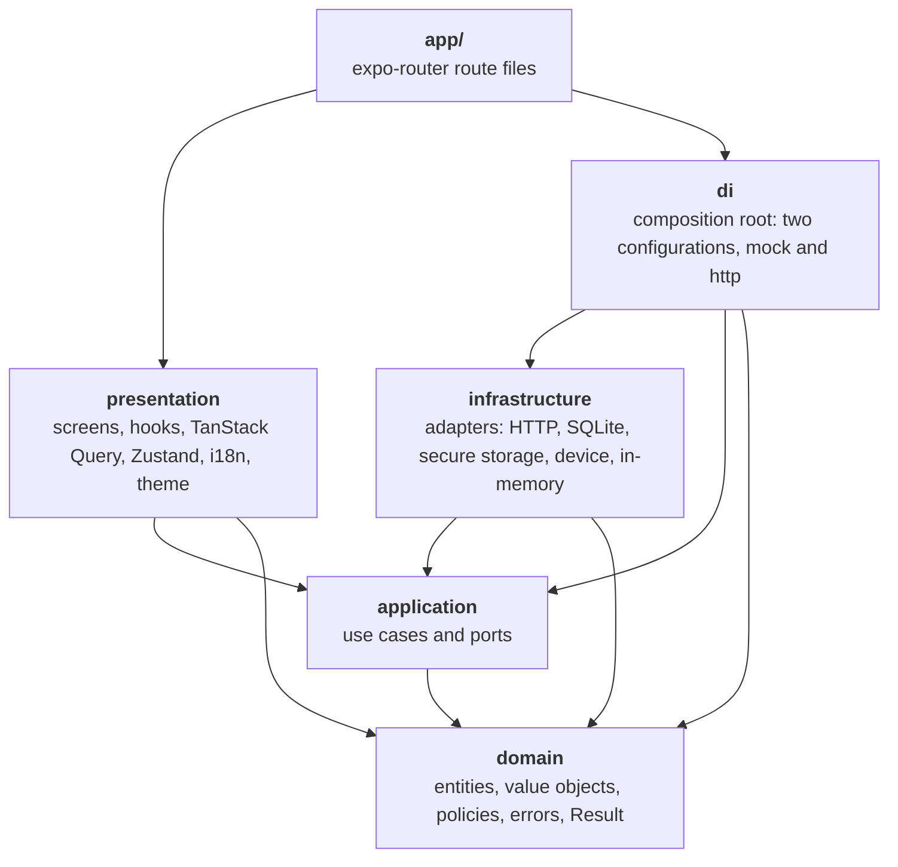
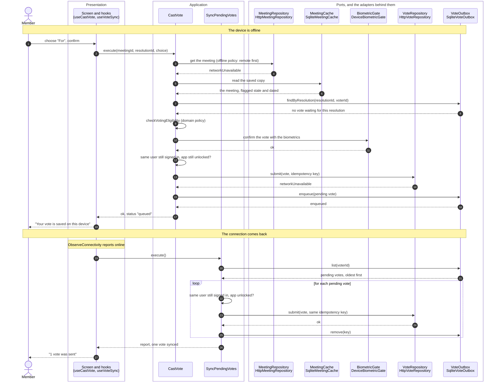
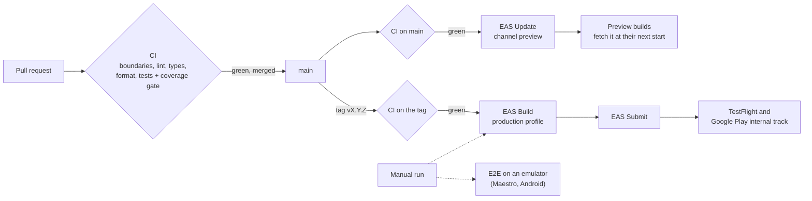
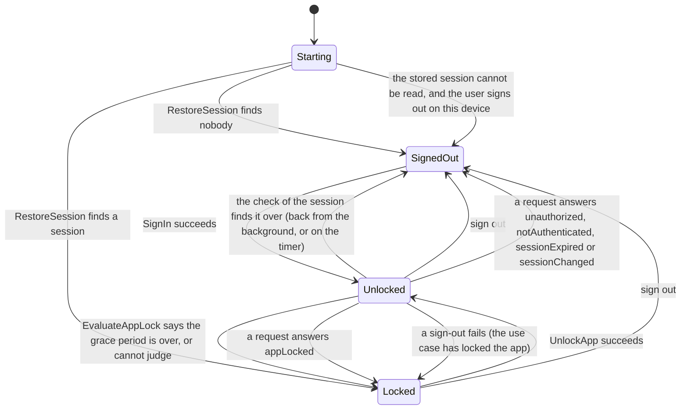

# Boardroom

Boardroom is a React Native app for board-of-directors governance: members read the papers of their meetings, vote on resolutions, and keep working when the network does not. It is a demonstration built to show how a mobile codebase can be structured, secured, tested and shipped like a product, and how it would replace a native app. The server is simulated (and a mock API can be run on a laptop), the business rules, the persistence, the security and the tooling are real.

What it is meant to show:

- **An architecture that is enforced, not described.** Hexagonal layers (domain, application, infrastructure, presentation, composition root) whose dependency rule is a lint error, with ports, adapters, fakes and contract suites. See [Architecture](#architecture).
- **Offline voting that cannot lose or duplicate a vote.** A durable outbox on encrypted SQLite, an idempotency key, and an offline policy that lives in the use cases. See [one use case, end to end](#one-use-case-end-to-end-casting-a-vote-offline-then-synced).
- **A security model with its limits written down.** Encrypted database, session in the keychain, biometric lock, a native module for screen protection, and an honest list of what is not covered. See [Mobile security](#mobile-security).
- **A way to get there from a native app.** See [Migration strategy](#migration-strategy-from-an-existing-native-app-to-react-native).
- **The reasons behind the choices.** Thirteen short [architecture decision records](docs/adr/README.md).

If you have ten minutes: read this page down to [Features](#features), skim the two diagrams, then [Mobile security](#mobile-security), the [migration strategy](#migration-strategy-from-an-existing-native-app-to-react-native) and [What is not verified](#what-is-not-verified). The sections after [Project status](#project-status) are the reference for the code.

## Contents

- [Quick start](#quick-start)
  - [Running against the simulated server](#running-against-the-simulated-server)
  - [Running against the mock API](#running-against-the-mock-api)
  - [Environment variables](#environment-variables)
  - [npm scripts](#npm-scripts)
- [Architecture](#architecture)
  - [Layers and the dependency rule](#layers-and-the-dependency-rule)
  - [One use case, end to end: casting a vote offline, then synced](#one-use-case-end-to-end-casting-a-vote-offline-then-synced)
  - [How the toolchain enforces it](#how-the-toolchain-enforces-it)
  - [Tech stack](#tech-stack)
  - [Folder layout](#folder-layout)
- [Features](#features)
- [Native module: ScreenProtection](#native-module-screenprotection)
- [Migration strategy from an existing native app to React Native](#migration-strategy-from-an-existing-native-app-to-react-native)
  - [Big bang or brownfield](#big-bang-or-brownfield)
  - [How React Native lives inside a native app](#how-react-native-lives-inside-a-native-app)
  - [Risks, and how to reduce them](#risks-and-how-to-reduce-them)
  - [Step-by-step plan](#step-by-step-plan)
  - [How this repository's architecture helps](#how-this-repositorys-architecture-helps)
- [Mobile security](#mobile-security)
  - [What protects what](#what-protects-what)
  - [What is in the release bundle](#what-is-in-the-release-bundle)
  - [Certificate pinning (not implemented)](#certificate-pinning-not-implemented)
  - [Jailbreak and root detection (a direction, not built)](#jailbreak-and-root-detection-a-direction-not-built)
  - [What is not covered](#what-is-not-covered)
- [Testing strategy](#testing-strategy)
- [CI/CD](#cicd)
- [What is not verified](#what-is-not-verified)
- [Architecture decision records](#architecture-decision-records)
- [Project status](#project-status)

**Reference** (the code in depth, after the project status):

- [Design in depth](#design-in-depth)
  - [Domain and application](#domain-and-application)
  - [In-memory adapters and contract tests](#in-memory-adapters-and-contract-tests)
  - [Persistence](#persistence)
  - [HTTP adapters and API contract](#http-adapters-and-api-contract)
  - [Composition root](#composition-root)
  - [Server state and UI state](#server-state-and-ui-state)
  - [Session, lock and navigation](#session-lock-and-navigation)
  - [Voting and synchronisation](#voting-and-synchronisation)
  - [Documents and watermark](#documents-and-watermark)
  - [How the rule is enforced](#how-the-rule-is-enforced)
  - [Tests](#tests)
- [Internationalisation](#internationalisation)
- [No magic strings](#no-magic-strings)
- [Git hooks and commit convention](#git-hooks-and-commit-convention)
- [iOS scene life cycle](#ios-scene-life-cycle)
- [Project setup notes](#project-setup-notes)

## Quick start

Prerequisites: Node.js 24 (`.nvmrc`) and npm 11. To run the app you also need a native toolchain: Xcode for iOS, or Android Studio with an emulator for Android.

```sh
nvm use            # picks the Node version from .nvmrc
npm install        # installs the dependencies and the git hooks (the "prepare" script)
npm run android    # or: npm run ios. Builds the development client, installs it and starts Metro
```

That is the whole of mock mode: in a development build the app runs on a simulated server with in-memory data, so there is no server to start, no account to create and no network needed. Once a development client is installed, `npm start` (`expo start --dev-client`) only starts Metro and the client connects to it.

**The development client is not optional.** The app contains native code that Expo Go does not have (SQLite built with SQLCipher, `react-native-pdf`, the local module ScreenProtection), so Expo Go cannot run it, and the first `npm run android` or `npm run ios` generates `ios/` or `android/` with `expo prebuild` and does a native build, which takes minutes. Keep the path of the project free of spaces: an Expo build script (expo-constants) fails on one. A client built before the document viewer was added lacks `expo-file-system` and `react-native-pdf`: rebuild it. Built with Xcode 27, the iOS 27 SDK requires the UIScene life cycle, which a local config plugin provides (see "iOS scene life cycle"). See "What is not verified" for what has been run where.

To check the repository without running the app: `npm run validate` runs lint, typecheck, the format check and the tests with the coverage gate.

### Running against the simulated server

In a development build mock mode is the default, so the commands above are all it takes: no server, no account to create, no network. `EXPO_PUBLIC_BOARDROOM_ADAPTERS=mock npm run ios` says the same thing explicitly, and a build that is not a development one (a release build) has to say it, because it never guesses (see the table).

**What state the app starts in.** Both configurations start the way a cold start does. With nobody signed in the app opens on the sign-in screen, and in the mock configuration that screen offers the two demo accounts below (a button each fills in the form). With a session stored on the device (only the http configuration keeps one across restarts) it opens on the lock screen, because a restored session always needs the biometric unlock. After a sign-in or an unlock it lands on the meetings list. See "Session, lock and navigation" for the whole flow.

**A two-minute tour.** Sign in as Alice (a button on the sign-in screen fills the form). Open a meeting and press a choice on an open resolution: the confirmation step explains that the vote is final and asks for the biometrics (the mock configuration recognises you). Now open the area marked "Demo" and switch on "Simulate being offline": the offline banner appears. Open a meeting you have already seen, vote on another resolution, and the vote is queued ("saved on this device"). Open the pending votes from the header of the list to see it. Switch the connection back on: the vote is sent, the summary says so, and the outbox is empty. Open a confidential document: the name of the reader is drawn over the PDF.

The setting is the environment variable `EXPO_PUBLIC_BOARDROOM_ADAPTERS`, documented in `.env.example` (copy it to `.env`, which is git-ignored, to change it; restart Metro with `npm start -- --clear` afterwards, because Expo reads it when Metro starts).

| Value            | Effect                                                                                                                                                                                      |
| ---------------- | ------------------------------------------------------------------------------------------------------------------------------------------------------------------------------------------- |
| missing or empty | In a development build, the mock adapters: the same as `mock`. In any other build, refused: the code is `missingAdaptersSetting`                                                            |
| `mock`           | The mock adapters: in-memory repositories, caches and outbox, behind a simulated server                                                                                                     |
| `http`           | The real adapters, against the API at `EXPO_PUBLIC_BOARDROOM_API_BASE_URL` (see "Running against the mock API"). A missing, malformed or insecure address is refused with a code of its own |
| anything else    | Refused: the app shows a screen with the technical code `invalidAdaptersSetting`. A typo must not start the demo against the wrong thing                                                    |

The two demo accounts of the simulated server share the password `boardroom-demo` (it protects nothing, the accounts exist only in the simulation): `alice.martin@boardroom.example`, who is a voting member of most meetings, chairs some, and attends two as a guest and one as the secretary; and `bruno.durand@boardroom.example`, who is invited to two meetings out of three, so the two users see different lists. The meetings are generated from the clock at start-up, so there are always upcoming and past ones. The resolutions follow the date of their meeting: open before it takes place (the demo user can vote on several right away, the minutes of one are already voted), closed after it started once it is behind, and a few past ones are still open by status although their voting window is over.

### Running against the mock API

The `http` configuration needs a server. `npm run mock:api` starts one on this computer: the routes of `docs/api.md`, over the simulated server and the seed of the mock configuration, so that the real adapters (the HTTP client, the encrypted SQLite database, the secure storage) can be tried with nothing to deploy.

```sh
npm run mock:api                    # http://127.0.0.1:4000
npm run mock:api -- --port 4010     # another port (or MOCK_API_PORT=4010)
npm run mock:api -- --latency 800   # slower answers, in milliseconds (default 200)
npm run mock:api -- --host 0.0.0.0  # reachable from a phone on the same network
```

It prints the address, the two accounts and the value to put in `.env`. Then start the app against it:

```sh
# .env
EXPO_PUBLIC_BOARDROOM_ADAPTERS=http
EXPO_PUBLIC_BOARDROOM_API_BASE_URL=http://localhost:4000    # iOS simulator
# EXPO_PUBLIC_BOARDROOM_API_BASE_URL=http://10.0.2.2:4000   # Android emulator
# EXPO_PUBLIC_BOARDROOM_API_BASE_URL=http://192.168.1.20:4000 # a phone: the address of the computer, with --host 0.0.0.0
```

`10.0.2.2` is how the Android emulator names the computer it runs on. A development build accepts `http` for any host, which is what a phone needs; any other build accepts it only for this machine (`localhost`, `127.0.0.1`, `[::1]`, `10.0.2.2`) and requires `https` elsewhere (`insecureApiBaseUrl`). The system has its own say, and it is stricter: the iOS project that Expo generates allows cleartext traffic to the local network only (`NSAllowsLocalNetworking`), and the Android one allows it in debug builds only. A release build therefore talks to a real server over `https`, and the exceptions of the app are there for development.

It is a program of its own, and neither it nor MSW is part of the app bundle (see "What is in the release bundle"): `tooling/mock-api/` holds the entry point (`main.ts`) and the translation between the `http` module of Node and the `Request` and `Response` of the API (`server.ts`), and the routes are `MockApi` in `src/infrastructure/mock-api`, the same code that answers the HTTP tests through MSW. There is no framework, no build and no dependency: Node 24 runs the TypeScript sources directly. Stripping the types alone is not enough here, because the sources use parameter properties (`constructor(private readonly deps)`), which only `--experimental-transform-types` handles, so the script passes it. Node does not know the `@domain/*` aliases of `tsconfig.json` either: `tooling/mock-api/register.mjs` is a small resolver hook (`module.registerHooks`) that reads them from `tsconfig.json` and adds the missing `.ts` extensions. `tooling/mock-api/main.test.ts` starts the real command and asks it something. The tokens are forgotten when it stops, so an app that holds a session from a previous run is told `401` and starts over.

`ios/` and `android/` are produced from `app.config.ts` by Continuous Native Generation and are never committed. Native configuration lives in `app.config.ts` and in config plugins, never in the generated folders (see [ADR 0002](docs/adr/0002-expo-continuous-native-generation-and-dev-client.md)).

### Environment variables

Only the first three reach the app, and only variables that start with `EXPO_PUBLIC_` can: Expo replaces them in the bundle, so none of them is a secret. All are documented in `.env.example`; `tooling/environment.test.ts` fails when the app reads one that is missing from it. Copy the file to `.env` (git-ignored) and restart Metro with `npm start -- --clear` after a change.

| Variable                                            | Read by                                   | What it does                                                                                                                           |
| --------------------------------------------------- | ----------------------------------------- | -------------------------------------------------------------------------------------------------------------------------------------- |
| `EXPO_PUBLIC_BOARDROOM_ADAPTERS`                    | the app (`mock`, `http`)                  | Which configuration the app starts with (see the table above)                                                                          |
| `EXPO_PUBLIC_BOARDROOM_API_BASE_URL`                | the app (`http` only)                     | Where the API is                                                                                                                       |
| `EXPO_PUBLIC_SENTRY_DSN`                            | the app                                   | The address of the Sentry project. Empty means off: the events go to the console (see "Monitoring: Sentry behind the port" in "CI/CD") |
| `EAS_PROJECT_ID`                                    | `app.config.ts`                           | The EAS project: the URL of the updates. Without it the updates are off in the build                                                   |
| `SENTRY_ORG`, `SENTRY_PROJECT`, `SENTRY_AUTH_TOKEN` | `app.config.ts`, the native build scripts | Together, they add the upload of the source maps to the native builds. The token is a secret and is never written in a file            |
| `SENTRY_URL`                                        | `app.config.ts`                           | The Sentry server, for an organisation that is not on `sentry.io`                                                                      |
| `BOARDROOM_BUILD_NUMBER`                            | `app.config.ts`                           | The build number of a store build, set by the Fastlane lanes (EAS numbers the builds remotely)                                         |

The build-time variables are never needed to run the app; see "CI/CD" for where each one is set.

### npm scripts

| Script                                  | What it does                                                                                     |
| --------------------------------------- | ------------------------------------------------------------------------------------------------ |
| `npm start`                             | Starts Metro for the development client                                                          |
| `npm run ios`                           | Builds and runs the iOS development client                                                       |
| `npm run android`                       | Builds and runs the Android development client                                                   |
| `npm run mock:api`                      | Starts the mock API on this computer, for the `http` configuration                               |
| `npm run lint`                          | ESLint over the whole repository, zero warnings allowed                                          |
| `npm run lint:architecture`             | ESLint on `app/` and `src/` alone, where the boundary rules apply (a separate step of the CI)    |
| `npm run lint:fix`                      | ESLint with autofix                                                                              |
| `npm run typecheck`                     | `tsc --noEmit`, which also checks the JS config files at the repository root                     |
| `npm test`                              | Runs every Jest project, without the coverage gate                                               |
| `npm run test:coverage`                 | Runs Jest with coverage and enforces the 90 percent gate on `domain` and `application`           |
| `npm run format`                        | Prettier, write mode                                                                             |
| `npm run format:check`                  | Prettier, check mode                                                                             |
| `npm run validate`                      | `lint`, `typecheck`, `format:check` and `test:coverage`, in that order                           |
| `npm run e2e`, `e2e:android`, `e2e:ios` | Run the Maestro flows of `.maestro/` on a running emulator or simulator (see "Testing strategy") |

## Architecture

The code is organised in layers, and dependencies only point inwards, toward the domain. The rule is not a convention: it is checked by the linter on every commit (see [How the toolchain enforces it](#how-the-toolchain-enforces-it) and [ADR 0001](docs/adr/0001-hexagonal-architecture-with-enforced-boundaries.md)).

### Layers and the dependency rule



An arrow is an allowed import. `domain` imports nothing. `application` declares the ports (the interfaces to the outside world: repositories, caches, the outbox, the biometric gate, the clock, the screen protection) and `infrastructure` implements them, which is why the arrow points from the adapters to the ports and never the other way: a use case does not know that an adapter exists. `presentation` never imports `infrastructure` or `di`: it declares the shape of the services it needs and receives them from the root layout. `di` is the one place where ports meet adapters.

| Folder                | Role                                                                                           | May import                                                                                           |
| --------------------- | ---------------------------------------------------------------------------------------------- | ---------------------------------------------------------------------------------------------------- |
| `app/`                | expo-router route files. Thin: they mount screens. The root layout builds the composition root | `presentation`, `di`, `assets/`, external modules (not TanStack Query nor Zustand)                   |
| `src/domain/`         | Entities, value objects, business rules, business errors                                       | `domain`. No external module at all                                                                  |
| `src/application/`    | Use cases and ports (interfaces)                                                               | `domain`, `application`. No external module at all                                                   |
| `src/infrastructure/` | Adapters implementing the ports: in-memory, HTTP, SQLite, secure storage, device               | `domain`, `application`, `infrastructure`, external modules (not TanStack Query nor Zustand)         |
| `src/presentation/`   | Screens, components, hooks, stores, i18n, theme tokens                                         | `domain`, `application`, `presentation`, `assets/`, external modules. Never `infrastructure` or `di` |
| `src/di/`             | The single composition root that wires ports to adapters with manual typed injection           | `domain`, `application`, `infrastructure`, `di`. No external module at all. Never `presentation`     |

Three extra rules: the `zod` package and the native modules of the device (`expo-sqlite`, `expo-secure-store`, `expo-crypto`, `expo-file-system`, `expo-local-authentication`, `expo-network`) may only be imported from `src/infrastructure` (`expo-file-system` from one file of it, `src/infrastructure/files/ExpoFileVolume.ts`, and `react-native-pdf` from one component of the presentation, `src/presentation/components/PdfViewer.tsx`), `@tanstack/react-query` and `zustand` (server state and interface state) may only be imported from `src/presentation`, the Sentry SDK (`@sentry/*`) from one file, the adapter of the `Monitoring` port (`src/infrastructure/monitoring/SentryMonitoring.ts`), and `fetch` is called by one module, the HTTP client (`src/infrastructure/http/HttpClient.ts`). The local native module `modules/screen-protection` is imported by `src/infrastructure/native` alone, with one exception, its secure view (see "The secure view" in "Native module: ScreenProtection").

Everything else in the repository (`package.json`, the configs, `tooling/`, scripts) is tooling. Code under `app/` and `src/` cannot import it.

Path aliases map to the matching `src` folder: `@domain/*`, `@application/*`, `@infrastructure/*`, `@presentation/*` and `@di/*`. They resolve in TypeScript, Metro, Jest and ESLint.

### One use case, end to end: casting a vote offline, then synced

The diagram follows one vote through the layers in the `http` configuration. A participant is a port (an interface of the application layer) with the adapter that implements it under its name. In the `mock` configuration the adapters are the `InMemory*` ones and nothing above the ports changes.



What to read in it:

- **The screen knows use cases, not adapters.** `useCastVote` is a TanStack mutation that awaits `CastVote` and unwraps its `Result`. The business answer (`queued` or `submitted`) is a value, and the screen translates it into a message.
- **The policy is in the application layer.** The fallback to the saved copy only when the network is unavailable, the eligibility check (a pure function of the domain), the second check that the same user is still there after the biometric prompt, the queueing: all of it is in `CastVote` and `loadWithCacheFallback`, testable with fakes and no device.
- **A queued vote is safe to send more than once.** The idempotency key is built from the resolution and the voter, and the server records the vote once. A business rejection on the replay (the resolution closed in between) moves the vote to `rejected` with its reason, kept until the user has seen it. After five unexpected failures the vote is given up and shown.
- **The application does not watch the network.** The presentation hears the connection come back (and the app return to the foreground, and a sign-in or an unlock) and asks for a run of `SyncPendingVotes`. That is the one place that decides when to sync (`useVoteSync`).
- **Online, the short path is the same code.** The submission succeeds at once, the vote is recorded on the cached meeting too, and the outbox is not touched.
- **See [ADR 0005](docs/adr/0005-offline-first-with-a-sqlite-outbox.md)** for why the outbox and the offline policy are built this way, and "Domain and application" for the whole policy.

### How the toolchain enforces it

- **ESLint, with `eslint-plugin-boundaries`** (`eslint.config.mjs`): every file under `app/` and `src/` belongs to a layer, and a layer may only import the layers it is allowed to. Imports of external packages are checked too: `domain`, `application` and `di` import none; `zod` and the native modules of the device only `infrastructure`; TanStack Query and Zustand only `presentation`; the local native module only `src/infrastructure/native` (and its secure view, one presentation component); the Sentry SDK only its adapter; `fetch` only the HTTP client. Production code cannot import a `testing` folder.
- **Purity of the inner layers.** In `domain` and `application`, `throw` is forbidden (every failure is an error `Result`), so is every read of the system clock (time comes from the `Clock` port), and so are the ambient globals that reach the runtime (`process`, `window`, `fetch`, timers, `console`).
- **TypeScript at its strictest.** `strict`, `noUncheckedIndexedAccess`, `exactOptionalPropertyTypes`, and `checkJs` for the JS configs. Translation keys, the maps from error codes to texts, and (once the dev server has run) the routes are typed.
- **No magic strings.** Lint rejects text, colours and test ids written inline in the UI code; they are translations, theme tokens and constants (see "No magic strings").
- **Tests of the rules themselves.** The Jest project `tooling` lints snippets with the real configuration, so a rule that stops working fails a test, and checks the repository's own invariants: aliases, environment reads, routes, the app config, the commit hook. The Jest project `core` runs `domain` and `application` in plain Node, with no React Native or Expo setup, behind a 90 percent coverage gate.
- **Git hooks and scripts.** The pre-commit hook runs lint-staged (ESLint and Prettier on the staged files) and the typecheck, the commit-msg hook enforces Conventional Commits, and `npm run validate` runs lint, typecheck, format check and the tests with coverage, and `npm run lint:architecture` runs the boundary rules alone. How the pipeline runs them is in [CI/CD](#cicd).

The complete list of rules is in "How the rule is enforced", and what a lint rule cannot catch is stated there and under "No magic strings".

### Tech stack

| Area          | Choice                                                                                                                                                                                                                                                        |
| ------------- | ------------------------------------------------------------------------------------------------------------------------------------------------------------------------------------------------------------------------------------------------------------- |
| Runtime       | Expo SDK 57, React Native 0.86, React 19 (New Architecture, always on from SDK 55)                                                                                                                                                                            |
| Server state  | TanStack Query 5: the query cache, pagination, pull to refresh, retries (see Server state and UI state)                                                                                                                                                       |
| UI state      | Zustand 5: the few pieces of interface state that must survive navigation                                                                                                                                                                                     |
| Navigation    | expo-router (file-based, typed routes, protected screens), custom scheme `boardroom`                                                                                                                                                                          |
| Native builds | expo-dev-client with Continuous Native Generation (`ios/` and `android/` are git-ignored), a local config plugin for the iOS scene life cycle, a local Expo module (`modules/`)                                                                               |
| i18n          | i18next, react-i18next, expo-localization: English and French, English as the fallback, typed keys (see Internationalisation)                                                                                                                                 |
| Language      | TypeScript, strict, plus `noUncheckedIndexedAccess` and `exactOptionalPropertyTypes`; the JS config files are type-checked too (`checkJs`)                                                                                                                    |
| Lint          | ESLint 9 flat config, eslint-config-expo, eslint-plugin-boundaries, eslint-config-prettier, no-magic-string rules for the UI code                                                                                                                             |
| Formatting    | Prettier                                                                                                                                                                                                                                                      |
| Persistence   | expo-sqlite built with SQLCipher (the caches of meetings and of documents, and the outbox of votes), expo-secure-store (the session and the key of the database), expo-crypto (the random bytes of that key), expo-file-system (the content of the documents) |
| Documents     | react-native-pdf draws a PDF from a file of the device (its peer, react-native-blob-util, is installed with it); a tiny PDF writer gives the demo documents their content                                                                                     |
| HTTP          | The global `fetch` behind one small client, zod for the schemas of the answers, a documented API (`docs/api.md`)                                                                                                                                              |
| Device        | expo-local-authentication (biometrics), expo-network (connectivity), the local module ScreenProtection (screen protection)                                                                                                                                    |
| Unit tests    | Jest 29 with four projects (`core`, `infra`, `ui`, `tooling`), jest-expo and React Native Testing Library for the screens, MSW and `node:sqlite` for the adapters                                                                                             |
| End-to-end    | Maestro flows (see [Testing strategy](#testing-strategy))                                                                                                                                                                                                     |
| Delivery      | EAS Build, Submit and Update (`expo-updates`) driven by GitHub Actions, Sentry for crash reports, Fastlane as the alternative: see [CI/CD](#cicd)                                                                                                             |
| Git hooks     | Husky, lint-staged, a Conventional Commits check written in plain shell                                                                                                                                                                                       |

### Folder layout

```text
app/                      expo-router routes (_layout.tsx, index.tsx, meetings/[meetingId].tsx, documents/[documentId].tsx, pending-votes.tsx, sign-in.tsx, lock.tsx) and +native-intent.tsx, which is not a route
docs/                     api.md: the contract between the HTTP adapters and the server
  adr/                    the architecture decision records and their index
locales/                  fr.json: the Info.plist strings of the iOS project in French (Face ID text)
src/
  domain/                 entities, value-objects, policies, errors, shared (Result, Brand)
    testing/                builders of fixtures for the tests (test support)
  application/            ports, use-cases (by feature), shared (offline policy, session)
    testing/                fakes of the ports, and the contract suites in contracts/ (test support)
  infrastructure/
    in-memory/            the simulated server, the in-memory caches, outbox, auth, biometrics, screen protection, the seed
    http/                 the client, the schemas and mappers (dto/), the repositories, the session adapter, the constants of the API
    mock-api/             the routes of the API over the simulated server (MockApi): shared by the HTTP tests and by npm run mock:api
    files/                the FileStore seam over a volume of files, and the volume of a device (expo-file-system)
    documents/            the name of the file of a download and how a download is kept, shared by both document repositories
    pdf/                  the tiny PDF writer of the demo content, and the check of the signature of a file
    persistence/          the SQL seam, the migrations, the SQLite caches (and the format of their rows) and outbox, the unlocking of the encrypted database, its key and generations, and the record of a reset
    secure-storage/       the key-value seam over the keychain, and the vault of the session
    biometrics/           the biometric gate over the device
    connectivity/         the connectivity over the device, and over the simulated network
    device/               the real device (expo-sqlite, expo-secure-store, expo-crypto, expo-local-authentication, expo-network, the local module ScreenProtection)
    native/               the adapter of the ScreenProtection port over the local native module, and the one place that imports the module
    clock/                SystemClock, the sleep behind the simulated latency
    monitoring/           ConsoleMonitoring, and SentryMonitoring (the one file that imports the Sentry SDK)
    shared/               copies, results, the bounded-time wrapper, the queue that runs jobs in order, the listeners of an adapter, the paths of a flawed payload, the schemas of a rejected vote
    testing/              the Node SQLite engine, MSW and the HTTP world, doubles of the device (test support)
  presentation/           screens, components, hooks
    i18n/                 translations, language detection, provider, maps from codes to translation keys
    theme/                design tokens (colours, spacing, font sizes, touch target)
    query/                query client and its session handling, query keys, the Result to query convention, retry policy, error codes
    services/             the use cases and settings the screens need (context), the providers of the app, the gate that starts it
    session/              the controller of the session and of the life of the app: restoring it, the lock and the check of the session on the way back and on a timer, the privacy cover, the connection, the synchronisation of the votes
    state/                the interface store (Zustand)
    format/               dates, times and numbers for the locale of the user, and the provider that shares them
    accessibility/        what the screen reader is told (announcements)
    platform/             the platform checks, spelled once
    navigation/           routes, the navigator (protected screens), opening a meeting, a document or the pending votes, the error boundary
    testing/              render helpers (a screen, a hook, the whole navigator), the AppState driver, query client tracker and fixtures for the screens (test support)
  di/                     composition root: configuration, ports, wiring, the choice of the monitoring, container
assets/                   app icons (Expo template placeholders)
modules/screen-protection/ the local Expo module ScreenProtection: Swift, Kotlin and its TypeScript entry (see "Native module: ScreenProtection")
plugins/                  the local config plugin that puts the iOS project on the scene life cycle (to delete with SDK 58)
tooling/                  tests of the repository configuration (including the lint rules), types for the JS configs, mock-api/ (the mock API as a program), app-routes/ (the route files the scenario tests mount, each a re-export of one of app/)
.env.example              the settings the app reads from the environment
app.config.ts             typed Expo config
eslint.config.mjs         ESLint flat config with the architecture rules
jest.config.js            Jest projects and coverage gate
eas.json                  the EAS build and submit profiles (see "CI/CD")
.github/                  the pipeline and the dependency updates (see "CI/CD")
.maestro/                 end-to-end flows (see "Testing strategy")
fastlane/                 the Fastlane alternative (see "CI/CD")
```

## Features

Each feature crosses the layers. The table says what the user gets and where to read it; the deep dives are under [Design in depth](#design-in-depth).

| Feature                | What the user gets                                                                                                                                                                                                      | Where it lives                                                                                                                                                                                                                  |
| ---------------------- | ----------------------------------------------------------------------------------------------------------------------------------------------------------------------------------------------------------------------- | ------------------------------------------------------------------------------------------------------------------------------------------------------------------------------------------------------------------------------- |
| Sign-in and session    | Sign in with an email and a password; the session is kept on the device, expires, and is ended by the server refusing it                                                                                                | `SignIn`, `SignOut`, `RestoreSession`, `requireSession`; `HttpAuthSession`, `SessionVault`; `SignInScreen`, `SessionController`                                                                                                 |
| Biometric lock         | A cold start is locked; the app locks again after 30 seconds in the background; strong biometrics only on Android, no passcode fallback                                                                                 | `AppLock`, `UnlockApp`, `EvaluateAppLock`, `appLock` policy; `DeviceBiometricGate`; `LockScreen`, `useAppLifecycle`, `PrivacyCover`                                                                                             |
| Meetings               | Upcoming and past meetings with cursor pagination and pull to refresh; a detail with the agenda, the documents and the participants                                                                                     | `ListMeetings`, `GetMeeting`, `Meeting` entity; `HttpMeetingRepository`; `MeetingsListScreen`, `MeetingDetailScreen`, `useMeetingsList`                                                                                         |
| Voting                 | A vote on an open resolution, final, confirmed by the biometrics; the reason when the user may not vote                                                                                                                 | `CastVote`, `checkVotingEligibility`, `getVotingState`; `HttpVoteRepository`; `ResolutionVoting`, `VoteDialog`, `useCastVote`                                                                                                   |
| Offline reading        | A meeting or a document already seen opens without a connection, dated "Showing saved data from ..."                                                                                                                    | `loadWithCacheFallback` (the offline policy); `MeetingCache`, `DocumentCache`; `SqliteMeetingCache`, `SqliteDocumentCache`; `StatusBanner`                                                                                      |
| Offline voting         | A vote cast offline is saved on the device, sent when the connection returns, and never lost or counted twice; a rejected vote is explained                                                                             | `VoteOutbox`, `SyncPendingVotes`, the idempotency key; `SqliteVoteOutbox`; `PendingVotesScreen`, `useVoteSync`                                                                                                                  |
| Confidential documents | A PDF with the name, the email and the time of the reader drawn over every document; confidential ones (and copies served from the cache) on a protected screen where the platform allows; a notice on a screen capture | `OpenDocument`, `CloseDocument`, `ObserveScreenCapture`, `ScreenProtectionCoordinator`, `Watermark`; `NativeScreenProtection`, `modules/screen-protection`; `DocumentScreen`, `SecureContent`, `PdfViewer`, `DocumentWatermark` |
| Encrypted local data   | The caches and the outbox are encrypted at rest; the key is in the keychain or keystore; a lost key resets the data and tells the user                                                                                  | `src/infrastructure/persistence` (`protectedDatabase`, `databaseKey`, `migrations`), `ExpoSecureStorage`; `StatusBanner`                                                                                                        |
| French and English     | Every text in both languages, following the device and the per-app language setting; dates and counts formatted for the locale                                                                                          | `src/presentation/i18n`, `locales/fr.json`, the `expo-localization` plugin                                                                                                                                                      |
| Accessibility          | Roles and states on the controls, announcements for what appears on its own, contrast checked by a test, 44 point targets                                                                                               | `LiveText`, `useAnnounce`, `SegmentedControl`, `theme/tokens.ts`                                                                                                                                                                |
| Failure handling       | Every failure has a message and, when asking again can help, a retry; a screen that crashes is replaced; a build that cannot start says why                                                                             | `AppErrorBoundary`, `StartupFailureScreen`, `QueryFailure`, the `Result` errors of `src/domain/errors`                                                                                                                          |
| Error reporting        | Crash and error reports, scrubbed to identifiers and codes, when the build has a Sentry address; the console otherwise                                                                                                  | `Monitoring` port, `SentryMonitoring`, `createMonitoring`, `ConsoleMonitoring`                                                                                                                                                  |
| Demo and mock server   | Two demo accounts, a switch that cuts the simulated network, and a mock API that can be run on a laptop                                                                                                                 | `InMemoryBackend`, `seed`, `DemoControls`; `MockApi`, `tooling/mock-api`                                                                                                                                                        |

## Native module: ScreenProtection

`modules/screen-protection` is a local Expo module, in Swift and Kotlin, that is the native half of the `ScreenProtection` port: it keeps a confidential screen out of the screenshots, the recordings and the app switcher as far as each platform allows (on iOS it also leaves the PDF and the watermark of a protected document out of screenshots, through a view of its own, and clears the text selection of the PDF views), and it tells the app when a screenshot or a recording happens. Expo autolinks it from the `modules/` folder (`expo-module.config.json`, an Android Gradle project, an iOS podspec); nothing is added to `app.config.ts` for it. The reasons for the choice of the Expo Modules API are in [ADR 0006](docs/adr/0006-expo-modules-api-for-screen-protection.md).

### What it does, per platform

|                              | Android                                                                                                                                                                                            | iOS                                                                                                                                                                                                                                                                                                                                                                                                                                                                                                                                                                       |
| ---------------------------- | -------------------------------------------------------------------------------------------------------------------------------------------------------------------------------------------------- | ------------------------------------------------------------------------------------------------------------------------------------------------------------------------------------------------------------------------------------------------------------------------------------------------------------------------------------------------------------------------------------------------------------------------------------------------------------------------------------------------------------------------------------------------------------------------- |
| Protection on                | `FLAG_SECURE` on the window of the current activity, on the main thread. The system **blocks screenshots and screen recordings** of that window and shows **a blank thumbnail in the recent apps** | A neutral native view (opaque, in the colour of the system background, no text) is put over the windows of the scene **whenever it resigns active** (app switcher, control centre, notification centre, a system prompt) and taken away when it becomes active again. The scene notifications are used (`UIScene.willDeactivateNotification`, `didActivateNotification`), because the app is scene based. This cover does not block screenshots or recordings: iOS has no public API for that (the PDF and the watermark have their own mechanism, see "The secure view") |
| Protection off               | The flag is cleared                                                                                                                                                                                | No cover                                                                                                                                                                                                                                                                                                                                                                                                                                                                                                                                                                  |
| The PDF and the watermark    | A plain container: `FLAG_SECURE` already keeps the whole window out of captures                                                                                                                    | They are inside the secure view, which sets the private `disableUpdateMask` flag on its layer, the flag UIKit sets for secure text fields: they are left out of screenshots (see "The secure view")                                                                                                                                                                                                                                                                                                                                                                       |
| Text selection in a PDF      | Nothing to do: the viewer has no text selection on Android                                                                                                                                         | While protection is on, the selection of any `PDFView` is cleared on the main queue as soon as PDFKit reports it (`PDFViewSelectionChangedNotification`, observed with no object), and the edit menus of that view are dismissed every 100 ms for 10 s after it. Off: no observer                                                                                                                                                                                                                                                                                         |
| Screenshot taken             | `Activity.ScreenCaptureCallback`, Android 14 (API 34) and later, with the `DETECT_SCREEN_CAPTURE` permission                                                                                       | `UIApplication.userDidTakeScreenshotNotification`                                                                                                                                                                                                                                                                                                                                                                                                                                                                                                                         |
| Recording started or stopped | `WindowManager.addScreenRecordingCallback`, Android 15 (API 35) and later, with the `DETECT_SCREEN_RECORDING` permission                                                                           | The capture state of the scenes on iOS 17 and later (`UITraitCollection.sceneCaptureState`, observed with `registerForTraitChanges` on each window scene), `UIScreen.isCaptured` and `UIScreen.capturedDidChangeNotification` before iOS 17 and for a scene that has no state. It covers recording, mirroring and AirPlay                                                                                                                                                                                                                                                 |
| "Is it captured now"         | The state of the recording callback on Android 15 and later; `false` before                                                                                                                        | The same sources as above                                                                                                                                                                                                                                                                                                                                                                                                                                                                                                                                                 |

**Limits, stated plainly.**

- iOS has no public way to block a screenshot or a recording. What the app does there is the cover in the app switcher, the events (it learns of a capture after the fact), and, for the PDF and the watermark of a protected document, the secure view, which relies on an undocumented flag (see "The secure view" below, with what was verified and what was not). Everything outside the secure view stays in a screenshot: the title, the badges and the page indicator are not hidden, and a photograph of the screen is not affected. On a physical iPhone (iPhone 17, iOS 27) the `screenshotTaken` event reached the app, which showed its notice (seen before the secure view existed, and not looked at again since).
- Android before 14 has **no screenshot detection**, and before 15 **no recording detection**: the system tells apps nothing there, and the module reports nothing (the protection itself, `FLAG_SECURE`, works on every version). A device that has not got the permission (a build without the manifest of the module) simply has the detection off; the module catches the `SecurityException`.
- `FLAG_SECURE` belongs to one window. A window of its own, such as a React Native `Modal` or a system dialog over the app, is not covered by the flag of the activity.
- The iOS text selection is cleared, not prevented: it exists until the next turn of the main queue, and what takes away the edit menu is a sweep of 10 seconds after each selection (the menu is presented when the finger is lifted, after the selection has been cleared, so clearing alone leaves it there, empty). It relies on a PDFKit notification and on the `UIEditMenuInteraction` of the `PDFView`, so a viewer that is not a `PDFView` would need its own handling, and a version of iOS that changes the interactions of PDFKit could break it; the Maestro flow `document-no-copy` is what would tell. It is on only while protection is.
- The iOS cover is also put up while a system prompt (Face ID) is on screen, because the scene is then inactive. It is what the `PrivacyCover` of the presentation does in JavaScript too, and it is only up while protection is on.
- The simulator and the emulator are not devices: what they show for recordings and for the app switcher is reported below, with what could not be checked.

**The events, and their payloads.**

| Event               | Payload                 | Sent when                                                                                                                         |
| ------------------- | ----------------------- | --------------------------------------------------------------------------------------------------------------------------------- |
| `onScreenshotTaken` | none                    | A screenshot of the app was taken                                                                                                 |
| `onCaptureChanged`  | `{ captured: boolean }` | The screen started (`true`) or stopped (`false`) being recorded, mirrored or AirPlayed. Sent when the state changes, not repeated |

The functions are `setProtectionEnabled(enabled): Promise<void>` (idempotent, resolves once the change is made, rejects if the platform could not make it) and `isCaptured(): Promise<boolean>`. The names are the same in `ScreenProtectionModule.swift`, `ScreenProtectionModule.kt` and the TypeScript entry; `tooling/screenProtectionModule.test.ts` fails when one of the three drifts, and the adapter assigns the real module to its own seam (`ScreenProtectionModuleApi`), so the typecheck fails too.

**Why the cover is on only while protection is on (iOS), and not always.** The whole app holds confidential meeting data, so covering the app switcher everywhere is a defensible policy, and the module could do it with one line. It does not, for three reasons. First, the module is a mechanism and the policy belongs to the application layer: `ScreenProtectionCoordinator` decides which screens need protection (a confidential document, or any document served from the cache) and turns the switch on and off accordingly; making the whole app protected is a change there (acquire for the length of the open session), not in a native file. Second, it keeps the two platforms saying the same thing: a protected screen is blank in the app switcher (Android with the flag, iOS with the cover), an unprotected one is not, and the port stays a real switch instead of a no-op on iOS that no test could tell from a working one. Third, the app already has a JavaScript `PrivacyCover` for the rest (see "Session, lock and navigation"): it is best effort on iOS, because the snapshot of the app switcher can be taken before React renders again, which is exactly the gap the native cover closes for the screens that matter most. Closing it for every screen is the one decision left to the owner of the product; it is a policy, and now a cheap one.

**Robustness.**

- _Threads._ All the state of the module is read and written on the main thread (Swift: the main queue, Kotlin: `Looper.getMainLooper()`), every entry point hops there, and the async functions are declared to run on the main queue, so that `setProtectionEnabled` resolves after the change has been made.
- _No activity, no window._ On Android, turning protection on with no current activity only remembers it; the flag is set when an activity enters the foreground. Nothing throws for a missing activity or window.
- _Activity recreation._ `FLAG_SECURE` belongs to a window, and a new activity has a new one. The module sets the flag again every time an activity enters the foreground (`OnActivityEntersForeground`), so protection survives a rotation, a change of the font size, a theme change that recreates the activity, and the app coming back from the background. The detectors follow the current activity the same way.
- _Listeners follow the observers._ The listeners of the system (the screenshot callback, the recording callback, the notifications of the scene, the trait observers) exist only while JavaScript listens to the event they feed (`OnStartObserving`, `OnStopObserving`), and are all removed when the module is destroyed. The adapter, for its part, listens to the module once for all its subscribers and stops when the last one leaves.
- _The selection observer and its sweep._ Turned on and off with protection, like the cover: one observer of `PDFViewSelectionChangedNotification`, added on the main queue with `[weak self]`, and one timer (in the common run loop modes) that exists only after a selection, for 10 seconds, and is invalidated when protection is turned off or the module is destroyed.
- _Idempotent._ Turning protection on twice, or off twice, or off when it is off, is harmless on both platforms. When the module is destroyed (React Native reloads), protection is switched off and the window is left as it was found.
- _Permissions._ The two Android permissions are declared in the manifest of the module (`DETECT_SCREEN_CAPTURE`, `DETECT_SCREEN_RECORDING`), which the Android build merges into the manifest of the app; both are normal permissions, granted at install, so no prompt is shown. iOS needs no Info.plist entry and no text: the native code shows none.

### The secure view

`ScreenProtectionSecureView` is a native view of the module: a container that the presentation component `SecureContent` puts around the PDF and the watermark of the document screen, with `secure` set when the document is screen-protected. The loading veil is inside it, the title, the badges and the page indicator are outside.

- **iOS.** The view sets the private Core Animation property `disableUpdateMask` (the value `(1 << 1) | (1 << 4)`) on its own layer, through key-value coding, and only when the layer answers to `setDisableUpdateMask:`. It is the flag UIKit sets for a secure text field, and the reason such a field is left out of captures: the PDF and the watermark are left out of screenshots. The children are mounted by React as in any view, nothing is moved, so layout, safe areas and touches are unchanged: the PDF scrolls and zooms as usual.
- **What was verified.** On a physical iPhone 17 under iOS 27 the PDF and the watermark of a protected document display normally on the screen, and a screenshot of that document shows their area blank while the title, the badges and the page indicator stay visible. **Not verified:** screen recordings and mirroring with this version, any other iOS version, any other device, and the simulator.
- **It is undocumented behaviour.** The property is private to Core Animation: App Review may object to it, and an iOS update may change or remove it. When the layer has no such property the view falls back to a plain view, reports it (the `onSecureLayerFallback` event, once, and a line in the system log under the subsystem `com.boardroom.screenprotection`), and never crashes. A build whose native module predates the view gives a plain `View` in TypeScript, with the same event.
- **The first attempt did not work.** Hosting the content in the internal canvas of a secure text field (`isSecureTextEntry`), the known workaround of older iOS versions, still showed the document in a screenshot and in a screen recording on the same iPhone under iOS 27. That is why the flag is set directly, on the layer of the view, and no text field is involved.
- **Detection and the watermark still apply.** The screenshot event comes from the notification of the system, not from the view, so detection is unchanged (it was not looked at again on the phone with the flag). The watermark still deters a photograph of the screen and anything that is not left out of a capture; it is itself inside the secure view, so a screenshot that is left blank has no watermark in it.
- **Android.** `FLAG_SECURE` is unchanged and covers the whole window; the view is a plain container there, which accepts `secure` and lays nothing out itself (the Kotlin view compiled with the app, see below, and was not run).
- **Lint.** The module is imported by `src/infrastructure/native` alone, with one exception: `SecureContent.tsx` may import its secure view (the entry point of the module, never its functions or its files), because a native view is an element of the tree and no port, which carries data and calls, can pass one.

### How it plugs into the port

```text
ScreenProtectionCoordinator (application)  ->  ScreenProtection (port)
                                                      ^
                                             NativeScreenProtection (src/infrastructure/native)
                                                      |  ScreenProtectionModuleApi (the seam)
                                      modules/screen-protection (Swift, Kotlin, TypeScript entry)
```

- **The adapter** (`NativeScreenProtection`) implements the port over the seam `ScreenProtectionModuleApi`. It never throws and settles in bounded time: a module that rejects, throws, never answers (5 seconds) or is not there is a `screenProtectionFailed` result (or `screenProtectionUnsupported` for a missing module, which makes `OpenDocument` refuse to show a confidential document: it fails closed), also reported to the monitoring with a kind of failure and nothing else. `enable` and `disable` reach the module one at a time, in the order they were issued. Disabling something that cannot be enabled succeeds.
- **The events** are mapped to the domain's: `onScreenshotTaken` is `screenshotTaken`; `onCaptureChanged` with `captured: true` is `recordingStarted`, `false` is `recordingStopped`. A report that is not a state, or that repeats the known one, is dropped. A recording that is **already running** when someone subscribes is told to that subscriber as `recordingStarted`, from `isCaptured()`: a document opened while the screen is being recorded needs to know, and the module only reports changes.
- **Wiring.** `createExpoPlatform` loads the module through `loadScreenProtectionModule` (the one file that imports it, whose entry reads it with `requireOptionalNativeModule`: a build without it gives `undefined`, not a crash) and puts it in `DevicePlatform.screenProtectionModule`. Both configurations use the device's screen protection, because it is a concern of the device and not of the backend that is simulated: `httpPorts.ts` builds `NativeScreenProtection` over it, and so does `mockPorts.ts` when the build has the module. Without the module the mock configuration falls back on `InMemoryScreenProtection` (which records what it is asked and can report a capture, and is what Jest uses, since Jest has no native module), and the http one answers `screenProtectionUnsupported`. A test hands any other `ScreenProtection` to the container through `ContainerRuntime.screenProtection`.
- **Lint.** `modules/screen-protection` can be imported only from `src/infrastructure/native` (and its secure view from `SecureContent.tsx`, see "The secure view"): the dependency policies refuse it to every other layer, and a restricted-imports pattern keeps the rest of the infrastructure out too. `expo-crypto` is among the native modules that only `src/infrastructure` may import (`tooling/lint-rules.test.ts` checks both).
- **Tests.** The existing contract suite of the port (`describeScreenProtectionContract`) runs against the adapter, with a JavaScript stand-in for the native module (`FakeScreenProtectionModule`, in the testing folder of the infrastructure, the only native stand-in the project has for this module; the real module is Swift and Kotlin and needs a device). The stand-in turns protection on later than it turns it off, so the order of the calls is really tested. `NativeScreenProtection.test.ts` adds what the contract does not say: the failures, the timeout, the missing module, the listeners that exist only while someone is subscribed, the mapping, the repeats, the recording that is already running, a listener that throws. In Jest the module is absent: an empty module in the `infra` project, and `null` from `requireOptionalNativeModule` in the `ui` one.

### Why the Expo Modules API, and not a bare TurboModule

The brief of the module is small (two functions, two events, and lifecycle hooks) and the native work is all platform API; the glue is what would dominate in a TurboModule. What the Expo Modules API gives:

- **SDK integration.** The module is part of the Expo build: autolinked from `modules/` for both platforms, compiled with the Gradle plugin and the podspec conventions of the SDK, and regenerated with the rest by Continuous Native Generation. Nothing is patched into `MainApplication` or the Xcode project by hand, and the generated `ios/` and `android/` folders stay disposable.
- **A DSL in Swift and Kotlin** (`Name`, `Events`, `AsyncFunction`, `OnStartObserving`, `OnStopObserving`, `OnActivityEntersForeground`, `OnDestroy`) instead of a protocol, an Objective-C++ class and a Kotlin class for the same thing. The argument types are converted for you, and a thrown error becomes a rejected promise with a code.
- **The lifecycle of the activity and of the module**, as hooks, which is exactly what re-applying `FLAG_SECURE` on a recreated activity needs (a TurboModule has to register a `LifecycleEventListener` itself).
- **Events with the count of listeners.** `OnStartObserving` and `OnStopObserving` tell the module when JavaScript starts and stops listening to an event, so the system observers exist only while needed; the JavaScript side is a plain `addListener` with a typed events map.
- **Configuration and permissions.** A manifest in the module that the build merges (and, when needed, a config plugin) in place of editing the app's manifest.
- **The New Architecture without C++ glue.** The Expo module is exposed to JavaScript through JSI by the Expo runtime, which works on the New Architecture; there is no codegen step, no generated C++ and no `.mm` entry to write.
- **Testing.** The JavaScript surface is a TypeScript declaration, so a typed seam can be given a stand-in (as `FakeScreenProtectionModule` does) and the adapter tested with no native code. Expo ships the native test helpers too (Robolectric and XCTest bases) for the day the native code needs its own tests; none is written here.

What a TurboModule gives in return: no dependency on the Expo runtime (a library meant for any React Native app), a schema that is the contract (the spec file), and synchronous methods on the JS thread. None of those is a need of this app.

### What was run on the module, and what could not be

Everything below was run from the copy of the project without spaces in its path, with a throwaway harness that exists only there (a floating panel that calls the real adapter and logs its events, plus, on iOS, a command channel because the simulator cannot be tapped from a script). It is not part of the project.

**Android 14 (API 34 emulator, arm64).** The Kotlin module compiled and was autolinked; the merged manifest of the app has both permissions and the system granted `DETECT_SCREEN_CAPTURE` at install.

- _Protection on:_ the window carries `FLAG_SECURE`, and `adb exec-out screencap` is **refused** (exit code 1, no bytes) instead of answering a black frame; with protection off it returns the whole frame. The card of the app in the recent apps, captured through the emulator console (`screencap` is refused while a secure window is on screen), is **blank** with protection on and shows the screen with it off.
- _Screenshot event:_ `adb shell input keyevent 120` makes the emulator take a system screenshot, and `screenshotTaken` reached JavaScript through the adapter, with protection on as well as off (a screenshot that is blocked is still reported).
- _Recreation:_ with the font size changed (a configuration change the activity does not handle) the activity was recreated twice, each time with a new window, and `FLAG_SECURE` was set again. With the orientation lock removed in the generated manifest of the copy, a real rotation did the same: set again in each new window, screenshot refused in landscape while protected, allowed (and cleared) after turning it off.
- _Idempotence and the query:_ on, on, off, off all succeed; `isCaptured` answers `false`. A reload of the JavaScript (the development client) destroys the module and clears the flag, as designed.
- _Android 15 (API 35, a scratch emulator):_ both permissions are granted, the screenshot event and the protection work, the module's callback is registered with the system's recording callback controller (`dumpsys window`) with no warning from the module. **A recording was not started**: no way was found to start a screen recording from the command line, so `recordingStarted` and `recordingStopped` on Android have not been seen.

**iOS 27.0 (iPhone 17 simulator, Xcode 27.1).** The Swift module compiled once the trait observation was called under `MainActor.assumeIsolated` (the iOS 27 SDK declares it main-actor isolated; the entry points of the module are already on the main queue).

- _App switcher:_ the simulator's app switcher cannot be driven from a script here (see below), so the snapshot that the system writes when an app goes to the background (`Library/SplashBoard/Snapshots` in the app container, after launching another app with `simctl`) was decoded and looked at. With protection **on** it is blank (the native cover, white in light mode) over the whole window, hiding even the harness panel, except for the floating button of the development client, which is a window of its own above the normal level. With protection **off** it shows what the `PrivacyCover` of the JavaScript put on screen in time.
- _Screenshot:_ **Device > Trigger Screenshot could not be used.** Xcode 27 replaced Simulator.app with DeviceHub, and driving its menus needs the assistive access that the shell does not have (`osascript` is refused), so nothing was clicked and no setting was changed. What was run instead: the harness posted `UIApplication.userDidTakeScreenshotNotification` from inside the app, and `screenshotTaken` reached JavaScript 3 ms later. That checks the observer, the event and the mapping of the adapter; it does not check that the system posts the notification on a screenshot of a simulator or a phone.
- _Recording:_ `xcrun simctl io <device> recordVideo` **does not change the capture state**: `isCaptured` answered `false` before, during and after a recording, and no event came. A host-side recording of a simulator is not what iOS reports as a capture, so `recordingStarted` and `recordingStopped`, and the scene capture state itself, have not been seen on iOS. They need a phone and Control Centre's screen recording, or AirPlay.
- _Text selection:_ on the confidential report, a long-press on the middle of the PDF view and another on a word of the title bring **no selection and no menu**, and the same gesture on an internal document brings the selection with its handles and the menu (Copy, Select All, Look Up). Two things were found by running it, and are why the module does more than clear the selection: the selection is cleared, but PDFKit presents its edit menu when the finger is lifted, after that, and the menu stayed on screen (with a Copy item that copied nothing: the pasteboard did not change when it was tapped, while on the internal document it received the word); so the menu is dismissed in a short-lived sweep (see "What it does, per platform"). Maestro sees the menu on iOS, which is what the flow `document-no-copy` relies on. A pasteboard check from the host (`simctl pbpaste`) returned nothing even for a string put there with `simctl pbcopy`, so what was copied was read from inside the app, with a temporary logger that is not in the repository.
- _Idempotence and the query:_ on, on, off, off all succeed; `isCaptured` answers `false`.

**Android, the secure view.** The Kotlin view had never been compiled. `npx expo prebuild --platform android` and `./gradlew :app:assembleDebug` built the app with it in 1 minute 29 seconds (arm64 only), the module's Kotlin compiled without an error or a warning, and the view is in the dex of the debug APK. It was not run: no layout, no touch and no capture was exercised on Android with it.

**iPhone 17 (physical), iOS 27.** Checked by hand by the owner, with the version that sets the flag: the PDF and the watermark of a protected document display normally, and a screenshot of that document shows their area blank, with the title, the badges and the page indicator still visible. The version before it, which hosted the content in the internal canvas of a secure text field, showed the document in the screenshot and in a screen recording on this phone, and was replaced. A screen recording and mirroring were not looked at with the flag.

**Not run at all:** the secure view on a recording, on mirroring, on an iOS version other than 27 and on a device other than that iPhone 17, and any physical Android device; Android before 14; recording detection on either platform; the `UIScreen` fallback of iOS 16; the iOS cover on a scene that resigns active because of a system prompt (it is the same notification, but no prompt was shown); `FLAG_SECURE` on a React Native `Modal` (it is not covered, by the design of the flag).

Nothing in the TurboModule sketch above was compiled.

### How the same module would look as a TurboModule

A sketch, to compare, not code in the project. It has the same two functions and two events.

**1. The typed spec, read by codegen** (`src/NativeScreenProtection.ts`). Events use the typed event emitters of the New Architecture (`CodegenTypes.EventEmitter`, React Native 0.78 and later; check the exact import of the version in use):

```ts
import { TurboModuleRegistry } from 'react-native';
import type { CodegenTypes, TurboModule } from 'react-native';

export interface Spec extends TurboModule {
  setProtectionEnabled(enabled: boolean): Promise<void>;
  isCaptured(): Promise<boolean>;
  readonly onScreenshotTaken: CodegenTypes.EventEmitter<void>;
  readonly onCaptureChanged: CodegenTypes.EventEmitter<{ captured: boolean }>;
}

export default TurboModuleRegistry.get<Spec>('ScreenProtection');
```

and the `codegenConfig` that tells the build where it is (in the `package.json` of the app or of a library that holds the module):

```json
{
  "codegenConfig": {
    "name": "ScreenProtectionSpec",
    "type": "modules",
    "jsSrcsDir": "src",
    "android": { "javaPackageName": "com.boardroom.screenprotection" },
    "ios": { "modulesProvider": { "ScreenProtection": "RCTScreenProtection" } }
  }
}
```

**2. What codegen generates.** From the spec, on each platform, an interface that the native class must satisfy, and the C++ JSI binding that nobody writes by hand: on iOS an Objective-C++ protocol `NativeScreenProtectionSpec` (with `setProtectionEnabled:resolve:reject:` and `isCaptured:reject:`) and a base class `NativeScreenProtectionSpecBase` that has `emitOnScreenshotTaken` and `emitOnCaptureChanged:`; on Android an abstract Java class `NativeScreenProtectionSpec` with abstract `setProtectionEnabled(boolean, Promise)` and `isCaptured(Promise)` and the `emitOnScreenshotTaken()` and `emitOnCaptureChanged(ReadableMap)` helpers.

**3. iOS: an Objective-C++ entry that calls Swift.** A TurboModule's iOS side must be an Objective-C++ class, because it returns the C++ JSI object. The logic can stay in Swift, behind an `@objc` class that the `.mm` file calls through the generated `-Swift.h` header:

```objc
// RCTScreenProtection.mm
#import "RCTScreenProtection.h"
#import <ScreenProtectionSpec/ScreenProtectionSpec.h>
#import "Boardroom-Swift.h"   // the Swift implementation, below

@interface RCTScreenProtection () <NativeScreenProtectionSpec>
@end

@implementation RCTScreenProtection

RCT_EXPORT_MODULE(ScreenProtection)

- (void)setProtectionEnabled:(BOOL)enabled
                     resolve:(RCTPromiseResolveBlock)resolve
                      reject:(RCTPromiseRejectBlock)reject
{
  dispatch_async(dispatch_get_main_queue(), ^{
    [ScreenProtectionImpl.shared setEnabled:enabled];
    resolve(nil);
  });
}

- (void)isCaptured:(RCTPromiseResolveBlock)resolve reject:(RCTPromiseRejectBlock)reject
{
  dispatch_async(dispatch_get_main_queue(), ^{ resolve(@(ScreenProtectionImpl.shared.isCaptured)); });
}

- (std::shared_ptr<facebook::react::TurboModule>)getTurboModule:
    (const facebook::react::ObjCTurboModule::InitParams &)params
{
  return std::make_shared<facebook::react::NativeScreenProtectionSpecJSI>(params);
}

@end
```

```swift
// ScreenProtectionImpl.swift: what ScreenProtectionModule.swift does today, minus the DSL.
@objc public final class ScreenProtectionImpl: NSObject {
  @objc public static let shared = ScreenProtectionImpl()
  @objc public var onScreenshot: (() -> Void)?      // the .mm calls emitOnScreenshotTaken from it
  @objc public var onCaptureChange: ((Bool) -> Void)?
  @objc public func setEnabled(_ enabled: Bool) { /* the cover, on the scene notifications */ }
  @objc public var isCaptured: Bool { /* the scene capture state */ false }
}
```

The events are emitted from the Objective-C++ class (`[self emitOnScreenshotTaken]`, `[self emitOnCaptureChanged:@{ @"captured": @YES }]`), and it must start and stop the observers itself, since there is no `OnStartObserving`: either always on, or by overriding `addListener` / `removeListeners`-style hooks that the legacy event emitter has and the typed emitters do not.

**4. Android: the Kotlin TurboModule and its package.**

```kotlin
@ReactModule(name = ScreenProtectionModule.NAME)
class ScreenProtectionModule(private val context: ReactApplicationContext) :
  NativeScreenProtectionSpec(context), LifecycleEventListener {

  init { context.addLifecycleEventListener(this) }          // the Expo DSL gives this as a hook

  override fun getName() = NAME

  override fun setProtectionEnabled(enabled: Boolean, promise: Promise) {
    UiThreadUtil.runOnUiThread {
      protectionEnabled = enabled
      applyFlag(context.currentActivity)
      promise.resolve(null)
    }
  }

  override fun isCaptured(promise: Promise) = promise.resolve(recording.isVisible())

  override fun onHostResume() = applyFlag(context.currentActivity)   // activity recreated
  override fun onHostPause() {}
  override fun onHostDestroy() {}

  private fun onScreenshot() = emitOnScreenshotTaken()
  private fun onCapture(captured: Boolean) =
    emitOnCaptureChanged(Arguments.createMap().apply { putBoolean("captured", captured) })

  companion object { const val NAME = "ScreenProtection" }
}

class ScreenProtectionPackage : BaseReactPackage() {
  override fun getModule(name: String, context: ReactApplicationContext): NativeModule? =
    if (name == ScreenProtectionModule.NAME) ScreenProtectionModule(context) else null

  override fun getReactModuleInfoProvider() = ReactModuleInfoProvider {
    mapOf(ScreenProtectionModule.NAME to ReactModuleInfo(
      ScreenProtectionModule.NAME, ScreenProtectionModule.NAME,
      false, false, false, true /* isTurboModule */))
  }
}
```

The package has to be registered in `MainApplication.getPackages()`: `PackageList(this).packages.apply { add(ScreenProtectionPackage()) }`. In this project `android/` is generated, so that line would need a config plugin, or the module would have to live in a library package that autolinking finds through `react-native.config.js`, which is more files. The Expo module needs none of it.

**What it would cost here:** a spec file, a `codegenConfig`, one Objective-C++ file and its header, a Swift class behind it, a Kotlin module and package, a registration in `MainApplication` (through a config plugin), the lifecycle listener and the observer counting written by hand, and a codegen run in the build. The behaviour is the same; the lines that carry it are about the same; the rest is glue that the Expo Modules API already owns.

## Migration strategy from an existing native app to React Native

This section is a strategy, not a verified integration: this repository is a React Native app from scratch, and nothing below has been built into a native host app. What is true of the repository is said as such, in the last subsection.

### Big bang or brownfield

|               | Big bang rewrite                                                                         | Brownfield, screen by screen                                                                                |
| ------------- | ---------------------------------------------------------------------------------------- | ----------------------------------------------------------------------------------------------------------- |
| What it is    | A new React Native app replaces the native ones in one release                           | React Native screens are added to the native app, flow after flow, until the native code is gone            |
| Where it fits | A small app, a native app that cannot be saved, a team that can freeze features          | A large or live app, a product that keeps shipping, a team that must prove the technology before it commits |
| Main risk     | No user feedback until the end, feature parity to chase, the old app frozen or abandoned | Two codebases and two navigation stacks for a long time, a bridge to keep, a build that is more complicated |
| Reversibility | Low: the old app is the only fallback                                                    | High: each flow can go back behind a flag, one release at a time                                            |
| Value early   | None until the cut-over                                                                  | From the first migrated screen, and the measurements start there                                            |

The default recommendation for a live app is brownfield: it turns a rewrite into a series of small, measurable, reversible releases, and the performance, accessibility and crash numbers of the first screens decide whether to continue. A big bang is defensible when the native app is small, the feature set is frozen, and the two platforms are being merged into one codebase anyway.

### How React Native lives inside a native app

- **iOS.** React Native, the pods it needs and the JavaScript bundle are built into a framework that the native app links. A native screen presents the React Native root view from a view controller, handing it its initial properties. The framework has its own version and release, so the native team consumes a binary.
- **Android.** The React Native screens are built as a library module (an AAR, published to the internal Maven repository or consumed as a project module) that exposes an activity or a fragment hosting the React Native surface, with one shared React host so that the engine starts once.
- **Navigation boundaries.** One flow, one owner. The native app keeps the shell (tab bar, root navigation, deep link entry) at first and opens a React Native flow as a destination with a typed set of initial properties, and the flow has its own stack inside. Never ping-pong between a native and a React Native screen inside one flow: the back behaviour, the transitions and the state are then split across two worlds. Deep links go through one route table that both sides read. When most of the screens are React Native, the shell moves: React Native owns the root navigator and the few native screens that remain become destinations of it.
- **Shared auth and session.** One source of truth for the tokens, owned by the native side while it holds the shell: the React Native `AuthSession` adapter reads and refreshes the session through a bridge to the native keychain or keystore (on iOS with a shared keychain access group when the code lives in separate targets), the refresh happens in one place only, and sign-out is an event both sides hear. The biometric lock state is shared too, so a user is not asked twice. When the shell moves, the source of truth moves with it.
- **Bridge for analytics and feature flags.** A thin, typed native module (an Expo module or a TurboModule) exposes the native analytics SDK and the feature-flag client to JavaScript, so there is one SDK instance and one catalogue of event names. Flags are read at start as a snapshot passed in the initial properties, and changes arrive as events. React Native never ships a second analytics SDK that would double count.
- **Release.** The React Native flows ship inside the native app binary through the stores, as everything else does. Over-the-air updates of JavaScript are a separate decision, taken with the store policies and the compliance of the company in view.

### Risks, and how to reduce them

| Risk                               | How to reduce it                                                                                                                                                                                                                                                                                                     |
| ---------------------------------- | -------------------------------------------------------------------------------------------------------------------------------------------------------------------------------------------------------------------------------------------------------------------------------------------------------------------- |
| Two codebases for a while          | Migrate flow by flow with an owner for each; freeze new features on a native screen once its replacement is in progress; a dated plan to delete the native code, not an open-ended coexistence                                                                                                                       |
| Performance on old devices         | Pick the lowest-tier devices still supported as the test fleet from the first screen; measure start-up time, time to interactive, memory, scroll frames and crash-free sessions against the native baseline; a go/no-go threshold decided before the first release; Hermes and the New Architecture are the baseline |
| Team skills                        | Pair native and React Native engineers on the first flows; one architecture with enforced rules (as in this repository) so that a newcomer cannot erode it; written decisions (ADRs)                                                                                                                                 |
| Store releases and release cadence | The React Native code rides the native release train; every migrated flow behind a remote flag with a kill switch; staged rollout and monitoring on the first releases                                                                                                                                               |
| Regressions                        | A characterisation of the native behaviour first (screenshots, scenarios, analytics events), end-to-end flows on both apps, contract tests on the shared ports, the native screen kept until the flag has been at 100 percent for several releases                                                                   |
| Bridge and integration bugs        | A small bridge with a typed contract and tests on both sides; errors as values across the bridge; no business logic in it                                                                                                                                                                                            |
| App size and start-up cost         | Measure the cost of the engine and the bundle in the first release; start the engine early or lazily by a measured decision                                                                                                                                                                                          |
| Drift of design and accessibility  | A shared token set and a design system built first; accessibility checks in the definition of done, on real assistive technology                                                                                                                                                                                     |

### Step-by-step plan

1. **Audit.** Inventory the screens, flows, SDKs, native dependencies, deep links, analytics events and feature flags; set the device matrix; record the baseline of crashes, start-up time and ratings; rank the flows by value, coupling and risk.
2. **Foundations.** Choose the architecture and enforce it with lint from day one; set up CI, the test strategy, the translations, the design tokens and a first design system; put the integration in place (framework on iOS, library on Android, the bridge for session, analytics and flags); add the remote flag and the kill switch.
3. **A first low-risk screen.** Read-mostly, reasonably visible, not sign-in and not payments, behind a flag, with the native screen still in the binary. The point is the pipeline and the measurements, not the screen.
4. **Measure.** Compare with the baseline on the device matrix: start-up, time to interactive, memory, frames, crash-free rate, accessibility, size of the binary. Decide with the thresholds that were set in advance, and write the decision down.
5. **Extend.** Move flow by flow, the loosely coupled ones first, with the same scaffolding each time: ports for the data and the platform, the flow behind a flag, the end-to-end scenario written before the switch.
6. **Switch the shell.** When most of the navigation is React Native, make React Native the root of the app; the native screens that remain become leaves, and the session moves to the React Native side.
7. **Retire the native code.** Remove a native screen when its flag has been fully on for several releases without regression, then the bridge parts that nothing uses. Keep the native modules that wrap platform capabilities; they are the adapters of the new app.

### How this repository's architecture helps

- **Ports are contracts that outlive the implementation.** The application layer talks to `AuthSession`, `Monitoring`, `BiometricGate`, `Connectivity`, `ScreenProtection` and the repositories only through interfaces. In a brownfield app the first adapters can be thin wrappers over what the native app already has (its session store, its analytics SDK, its network stack), then be replaced by React Native ones when the shell moves, with no change to a use case or a screen. A `FeatureFlags` port would be added the same way; it does not exist here.
- **The contract suites qualify any implementation.** The reusable suites in `src/application/testing/contracts` are functions that take a factory: the same checks that run against the in-memory and the SQLite adapters would run against an adapter backed by a native bridge, which is how to know that it behaves like the one it replaces.
- **The API contract is explicit.** `docs/api.md` is a contract between the app and the server (routes, errors, idempotency key, pagination) that a native client and a React Native client can both be written against, and the HTTP adapters are tested against an implementation of it.
- **Failures are values.** `Result` errors cross a bridge naturally as data; a bridge that throws is the usual source of bugs between two worlds.
- **Native code stays behind one door.** `modules/screen-protection` is imported by one folder, `src/infrastructure/native`, and that is how a native capability would enter in a migration: a module, an adapter, a port.
- **What does not carry over.** Continuous Native Generation assumes that the native projects are generated from `app.config.ts`. In a brownfield app the native projects belong to the host, so the React Native part would be packaged as a framework and a library, and the config plugins of this repository would become changes to the host project. The architecture and the tests transfer; the build wiring does not.

## Mobile security

What protects what, as built, with the limits written next to it. The rules of the application layer that enforce it (the app lock, the session guard, the offline policy) are in "Domain and application"; the reasons are in [ADR 0012](docs/adr/0012-security-model.md). In short:

- **Secrets.** The session and the key of the database are in the keychain (iOS, `WHEN_UNLOCKED_THIS_DEVICE_ONLY`: readable only while the device is unlocked, not synchronised, not restored onto another device) or in preferences encrypted with a key of the Android Keystore, out of the backups. Nothing secret is in `app.config.ts` or in an `EXPO_PUBLIC_` variable, which is readable in the bundle (a test checks the config).
- **Encrypted database.** SQLite is built with SQLCipher; the key is 256 random bits from the secure generator of the platform. The app refuses to open the database when SQLCipher is not there, instead of keeping data in clear. If the key is lost the unreadable file is set aside, not deleted, and the user is told.
- **Biometrics.** A cold start is locked; the lock is state of the application layer that every use case goes through, not a flag a screen may forget; only strong biometrics count on Android; the passcode of the device is not accepted as a fallback; a device that cannot do biometrics fails closed.
- **The screen.** `FLAG_SECURE` on the activity window on Android blocks screenshots and recordings and blanks the recent apps card. iOS offers no public way to block them: the app covers the app switcher, listens for captures, and leaves the PDF and the watermark of a protected document out of screenshots by setting a private, undocumented flag on their layer (the flag UIKit sets for secure text fields): verified for screenshots on one iPhone 17 under iOS 27, not for recordings, and it may stop working with an iOS update. The title, the badges and the page indicator stay visible. A name watermark deters and attributes. **On iOS the text selection of a protected document is cleared as soon as it appears**, and the edit menu that the long-press brings (Copy, Select All, Look Up) is dismissed, so nothing can be copied from the viewer (the module watches PDFKit; see "What is not covered"); Android has no text selection in this viewer. A photo of the screen remains possible. See "Native module: ScreenProtection" (and "The secure view" there) for the limits per platform and version.
- **The network.** HTTPS outside development builds, no redirect, no cache. No certificate pinning: see [Certificate pinning](#certificate-pinning-not-implemented).
- **Logs and crash reports.** Events carry identifiers, codes and counts, never a name, a token or the choice of a vote. When the build has a Sentry address they go to Sentry through an adapter whose `beforeSend` keeps only the attribute names of the port and the id of the user (see "Monitoring: Sentry behind the port" in "CI/CD").
- **Not covered:** see [What is not covered](#what-is-not-covered).

### What protects what

| What                                         | Where it lives                                                                                                 | Protection                                                                                                                                                                                                                                                                                                                             | After a sign-out                                                      |
| -------------------------------------------- | -------------------------------------------------------------------------------------------------------------- | -------------------------------------------------------------------------------------------------------------------------------------------------------------------------------------------------------------------------------------------------------------------------------------------------------------------------------------- | --------------------------------------------------------------------- |
| The session and its token                    | The keychain (iOS) or the keystore-backed preferences (Android), in one item, and in memory while the app runs | `WHEN_UNLOCKED_THIS_DEVICE_ONLY` on iOS: readable only while the device is unlocked, not synchronised, not restored onto another device. Out of the Android backups                                                                                                                                                                    | Deleted                                                               |
| The key of the database                      | The same secure storage                                                                                        | The same. 256 random bits from the secure generator of the platform (`expo-crypto`), made once per file; the generation of the file with it                                                                                                                                                                                            | Kept: it belongs to the installation, not to the user                 |
| The cache of meetings (pages and meetings)   | The database, `meeting_pages` and `meeting_details`                                                            | SQLCipher (AES-256): encrypted at rest with the key above. Deleted rows are overwritten (`secure_delete`)                                                                                                                                                                                                                              | Emptied, for every owner, with the cache of documents                 |
| The vote outbox                              | The database, `outbox_votes`                                                                                   | The same. It holds the choices of a secret ballot and is never logged. An entry that cannot be read is quarantined, not deleted, until the user discards it                                                                                                                                                                            | **Kept**: a vote belongs to its voter and is sent when they come back |
| The cache of documents (metadata)            | The database, `document_entries`                                                                               | SQLCipher, as above                                                                                                                                                                                                                                                                                                                    | Emptied, for every owner, with the cache of meetings                  |
| The content of the documents                 | Files in a directory of the app: the caches directory (iOS), the private storage (Android)                     | The sandbox and the data protection of the platform; out of the backups; **not encrypted by the app** (see "Documents and watermark")                                                                                                                                                                                                  | Deleted, every file, a download still running included                |
| A document on the screen                     | The viewer, in the state of its screen                                                                         | The screen protection while a confidential document (or one served from the cache) is shown (on iOS the PDF and the watermark are left out of screenshots by an undocumented layer flag, the secure view), and the watermark of the reader over every document. Not in the query cache                                                 | Gone (the screen is removed and the document released)                |
| The biometric proof                          | Nowhere: the system answers yes or no, and `AppLock` holds the answer in memory                                | A cold start is always locked; the lock fails closed. The passcode of the device is not accepted as a fallback                                                                                                                                                                                                                         | Locked                                                                |
| The password being typed                     | The state of the sign-in screen, while it is typed                                                             | Emptied from the screen when the form is sent, whatever the answer; never the input of a mutation (TanStack Query keeps those), never logged. Secure entry, and the autofill hints that password managers need. What the JavaScript runtime does with the string it was handed is not controlled                                       | Gone (the screen is removed)                                          |
| What is on the screen and in the query cache | The screens of the open app, and the query client                                                              | Emptied and removed when the user signs out, when the app locks and when a failure ends the session; covered while the app is inactive or in the background (the JavaScript fallback, see "Session, lock and navigation"). Mutations are dropped as soon as nothing observes them                                                      | Gone                                                                  |
| What goes over the network                   | HTTPS, with the token in the `Authorization` header                                                            | `https` is required outside a development build, except for this machine. No certificate pinning (see "Certificate pinning (not implemented)")                                                                                                                                                                                         |                                                                       |
| What goes to the logs                        | The monitoring                                                                                                 | Identifiers, codes and counts only, from const sets, to the console or, when the build has a Sentry address, to Sentry through an adapter that keeps only the attribute names of the port and the user id: never a name, an email, a password, a token, a URL, a path, a title, a document or the choice of a vote. The tests check it |                                                                       |

Android has backups off for the app (`android.allowBackup: false`), and the `expo-secure-store` plugin adds the rules that exclude its preferences from the automatic ones anyway. The database of Android lives in the private storage of the app.

**What the encryption does not do.** The key and the data are on the same device: someone who can run code as the app on an unlocked device (a rooted or jailbroken phone, a debugger) reads both. The database is encrypted against a copy of the file, a lost device that is locked, a backup restored elsewhere. Nothing detects a rooted device. While the app runs, the data it shows is in memory in clear (the query cache, emptied when the session ends and after five minutes without use).

### What is in the release bundle

Checked on the bundle Metro produces (an iOS export without minification, searched for the names of the modules and for the demo password).

- **Excluded**, because nothing the app imports reaches it: the mock API (`MockApi`, `tooling/mock-api`), MSW, the fakes of the ports (`src/application/testing`), the Node drivers and doubles of the persistence and the device (`src/infrastructure/testing`: `node:sqlite`, `SimulatedCipherOpener`, `fakeExpoSqlite`, `MemorySecureStorage`, the test server and the HTTP world), and every test file. A lint rule forbids production code from importing a `testing` folder, and the dependencies they use (`msw`) are development dependencies.
- **Included**, in every build, release included: **the mock configuration**, which is a configuration of the app and not test code. That is the in-memory adapters (`src/infrastructure/in-memory`), the simulated server (`InMemoryBackend`), its seed with the two demo accounts and their password (`boardroom-demo`, `DEMO_PASSWORD`), and the wiring that builds them (`src/di/mockPorts.ts`). It is there because the app is a demonstration: the mock configuration is how it runs with nothing to deploy, and the demo controls of the sign-in screen read it. It is not engineered away on purpose.
- **Also included**: the Sentry SDK (`@sentry/react-native`), which is imported by its adapter, which the composition root imports, so it is in every bundle (by the import graph: the check above predates the adapter), and which sends nothing unless the build was given an address (`EXPO_PUBLIC_SENTRY_DSN`). See "Monitoring: Sentry behind the port" in "CI/CD".
- **What keeps a release build from running it by mistake** is the start, not the bundle: a build that is not a development build and is not told which adapters to use fails with `missingAdaptersSetting` instead of starting on the simulated server, and the demo accounts are offered only by the mock configuration. The demo password protects nothing real, but it is a string in the binary.
- **How a production app would leave it out**: a build-time flag. A variable such as `EXPO_PUBLIC_BOARDROOM_INCLUDE_MOCK` is replaced by its value when Metro bundles, and the composition root loads the mock wiring only behind it (`if (process.env.EXPO_PUBLIC_BOARDROOM_INCLUDE_MOCK === 'true') { ... require('./mockPorts') ... }`); with the flag `false` the branch is dead code, the minifier removes it, and the modules only it reaches (the in-memory adapters, the simulated server, the seed and its credentials) fall out of the bundle. The cost is a `require` in the composition root and a second configuration of the build; it is not done here.

### Certificate pinning (not implemented)

The client trusts the certificate authorities of the system, so a certificate issued for the host of the API by any authority the device trusts (including one that a user or a device management profile installed) is accepted. Pinning narrows that trust to keys the app knows. It is not implemented here; this is the approach.

**Pin the public key, not the certificate.** Pin the SHA-256 hash of the SubjectPublicKeyInfo (SPKI) of a key in the chain of the server. A leaf certificate is renewed every few months, and a pinned certificate breaks at each renewal. A public key survives a renewal as long as the key pair is reused, and the key of an intermediate authority survives the re-issuance of the leaf, at the price of trusting everything that authority signs. The choice between the leaf key and an intermediate key is the choice between a tighter pin and an easier rotation.

**Always at least two pins.** A pin for the key in use and a backup pin: the hash of a key pair generated now and kept offline, ready to be installed on the server if the first key is compromised or retired. A pin set that has one entry is a pin set that bricks the app on the first incident. Each pin set has a review date.

**Rotation, in order.** (1) Generate the next key pair and ship its hash in the app as the backup pin. (2) Wait until the versions that carry it are almost every active install: it is a store release cycle, and the oldest versions need a forced update. (3) Only then put the new key on the server. (4) In a later release, drop the retired pin and add the next backup. Switching the server before step 2 is complete locks out the users who have not updated.

**Where it would go in this app: below JavaScript, not in it.** `fetch` gives no access to the TLS session, and a check made from JavaScript would be late and easy to bypass. `HttpClient` stays as it is, the one module that calls `fetch`; the pins belong to the TLS configuration of each platform:

- Declaratively, through a config plugin written like `plugins/withSceneLifecycle`: the Android Network Security Configuration (`<pin-set>` with an `expiration` date, applied by the platform's default trust manager) and, on iOS, `NSPinnedDomains` in `Info.plist` (SPKI hashes, iOS 14 and later). A typed list of hosts and pins in the repository, read by the plugin, makes a change of pins a reviewed change. Development builds that reach the mock API over `http` must stay out of it (the Android configuration has a debug override).
- By a native module, when more control is needed (OkHttp `CertificatePinner`, a `URLSession` delegate, a library such as TrustKit): pin failures can then be reported with their reason, at the price of more native code and of owning the networking path.
- Either way, whether the networking stack under the `fetch` of the app honours the declarative configuration has to be checked on a device. It has not been, since nothing is implemented.

**A pin failure looks like a network failure.** From JavaScript, a connection refused by the platform is a failed request, which the HTTP client reports as `networkUnavailable`, and the offline policy then shows the saved copy under its banner and queues the votes: an interception would look like "no connection". A real implementation needs the native side to report the pin failure to the monitoring and to the app as an error of its own, so that a use case refuses to serve and the user is told.

**The risk: bricking the clients.** If the server presents a key that no pin of an installed version matches (an early rotation, a change of authority, a CDN that changes the chain, an emergency re-issue), every such version stops reaching the API, and the only repair is a new app version. What reduces it: the backup pin; pinning an intermediate key rather than a leaf; the expiry date of the pin set on Android (after it the pins are ignored, which is a safety valve and also a date that must be in someone's calendar); enforcing on a staged rollout after observing the failures without enforcing them; a written rotation procedure; and an API that can tell an old version to update.

### Jailbreak and root detection (a direction, not built)

Nothing in the app detects a rooted or jailbroken device, and "What the encryption does not do" says what that costs: on such a device whoever controls it can read the key and the data. The direction is to treat detection as a signal, never as a wall.

- **Client-side checks are heuristics.** Known binaries and packages (`su`, Magisk, Cydia), writable system paths, a sandbox that can be escaped, injected libraries, an attached debugger. Someone with root can hook the checks or patch the app, so they stop casual cases and cost honest users on custom systems.
- **Stronger evidence comes from the platform and is judged by the server**: the Play Integrity API on Android, App Attest and DeviceCheck on iOS. The server verifies the verdict and decides, at sign-in and before sensitive actions such as voting; the app does not decide about itself.
- **Decide the response before the mechanism.** Refuse to run, run in a reduced mode (no saved documents, voting only online), or warn and log. Each has a cost for legitimate users, and a false positive is a board member locked out of a vote.
- **In this architecture** it would be a port in the application layer (a `DeviceIntegrity` port, which does not exist here), an adapter over a native module or the attestation APIs in `infrastructure` behind a seam, as for `ScreenProtection`, and the policy a pure function of the domain next to `votingEligibility`, enforced by the session guard like the lock.

### What is not covered

- **No certificate pinning** (above). The client trusts the authorities of the system.
- **No root or jailbreak detection and no app attestation** (above).
- **No server-side revocation.** The demo API has no endpoint to revoke a token: signing out forgets it on the device only. A real server must offer one, and the client then calls it before it forgets the token.
- **The keychain of iOS outlives the app.** A reinstalled app finds the session of the previous installation in the keychain (locked, because a cold start is, and expiring on its own). Wiping the keychain on the first start of a fresh installation needs to know that it is one, which the app does not do.
- **The iOS backup** includes the encrypted database (see "Persistence"). The content of the documents is not in it (the caches directory is out of the backups).
- **The content of the documents is not encrypted by the app.** It is a plain PDF in a directory of the sandbox: the platform protects it from other apps and from a locked device, and the app deletes it at sign-out, but anyone who can run code as the app on an unlocked device reads it, and a rooted device gives it away. Encrypting it needs a key and a viewer that decrypts to memory or to a temporary file, and `react-native-pdf` reads a file; it is not done.
- **The watermark deters and attributes; it prevents nothing** (see "Documents and watermark").
- **The screen protection of iOS rests on undocumented behaviour, and detection depends on the Android version.** iOS has no public way to block screenshots or recordings. Its protection is a cover in the app switcher, events, and the secure view: the PDF and the watermark of a protected document are left out of screenshots through the private `disableUpdateMask` flag of their layer. That was verified for screenshots only, on a physical iPhone 17 under iOS 27; recordings and mirroring were not verified with this version, nothing was checked on another iOS version, App Review may object to a private property, and an iOS update may change it (the view then falls back to a plain view, says so, and never crashes). The title, the badges and the page indicator are not hidden, and a photograph of the screen is not affected. Android blocks captures with `FLAG_SECURE` on the window of the activity (not on other windows), and detects a screenshot only from Android 14 and a recording only from Android 15. See "Native module: ScreenProtection".
- **On iOS the text of a protected document cannot be copied from the viewer, within limits.** The viewer is a PDFKit `PDFView`, and `react-native-pdf` 7.0.5 cannot turn its text selection off: the `enableTextSelection` prop is not in its Fabric spec, so it never reaches the iOS view (and where the old view manager receives it, it only stops the selection from being reported to JavaScript), which is why the app does not set it. Instead, while the screen protection is on, the native module clears the selection of any `PDFView` as soon as PDFKit reports one, and keeps dismissing the edit menu (Copy, Select All, Look Up) that the long-press brings, because clearing the selection alone does not take that menu away on iOS 27 (it is presented when the finger is lifted, and is then shown with nothing left to copy). The limits: it relies on `PDFViewSelectionChangedNotification`, so a future viewer that is not built on `PDFView` would need its own handling; the menu is dismissed for 10 seconds after each selection, so a finger held longer than that gets the menu, which copies nothing (the selection is already empty); it is on only while the protection is, so the text of a document that is not protected (an internal or a public one, not served from the saved copy) can still be selected and copied; the selection exists for the moment between PDFKit's notification and the next turn of the main queue; and a photo of the screen remains possible, as above. Android has no text selection in this viewer. See "Native module: ScreenProtection".
- **A residual advisory in the router's dependencies.** expo-router 57 parses the query string of a link with `decode-uri-component` 0.2.2, which takes a time quadratic in the length of the link when the percent-encoding is malformed (about two seconds for 1.2 KB on Node, on the JavaScript thread). The app does not depend on the router for this: `redirectSystemPath` drops a link longer than `MAX_SYSTEM_LINK_LENGTH` (2048 characters) or that `decodeURIComponent` refuses, before the router reads it (`systemLinks.test.ts`). The package stays in the tree, unpatched, and goes away with expo-router 58.
- **The key is replaced only when the database is lost** (see "Persistence"): there is no periodic rotation. When that happens the unreadable file is kept (the latest one), not deleted; it stays on the device, encrypted, until the next reset replaces it.
- **The biometrics prove presence, not identity.** A device can hold several fingerprints; the session itself expires for that reason.
- **Data in memory.** While the app runs, what it shows is in memory in clear (the query cache, emptied when the session ends and after five minutes without use), and what the JavaScript runtime does with a password string it was handed is not controlled.
- **The bundle is not a secret.** The JavaScript ships as Hermes bytecode, which is not a protection, no obfuscation is configured, and every `EXPO_PUBLIC_` value is readable. The app ships no secret, and the mock configuration with its demo accounts is in every build (see "What is in the release bundle").
- **Crash reports leave the device** when the build is given a Sentry address. The adapter scrubs them to the attribute names of the port and the user id, and that is tested against a stand-in of the SDK; the delivery to a real Sentry project was not run (see the "CI/CD" section).
- **The clock is the device's.** Session expiry, the age of the cache and the lock use it; see "Clock limits".

## Testing strategy

The pyramid as it exists in this repository, from the cheapest and most numerous tests to the dearest and fewest. The counts are test cases as Jest declares them, taken from a run of each project (`npx jest --selectProjects <project> --json`); they move with every change, so read them as an order of magnitude and regenerate them with that command (`npx jest --listTests | wc -l` counts the files).

| Level                              | Where it runs                           |   Files | Cases | What it proves                                                                                                                                      |
| ---------------------------------- | --------------------------------------- | ------: | ----: | --------------------------------------------------------------------------------------------------------------------------------------------------- |
| Domain and application (`core`)    | Node, no React Native, no Expo          |      60 | 1,058 | The business rules and the use cases, against the in-memory fakes of the ports, and that the fakes keep the contract of the real adapters           |
| Adapters and composition (`infra`) | Node, MSW, `node:sqlite`                |      66 | 1,773 | The HTTP, SQLite, file, native-wrapper and in-memory adapters against the same contract suites, and the container end to end in both configurations |
| Screens and navigation (`ui`)      | `jest-expo` with Testing Library        |      69 | 2,172 | Components, hooks, screens, the real navigator on the real route files, and the whole app on the real composition root in its mock configuration    |
| Repository checks (`tooling`)      | Node                                    |      14 | 1,082 | The configuration itself: aliases, route constants, lint rules, `app.config.ts`, the commit hook, the mock API                                      |
| End to end (Maestro)               | An Android emulator or an iOS simulator | 4 flows |     - | The built app on a device, through the accessibility tree: sign in, vote, vote offline and resync, a confidential document, the lock on resume      |

Of those cases, 54 in `core` and 40 in `infra` are shown as skipped on purpose: they are the groups of a contract suite that an adapter cannot take (see below). The numbers say nothing of quality by themselves: what each level does not replace is told in the paragraphs that follow.

**How the levels are kept honest.**

- **Nothing of ours is replaced with `jest.mock`.** The layers are tested against fakes that implement the real ports, and the screens against the real use cases, the real i18n and the real query client (see "Tests"). The few `jest.mock` of the repository are in the tests of the thin wrappers of Expo modules (`expo-secure-store`, `expo-sqlite`, `expo-network`, `expo-local-authentication`, `expo-file-system`), on modules that are not ours, each with a comment that says why.
- **The levels overlap on purpose.** A use case is tested alone in `core`, then through a screen in `ui`, then through the real composition root (`rootLayout*.test.tsx`, which render `app/_layout.tsx` and the real route files with `expo-router/testing-library`), and finally on a device by a Maestro flow.
- **The integrated tests and the Maestro flows share their ids.** `src/presentation/navigation/rootLayout.voting.test.tsx` (sign in, open `meeting-002`, vote, see it recorded; vote offline and follow the vote in the pending votes), `rootLayout.session.test.tsx` (the lock after the grace period, the unlock, the sign-out from the lock screen), `rootLayout.documents.test.tsx` (a confidential document, protected and watermarked, and its saved copy offline) and `offlineScenario.test.tsx` run the same scenarios as the flows, on the same data of the simulated server and with the same `TEST_IDS`. The flows check that the build does what Jest says it does; Jest checks what a device cannot show quickly (every branch, every language, every failure).

### Contract suites

A port has one behaviour, written once as a suite under `src/application/testing/contracts/` (`authSessionContract`, `connectivityContract`, `documentCacheContract`, `documentRepositoryContract`, `meetingCacheContract`, `meetingRepositoryContract`, `screenProtectionContract`, `voteOutboxContract`, `voteRepositoryContract`), and run against **every implementation of that port**:

| Contract                                      | Fake (in `core`, `fakes.contracts.test.ts`) | Adapters that run it (in `infra`)                                |
| --------------------------------------------- | :-----------------------------------------: | ---------------------------------------------------------------- |
| Meeting, vote and document repositories       |                     yes                     | In-memory (over the simulated server), HTTP (over MSW)           |
| Authenticated session                         |                     yes                     | In-memory, HTTP                                                  |
| Meeting cache, document cache and vote outbox |                     yes                     | In-memory, SQLite (over `node:sqlite`, with the migrations)      |
| Connectivity                                  |                     yes                     | Simulated, Expo network (over a scripted network state)          |
| Screen protection                             |                     yes                     | In-memory, native wrapper (over a stand-in of the native module) |

A fake is therefore never trusted on its own: what a use-case test learns from `FakeVoteOutbox` is true of `SqliteVoteOutbox` because both pass the same suite. Some groups need a storage that can fail, be closed and opened again, or hold data it cannot read; an implementation without one says so in the options of the suite (`failsStatements`, `survivesReopen`, `holdsUnreadable`) and the group is declared with `describe.skip`, so it shows as skipped instead of silently missing (the 54 and 40 cases above).

### Coverage gate

`npm run test:coverage` enforces **90 percent of statements, branches, functions and lines on `src/domain` and `src/application`**, each layer separately (`coverageThreshold` of `jest.config.js`, registered as soon as a layer contains source files), and `npm run validate` ends with it. The `testing` folders (fakes, builders, contract suites) are test support and are not counted. At the time of writing the two layers together are at 99.3 percent of statements, 98.6 of branches, 99.1 of functions and 99.7 of lines. The gate is on the two layers that hold the rules. `infra`, `ui` and `tooling` have no numeric threshold; they are held by the contract suites, by the integrated tests above and by the lint rules (the dependency rule, no magic strings, no raw `testID`, no `jest.mock` of our own code), which `npm run validate` runs first.

### Mutation checks

There is no mutation-testing tool in the repository and no mutation score. What is done, by hand, during the reviews, is the check that matters most for a test: break one line of the code under test (take out a guard, change a constant, drop a test id), run the suite, see a test fail for the right reason, put the line back. Those checks of the earlier steps are not recorded in the repository, so none is listed here. For the integrated tests added with the end-to-end flows it was done on a copy of the project, and recorded as what it is, two checks:

- the grace period of the lock (`APP_LOCK_GRACE_PERIOD`) raised from 30 seconds to one hour: the two tests of `rootLayout.session.test.tsx` that expect the lock screen after a long absence fail, and the one that comes back early still passes;
- the test id of the outcome of a cast vote taken off `ResolutionVoting`: the test of `rootLayout.voting.test.tsx` that follows a vote on the real composition root fails (and the flow `login-list-detail-vote.yaml` would, for the same id).

A mutation tool (Stryker) could automate this for `domain` and `application`, where a mutant is cheap to kill; it is not set up, and no claim is made about what it would find.

### End-to-end flows (Maestro)

The flows are in `.maestro/`, written for [Maestro](https://maestro.dev) (a standalone command-line tool, not an npm package, so nothing is added to `package.json` but the scripts). They run **against the mock configuration**: the app starts signed out, the sign-in screen offers the two demo accounts, and a switch simulates being offline (see "Demo controls"). The simulated server is deterministic (`src/infrastructure/in-memory/seed.ts`): `meeting-002` is an upcoming meeting where Alice Martin is a voting member of one open resolution she has not voted on (`meeting-002-resolution-subject`), and `meeting-001` has a confidential report (`meeting-001-document-2`). Every flow starts by **killing the app**, because the simulated server lives in the memory of the JavaScript runtime: a new process is a new server with no vote cast, so the flows do not depend on one another and can run in any order.

| Flow                     | What it does                                                                                                                                                                                                                                                                                                                                                              |
| ------------------------ | ------------------------------------------------------------------------------------------------------------------------------------------------------------------------------------------------------------------------------------------------------------------------------------------------------------------------------------------------------------------------- |
| `login-list-detail-vote` | Signs in with the demo account, opens `meeting-002` from the list, votes "for", reads the confirmation (the choice, "final", and no mention of being offline), confirms, and sees the outcome, the choices gone and the resolution saying the user has voted                                                                                                              |
| `offline-vote-resync`    | Signs in, opens the meeting, cuts the network with the demo switch, votes, sees "saved on this device" (and nothing yet on the server side), switches back online, and sees the summary of the synchronisation and the resolution saying the user has voted                                                                                                               |
| `document-watermark`     | Opens the confidential report of `meeting-001`, and asserts the title, the "Protected screen" badge, the PDF view, the absence of an error and, on Android, the watermark with the name and the email of the reader                                                                                                                                                       |
| `document-no-copy`       | iOS only (nothing on Android). Opens the confidential report of `meeting-001`, long-presses the PDF view twice (the middle, then a word of the title) and asserts that no "Copy" or "Copier" menu item shows; then opens the internal agenda of the same meeting and shows that the same gesture does bring it, which is what proves that the first part can see the menu |
| `lock-on-resume`         | Presses Home, waits 35 seconds (longer than the 30-second grace period), brings the app back **without killing it** (`launchApp` with `stopApp: false`), asserts the lock screen and no meetings behind it, unlocks, and asserts the meetings again                                                                                                                       |

Three rules hold for every flow:

- **Ids, not texts.** Everything is selected with `id:` (a `testID`, from `src/presentation/testIds.ts`), so the flows do not depend on the language of the device (they were run with the Android emulator in English and the iOS simulator in French). The one text query is the watermark, which asserts the name and the email of the reader: they are data, not translations.
- **A shared sign-in**, `subflows/sign-in.yaml`, which waits for the sign-in screen (up to three minutes: the first start of a development client bundles the JavaScript), taps the demo account and sends the form.
- **Timeouts that mean something.** `extendedWaitUntil` waits for a screen with 30 seconds (the simulated server answers in 400 ms; the rest is a slow emulator) and for a document with 60.

**Installing Maestro** needs Java 17 or later. The official installer puts it in `~/.maestro` and adds it to the `PATH` of your shell profile:

```sh
curl -fsSL "https://get.maestro.mobile.dev" | bash
maestro --version
```

**Running against a development client** (the usual case, since the project uses one). The build must be installed on the emulator or the simulator (`npm run android`, `npm run ios`), and Metro must be running and reachable from it:

```sh
npm start                                  # Metro, in one terminal
adb reverse tcp:8081 tcp:8081              # Android emulator: the device reaches Metro as localhost
npm run e2e:android                        # in another one: all the flows, on the Android device
npm run e2e:ios                            # all the flows, on the booted iOS simulator
npm run e2e                                # an alias of e2e:android
```

The scripts run `maestro --platform <platform> test -e METRO_URL=<url> .maestro`. Environment variables:

| Variable             | Default                 | Meaning                                                                                                                                                                     |
| -------------------- | ----------------------- | --------------------------------------------------------------------------------------------------------------------------------------------------------------------------- |
| `METRO_URL`          | `http://localhost:8081` | Where the device reaches Metro (`http://10.0.2.2:8081` on an Android emulator without `adb reverse`). **Set empty, it means a build with no development client**, see below |
| `E2E_ANDROID_DEVICE` | not set                 | The serial of the device (`adb devices`), passed as `--device`. Needed when more than one Android device or emulator is connected                                           |
| `E2E_IOS_DEVICE`     | not set                 | The id of the simulator (`xcrun simctl list devices booted`), passed as `--device`                                                                                          |

One flow, by calling the tool directly: `maestro test -e METRO_URL=http://localhost:8081 .maestro/lock-on-resume.yaml`. `maestro test .maestro` runs the flows at the top of the folder only (`config.yaml` says `flows: ['*.yaml']`); the files of `subflows/` are building blocks and are never run alone.

**How the app is opened**, in `subflows/launch.yaml`:

- With `METRO_URL`, `subflows/launch-dev-client.yaml`: it stops the app and opens `exp+boardroom://expo-development-client/?url=<the Metro URL, URL-encoded>&disableOnboarding=1`. The development client does not start the app by itself (it shows its launcher), and the sheet of its developer menu can come up on top of the first screen, which hides the screen from the accessibility tree and makes the flow wait for nothing. The link loads the bundle from Metro and, with `disableOnboarding=1`, keeps the onboarding sheet away. **Do not `clearState` a development client**: it resets the launcher, and the sheet came back after one.
- Without it (`METRO_URL= npm run e2e:android`, or no `-e` at all when calling `maestro` directly), `subflows/launch-app.yaml` calls **`launchApp` directly**, with a clean state. That is the path of a **release or a preview build**, which has no launcher and no Metro. Such a build has to be made with the mock adapters (`EXPO_PUBLIC_BOARDROOM_ADAPTERS=mock`), because a build that is not a development one never guesses the configuration (see "Running against the simulated server"); the flows need the demo accounts and the demo switch, which only the mock configuration has.
- No default is declared in an `env:` header of a flow, on purpose: in Maestro a value written in a header wins over the one passed with `-e`, so a default there would make `-e METRO_URL=...` unusable.

**Working from a path with spaces.** An Expo build script breaks on a path with spaces (see "iOS scene life cycle"), and this repository may live in one. The Android run reported below used a copy of the working tree without spaces in its path: `rsync` of the tree to another folder without `/node_modules`, `/android`, `/ios` and `/.expo`, `npm ci`, then `npx expo start --dev-client --port 8081` from there. The flows themselves are in the repository and are run from it.

**What was run.** All four flows passed on an Android 14 emulator (API 34, 1080x2400) with the development client installed and Metro serving the copy described above: first one by one while they were written, then together with `npm run e2e:android`, `4/4 Flows Passed in 2m 13s` (`login-list-detail-vote` 25 s, `offline-vote-resync` 34 s, `document-watermark` 22 s, `lock-on-resume` 52 s, of which 35 are the wait for the grace period). What the run showed, and the flows now account for:

- **A first attempt failed for a reason that is not the app's**: the sheet of the developer menu was on top of the sign-in screen, after a first version of the launch step that called `launchApp` with `clearState` on the development client (see above). The screen was there and Maestro waited three minutes without seeing it, because the sheet is a window of its own. The cause is the reset of the launcher, as far as the next runs showed: with the link alone the sheet did not come back.
- **The watermark is visible to Maestro on Android**, although it is hidden from screen readers (`importantForAccessibility="no-hide-descendants"`): its snapshot lists `document-watermark`, its tiles and their text. The flow asserts the ids and the name and email of the reader. On iOS, XCTest honours `accessibilityElementsHidden` and does not list it: run on a simulator with the guard removed, the flow fails at `assertVisible: document-watermark` (the hierarchy of the screen has the title, the badge, the PDF view and the page indicator, and none of the tiles), so those assertions are guarded with `platform: Android` and the rest of the flow is common. On iOS the watermark is checked on a simulator screenshot instead (see "What was run on iOS"). The text of the tiles, their placement above the PDF and `pointerEvents="none"` are also asserted in Jest.
- **The secure window works**: on the document screen `adb screencap` returns no bytes (`FLAG_SECURE`), so the screenshots Maestro takes of that screen are empty.
- A header declared in a flow with `env:` overrides `-e` (see above).

**What was run on iOS.** The four flows passed on an iOS 27 simulator (iPhone 17, Xcode 27.1) with the development client built in place by `npx expo run:ios --device <udid>` (the path of the repository has no space) and Metro on 8081, through `METRO_URL=http://localhost:8081 E2E_IOS_DEVICE=<udid> npm run e2e:ios`: `4/4 Flows Passed in 1m 50s` (`login-list-detail-vote` 20 s, `offline-vote-resync` 21 s, `document-watermark` 18 s, `lock-on-resume` 50 s, of which 35 are the wait for the grace period), and again `4/4 in 1m 48s` after the fix below. No flow needed a change to run on iOS. With `document-no-copy` (iOS only) added, and the text selection cleared by the screen protection module, the five flows passed together: `5/5 Flows Passed in 2m 30s` (`document-no-copy` 37 s, `login-list-detail-vote` 19 s, `offline-vote-resync` 24 s, `document-watermark` 20 s, `lock-on-resume` 50 s). What the run showed:

- **The ids are exposed.** Every id the flows use is an `accessibilityIdentifier` that XCTest sees (sign-in, list, detail, vote dialog, offline banner, sync summary, document screen and badge, PDF view, lock screen); none was missing, so no id was added for the flows.
- **The development client link opens without a stop.** `openLink` of `exp+boardroom://expo-development-client/?url=...&disableOnboarding=1` loaded the bundle from `localhost:8081` with no confirmation dialog and no onboarding sheet; `launchApp` with `stopApp: false` and `pressKey: Home` also behaved as on Android, and the lock screen came up after the grace period.
- **The watermark is not in the hierarchy** (above), as expected; the guard stays.
- **A defect that only a screenshot showed, and that the flows cannot see.** In French, on a 402-point phone (the iPhone 17), the three vote choices side by side were about 109 points wide, about 77 for the label once the padding is taken off, and "Abstention" was cut in two ("Abstentio" and "n"). The choices are now stacked, one button per line, in `ResolutionVoting`, with a test in `MeetingDetailScreen.voting.test.tsx`; the ids did not change.
- **What the screenshot of the confidential document shows on iOS**: the PDF is rendered (the generated report, with its title and its page counter "page 1 / 38"), the watermark is drawn above it, slanted and faint, with the name and the email of the reader and the moment of the opening, and the "Protected screen" badge ("Écran protégé" in French) is under the title. A simulator screenshot is not blocked on iOS, unlike `adb screencap` on a protected Android window; that is not a statement about a phone.

### What is verified on a device, and what is not

Verified, on an Android 14 emulator and on an iOS 27 simulator (the flows, "What was run" and "What was run on iOS"):

- the four flows above, against the mock configuration of a development client: sign-in, the list, the detail, a vote online and offline with its synchronisation, a confidential PDF with its badge and its watermark, the lock after the grace period and the unlock;
- the native screen protection (the secure window, the screenshot event, the recreation of the activity), on Android, run earlier with a harness and reported in "Native module: ScreenProtection";
- on iOS, the same flows except the watermark assertions (the watermark was looked at on a screenshot), with the PDF drawn and the badge shown.

Not verified, and so not claimed:

- **iOS beyond one simulator**: the flows ran on a single simulator (iPhone 17, iOS 27, French), not on another size, on an older iOS, on a phone (apart from the screenshot check of the secure view), or in English; the iOS watermark assertions are left out on purpose (above), and the watermark itself was checked on a screenshot, not asserted by a test on the device;
- **a physical device** of either platform, apart from the screenshot check of the secure view on one iPhone 17 under iOS 27, and Android before 14;
- **a release or a preview build** (`subflows/launch-app.yaml` has not been run: the emulator only has a development client, and `clearState` would reset it);
- **the `http` configuration on a device**: the flows run on the simulated server; the HTTP adapters are tested in `infra` against MSW and the mock API server, never from a phone;
- **the biometric prompt**: the mock configuration recognises the user without showing one, so `lock-on-resume` unlocks with a tap; what a system prompt does to `AppState` (see "What is not verified") is not exercised;
- **VoiceOver and TalkBack**, and large text, which the flows do not drive: they select elements by id, not by what a screen reader would announce (the announcements are asserted in Jest);
- **the flows in a pipeline**: they need a device and Metro (or a mock build), so they are run by hand with the commands above; what a pipeline runs of them belongs to "CI/CD".

## CI/CD

Every change goes through the same checks, `main` publishes its JavaScript to the testers by itself, and a version tag becomes a store build. The pipeline is GitHub Actions around EAS (build, submit, update) and Sentry (crash reports); Fastlane is the documented alternative to EAS for the builds.



### The workflows

| File                                | Runs on                                                  | What it does                                                                                                                                                                                                                 |
| ----------------------------------- | -------------------------------------------------------- | ---------------------------------------------------------------------------------------------------------------------------------------------------------------------------------------------------------------------------- |
| `.github/workflows/ci.yml`          | Pull requests, pushes to `main`, and called by the build | Installs with `npm ci` (Node.js from `.nvmrc`, npm cache), then runs the boundaries, the lint, the typecheck, the format check and the tests with the coverage gate, and uploads the coverage report                         |
| `.github/workflows/eas-update.yml`  | A successful CI of a push to `main`, or by hand          | Publishes the JavaScript of that commit to the `preview` channel with EAS Update                                                                                                                                             |
| `.github/workflows/eas-build.yml`   | A tag `v*.*.*`, or by hand                               | A tag: CI on the tag, then the production build, submitted to the stores. By hand: the preview or the production profile, for one platform or both, with or without submission. It starts the build and does not wait for it |
| `.github/workflows/e2e-android.yml` | By hand                                                  | Builds a release APK with the environment of the preview profile and runs the Maestro flows of `.maestro` on an Android emulator                                                                                             |
| `.github/dependabot.yml`            | Weekly                                                   | Opens a pull request when an action has a new major version, which the CI then checks                                                                                                                                        |

**The CI.** Its steps are separate so that the one that fails is the one the run page shows: `npm run lint:architecture` (ESLint on `app/` and `src/` alone, which is where the boundaries of the layers and the packages each layer may import are enforced, so a broken boundary is named before the full lint), `npm run lint`, `npm run typecheck`, `npm run format:check` and `npm run test:coverage -- --ci`, which is `npm run validate` taken apart (a test of the tooling checks that nothing `validate` runs is missing from the workflow). The 90 percent gate on `src/domain` and `src/application` is Jest's: the step fails when a layer falls under it. The coverage report is uploaded as an artifact even when the tests fail. A new push to a branch cancels the run of the previous one (`concurrency` with `cancel-in-progress`, per ref). The permissions are `contents: read`, declared in every workflow, and the CI uses no secret, so a pull request from a fork runs the same checks. Every action is pinned to a major version (`@v7`), and Dependabot proposes the next major. `HUSKY=0` keeps the Git hooks, which are for the machines of the developers, from running on the runner.

**The gate of EAS Update.** `eas-update.yml` starts on `workflow_run` of the CI, limited to `main`, and publishes only when that run succeeded and was a push (never a pull request, which could carry someone else's code into a run that has the token). It checks out the commit the CI validated (`head_sha`), not whatever `main` is by then. Publications are queued, not cancelled, so one cannot be left half done. A tag is built only after the CI has passed on it: `eas-build.yml` calls `ci.yml` as a reusable workflow first, and refuses a tag that is not `v` plus the `version` of `app.config.ts`.

**The environment of an update.** `eas update` bundles the JavaScript on the runner, and Metro inlines the `EXPO_PUBLIC_*` variables of the environment it runs in, not of a build profile. A bundle made without `EXPO_PUBLIC_BOARDROOM_ADAPTERS` refuses to start (a release build must be told which adapters it uses, see "Composition root"). So the update job copies the `env` of the `preview` profile from `eas.json` into its environment before publishing (`jq`), and the update and the builds it goes to cannot disagree: `eas.json` is the single source of those values. The same step is in the end-to-end workflow.

### EAS: profiles, channels and the runtime version

`eas.json` has the three profiles. Each one sets `EXPO_PUBLIC_BOARDROOM_ADAPTERS` itself, because a release build refuses a missing value, and none of them holds a secret (a test checks that every variable of a profile starts with `EXPO_PUBLIC_`, since whatever starts with it is readable in the bundle).

| Profile       | Distribution | Channel      | Adapters | Notes                                                                                                                                                                  |
| ------------- | ------------ | ------------ | -------- | ---------------------------------------------------------------------------------------------------------------------------------------------------------------------- |
| `development` | internal     | none         | `mock`   | Development client (`expo-dev-client`) for the team, an APK on Android. Takes no update: it loads its JavaScript from Metro                                            |
| `preview`     | internal     | `preview`    | `mock`   | What testers install. An APK on Android. Receives the updates that `main` publishes. To point it at a server, set `http` and `EXPO_PUBLIC_BOARDROOM_API_BASE_URL` here |
| `production`  | store        | `production` | `http`   | The store build. `autoIncrement` raises the build number, which EAS keeps remotely (`appVersionSource: remote`). The API address is a placeholder                      |

**Placeholders to replace before a real release.** `EXPO_PUBLIC_BOARDROOM_API_BASE_URL` of the production profile is `https://api.replace-me.example.com`: a valid address (the app starts and then fails to reach it, loudly, which is better than a mock server in a store build), and `ascAppId` of the submit profile is `0000000000`. The bundle identifier and the package name (`com.boardroom.demo`) are the placeholders already noted in "Placeholders in the native configuration". There is no project id, token or secret in the repository: the project id is read from `EAS_PROJECT_ID`.

**Channels.** A build is tied to a channel by its profile and looks for updates on the branch that channel points at. `eas build` creates the channel `preview` (and a branch of the same name) the first time a preview build is made, and `eas update --channel preview` publishes to it, so make one preview build before the first update. Production gets no update from the workflows: its channel is published by hand, after a preview has been seen working (`eas update --channel production`).

**What `app.config.ts` does for updates.** `expo-updates` is configured from the environment: with `EAS_PROJECT_ID` it sets `updates.url` to `https://u.expo.dev/<id>`, `extra.eas.projectId`, and checks for an update when the app starts (`ON_LOAD`) without waiting for the network (`fallbackToCacheTimeout: 0`): a new update is used at the next start. Without it, `updates.enabled` is `false`, which is what a local or a CI build wants. A development build never takes an update.

**The runtime version is the `appVersion` policy** (`runtimeVersion: { policy: 'appVersion' }`): an update reaches only the builds that have the same `version` as `app.config.ts`. The other choice, `fingerprint`, hashes the native side of the project and needs no discipline, but this configuration is not the same everywhere: the Sentry plugin is declared only where there is a token, the build number is written only by Fastlane, and the plugin list is part of the fingerprint. The same commit would then have one fingerprint on a laptop, one on the CI runner and one on the EAS servers, and an update published from the CI would never match the builds it is meant for. `appVersion` is explicit, readable on the store and in the EAS dashboard, and the same wherever the configuration is read. **The price is a rule:** raise `version` in `app.config.ts` whenever the native side changes (a package with native code, an Expo plugin, the local module ScreenProtection, an SDK upgrade), because an update with new JavaScript on a binary that lacks the native code it calls crashes at start. The check of the tag against the version, the store's own refusal of a version already uploaded, and the habit of testing a preview first are what protect it; a stricter team switches to `fingerprint` and gives every environment the same plugins.

**Submission.** `eas-build.yml` adds `--auto-submit` to a production build, which sends it to TestFlight and to the internal track of Google Play (as a draft, which a person releases from the console), using the credentials stored in EAS. Going public is never automatic.

### Monitoring: Sentry behind the port

`SentryMonitoring` (`src/infrastructure/monitoring`) is the second adapter of the `Monitoring` port. It is off by default: with no `EXPO_PUBLIC_SENTRY_DSN` the monitoring is `ConsoleMonitoring`, as before, and nothing of Sentry starts.

- **Wiring.** The root layout reads `EXPO_PUBLIC_SENTRY_DSN` with the two other variables, in the one place that reads the environment (the guard test in `tooling/environment.test.ts` counts three reads and requires the variable in `.env.example`, empty: off is its default). It goes raw to `parseConfiguration`, which keeps it, trimmed, in the configuration (`sentryDsn`, absent when blank), and `createMonitoring` (`src/di`) chooses the adapter when `mockPorts` and `httpPorts` build the ports, unless the runtime hands over a monitoring (the tests). A DSN that is not valid, or an SDK that does not start, never stops the app: the console stays and says why once (`monitoringNotStarted`, with the reason `invalidDsn` or `sdkFailed`, never the address).
- **Logs are breadcrumbs.** `log` adds a breadcrumb in the `boardroom` category, with the event as message, the level of the port and the allowed attributes. They are the trail an error report carries (the last 50).
- **Errors are exceptions.** `captureError` reports an exception named by the code of the error, with the event (and the `cause`, which the port limits to a kind of failure) as message, the tags `event` and `errorCode`, the allowed attributes as extra data, and a fingerprint made of the two, so that reports group by what happened and not by where the stack starts. The user is known by the `userId` attribute if the port passes one, as `user.id`, and by nothing else.
- **`beforeSend` scrubs.** Of tags, extra data and breadcrumb data, only the attribute names of the port stay (`LOG_ATTRIBUTE`, plus the `event` tag), whoever added the rest. The user keeps its id only (no email, name or address). The request (URL, headers, cookies), the server name and the modules go. Of the contexts, only the technical ones stay, field by field (app, OS, device model, runtime, locale and time zone, trace ids): not the name the user gave the phone. The free texts go: the message of the event, and the message of an exception the app did not report itself, since an uncaught error may quote what the code was handling; its type and stack stay, which is what a crash is read from. `beforeBreadcrumb` drops the automatic breadcrumbs of the SDK (console, requests, taps).
- **Options.** `sendDefaultPii` is off; no screenshot and no view hierarchy (the screens show confidential material); no capture of failed requests (they quote the URL); no performance tracing.
- **Only the adapter knows the SDK.** `@sentry/*` may be imported from `SentryMonitoring.ts` alone (a dependency policy for the layers other than the infrastructure, and `no-restricted-imports` for the rest of it, tests included), the way `react-native-pdf` is reserved to the viewer. The SDK is a parameter (`SentrySdk`, the three functions used), so the tests hand over a recording stand-in, with a comment that says why: the real one needs its native module and sends over the network. In Jest, the "infra" and "ui" projects give the package an empty module like the Expo native modules, so that importing the composition root loads nothing native. `expo-updates` is not imported by any code, and is reserved to the infrastructure like the other native modules of the device, should an adapter ever need it.
- **Source maps.** The Sentry plugin of `app.config.ts` adds the upload of the source maps and debug files to the native builds. It is declared only when `SENTRY_ORG`, `SENTRY_PROJECT` and `SENTRY_AUTH_TOKEN` are all set (`SENTRY_URL` too, for an organisation not on `sentry.io`): without them the build does not touch Sentry, so a local or a CI build never fails for lack of a token, and the reports are sent either way, readable as minified code. The token is read by the build scripts from the environment and never enters the configuration (a test checks that it does not appear in it). **Limits:** the maps uploaded are those of the binary; the JavaScript of an OTA update is not uploaded, so its crashes are not symbolicated until `@sentry/react-native/scripts/expo-upload-sourcemaps.js` is added to the update job (it needs the token as a secret of the workflow, and the Debug IDs of the Sentry Metro configuration, neither of which is set up). The Sentry `environment` is the one the SDK picks (`development` or `production`); to separate preview from production reports, use a DSN, or a project, for each.

### Fastlane, the alternative to EAS

`fastlane/` and the `Gemfile` do the work of EAS Build and EAS Submit from the machine that runs them. Fastlane is Ruby: it is declared in the `Gemfile` (and `Gemfile.lock`) and installed with Bundler in the project, never as a global gem.

| Lane                             | What it does                                                                                                                                                                                                                                    |
| -------------------------------- | ----------------------------------------------------------------------------------------------------------------------------------------------------------------------------------------------------------------------------------------------- |
| `fastlane prebuild platform:<p>` | `npx expo prebuild --clean` for one platform, with the environment of the production profile of `eas.json` (so the two tools build the same thing) and the build number. The native projects are not committed, so every lane begins here       |
| `fastlane ios beta`              | The next build number after the last of TestFlight, prebuild, `match` read-only (the certificate and profile of the private repository), the signing set by hand on the generated project, `build_app` on the workspace, `upload_to_testflight` |
| `fastlane android internal`      | The next version code after the highest of the internal track, prebuild, `gradle bundle` for the release, signed with the upload key, `upload_to_play_store` to the `internal` track as a draft                                                 |

Everything secret comes from the environment, and a lane stops naming the variable it lacks. Nothing is committed (`*.p8`, `*.jks`, `*.key` and the like are in `.gitignore`).

| Variable                                                                                          | For                                                                       |
| ------------------------------------------------------------------------------------------------- | ------------------------------------------------------------------------- |
| `APP_STORE_CONNECT_KEY_ID`, `APP_STORE_CONNECT_ISSUER_ID`, `APP_STORE_CONNECT_KEY_CONTENT`        | The App Store Connect API key (the `.p8`, in base64): no Apple ID, no 2FA |
| `APPLE_TEAM_ID`                                                                                   | The developer team                                                        |
| `MATCH_GIT_URL`, `MATCH_PASSWORD`                                                                 | The private repository of `match`, and the passphrase that encrypts it    |
| `PLAY_JSON_KEY_PATH`                                                                              | The service account key of Google Play (a path)                           |
| `ANDROID_KEYSTORE_PATH`, `ANDROID_KEYSTORE_PASSWORD`, `ANDROID_KEY_ALIAS`, `ANDROID_KEY_PASSWORD` | The upload key that signs the bundle                                      |

`BOARDROOM_BUILD_NUMBER` is set by the lane itself; `app.config.ts` writes it as `ios.buildNumber` and `android.versionCode` when it is there, and never otherwise, so EAS (which numbers remotely) is never given one.

**EAS or Fastlane.** Choose EAS when the team wants builds without a Mac and without keeping a signing setup alive: the servers build both platforms, store the credentials, number the builds, and publish updates over the air with the same tool, which is what this repository's pipeline does. Choose Fastlane when the build has to run on your own machines (a policy that keeps signing material off a third party, an existing release process in Fastlane, a Mac farm, the need to patch the native project in the middle of the build), or when the stores' metadata and screenshots are managed in code too. Fastlane gives no updates over the air: it can sit beside EAS Update, but then `eas update` still needs the project id. The cost of Fastlane is the machine and the upkeep of `match` and of the Ruby toolchain; the cost of EAS is a build queue, a third party that holds the credentials and a bill.

### Secrets and variables

Nothing below has a value in the repository. `EAS_PROJECT_ID` is not a secret (it is in every update URL), but it is not committed either, so that the project can be another one.

| Name                           | Kind             | Where                                                                                     | Used by                                                                |
| ------------------------------ | ---------------- | ----------------------------------------------------------------------------------------- | ---------------------------------------------------------------------- |
| `EXPO_TOKEN`                   | Secret           | GitHub secret                                                                             | `eas-build.yml`, `eas-update.yml` (the only secret the workflows read) |
| `EAS_PROJECT_ID`               | Variable         | GitHub variable, and an EAS environment variable (plain text) for the builds              | `app.config.ts`: the updates URL and `extra.eas.projectId`             |
| `SENTRY_ORG`, `SENTRY_PROJECT` | Variable         | EAS environment variables (plain text)                                                    | `app.config.ts`: the upload of the source maps                         |
| `SENTRY_AUTH_TOKEN`            | Secret           | EAS environment variable (secret)                                                         | The native build scripts of the Sentry plugin, never the configuration |
| `EXPO_PUBLIC_SENTRY_DSN`       | Public by design | EAS environment variable, per environment                                                 | The app (off when empty)                                               |
| The store credentials of EAS   | Secret           | `eas credentials` (signing), `eas submit` (App Store Connect key, Google service account) | EAS Build and EAS Submit                                               |
| The variables of Fastlane      | Secret           | The shell or the secret store of the machine that runs it                                 | `fastlane/`                                                            |

The EAS environment variables are set with `eas env:create` (for the `preview` and `production` environments of the profiles), for example `eas env:create --name EAS_PROJECT_ID --value <id> --environment production --visibility plaintext` and `eas env:create --name SENTRY_AUTH_TOKEN --value <token> --environment production --visibility secret`.

### Running each part locally

- **The CI.** `npm run validate` is the whole of it; `npm run lint:architecture` is the boundary step alone. `npm run test:coverage` writes `coverage/` as the artifact does.
- **A build, on the servers of Expo.** `npx eas-cli login`, then `npx eas-cli build --profile preview --platform android` (`development`, `preview` or `production`; `--platform ios` needs the Apple credentials). The project id must be in the environment (`EAS_PROJECT_ID=<id>`) or in `.env`. `npx eas-cli build --profile preview --platform android --local` builds on this machine, which needs the Android toolchain (and a path without spaces, see "What is not verified").
- **An update.** With the environment of the profile: `export $(jq -r '.build.preview.env | to_entries[] | "\(.key)=\(.value)"' eas.json | xargs)`, then `EAS_PROJECT_ID=<id> npx eas-cli update --channel preview --message "try it"`.
- **What the build produces, without any account.** `npx expo config --type public` prints the configuration (no secret in it), `npx expo export --platform android` bundles the JavaScript, `npx expo prebuild --no-install` generates the native projects (add `EAS_PROJECT_ID=<id>` to see the update settings land in the manifest, and the three Sentry variables to see the plugin), and `npx expo-doctor` checks the project.
- **Sentry.** Put a DSN in `.env` (`EXPO_PUBLIC_SENTRY_DSN=...`) and restart Metro with `npm start -- --clear`; with the mock configuration, any event the app captures (a failed cache write, say) is reported. Without it the events are in the console.
- **Fastlane.** `bundle config set --local path vendor/bundle`, `bundle install`, export the variables above, then `bundle exec fastlane ios beta` (a Mac with Xcode) or `bundle exec fastlane android internal`. `bundle exec fastlane lanes` lists them without running anything.
- **The end-to-end flows.** `maestro test .maestro` on a running emulator with the app installed, or the workflow `E2E (Android)` from the Actions tab.

### What was run, and what could not be

Run here: the lint (the new rules have their cases in `tooling/lint-rules.test.ts`), the typecheck, the tests (the adapter and its scrubbing, the wiring, `app.config.ts` under each combination of the variables, `eas.json`, the workflows and the Fastlane files in `tooling/release.test.ts`), `expo-doctor`, `expo config --type public` (with and without the variables: the token appears nowhere), `expo export --platform android`, and `expo prebuild` with the variables, which wrote the update URL, the runtime version and the build number into the Android manifest and the Sentry properties, and no token. The profiles of `eas.json` were read with the validator of `@expo/eas-json`, and the Fastfile parsed by Fastlane (`fastlane lanes`).

**Not run, and so unverified:** the workflows on GitHub (no repository to run them on), anything on the servers of Expo (a build, a submission, an update: they need an account and a token), the Fastlane lanes (they need an Apple and a Google account, and Xcode 27 with the iOS 27 SDK does not build the app yet, see "iOS scene life cycle"), the end-to-end workflow's emulator (the flows were written, not run), the delivery of an event to a Sentry project and the upload of the source maps, and that the version of the EAS CLI the workflows pin (`24.x`) accepts every key of `eas.json` the way the validator did.

## What is not verified

Apart from the screenshot checks of the secure view on one iPhone 17 under iOS 27, nothing of this app has been run on a physical device. What was run, and where:

| Where                                 | What ran                                                                                                                                                                                                                                                                                                                                                                                  |
| ------------------------------------- | ----------------------------------------------------------------------------------------------------------------------------------------------------------------------------------------------------------------------------------------------------------------------------------------------------------------------------------------------------------------------------------------- |
| Jest, four projects                   | The SQL (on `node:sqlite`), the migrations, the key lifecycle, the HTTP client and adapters over `fetch` (on MSW), the schemas, the mock API, the composition root in both configurations, and the screens and the navigator (React Native Testing Library, the real route files, the real use cases over fakes). It proves the logic, not the device                                     |
| Android 14 emulator (API 34), by hand | The app in the mock configuration (the offline switch, voting, the pending votes, the document viewer) and in the http configuration over `npm run mock:api`: a vote queued offline, a cold restart, an unlock with an emulated fingerprint, the vote still waiting, then sent when the connection came back. The native module: `FLAG_SECURE`, the screenshot event, activity recreation |
| Android 15 emulator, by hand          | The permissions of the native module are granted, the screenshot event and the protection work, the recording callback is registered. A recording was not started                                                                                                                                                                                                                         |
| iOS 27 simulator, Xcode 27.1, by hand | The build with the scene life cycle plugin, the launch and the sign-in screen; the cover in the snapshot of the app switcher; the screenshot event, from a notification posted by the app itself. Beyond that, iOS was not exercised by hand, apart from the Maestro flows below                                                                                                          |
| iPhone 17 (physical), iOS 27, by hand | The secure view: the PDF and the watermark of a protected document display normally, and a screenshot of that document shows their area blank, with the title, the badges and the page indicator visible. Screen recording and mirroring were not checked with it. See "Native module: ScreenProtection"                                                                                  |
| Maestro flows, Android 14 emulator    | The four flows of `.maestro/` (sign-in and vote, offline vote and resync, a confidential document with its watermark, the lock on resume) passed against the mock configuration of a development client. See [Testing strategy](#testing-strategy)                                                                                                                                        |
| Maestro flows, iOS 27 simulator       | The same four flows passed on an iPhone 17 simulator (iOS 27, Xcode 27.1, French), against the mock configuration of a development client, with the watermark assertions guarded to Android on purpose; the confidential document was checked on a screenshot (PDF, watermark and badge). See [Testing strategy](#testing-strategy)                                                       |
| The pipeline                          | Configuration, validators and tests of the pipeline files, not the workflows themselves. See [CI/CD](#cicd)                                                                                                                                                                                                                                                                               |

The manual runs were scripted with `adb` and are not part of the repository, so they are evidence for this document and not a regression suite. What is **unverified**, because it needs a device or a platform that was not used:

**The native modules on iOS, and on any physical device**

- That `expo-sqlite` built with SQLCipher on iOS accepts `PRAGMA key` as the opener sends it, answers `PRAGMA cipher_version`, and says "file is not a database" to a wrong key (`unlockDatabase` assumes the documented behaviour and fails closed when it does not hold); on Android the database was opened, closed and opened again. The key-lost path (the unreadable file set aside, the notice to the user) has been run in Jest against stand-ins only, and `deleteDatabaseAsync` rejecting with a message that says "not found" for a database that is not there is assumed (the wrapper tolerates exactly that and lets any other failure go).
- That the iOS keychain stores and returns the items with the options given, that the biometric prompt of iOS shows the text and returns the outcomes the table assumes, that the cancel label and the strong-biometrics option behave as documented on a device, that iOS answers `missing_usage_description` the way the adapter maps it, and that `expo-network` reports `isInternetReachable` and its changes the way the adapter reads them on iOS.
- The screen protection: a physical Android device, and a physical iOS device other than the one iPhone 17 above; the secure view on a screen recording, on mirroring, on any iOS version but 27 (it relies on a private property that may change), and on Android (the Kotlin view compiled and is in the build, and was not run); Android before 14; recording detection on either platform (`recordingStarted` and `recordingStopped` have not been seen); the `UIScreen` fallback of iOS 16; the iOS cover on a scene that resigns active because of a system prompt; that the system posts the screenshot notification on a screenshot of a phone. `FLAG_SECURE` on a React Native `Modal` is not covered, by the design of the flag. See "Native module: ScreenProtection", which also says what each run showed. Nothing in the TurboModule sketch there was compiled.

**The generated projects and the network**

- That the generated native projects build and run everywhere: `expo prebuild` was run to check the plugins (the SQLCipher flags, the Face ID text in both languages, the permissions, the backup rules), the iOS and Android bundles were exported with Metro, and `expo-doctor` and `expo install --check` pass. Native builds were made from a copy of the project without spaces in its path (an Expo build script breaks on one) and are reported under "iOS scene life cycle" and "Native module: ScreenProtection".
- The cleartext rules of the system for the mock API on a real device (see "Running against the mock API").
- That React Native's `fetch` honours `redirect: 'error'`: the client asks for it on every request, but the networking layer underneath (`NSURLSession`, `OkHttp`) may follow a redirect anyway. If it does, the guarantee that a redirect never carries the token elsewhere is the server's (the API does not redirect), not the client's. And that it gives a readable body stream (`response.body`): where it does not, the client reads the text whole and checks its length after, with the timeout as the bound (the global `fetch` of SDK 57 is the one of `expo/fetch`, which has a stream).

**The document viewer**

- It was run by hand on the Android emulator, and on an iOS 27 simulator through the Maestro flows, where `react-native-pdf` (with `react-native-blob-util`) builds and draws on the New Architecture of SDK 57. The clearing of the text selection of a protected document was run on an iOS 27 simulator only, with synthetic long-presses (see "Native module: ScreenProtection"): not on a device, not with the handles dragged by a finger, and not on another version of iOS. Unverified on a device: that the viewer reads a `file://` location of the caches directory (iOS) and of the files directory (Android) with spaces or accents in the path, and reports the page it is on; that `expo-file-system` behaves on a device as the stand-in of the tests says (a file moved onto another with `overwrite`, which on iOS removes the target and then renames it, so an app killed between the two leaves a miss and not a half file; `create` over an existing file; listing a directory the system emptied); that the caches directory of iOS and the files directory of Android stay out of the backups as documented; that the global `fetch` of SDK 57 gives a stream for a body of several megabytes, which the download reads in chunks (it falls back on `arrayBuffer` and checks the length after if it does not); and how the watermark lays out with large text, on a tablet and in landscape.

**The screens and the session flow**

- VoiceOver and TalkBack, on the whole app: the tests check what is asked of the platform (the roles, the state, the live region and the announcement), not what is spoken. That includes the dialogs (the focus on the title when they open, the content behind unreachable, which on Android rests on `no-hide-descendants` and has been checked in Jest as a flag on the content), the announcements of the outcomes and the banner, and the viewer (the page indicator, the badge, the notice of a capture).
- On iOS: that the biometric prompt makes `AppState` go inactive the way the lifecycle assumes (and that the grace period is not counted from it); that the privacy cover is rendered before the snapshot of the app switcher (it may not be: the native cover of the screen protection closes that gap for protected screens); the native header with its custom actions (`headerRight`) with large text; the autofill of the password managers on the sign-in fields; the keyboard handling of the sign-in form.
- The behaviour of expo-router's protected screens for a link that arrives while the app is already running in the background, on both platforms.

**The pipeline**

- The workflows were not run on GitHub, nothing was run on the servers of Expo (a build, a submission, an update), the Fastlane lanes were not run, and the delivery of an event to a Sentry project and the upload of the source maps were not checked. The "CI/CD" section says what was run instead (the configuration, the validators and the tests of the pipeline files) and what could not be.

**Not built, and so not verified:** certificate pinning, root and jailbreak detection, app attestation, server-side revocation, a real splash screen, the brand artwork and the store identifiers (see "What is not covered" and "Placeholders in the native configuration"). No store submission was made.

## Architecture decision records

The decisions behind the code are written down in [`docs/adr/`](docs/adr/README.md), one short page each (status, context, decision, consequences, alternatives considered). Thirteen are recorded.

| ADR                                                                          | Decision                                                                                  |
| ---------------------------------------------------------------------------- | ----------------------------------------------------------------------------------------- |
| [0001](docs/adr/0001-hexagonal-architecture-with-enforced-boundaries.md)     | Hexagonal architecture, with the dependency rule enforced by lint                         |
| [0002](docs/adr/0002-expo-continuous-native-generation-and-dev-client.md)    | Expo with Continuous Native Generation and a development client, not bare React Native    |
| [0003](docs/adr/0003-expo-router-with-typed-routes.md)                       | expo-router with typed routes and protected screens                                       |
| [0004](docs/adr/0004-tanstack-query-and-zustand-rather-than-redux.md)        | TanStack Query for server state, Zustand for the little interface state                   |
| [0005](docs/adr/0005-offline-first-with-a-sqlite-outbox.md)                  | Offline-first with a SQLite outbox; the offline policy lives in the use cases             |
| [0006](docs/adr/0006-expo-modules-api-for-screen-protection.md)              | Expo Modules API rather than a raw TurboModule for ScreenProtection                       |
| [0007](docs/adr/0007-eas-as-the-default-delivery-pipeline.md)                | EAS as the default delivery pipeline, Fastlane kept as a documented alternative           |
| [0008](docs/adr/0008-result-type-instead-of-exceptions.md)                   | A `Result` type instead of exceptions across layers                                       |
| [0009](docs/adr/0009-manual-dependency-injection-in-one-composition-root.md) | Manual dependency injection in one composition root, with two configurations              |
| [0010](docs/adr/0010-zod-at-the-adapter-boundary-only.md)                    | zod at the adapter boundary only                                                          |
| [0011](docs/adr/0011-i18n-from-the-first-screen-with-typed-keys.md)          | Internationalisation from the first screen, typed keys, no magic strings enforced by lint |
| [0012](docs/adr/0012-security-model.md)                                      | The security model, and what it does not cover                                            |
| [0013](docs/adr/0013-uiscene-life-cycle-through-a-local-config-plugin.md)    | The UIScene life cycle on SDK 57 through a local config plugin                            |

## Project status

Eight steps, numbered as in the original plan of the project. All eight are done.

| Step | Scope                                               | What it delivered                                                                                                                                                                                                                                                                                                      |
| ---- | --------------------------------------------------- | ---------------------------------------------------------------------------------------------------------------------------------------------------------------------------------------------------------------------------------------------------------------------------------------------------------------------- |
| 1    | Foundations and tooling                             | Expo SDK 57 with the development client and Continuous Native Generation, strict TypeScript and the layer aliases, Prettier, ESLint with the boundaries and the no-literal rules, Jest in four projects with a coverage gate, git hooks and Conventional Commits, design tokens, English and French with typed keys    |
| 2    | Domain and application                              | `Result`, coded errors, value objects, entities, business policies, the ports, the use cases, the offline cache policy, and the fakes of every port                                                                                                                                                                    |
| 3    | Adapters in memory, composition root, first screens | The simulated server and the in-memory adapters, the reusable contract suites, the composition root, TanStack Query and Zustand, the meetings list and the meeting detail                                                                                                                                              |
| 4    | Real adapters, session and voting                   | The HTTP adapters and `docs/api.md`, encrypted SQLite persistence, secure storage, biometrics, connectivity, the mock API; sign-in, lock, voting, the outbox and its synchronisation, the offline banner, the demo controls                                                                                            |
| 5    | Native module, scene life cycle, documents          | The ScreenProtection module for iOS and Android, the UIScene plugin for the iOS 27 SDK, the document viewer with the watermark and the capture notice                                                                                                                                                                  |
| 6    | Screen tests and end-to-end flows                   | Integrated React Native Testing Library tests on the real composition root (session, lock on resume, voting, pending votes), and four Maestro flows (sign-in and vote, offline vote and resync, a confidential document, the lock on resume), run on an Android 14 emulator: see [Testing strategy](#testing-strategy) |
| 7    | Delivery                                            | The GitHub Actions pipeline, EAS Build, Submit and Update, Fastlane as the alternative, and Sentry behind the `Monitoring` port. The configuration is validated and tested; the workflows and the accounts were not run: see [CI/CD](#cicd)                                                                            |
| 8    | Decision records and documentation                  | The [architecture decision records](docs/adr/README.md) and this README                                                                                                                                                                                                                                                |

What remains is listed, not hidden: [What is not verified](#what-is-not-verified) and [What is not covered](#what-is-not-covered).

## Design in depth

The deep dives into the code, in the order of the layers and then of the features. They are the reference behind the sections above, and the headings are the names the rest of this document refers to.

### Domain and application

The two inner layers hold all the business logic. They are plain TypeScript, in a plain Node environment, with no external module and no ambient global.

**Errors are values.** Every operation that can fail returns `Result<T, E>` (`src/domain/shared/Result.ts`), or `Promise<Result<T, E>>` when it is asynchronous. Production code of `domain` and `application` never throws (a lint rule enforces it; tests and the `testing` folders may), and the contract of every port says that an adapter never throws or rejects: it returns an error `Result`. An error is plain data: a `code` taken from a const object, plus the structured fields that matter (`src/domain/errors`, one file per concern: validation, authentication, repository, voting, vote delivery, biometric, storage, screen protection). It carries no text, because the translation happens in the presentation. The codes are unique across concerns, so a union of errors from several concerns is told apart by `code` alone. The free-text `cause` of an error is a technical diagnostic: it never holds personal data nor the values of a query.

**Plain, immutable data.** Entities are `readonly` plain objects built by factory functions. A factory with something to check returns a `Result` (`createMeeting`, `createResolution`, `createDocument`, ...); one that has nothing to check just builds the data (`createVote`, `createSession`, `createPendingVote`, `createPage`, `createWatermark`). Value objects are branded types with a validating factory (`parseInstant`, `parseMeetingId`, `parseEmailAddress`, ...): a `UserId` and a `MeetingId` are both strings at runtime, and the compiler keeps them apart. There are no classes to map, so the same data goes to SQLite and to the query cache as it is. Every code, role, status, choice and event name is a const object (`VOTE_CHOICE`, `PARTICIPANT_ROLE`, `MONITORING_EVENT`, ...) with its union type derived from it, never a string literal repeated at call sites. Time is an `Instant` (epoch milliseconds), read from the `Clock` port only.

**Business rules are pure functions** (`src/domain/policies`): the eligibility to vote (and the precise reason when not eligible), the biometric app lock, the expiry of a session, the maximum age of a cached entry. Which list a meeting belongs to (upcoming or past) is decided by the server: `MeetingPeriod` is only a query value. The `Watermark` fixes the content of what a document shows (name, email and instant of the reader); formatting the instant and laying the watermark out stay in the presentation.

**The offline policy lives in the application layer**, in one place (`src/application/shared/loadWithCacheFallback.ts`), where it can be read and tested, not hidden in an adapter. The use cases that read meetings and documents need a valid session, and read and write the cache of that user only (every cache operation takes the owner, so reading as another user finds nothing, by construction).

1. Ask the remote source first. Then check that the user it was asked for is still the one signed in and the app still unlocked: a slow request can span a sign-out and a sign-in, and what comes back must neither be written under the previous owner nor returned as the answer to the new one. If somebody else is signed in, nothing is written or returned and the answer is `sessionChanged`. When the remote call had succeeded, both caches are emptied first, the files of the documents with them (unless the answer is `appLocked`: the user is the same and comes back): the repository of the documents writes the file as soon as the download is complete, no entry points at it, and a download that ends after a sign-out would otherwise leave a PDF on the device until the next start sweeps it (`signOutDuringDownload.test.ts` checks it with the real cache and real files).
2. On success, write the data through to the cache and return it flagged `fresh`. A write that fails does not fail the call: the failure is captured, and the entry is removed, so that an older copy that could not be refreshed is not served afterwards as if it were current (a full purge if even the removal fails).
3. When the network is unavailable, and only then, return the cached copy flagged `stale` with the instant it was cached, if it is not older than the maximum age given in the `deps` (an older entry, or one dated in the future, counts as a miss). On a miss, return the network error.
4. `unauthorized` means the session is no longer valid, for anything: both caches are emptied, for every owner. `forbidden` (the session is valid, the user may not have this item) and `notFound` concern one item: it is removed from the cache with what hangs off it, so a meeting takes the documents it lists with it. A removal that fails is captured and falls back on the full purge, so that a copy the server refused is never served afterwards; a purge that fails is captured. The error is returned.
5. Any other error (`unexpected`) is returned as is.

Known limit: the pages of the list that were cached are not walked on a revocation. A cached page that shows the title of a meeting that became forbidden keeps showing it until it is refreshed or expires; opening the meeting is refused, and its detail and documents are gone.

A cache that cannot be written, read or evicted does not fail the call, the failure is captured by the monitoring. Signing out, signing in (over whoever was signed in before: it also retries a purge that failed earlier), ending an expired session at start, and the session guard meeting an expired session while the app runs, all empty both caches (the stored content of the documents included); the vote outbox is kept, because a vote belongs to its voter and must be sent when they come back. `ListMeetings`, `GetMeeting`, `OpenDocument` and `CastVote` all use the policy.

| Port (`src/application/ports`) | Role                                                                                                                                     |
| ------------------------------ | ---------------------------------------------------------------------------------------------------------------------------------------- |
| `MeetingRepository`            | Remote source of truth: a page of meetings for a period, one meeting                                                                     |
| `MeetingCache`                 | Local store of pages and meetings, per owner: save, read (a miss is a value, not an error), remove, purge                                |
| `DocumentRepository`           | Remote documents: metadata, and the local location of the downloaded content                                                             |
| `DocumentCache`                | Local store of documents already viewed (metadata and location), per owner; `remove` and `purge` also delete the stored content (a file) |
| `VoteRepository`               | Remote votes. Idempotent on the idempotency key; a business rejection is distinct from a network failure; never trusts `castAt`          |
| `VoteOutbox`                   | Durable local store of the votes of each voter, pending or rejected, oldest first. Reads are scoped by voter. Not cleared at sign-out    |
| `AuthSession`                  | Sign in, current session, sign out. Tokens stay inside the adapter                                                                       |
| `BiometricGate`                | Availability and authentication, for a reason (`unlockApp`, `confirmVote`). No prompt text crosses the port                              |
| `ScreenProtection`             | A dumb global switch (enable, disable) and the capture events. Which documents need it is decided by `ScreenProtectionCoordinator`       |
| `Connectivity`                 | What the device says about its connection (online, offline) and when it changes. A hint, never the truth: the calls are                  |
| `Clock`                        | `now()`                                                                                                                                  |
| `Monitoring`                   | Structured logs and error capture. Events and attribute names are const sets                                                             |

Every method of every port settles in bounded time; a remote adapter maps a timeout to `networkUnavailable`, a local store to a storage error.

| Use cases (`src/application/use-cases`) | What they do                                                                                                                                                                                                      |
| --------------------------------------- | ----------------------------------------------------------------------------------------------------------------------------------------------------------------------------------------------------------------- |
| `auth/SignIn`                           | Validate the credentials and sign in                                                                                                                                                                              |
| `auth/SignOut`                          | Empty the caches, then sign out. A cache that cannot be emptied does not stop the sign-out                                                                                                                        |
| `auth/GetCurrentUser`                   | Needs a session. Who is signed in, for the screen that applies a rule to the user (the eligibility to vote). Discloses nobody while the app is locked                                                             |
| `auth/RestoreSession`                   | Cold start: no session, or the requirement to unlock the app (the status only, no name nor email before the unlock). Locks the app. An expired session is ended (caches emptied, signed out) and reported as none |
| `auth/EvaluateAppLock`, `UnlockApp`     | Must the app be unlocked on return from the background; unlock it with the biometrics. `UnlockApp` fails closed                                                                                                   |
| `meetings/ListMeetings`, `GetMeeting`   | Need a session. Meetings with the offline policy                                                                                                                                                                  |
| `documents/OpenDocument`                | Needs a session; protects the screen of a confidential document, or of any document served from the cache (fails closed); watermark of the user checked after the load; access log; offline policy                |
| `documents/CloseDocument`               | Releases a document; the screen protection goes off when no confidential document is left open                                                                                                                    |
| `documents/ObserveScreenCapture`        | Needs a session; logs the capture events with the document and user ids, forwards them, and succeeds with the unsubscribe function                                                                                |
| `votes/CastVote`                        | Needs a session; checks eligibility; biometric confirmation; submits, or queues the vote when the network is down or the server fails unexpectedly                                                                |
| `votes/SyncPendingVotes`                | Sends the pending votes of the signed-in user, oldest first; see below                                                                                                                                            |
| `votes/ListPendingVotes`                | The outbox of the signed-in user, pending and rejected votes told apart                                                                                                                                           |
| `votes/AcknowledgeRejectedVote`         | Deletes a rejected vote once the user has seen it                                                                                                                                                                 |
| `votes/DiscardUnreadableVotes`          | Deletes the saved votes that can no longer be read, when the user asks for it, behind a confirmation that repeats how many there are. Needs a session                                                             |
| `connectivity/ObserveConnectivity`      | Needs no session. The status of the connection now and each change after it, one change at a time; the presentation calls `SyncPendingVotes` when it comes back                                                   |

A use case is a class with a single public `execute` method (`ObserveScreenCapture` also takes the callback to call). Its dependencies are injected through the constructor as one typed, `readonly` `deps` object of ports, plus the configuration values it needs (`maxCacheAge`, `maxAttempts`, `gracePeriod`). There is no static state and no singleton; the few instances that guard something in memory (`SyncPendingVotes`, `CastVote`, `ScreenProtectionCoordinator`, `AppLock`) must be created once by the composition root and shared.

**Votes.** A vote is final: a voter has one vote per resolution, identified by an idempotency key built from the resolution and the voter. Sending a vote again is safe as long as the server honours that key, which the `VoteRepository` contract requires: a retry after a lost answer is recorded once.

- `CastVote` refuses a second vote on a resolution being cast on the same instance (`voteInProgress`), checks the eligibility against the meeting (cached or fresh) and the outbox, then asks for the biometric confirmation. A submitted vote is also recorded on the cached copy of its meeting, so that the voter cannot vote again from it offline.
- The outbox keeps a vote in one of two states, pending or rejected, which cannot be mixed up: a rejected vote always carries its reason.
- `SyncPendingVotes` is triggered by the presentation or the composition root, when connectivity is regained (it observes it through `ObserveConnectivity`) and when the app returns to the foreground; the application layer does not decide when to sync. It sends the pending votes oldest first, one at a time, and checks the session again before each one (a run stops if the user signed out or changed, or the app was locked; it does not start while the app is locked). Its report names the resolutions and the reasons, never the choices. A vote the server rejects for a business reason is kept as rejected, with the reason, until the user acknowledges it. Only `networkUnavailable` and `unauthorized` stop the whole run; they concern every vote and count no attempt. An `unexpected` failure counts an attempt on that vote and the run goes on with the next one; after `maxAttempts` the vote is given up as `voteUndeliverable` and shown to the user. A second call while a run is in progress on the same instance does nothing (`alreadyRunning`); two instances, or two processes, are protected by the idempotency key only.

**Biometric lock.** The lock is enforced, not only reported. `AppLock` is one shared in-memory state that the session guard (`requireSession`, which every use case that serves the user goes through) reads: while it is closed, the guard answers `appLocked` and no use case returns data, queues or sends anything. A cold start always closes it (`RestoreSession` returns the status `unlockRequired` and nothing about the user), `EvaluateAppLock` closes it when the grace period in the background is over or cannot be judged, `UnlockApp` opens it when the biometrics succeed, a successful `SignIn` leaves it open (the credentials just typed are the proof of presence) and `SignOut` closes it. On a device where the biometrics cannot be used, `UnlockApp` fails closed every time, and the only way forward is to sign out and sign in again. The biometrics prove that a person enrolled on the device is there, not that it is the user of the session; whether the device passcode is accepted as a fallback is a setting of the adapter, chosen at the composition root.

**Screen protection.** `ScreenProtectionCoordinator` counts the views of each document (a document opened twice is two views) and serialises its calls to the platform, so that the last view of all turns the protection off and a slow `disable` can never land after a later `enable`. A view that is closed is never counted again, whatever the platform answers: when the `disable` of the last view fails, the failure is returned and the coordinator remembers that a `disable` is owed, and the next release that finds no view open sends it again (a later `acquire` puts the protection on anyway, and its own release owes the `disable`), so one failure cannot keep the protection on for the rest of the session. `OpenDocument` protects a confidential document and any document served from the cache, whatever level the cache remembers: a copy may have been public when it was saved.

**The session is checked again.** The session guard also detects an expired session while the app runs (both caches are emptied, best effort, and the caller still gets `sessionExpired`). A use case that waits for something (the network, a biometric prompt) checks again, with `requireSameUser`, that the same user is still signed in before it writes or returns anything. That includes the reads of the local stores: `ListPendingVotes`, `AcknowledgeRejectedVote` and `DiscardUnreadableVotes` check again once the outbox has answered, so a late answer never returns the entries of one user (or acts on them) after another has signed in, and `recordVoteInCache` checks the voter between reading the cached meeting and writing it back, so a sign-out that emptied the caches in between is not undone by a late write.

**Test doubles** live in `src/application/testing/` (and the builders of domain fixtures in `src/domain/testing/`, because the domain tests need them and the domain cannot import the application). They are hand-written, in-memory fakes of every port, scriptable (a switch for the network, failures of the storage, queued answers of the server) and checked against the contract of the ports by `fakes.test.ts`. They exist so that the use cases are tested without `jest.mock`, against objects that behave like the real thing. They are test support, not production code: they are excluded from the coverage figures, a fixture there may throw, and a lint rule forbids production code from importing any `testing` folder.

### Clock limits

Time is the clock of the device, read through the `Clock` port, and the user controls it. What the rules built on it do about that:

- Session expiry (`expiresAt`) is on the device clock: a clock set back extends a session locally, a clock set forward ends it early. The server enforces its own expiry on every call.
- The age of a cached entry is compared with the device clock. An entry dated in the future (the clock was set back) is a miss, and so is one older than the maximum age. A clock set back far enough that an old entry looks young cannot be detected, and keeps an entry usable longer than the maximum age.
- The app lock fails closed when the clock goes back (`now` earlier than the instant the app went to the background), and a grace period of zero locks every time. A clock set forward only locks sooner.
- `castAt` of a vote comes from the device. The `VoteRepository` contract says that the server stamps the vote with its own time and applies the voting window to it. The local eligibility check (`votingWindowOver`) is a courtesy that can be wrong in either direction.
- The ordering of the outbox is the order of enqueueing, not a comparison of instants.

### In-memory adapters and contract tests

`src/infrastructure/in-memory` holds an adapter for every port, so that the whole app runs without a server, and `clock/` and `monitoring/` hold the two that are not in-memory by nature.

| Adapter                                                                             | What it is                                                                                                                                                                                                                                        |
| ----------------------------------------------------------------------------------- | ------------------------------------------------------------------------------------------------------------------------------------------------------------------------------------------------------------------------------------------------- |
| `InMemoryMeetingRepository`, `InMemoryDocumentRepository`, `InMemoryVoteRepository` | Three thin windows on one `InMemoryBackend`, the simulated server, so that a vote recorded through one is seen through the others                                                                                                                 |
| `InMemoryMeetingCache`, `InMemoryDocumentCache`, `InMemoryVoteOutbox`               | The local stores, per owner and per voter. They copy what they are given and what they hand back. The document cache answers for the files of the device (the `FileStore`: an entry whose file is gone is a miss)                                 |
| `InMemoryAuthSession`                                                               | The accounts of the simulated server and the session store of the device in one. Sessions expire a lifetime after the sign-in, on the clock it is given. No tokens exist, so none can leak                                                        |
| `InMemoryBiometricGate`, `InMemoryScreenProtection`                                 | Biometrics that are always available and always recognise the user; a screen protection that records what it was asked and can report a capture. Both can be made to fail, for tests                                                              |
| `SimulatedConnectivity`                                                             | The connectivity of the mock configuration: online when the simulated network is, and told when the demo cuts it. Deterministic, nothing native                                                                                                   |
| `SystemClock`, `ConsoleMonitoring`, `SentryMonitoring`                              | The clock of the device (the only production code that reads it); structured events written to the console; and, when the build has a Sentry address, the same events sent to Sentry, scrubbed (the composition root chooses: `createMonitoring`) |

**The simulated server** (`InMemoryBackend`) behaves the way the port contracts describe a real one. Every request enters the network first (`networkUnavailable` offline, then the latency), then is authenticated from the stored session (`unauthorized` without a valid, unexpired one). The identity is read when the request is created, and the answer is the one for that identity even if somebody else signs in while the request waits. A user sees the meetings they take part in. A meeting, or a document of a meeting, that exists but that they may not have is `forbidden`; one that does not exist is `notFound`. Telling the two apart shows that an id exists, which costs little here (ids are opaque and a board is a closed group) and lets the app say "you no longer have access"; a server that prefers to hide it answers `notFound`, which the application treats the same way. Which of the two lists a meeting is in is decided against the clock; upcoming ones are soonest first, past ones latest first, ties broken by id. The limit of a page is checked with the page rules of the domain, not trusted, and pages continue after an opaque cursor (the instant and the id of the last meeting) that stays valid when a meeting moves from one list to the other between two pages. The decoder of the cursor is strict: `1e3`, hexadecimal, a space, a negative number or an extra segment is refused. A vote is recorded for the authenticated user only, once per resolution, under a key the server derives itself. A key that already holds a vote is answered before any rule of eligibility, so that a replay still works after the resolution is closed: the same vote again succeeds, another choice is `alreadyVoted`, whatever the clock says. A voter that is not the authenticated user is `unauthorized`. The business rules are the ones of the domain (`checkVotingEligibility`), applied at the time of the server, which stamps the vote with its own time and never trusts `castAt`: a vote whose device time is after the closing instant is accepted while the server's time is still before it. Resolution ids are unique across all meetings (the domain says so for the id and for the idempotency key built from it), and the server refuses content that breaks it. The content of a document is a PDF that the server makes for it (one page for each page of the document, up to 100, showing the title and `page i / n`), served with the user it is for and a version, which is the revision of what the server holds: the repository writes it to a file named after the user, the document and the version, so the content one user fetched does not serve another, and a document that changed is a new file. A meeting returned to a user carries their own recorded votes. Everything it returns is a copy.

**The seed** (`seed.ts`) is the content of the server, generated from the clock when the app starts: 24 upcoming and 42 past meetings, nothing random. Its resolutions follow the date of the meeting: in an upcoming meeting they are open, with a closing time after the meeting starts or none; in a past meeting they were closed after it started, with the votes of the demo users on most of them (the demo user voted for, against and abstained in turn), except in some meetings where the status was never closed and the window is simply over, with nobody having voted. All three states of voting, all three choices, a meeting where the demo user is a guest and several resolutions they can vote on right away are in the data at any start instant (`seed.test.ts` checks it at several). It is server data, so it is in English whatever the language of the app. It is built through the domain factories, so a seed that breaks an invariant makes `buildSeed` return the error (and its test fail), and the container then refuses to start.

**The network** (`SimulatedNetwork`) is the connectivity of the server, owned by the backend (`backend.network`): `setOnline(boolean)` is the one way to cut or restore it, `subscribe()` tells whoever listens when it changes (the `Connectivity` of the mock configuration does), and `setLatency()` changes how long the server takes. Every client of the server goes through it, so going offline cuts them all, deterministically; `container.demoControls.network` (the same object as `container.controls.network`) hands it to the demo and to the tests: it exists in the mock configuration only, because a real device has no switch to cut its own network. The latency is a `Sleep` function handed in at construction, so the domain and the application contain no timer and the tests, which give a sleep that does not wait (`src/infrastructure/testing/sleep.ts`), never sleep. A request never waits more than `MAX_SIMULATED_LATENCY_MILLIS`, whatever is configured, because every port settles in bounded time: a latency above the cap is a timeout and answers `networkUnavailable` once the cap has elapsed, and a sleep that throws or rejects is a network that failed and answers `networkUnavailable` too. Nothing escapes the port.

**The monitoring** (`ConsoleMonitoring`) writes each event to the channel of the console that matches its level, through a map typed over every level: a level added to the port without a channel fails the typecheck instead of being dropped. Serving data from the cache is expected behaviour (it is what the offline demo shows), so it is logged at `info`: a warning would raise a LogBox toast in development. The tests of the container are given a silent monitoring through the runtime override, so they print nothing. In a build that was given `EXPO_PUBLIC_SENTRY_DSN`, `createMonitoring` (`src/di`) builds `SentryMonitoring` instead, the second adapter of the port, whose `beforeSend` keeps only the attribute names of the port and the id of the user (see "Monitoring: Sentry behind the port" in "CI/CD"); an address that is not valid, or an SDK that does not start, leaves the console in place and says so once with `monitoringNotStarted`, because monitoring must not decide whether the app runs.

**Contract tests.** For each port that holds state or talks to a server there is a reusable suite, a function that takes a factory and registers the same `describe` against any implementation: `describeMeetingCacheContract`, `describeDocumentCacheContract`, `describeVoteOutboxContract`, `describeMeetingRepositoryContract`, `describeDocumentRepositoryContract`, `describeVoteRepositoryContract`, `describeAuthSessionContract`, `describeScreenProtectionContract`, `describeConnectivityContract` (`src/application/testing/contracts`). That is nine suites for twelve ports. `BiometricGate`, `Clock` and `Monitoring` have none, on purpose: they hold no state and are thin. The first is one question and one prompt that the platform answers (the in-memory adapter only replays what it is told, and the real one maps every outcome of the library to an error of the domain, which its own test checks case by case), the second is a single call that returns the time, and the third is fire and forget and returns nothing a test could read. Their adapters are tested directly. The suites only use the public surface of the port, plus a small harness the factory provides where a port alone cannot say it: to put meetings on the server, to cut the connection, to lose a downloaded file, to move the clock of the server. The caches and the outbox suites check, among others, the isolation of two owners or voters (also under ids that would collide if the owner and the id were concatenated), that `purge` removes everything for every owner, that a miss is a value and not an error, first in first out by insertion (the votes are enqueued with decreasing instants, so that an adapter that sorts by the instant fails), idempotent `enqueue` that reports the vote that holds the key, the rejected state (also through `findByResolution`), and that mutating an object after saving it or after reading it changes nothing the next read returns. The repository suites check, among others, that a recorded vote of one user is not seen by another, and the clauses of the vote that depend on time (a replay or another choice after the close, a late `castAt`).

Three groups of the cache and outbox suites need an implementation with a real storage, and say so as options (`StoreContractOptions`) instead of passing for an implementation that has none:

- **A statement that fails.** The harness has a hook that makes the next statement the store sends fail, once (`failNextStatement`). Each call must then answer with the storage error of its port, leave the data as it was (an enqueue that failed queued nothing, a rejection that failed left the vote pending, a purge that failed removed nothing), and work again straight after. A save that fails must leave no older entry readable, which the harness checks with a full disk that still lets space be freed.
- **Closed and opened again.** The harness closes the store and opens a new one on the same storage (`reopen`): the cache gives back what was saved with its instants, the outbox gives back every vote of every voter in the order of enqueueing, with its attempts and the reason of a rejection, still holds the key of each vote, and goes on in the same order after a vote was removed.
- **Writers at the same time.** The same key written by several callers at once leaves one complete version (never a mix of two), a vote enqueued by eight callers at once is queued once and every caller is told which vote won, and ten attempts counted at once are ten attempts. This group has no option: the fakes and the in-memory adapters run it too.

The groups that an implementation cannot honour show as skipped, not as passed.

Every suite runs against the fakes of the application (`src/application/testing/fakes.contracts.test.ts`), against the in-memory adapters (the tests next to them), and against the real adapters: the SQLite ones over a SQLite database in a file (`SqliteMeetingCache.test.ts`, `SqliteDocumentCache.test.ts`, `SqliteVoteOutbox.test.ts`; the document cache runs over a real directory of files too), the connectivity ones (`ExpoConnectivity.test.ts`, `SimulatedConnectivity.test.ts`) and the HTTP ones through MSW (`HttpRepositories.test.ts`, which runs the repository and the session suites against the real client, the real schemas and the routes of the mock API in front of the same `InMemoryBackend`). The fakes keep no files (so the checks on the content of documents are skipped for them), their server only replays scripted answers (so the business rules of a vote are skipped), and the in-memory stores have no storage to fail nor to reopen.

**Why there are fakes and adapters.** The application has its own fakes of the ports (`src/application/testing`) and the infrastructure has its in-memory adapters, and they do not share code. They answer different needs. The fakes belong to the layer that is tested with them: `application` may not import `infrastructure`, so a use case test cannot use an adapter, and the fakes have switches that an adapter must not have (make the next write fail, queue the answer of the server, see what was asked). The adapters are a working implementation that the app runs on, a simulated server with its own rules. The contract suites are what keeps the two honest: both pass the same checks, so a fake cannot drift from what a real adapter does without a test failing.

### Persistence

`src/infrastructure/persistence` holds the `MeetingCache`, the `DocumentCache` and the `VoteOutbox` on SQLite. The `DocumentCache` keeps the metadata of a document in the database and its content in a file, behind the `FileStore` seam (below): a document opened once is available offline until the user signs out, and survives the app being killed.

**The driver seam.** The adapters and the migrations are written against `SqlDatabase`: run a statement, read rows, run a transaction, close. It is made by `createSqlDatabase` from a `SqlConnection`, which is what an engine provides and is three calls (`run`, `all`, `close`). The serialisation and the transactions are in `createSqlDatabase`, once, whatever the engine: statements run one at a time in the order they were asked for (the queue, `createSerialQueue`, is the one the session vault uses too), a transaction holds the connection until it ends (committed when its work resolves, rolled back when it rejects), and a lone statement never lands inside the transaction of another caller. `expo-sqlite` has its own exclusive transactions, which open a second connection, and that connection would not know the key of an encrypted database; running the transactions on the one connection avoids it.

Two engines sit behind `SqlConnection`:

- `ExpoSqliteOpener` (`expo-sqlite`, on a device) provides the raw calls of a `DatabaseOpener`: open a file by its name, remove a file, and on a connection, the statements of `SqlConnection` plus `exec`, for the ones that take no parameter (`PRAGMA key`). **It decides nothing**: what to do with a key (unlock the file and check it is SQLCipher), how a failure is classified ("file is not a database" is a key that is rejected) and what to do with a file in the way are in `unlockDatabase` and `openProtectedDatabase`, which Jest tests against SQLite. The one thing the wrapper does is tolerate a file that is not there when it is asked to remove it (the module rejects, and a caller that wants a file gone does not care that it already is). **It is the only part of the persistence that no Jest test executes for real**: its test replaces the native module with a stand-in that runs the statements on `node:sqlite` and rejects, like the module, when asked to delete a database that is not there or that is open, and checks the conversation.
- The Node one (`src/infrastructure/testing/NodeSqlite.ts`, test support) runs the same SQL on `node:sqlite`, which comes with Node 24, so the contract suites execute real SQL in Jest with no dependency. Jest cannot resolve the module (`import 'node:sqlite'` fails: its list of Node modules predates it), so it is obtained with `process.getBuiltinModule('node:sqlite')`, which returns the same module; a comment in the file says so. A lint rule keeps this driver out of production code (nothing outside the tests and the `testing` folders may import a `testing` folder).

**Schema and migrations.** The version of the schema is the `user_version` of the header of the database. `MIGRATIONS` (`migrations.ts`) is the list, numbered 1, 2, 3, with no gap: version 1 creates the cache tables and the outbox, version 2 adds the index that finds the votes of a voter on a resolution, version 3 rebuilds the outbox so that its status can be `quarantined` (SQLite cannot change a `CHECK`: the table is made again with the same columns, the rows are copied with their numbers, the high-water mark of the sequence is carried over and the index is created again), version 4 adds the cache of documents (a table keyed by `(owner, document_id)` and an index on the location of the content). Each migration runs in its own transaction together with the update of the version, so one that fails leaves the database at the version before it and the next start tries again; a migration that was released is never edited, a change is a new one, and there is no way back. A database that is more recent than the app (the app was downgraded) is refused and left alone (`databaseIsNewer`). The tests open a database at every past version, fill it with rows written the way that version wrote them, migrate it to the latest and check the rows and the new objects; they run a migration that fails halfway and check that the version, the schema and the data are those from before; and they refuse a list of migrations with a gap. The names of the tables and columns are constants (`schema.ts`) and are part of the format: they are never edited, a rename is a migration.

**What is stored, and how.**

- The cache keeps a page or a meeting as JSON in **a format of its own** (`storedMeeting.ts`: its zod schemas and its mappers), not the DTOs of the API, so that a change of the API (a field renamed, an instant written another way) cannot make the rows already on the devices unreadable, and a change of what is stored is a decision of the cache. The format happens to be what the API wrote when the cache was first written, and a test holds a row of each kind exactly as that version wrote it and reads it. Its key is one column for each part, never the parts joined in a text: `(owner, meeting id)` for a meeting, `(owner, period, cursor, page size)` for a page, with the cursor written as JSON in its column so that "no cursor" is kept apart from any cursor. `(owner, id)` is therefore injective whatever characters they hold, which the contract suite checks on the awkward ids it uses everywhere (separators, quotes, other case, surrounding spaces, the same letter written as one code point or as two).
- The outbox keeps a vote **in columns**, in the order it was enqueued: `sequence` is an `INTEGER PRIMARY KEY AUTOINCREMENT`, so it only grows and a row that is deleted never gives its number back (the order is never a timestamp). The idempotency key is a `UNIQUE` column compared byte for byte (two keys that share a prefix or differ by case are two votes). A `CHECK` constraint makes a rejected vote always carry its reason and its instant and a pending one never: the database refuses the other states. `enqueue` reads the key and inserts in one transaction, so two callers with the same key enqueue it once and both are told; `markAttempt` is an `UPDATE ... SET attempts = attempts + 1` that runs only on a row that reads back as a vote, in the same transaction as the look at that row.
- **What is read back is checked.** The payloads of the cache go through the stored schemas and the factories of the domain; a row of the outbox goes through the factories of the domain, and the key it derives must be the key it holds. For the **cache**, a row that no longer passes (the format moved on, the file was altered) is a **miss**: it is reported to the monitoring (`storedRowDiscarded`, with the kind of row and, for a payload, the paths of the fields that failed, never their values), left out of the answer and deleted, since the next request refills it. It never throws.
- **A vote that cannot be read is quarantined, never deleted by a read and never overwritten.** An entry of the outbox that no longer reads back as a vote may still be the only trace of a choice, so nothing destroys it silently. Version 3 of the schema adds a status, `quarantined`, and the outbox marks the row with it the first time it fails to read (`storedRowQuarantined`, without the content; the columns of the row are left exactly as they were). A quarantined entry is out of the queue: `list` leaves it out of the votes and **counts it** (`OutboxListing.unreadable`), `findByResolution` does not return it, `markAttempt`, `reject` and `remove` do not touch it, and `enqueue` of a vote whose key it holds queues nothing and says `heldByUnreadable` (the vote is not written over it, and `CastVote` reports a storage error with that cause). Only `discardUnreadable` removes entries, when the user asks: `ListPendingVotes` returns the count, the pending votes screen says how many saved votes can no longer be read and offers to delete them behind a confirmation that repeats the number, and the use case `DiscardUnreadableVotes` is what the button calls. A row is attributed to a voter by its `voter_id` text, whatever else it holds; a row whose `voter_id` is no voter's belongs to nobody who can ever sign in and stays where it is (a few bytes). The in-memory outboxes hold typed values and cannot hold such an entry; the contract suite pins the behaviour above for the implementations that can (the SQLite outbox and the fake, which can be given one) and shows the group as skipped for the others.
- **Failures.** A statement that fails, or does not answer within the time it was given (10 seconds), is the storage error of the port, with a cause that is a kind of failure (`sqlite error 13`, `timeout`) and never a statement, a path or a value. A save that fails removes the older entry of its key, so that it is not served afterwards as if it were current.

**Documents: the metadata in the database, the content in files.**

- **The seam, `FileStore`** (`src/infrastructure/files`), is to the files what `SqlDatabase` is to the statements: write a file whole or not at all, say whether it is there and how big, delete it, list the names, delete everything. It is made by `createFileStore` from a `FileVolume`, the raw calls of a directory (`ensureRoot`, `write`, `move`, `size`, `remove`, `list`), which may reject. All the logic is in `createFileStore`, once: a name is one segment of letters, digits, dots, dashes and underscores (anything else is a failure, so a name from outside cannot reach a directory above the store); a write goes to a file of its own and is **moved** onto its name only when it is complete, so a reader never finds half a file and a failure leaves the previous file as it was and no partial file behind; a failure is a value whose cause is a code (`ENOENT`, `timeout`), never a path or a message; every call settles in bounded time. Two volumes sit behind it: `ExpoFileVolume` (`expo-file-system`, on a device) is as thin as it can be, and is the only file that imports the package (a lint rule); the Node one (`src/infrastructure/testing/NodeFileVolume.ts`, test support) runs the same calls on the file system of the machine, and is obtained from `process.getBuiltinModule` like the Node SQLite driver. The store is tested in Node (`FileStore.test.ts`, over a volume that can be made to fail); the wrapper's test (`ExpoFileVolume.test.ts`) replaces the package with a stand-in that keeps files in memory and checks the conversation.
- **Where the files are.** In a directory of the app that the backups leave out: the **caches directory on iOS** (the documents folder is part of the iCloud and iTunes backups, and keeping a file out of them needs a call `expo-file-system` does not offer) and the **private storage of the app on Android** (the files directory; Android's backups are off for the app, `android.allowBackup: false`). The caches directory may be emptied by the system when the device runs low on storage, which the contract already covers: **a file that is gone makes the entry a miss** (the row is dropped, the next open downloads it again). On Android the files directory is not emptied by the system to make room, which is why it is used there: a document already opened stays available offline until the user signs out or clears the data of the app. The files are protected by the sandbox and by the data protection of the platform; **the app does not encrypt them**. Someone who can run code as the app on an unlocked device (a rooted or jailbroken phone) reads them (see "Mobile security").
- **The name of a file** is the SHA-256 digest of the owner, the document and the version (`documentFileName`, written in plain TypeScript for short texts: nothing is hashed that is longer than an identifier), through JSON so that the parts are never joined in one text. So two users never share a file, a new version never reuses the file of the one before, the same triple always gives the same place, and the name is hexadecimal (safe whatever the identifiers contain, the same on a case-insensitive file system) and says nothing of the user or the document to someone who lists the directory. The version is the `ETag` of the answer (the revision of the server in the mock configuration).
- **The table `document_entries`** (migration 4) is keyed by `(owner, document_id)`, one column for each part. The location of the content is a column of its own, with an index, because the cache has to ask which other entries point at a file. The metadata is JSON in the cache's own format (`storedDocument.ts`: its zod schema and its mappers, not the DTO of the API).
- **Content is deleted before the entry, and files are shared by count.** `remove`, `purge` and a `save` that moves an entry to another file delete the file first, and only then drop the row; if the file cannot be deleted the call fails and the row stays, so it can be repeated. Two owners may point at the same file: it is deleted only when no other row points at it, so one user's sign-out cannot take the file from another. A `save` that fails drops the older entry whatever its file does (it is not served as if it were current; the file it leaves is for the sweep). `purge` deletes every file of the directory, the ones no entry points at included, and keeps the entries whose file could not be deleted.
- **A row that no longer reads back is a miss**, as for the meetings: reported (`storedRowDiscarded`, the paths of the fields that failed, never their values), left out of the answer, and removed **together with its file**. A location that is no file of the store is such a row. A row whose file is gone is dropped, and only while it still points where it was read: a newer save is left alone.
- **The files no entry points at are swept when the cache starts** (`sweepOrphans`, called by the composition root before anything can be downloaded): a download whose entry was never saved, a deletion that was interrupted, a file that was being written when the app stopped. A file that cannot be deleted is reported (`orphanFileNotDeleted`, without its name) and left for the next start. The mock configuration has no database, so its cache is in memory and its composition root empties the store when it starts.
- **Calls run one at a time**: a `save`, a `remove` or a `read` reads a row, decides, touches a file and writes a row, and two callers must not interleave those steps. The contract suite of `DocumentCache` runs against it with the groups for a statement that fails, a store closed and opened again, writers at the same time, and the content (`SqliteDocumentCache.test.ts`).

**At rest.** The cache holds confidential meeting data and the outbox holds the choices of a secret ballot, so the database is encrypted. The outcome of the evaluation:

- `expo-sqlite` in SDK 57 can be built with SQLCipher: `['expo-sqlite', { useSQLCipher: true }]` in `app.config.ts` sets `expo.sqlite.useSQLCipher` for both native projects (checked with `expo prebuild`: the flag is in `Podfile.properties.json` and `gradle.properties`). The database is unlocked with `PRAGMA key` right after it is opened. Plain SQLite ignores that pragma without a word, so the opener asks for `PRAGMA cipher_version` and **refuses to open when it gets no answer** (`encryptionUnavailable`): a build made without the option fails to start instead of keeping the data in clear.
- **The key** is 256 random bits, made once per file and kept in the secure storage (`expo-secure-store`: the Keychain with `WHEN_UNLOCKED_THIS_DEVICE_ONLY` on iOS, so it is not synchronised and not restored onto another device; preferences encrypted with a key of the Android Keystore on Android, out of the automatic backups). It is stored before it is used, so that a start that stops in between leaves a key and no file, which the next start fills. The keychain item holds the key **and the generation of the file it opens** (`<generation>:<64 hexadecimal digits>`; a bare key, which an app that knew one file kept, is the first generation): the two change in one write. Starts are one at a time for a keychain (`openProtectedDatabase` queues them), because two starts at once would each find no key, each make one, and leave a key that does not open the file the other created.
- **Where the random bits come from.** `expo-crypto`: `getRandomBytesAsync(32)` draws from the secure generator of the platform (`SecRandomCopyBytes` on iOS, `SecureRandom` on Android) and rejects when it cannot, it never falls back on a weaker source. Earlier versions asked SQLite for `randomblob(32)` on a scratch database, whose generator falls back on a weak seed (the time, the process number) if the operating system's source cannot be opened, without saying so; that is gone, with the scratch database (`DatabaseOpener.openScratch`). The generator is injected (`RandomBytes`, the `randomBytes` option of `openProtectedDatabase`, `DevicePlatform.randomBytes`), so the code that decides what to do with the bits is tested in Node with `crypto.randomBytes` (`nodeRandomBytes`, test support), and the device side, `expoRandomBytes`, is one line. The bytes become the key in `keyFromBytes`: exactly 32 bytes, written as **64 lower-case hexadecimal digits, the form every key has always been kept in, so a database made by an earlier version opens as before**; anything else (too few or too many bytes, all zeros, something that is not an array of bytes, a generator that rejects, throws or does not answer in time) is a failure of the key storage (`keyStorage`) with nothing stored, made or opened.
- **Loss, and what is done about it: nothing is deleted.** If the key is not in the keychain and a file is on the device (the keychain was cleared, or the file was restored onto a device whose keychain does not have the key), or the keychain holds a key that does not open the file, or the file is not a database, the content cannot be read with the key the app has. The app does not delete the file. The engine has no rename, so a name is never reused: each generation of the database is a file of its own (`boardroom.db`, `boardroom.db.1`, `boardroom.db.2`, ...), and the unreadable one is **set aside** where it is while a new database is created in the next file, with a new key. In order: (1) a record that local data was reset is written to the keychain, which a reset of the database does not touch; (2) the key that did not open the file is kept under another item (`boardroom.database-key.previous`), best effort, so that the file can be read again if the cause was the keychain and not the file; (3) the new key and the next generation are stored in one write, which is the point of no return; (4) the monitoring is told with `captureError` (`databaseRecreated`, with `keyLost` or `keyRejected`), not with a log; (5) once the new database is open and migrated, the copy set aside by the reset before this one, if any, is removed: **at most one unreadable copy is kept, the latest.** Because the new file has another name, a leftover journal of the old one cannot be applied to it. It happens at most once in a start, and a start that stops anywhere in it finds the state of the last write and goes on. **The votes that were waiting in the old file are not in the new one**: the user is told (below). An item of the keychain that is there and is not a key (or a generation and a key) is **not** a lost key but a keychain that cannot be trusted: the start fails with `storageUnavailable` (`keyStorage`) and nothing is made, set aside or deleted. A start that fails for any other reason (the keychain cannot be read or written, the file cannot be opened, the schema cannot be migrated) does not start either. One limit: when the keychain is lost and a later generation of the file is on the device, nothing says which file was the current one, and the app looks for the first; the data of a later generation is then never found (and is unreadable anyway without its key).
- **The user is told, once, after the next sign-in or unlock.** The record in the keychain becomes a startup notice of the container (`notices.localDataReset`, read while the container starts, with `acknowledgeLocalDataReset` to clear it). The screens of the open app show it in the banner area (`StatusBanner`): _"Some data saved on this device could not be read and was reset. Votes that were waiting to be sent from this device may have been lost: please check that your votes were recorded."_ (and its French text), with a button to dismiss it. Dismissing clears the record; a record that cannot be cleared is captured and the notice comes back at the next start. It is not forgotten when the user signs out, it is owed to them.
- **Rotation.** The key is replaced only by the reset above. Nothing rotates it while the database is in use: it would be `PRAGMA rekey` with the new key written to the keychain first, and read back on the next start when the old one is rejected; no policy of the app asks for it, so it is not built. The cost to add it is small once a policy exists (for instance "rotate when the user signs out").
- **Not covered.** On iOS the file lives in `Documents/SQLite`, which is part of the device backups. It is encrypted with a key that never leaves the device, so a copy of the file is useless elsewhere, but excluding it from the backup (`NSURLIsExcludedFromBackupKey`) needs a native module or a file system package, which the app does not add. Nothing was run on a device: see "What is not verified".

### HTTP adapters and API contract

`src/infrastructure/http` has the adapters of `MeetingRepository`, `DocumentRepository`, `VoteRepository` and the HTTP side of `AuthSession`, over one small client. `docs/api.md` is the contract between them and the server: routes, payloads, the shape of an error, the idempotency key header, the pagination cursor. The mock API implements it, and the tests run the adapters against that implementation.

- **One client, `HttpClient`**, over the global `fetch`, the only module allowed to call it (a lint rule). It never throws and never hangs: the request is aborted after the timeout (15 seconds, `HTTP_REQUEST_TIMEOUT` in `src/di/config.ts`) and the answer must come within it, body included, whether or not the platform honours the abort. The base URL is a setting, validated at start. A request is given to the client as a description, or as a function that builds it: the route is made of an identifier and the query of values, and building them (`encodeURIComponent` throws on a lone surrogate) happens where the client can catch a failure, which is `unexpected` with a cause that holds nothing of the value, and nothing is sent. The token of the signed-in user is read when the request is created **together with the user it belongs to**, and attached to it, so the answer is the one for that user even if somebody else signs in while it is on its way. A request that needs a token and finds none is `unauthorized` without being sent, and so is a request made _for_ a user (`forUser`) when the token it holds belongs to another: that is how a vote is backed up against the voter not being the signed-in user any more, instead of relying on the server to refuse it. Every request asks that nothing be stored (`Cache-Control: no-store`) and refuses redirects (`redirect: 'error'`: a redirect would carry the token to another address). An answer is read up to 2 MiB (`MAX_RESPONSE_BYTES`): one that declares more is refused unread, and a body that grows past it stops being read; the read as a stream is used where the platform has one, and where it has not (React Native's `fetch`) the whole text is read and its length checked, the timeout being the bound. A request can say that the body of a success is not read (`perform`), which is what a vote does: the server recorded it, and whatever it says is not the vote's business.
- **Downloading a file** (`HttpClient.download`) follows the same rules as a request of JSON, because it is the same client: the headers (`Accept` is the media type asked for), the token read when the request is created together with the user it belongs to (which the download hands back, so the file is named for the user whose token it carried), the statuses and the failures, the causes without a URL. Then its own checks, in order: the **media type** of the answer must be the one asked for (`application/pdf`, parameters and case ignored), checked before a byte of the body is read; the length it **declares** must not be above the maximum (20 MiB, `MAX_DOCUMENT_BYTES`); the body is read as a **stream** and abandoned as soon as it grows past the maximum, or whole through `arrayBuffer` where the platform gives no stream, and its length checked after; and the whole download has a **timeout of its own** (a minute, `DOCUMENT_DOWNLOAD_TIMEOUT`), since a file takes longer than a page of JSON. The body of an answer that is not a success is never read.
- **Status codes.** 401 is `unauthorized`, 403 `forbidden`, 404 `notFound`, 422 a business rejection of a vote (the body says which rule, see `docs/api.md`), a failure to reach the server, a timeout and a cut-off answer are `networkUnavailable`, and so are 408 (the server gave up waiting for the request), 429 (too many requests, to be sent again later) and 502, 503 and 504 (the service behind a gateway cannot be reached): they say the service cannot take the request now, so the offline policy applies and a queue of votes is not given up during an outage (a vote only counts an attempt for `unexpected`). Any other status, a redirect included, is `unexpected` with the status as its only cause. No cause holds a URL, a path, a token or a part of a body, which the tests check on hostile inputs. **A 401 ends the session on the device**: see "Session, lock and navigation".
- **Schemas and mappers.** There is a zod schema for every answer, one file per resource (`dto/meetingDto.ts`, `documentDto.ts`, `sessionDto.ts`, `voteDto.ts`), and mappers between the wire and the domain in both directions. A schema checks that each field is there with the type of the API and ignores the fields it does not know; the **values** are checked by the factories of the domain (`createMeeting`, `parseMeetingId`, ...), so a status nobody knows, a blank title or a duplicate id is as invalid as a missing field. An invalid answer is `unexpected`, and the monitoring gets `responseInvalid` with the paths of the fields that failed (`agenda.0.status`), never their values. Instants are ISO 8601 strings on the wire and numbers in the domain; requests are mapped from the domain to the wire explicitly, and a vote does not carry its key (it is derived from the resolution and the voter, and also sent as the `Idempotency-Key` header, which the server checks against the body).
- **The session.** `HttpAuthSession` signs in against the API; the session and the token are kept by `SessionVault` in the secure storage, in **one item**, so that a new session replaces the old one with one write and there is no instant at which the storage holds the token of one user and the session of another, or none while a sign-in succeeds. The memory follows the storage: it changes only once the write succeeded, and `current()` reads from memory once it was loaded. Every operation of the vault goes through one queue, in the order it was asked for; a write the vault gave up on because the keychain was slow can still land later, and when it does the vault puts the storage back in the state of its memory (through the same queue), so a sign-out is never undone by a sign-in write that arrived late, nor the other way round. The application only sees the `Session`; the expiry is computed on the clock of the device from the lifetime the server grants (`expiresIn`), never copied from a timestamp of the server. Signing out empties the memory first, then the storage: whatever happens to the storage the token is no longer used, and a storage that cannot forget reports it, so that signing out can be repeated. The demo API has no endpoint to revoke a token, so it stays valid on the server until it expires (a limit of the demo, written in `docs/api.md`). A stored session that no longer reads back is treated as nobody being signed in, reported, and deleted. What the server grants is bounded before it is believed: a token is visible ASCII with no space or control character and at most 4096 characters (it goes into a header), and a lifetime is at most 30 days.
- **Documents.** `GET /documents/{id}/content` is the PDF itself, with the version of the content as its `ETag`. `HttpDocumentRepository.fetchContent` downloads it with the checks above, then refuses it unless the bytes start with `%PDF-` (a server that says `application/pdf` and sends an error page is not trusted) and the answer carries a usable `ETag` (visible ASCII, 1 to 256 characters), both `unexpected` with the cause `invalid response` and a `responseInvalid` for the monitoring that says which (never the file); then writes it to the `FileStore` under the name of the user, the document and the version (`storeDocumentContent`, shared with the in-memory repository, so both configurations name and keep the files the same way), and answers with the location of the file. A file that cannot be written is `unexpected` with the cause `content not stored`, and `documentContentNotStored` goes to the monitoring with the code the file system gave. Asking again downloads again and replaces the file in the same place. The API never names a location, and the client never reads one from an answer.
- **Tests.** `HttpClient.test.ts` covers every status and every failure of the client (against a scripted `fetch`, and against the real `fetch` of Node through MSW for the connection that fails, the server that never answers and the abort). Each schema has its rejection cases (every field missing, every field mistyped, the unknown fields ignored) and a round trip through the mappers, including every meeting of the seed. `HttpClient.download.test.ts` covers the download against a scripted `fetch` (the media type refused before a byte is read, the size by declaration and by stream, the buffer where there is no stream, every status, the timeout), and `HttpDocumentRepository.test.ts` runs it end to end through MSW and real files (a real PDF, a wrong media type, bytes that are not a PDF, a body that is too big, a server that is too slow, 401, 403, 404, 503, a file that cannot be written). `HttpRepositories.test.ts` runs the existing contract suites against the HTTP adapters. The MSW handler is one line: it hands the `Request` to `MockApi`, which asks the same `InMemoryBackend` as the in-memory repositories, so one implementation of the server rules backs both configurations. MSW is a development dependency used through its Node integration only; it is ES modules only, which Jest 29 does not run, so the "infra" project transforms it (explained in `jest.config.js`) and runs in a plain node environment.

### Biometrics and connectivity

`DeviceBiometricGate` is the `BiometricGate` over `expo-local-authentication`. Availability is the hardware and at least one enrolment (a library that throws or does not answer is `biometricUnavailable`: it fails closed). Authentication maps every outcome of the library to the biometric errors of the domain, in a table typed over all the codes of the library, so a code added by an update fails the typecheck; a code the library sends that the types do not know is `biometricFailed`, never a success:

| Library outcome                                                          | Error of the domain    |
| ------------------------------------------------------------------------ | ---------------------- |
| `user_cancel`, `app_cancel`, `system_cancel`, `user_fallback`, `timeout` | `biometricCancelled`   |
| `authentication_failed`, `unable_to_process`, `unknown`                  | `biometricFailed`      |
| `lockout`                                                                | `biometricLockedOut`   |
| `not_enrolled`                                                           | `biometricNotEnrolled` |
| `not_available`, `passcode_not_set`, `no_space`, `invalid_context`       | `biometricUnavailable` |

The text of the system prompt is user-facing, and infrastructure cannot import the translations, so the adapter is given a function `(reason) => { message, cancelLabel }`: what the prompt says and the label of its cancel button, which the system would otherwise write in its own language. The composition root receives it through `ContainerRuntime.biometricPromptText`, `StartupGate` (presentation) builds it from the i18n instance of the app and `app/_layout.tsx` hands it to `startContainer`; the function reads the current language each time it is called, so a language changed while the app runs is followed by the next prompt. **Only strong biometrics count on Android** (`biometricsSecurityLevel: 'strong'`, for both reasons): a camera-based face unlock is a Class 2 biometric a photograph can fool; iOS has no weak one. The outcomes are looked up by their own keys only (`Object.hasOwn`: `constructor` or `toString` is not a code), and only `success: true` is a success. iOS answers `missing_usage_description`, which the types of the library do not list, when the build lacks the Face ID usage description: it is `biometricUnavailable` for the user and is captured as a configuration error (`biometricMisconfigured`), because it is a mistake of the build. **Whether the device passcode is accepted as a fallback** is a named setting, `ALLOW_DEVICE_PASSCODE_FALLBACK` in `src/di/config.ts`, **off**: the biometrics unlock the app and confirm a vote that is secret and final, a passcode is something a colleague may have seen being typed, a fingerprint is not. The price is a user who is locked out of the biometrics waiting, or signing out and in again; a board that prefers the other trade-off turns it on and nothing else changes. A test starts the real container with the setting both ways and checks the options the platform receives.

`ExpoConnectivity` is the `Connectivity` over `expo-network`: `offline` when the platform says the device is not connected or is connected to a network that does not reach the internet, `online` otherwise, and `online` when it cannot say (the calls are the judge). It listens to the platform once however many subscribers there are, only while there is one, and tells its subscribers about changes of the status, not about each report of the platform. Each call of `subscribe` is a subscription of its own, even for the same function (unsubscribing one leaves the other), and a listener that throws is captured by the monitoring (`connectivityListenerFailed`) without stopping the others from hearing the change, nor escaping; the contract suite pins both for every implementation. `SimulatedConnectivity` is the same port over the simulated network, so that the offline switch of the demo drives the whole app, the banner and the sync included; the mock configuration uses it and has no native requirement.

### Composition root

`src/di` is the one place where ports meet adapters, by manual, typed constructor injection: no container library, no lookup by name, no module-level instance. It imports no external module: the device adapters are built in `src/infrastructure` (`createExpoPlatform`), and `di` only calls them.

| File                              | Role                                                                                                                                                                                                                                                                         |
| --------------------------------- | ---------------------------------------------------------------------------------------------------------------------------------------------------------------------------------------------------------------------------------------------------------------------------- |
| `config.ts`                       | The configuration values, each with a one-line reason: the maximum age of a cache entry, the number of delivery attempts, the app lock grace period, the page size, the simulated latency and session lifetime, the request timeout, the passcode fallback of the biometrics |
| `adapters.ts`, `configuration.ts` | The two configurations as a discriminated union (`mock`, `http`), and the parsing and validation of every setting, in one place (`parseConfiguration`)                                                                                                                       |
| `errors.ts`                       | Why a container cannot be built: one code for each invalid setting, for the storage, for a native module that fails, for the seed                                                                                                                                            |
| `Ports.ts`                        | An adapter for every port, and the configuration values the use cases take                                                                                                                                                                                                   |
| `mockPorts.ts`                    | The adapters of the mock configuration, wired to each other                                                                                                                                                                                                                  |
| `httpPorts.ts`                    | The adapters of the http configuration, wired to each other: the client, the session storage, the encrypted database, the biometrics, the connectivity                                                                                                                       |
| `createMonitoring.ts`             | The monitoring of the container: `SentryMonitoring` when the build has an address, `ConsoleMonitoring` otherwise, and the console again when the address is bad or the SDK does not start                                                                                    |
| `wireUseCases.ts`                 | Builds the use cases from the ports. The same for every configuration                                                                                                                                                                                                        |
| `ContainerRuntime.ts`             | What the container reads from outside: the clock, the monitoring, the Sentry SDK (a stand-in in the tests), the sleep, the device, and the text of the biometric prompt                                                                                                      |
| `createContainer.ts`              | `createContainer(config, runtime)` and `startContainer(settings, environment, runtime)`: the container, or an error                                                                                                                                                          |

**Starting is asynchronous, and can fail.** `createContainer` returns `Promise<Result<Container, ContainerError>>`: the http configuration opens its database, which reads the key from the keychain, opens a file and migrates the schema, and none of it may throw or be skipped. The mock configuration is built the same way, with nothing to wait for. A failure is an error to show (`storageUnavailable` with its reason, among others), never an exception and never the other configuration. `createContainer` never rejects: a native module of the device that fails to load or to start, or anything else the construction throws, is `platformUnavailable`, an error with a code of its own whatever was thrown (what it said is not kept). The root layout stays thin: it hands `startContainer` to `StartupGate` (presentation), which shows a translated loading state, then the screens inside `AppProviders`, or `StartupFailureScreen` with the technical code.

The container holds the use cases, the settings the screens need (`meetingsPageSize`), the clock the use cases read (`clock`: the one instant the presentation records itself, the moment the app goes to the background, is read from it so that `EvaluateAppLock` compares two instants of the same clock) the notices the user is owed at the start (`notices`: for now, that local data was reset, see "Persistence") and, in the mock configuration only, the demo controls (`demoControls`: the simulated network, off and on, and the accounts of the simulation). The presentation declares the shape it needs (`AppServices`): the use cases it calls, the settings, the clock, and optional `demoControls`. Stateful objects are single shared instances, built once per container: `ScreenProtectionCoordinator` (shared by `OpenDocument` and `CloseDocument`), `CastVote` and `SyncPendingVotes` (their guards live in the instance). `ContainerRuntime` replaces the clock, the monitoring and the sleep for a test, and hands the container the device (`platform`: the engine of the database, the secure storage, the secure random generator, the biometrics, the state of the network and, when the build has it, the native module that protects the screen; the real one is `createExpoPlatform`, whose wrappers import their native modules like any other import: they are loaded with the app, and in Jest the "infra" project gives each of the six Expo modules it wraps and the local ScreenProtection module an empty module (`NATIVE_MODULES` in `jest.config.js`), so that the platform factory and the composition root are imported as the app imports them and nothing native is loaded; the tests of the wrappers keep a stand-in of their own, each with its reason) and the text of the biometric prompt (required: only the layout can read the translations).

The two configurations differ as follows.

| Port              | `mock`                                                                                                | `http`                                                                                                    |
| ----------------- | ----------------------------------------------------------------------------------------------------- | --------------------------------------------------------------------------------------------------------- |
| Remote            | `InMemory*Repository` over the simulated server                                                       | `Http*Repository` and `HttpAuthSession` over `HttpClient`                                                 |
| Session           | In memory, in the simulated accounts                                                                  | `SessionVault` in the secure storage                                                                      |
| Meeting cache     | In memory                                                                                             | SQLite, encrypted                                                                                         |
| Vote outbox       | In memory                                                                                             | SQLite, encrypted                                                                                         |
| Document cache    | In memory, and files for the content                                                                  | SQLite (encrypted) for the metadata, and files for the content                                            |
| Biometrics        | `InMemoryBiometricGate`: always available, always recognises the user                                 | `DeviceBiometricGate` over `expo-local-authentication`                                                    |
| Connectivity      | `SimulatedConnectivity` over the simulated network                                                    | `ExpoConnectivity` over `expo-network`                                                                    |
| Screen protection | `NativeScreenProtection` over the local module, or `InMemoryScreenProtection` when the build has none | `NativeScreenProtection` over the local module (a build without it answers `screenProtectionUnsupported`) |

The mock configuration carries what varies between demos, each with its default in `config.ts`: whether the demo user is signed in at start (in which case the app starts unlocked, as after a sign-in; otherwise it starts locked, as after a cold start; the default is **signed out**, and only a test asks for the other), the latency of the server and the lifetime of its sessions. The http configuration carries the address of the API, the request timeout and the passcode fallback. **Every setting is validated in one place, `parseConfiguration`, and an invalid one is a start error with a code of its own:** `missingApiBaseUrl`, `invalidApiBaseUrl` (not an `http` or `https` URL of a host, or one with credentials, a query or a fragment), `insecureApiBaseUrl` (`http` outside a development build for a host that is not this machine), `invalidRequestTimeout` (not a whole number of milliseconds from 1 to 60 seconds) and `invalidBiometricFallback` (not a yes or a no). The wiring of the ports reads them from the configuration and imports none of them. The one setting that is not validated there is the address of the crash reporter: `createMonitoring` checks it and falls back on the console, since monitoring must not decide whether the app starts.

**Where the environment is read.** The settings are `EXPO_PUBLIC_BOARDROOM_ADAPTERS`, `EXPO_PUBLIC_BOARDROOM_API_BASE_URL` and `EXPO_PUBLIC_SENTRY_DSN` (the address of the crash reporter, optional), and they are read once each, in `app/_layout.tsx`, and nowhere else: Metro replaces the exact expression `process.env.EXPO_PUBLIC_...` with its value when it bundles, `domain`, `application` and `di` take no external input (`di` imports no external module), and the layout is the entry point that starts the container. The raw values go to `startContainer` together with whether this is a development build (the layout reads `__DEV__`; `di` reads no global), which parses and validates them: a missing or empty adapters value means `mock` in a development build and is the error `missingAdaptersSetting` in any other, so that a release build never starts on the simulated server because a variable was forgotten; anything unknown is `invalidAdaptersSetting`. When the container cannot be built, the layout shows `StartupFailureScreen` with the technical code, instead of the app. `tooling/environment.test.ts` fails if a second place reads the environment, or if a variable is missing from `.env.example`.

### Server state and UI state

**How the screens get the use cases.** Presentation declares the shape it needs (`AppServices` in `src/presentation/services`: the use cases it calls and the settings it reads) and exposes it to the hooks through React context. The root layout hands the container to `AppProviders`, which also creates the query client and the interface store of this app instance. Presentation never imports `di`, and the container satisfies the interface structurally. A query function calls a use case, never an adapter or a port.

**From a `Result` to query state** (`query/QueryFailure.ts`). A use case returns a `Result`; a query function returns data or throws. The choice made: the query function throws a `QueryFailure` that wraps the error of the `Result`, instead of returning the `Result` as the data of the query. A failed query then goes to its error state, keeps the data of its last success next to the error (so a failed refresh or a failed next page does not blank the list), exposes `error.error.code` typed as one of the codes of the domain, and lets the retry look at the code. Returning the `Result` as data would make every query "successful", hide failures from `isError` and from the retry, and turn a failed page into one more page.

| Error code                                                                          | Retried               | What the screen does                                                               |
| ----------------------------------------------------------------------------------- | --------------------- | ---------------------------------------------------------------------------------- |
| `networkUnavailable`, `unexpected`, `storageReadFailed`                             | Twice, with a backoff | Keeps what it has next to the error, with a retry button                           |
| `unauthorized`, `notAuthenticated`, `sessionExpired`, `sessionChanged`, `appLocked` | Never                 | The session is over for the whole app: see below                                   |
| `forbidden`, `notFound`, `validation`                                               | Never                 | The error replaces the content, never what was loaded before, with no retry button |

Whatever a query rejects with goes through one function, `errorCodeOf` (`query/errorCode.ts`): a `QueryFailure` gives its code, and anything else (an `Error`, a string, a code no screen has a text for) is `unexpected`. The retry policy, the screens and the query cache all use it, so a bug that rejects with something else shows an error instead of crashing a screen.

**A failure that asking again cannot fix is final for the screen.** It shows the error and never the data it had, and offers a retry button only when the code is one a retry can fix (`isRetryableCode`), in the error that replaces a screen, in the error next to content (`InlineError`) and in the footer of a next page that failed, which says why with the text of the code. The use case has already evicted the saved copy in these cases, and the query client drops the data from the query itself when the item is refused or gone (`forbidden`, `notFound`: `forgetRefusedItem` in `query/createQueryClient.ts`, run by the `QueryCache` when the query fails), so the meeting is not in memory either, only hidden. Any other failure keeps the data of the last success next to its error.

**A failure that ends the session ends it for the whole app.** The codes `unauthorized`, `notAuthenticated`, `sessionExpired`, `sessionChanged` and `appLocked` are handled in one place, by the `QueryCache` and the `MutationCache` of the query client (`query/createQueryClient.ts`): a query or an action of the user (a vote, say) that meets one tells the interface store why, which sends the user to the sign-in screen (`appLocked` to the lock screen) with the reason, then empties the whole cache, so nothing of the previous session stays in memory. The same code met by the synchronisation of the votes ends the session the same way. `createAppState` also empties the cache, the queries and the mutations, whenever the user leaves the open app by any other way, a sign-out or a lock: it subscribes to the store, so no path to the sign-in or the lock screen can forget it. The screens that show data are removed by the navigator in the same update (see "Session, lock and navigation"), and the queries that hold data of a user run only while the app is open (`enabled`, from `useSessionOpen`), so that a screen still mounted for one more render cannot ask again on the empty cache. **An answer belongs to the access it started under.** The store counts the changes of `access` (`accessEpoch`, which goes up every time the user moves), and whatever starts under one access and answers later hands the epoch back with its result: the store applies a result only if it is still the current one. A synchronisation that finishes after another user has signed in neither shows them its summary nor signs them out with its `sessionChanged`; an action of the user (a vote, say) carries the epoch it started under in its `QueryFailure`, so its refusal does not end the session of the user who came after; a query that was removed from the cache when the user left never reaches the handler (a cancelled query does not call it). A failure that ends the session on a device also signs the user out of it, so that a restart does not restore a session the server no longer accepts; a lock does not. Who does it depends on the failure. **The server refusing the session (`unauthorized`) is ended by the application layer, where the answer was met** (`endRefusedSession`, called by the one place that handles it for the cache fallback, by `CastVote` and by `SyncPendingVotes`): the app is locked, both caches are emptied, the session is forgotten through the port, and a session that cannot be forgotten is captured (`signOutFailed`) while the caller still gets `unauthorized`. It does so only for the user the refusal was about: `unauthorized` is also what the HTTP adapter answers when the token it holds belongs to another user than the request was made for (somebody signed in while it was on its way), and that other session was not refused. The votes in the outbox stay. `SessionController` then moves the screens (the query client tells the interface store) and signs out only for the codes the application layer did not end (`notAuthenticated`, `sessionExpired`, `sessionChanged`), so a refused session is signed out once, not twice.

**Query keys** are built by one typed factory (`queryKeys`), from named constants: the meetings (`list`, `detail`, and `details`, the prefix of every detail), the outbox (`votes.pending`) and the signed-in user (`session.user`). The user is not in the key. The query client is created per app instance and holds one session at a time, which is only true because the cache is emptied when the session ends: by the handlers above, and by `createAppState` when the user signs out or the app locks. Without that call a second user would be shown the rows of the first until their own request answers; `screens/failures.test.tsx` and `navigation/sessionNavigation.test.tsx` show it both ways. What an action makes stale is marked through the same keys (`useRefreshQueries`), never by writing to the cache by hand.

**Actions of the user follow the same convention as queries** (`query/useResultMutation.ts`, documented in `query/QueryFailure.ts`). Sign-in, unlock, sign-out, casting a vote and acknowledging a rejected vote are TanStack mutations whose function awaits a use case and unwraps its `Result`: a failure is a thrown `QueryFailure`, the mutation goes to its error state, and `failure` is typed with the errors of that use case (any rejection that is not a `QueryFailure` is `unexpected`). A mutation is never retried, whatever the error (the client says so, and so does the hook); a second `run` while one is under way is ignored, even in the same tick, which is what makes a double tap act once; `onSuccess` refreshes the keys the action made stale and keeps the button busy until it is done; and a mutation is dropped from memory as soon as nothing observes it (`gcTime: 0`), because its result may hold the choice of a vote. The password never becomes the input of a mutation, since TanStack keeps the variables of a mutation next to its state while a screen observes it: `useSignIn` hands the credentials over in a reference that the mutation function empties as it reads it. What the tests assert is that no mutation of the query client holds it (neither as its variables nor in its state), that the field is empty once the form is sent and that it is never logged; what the JavaScript runtime does with a string it was given (strings are immutable and are freed by the garbage collector, not erased) is not controlled. `onSuccess` and `onFailure` are told the epoch the action started under, for the ones that move the user.

**Cache policy** (`QUERY_STALE_TIME_MILLIS` and `QUERY_GC_TIME_MILLIS`, with their reasons). Data counts as current for one minute: coming back to a screen or to a period inside it shows what is held and asks nothing, and after it the screen shows what it holds at once and checks with the server in the background. The persistent copy and the offline rules belong to the use cases, so this cache is only there to avoid asking again for what was just asked, and a short window is enough; revalidating a list of several pages asks for every page loaded, one after the other, which is not worth doing at every return. An unused query is dropped after five minutes: the data is confidential and must not stay in memory for the whole session. A pull to refresh does not revalidate every page: it cuts the list back to its first page and asks for that one (`restart` in `useMeetingsList`), and the next pages are asked for again as the user scrolls.

**Interface state** is a Zustand store, created per app instance and provided through context, again with no module-level store, so tests are isolated. Server data is not in the store, and state that belongs to one component stays in `useState`. Each field is there because no query holds it, more than one place reads it and it is written from outside any component: `meetingsPeriod` (the selected period of the list; today a `useState` would do, it is the first piece of interface state and the stack mandates a store for it); `access` (where the user stands: starting, signed out, locked or unlocked; the application layer holds the truth about the lock and the session but no use case reports it, and the navigator, the lifecycle of the app and the failures that end a session all read or write it; its transitions are guarded, each one starts from the state it makes sense from, so a late check cannot put a lock screen back for a session that has ended) and `accessEpoch` (goes up with every change of `access`: see above); `sessionEndedBy` (why the user was sent back to the sign-in or lock screen, to explain it: the cache that saw the failure is emptied and the screen that showed it is gone); `connectivity` (what the device says about its connection: an event and not a request, read by the offline line of the banner, which the screens of the open app and the sign-in and lock screens show, and by the trigger of the synchronisation); `privacyCover` (whether the content is hidden because the app is inactive or in the background, written by the events of the system and read by the root and by the dialogs); `syncSummary` (what the synchronisations sent or rejected, added up until the user dismisses it, so that a later run does not wipe what an earlier one told); and `localDataResetNotice` (whether the notice that local data was reset is shown, until the user dismisses it: see "Persistence"). What belongs to a session (`syncSummary`, `sessionEndedBy`) is forgotten when the user leaves the open app, and the store never holds a name, an email, a password or a vote.

**The screens.** The meetings list has two periods behind an accessible segmented control (a `tablist` of `tab`s that say which is selected, at least 44 points tall). Each period is a list of its own (keyed by period), with its own pull to refresh in progress and its own scroll position. It has infinite cursor pagination with `useInfiniteQuery` (the `select` that builds the view of the pages is a stable function, so the query keeps its result between renders), pull to refresh, and every state: loading, empty, error with a retry (only when trying again can help), the end of the list, a next page that failed (with its own retry) and a refresh that failed (the list stays). A banner says "Showing saved data from ..." whenever a page comes from the cache; for a list of several pages it is dated with the oldest saved page, and the rows are not told apart (one banner for the whole list is the conservative reading, and pages of mixed freshness are not marked row by row). The list is a `FlatList` with a stable `keyExtractor`, a memoised `renderItem` and memoised rows. The meeting detail shows the header, the agenda in order with the resolution of an item, the documents (confidentiality, page count) and the participants (role), with loading, error, not found and saved-copy states; the route parameter is parsed first, and one that is no meeting id is not found. A document of the meeting is a button that opens the viewer (see "Documents and watermark"): its row has the role and a name that says the title, the level and the pages, and a hint. Resolutions carry the voting described in "Voting and synchronisation".

**Where voting stands.** The domain has one function that says it at an instant (`getVotingState`: open, closed, or window over), and the eligibility policy uses it, so a screen and the rules cannot disagree. The presentation reads no clock: the answer of a use case carries the instant it was produced at (`loadedAt` of `Loaded`, the instant of the clock when the use case answered, for a saved copy as well as for fresh data), and the resolution is judged at that instant. A screen that stays open past a closing time shows the state it had at the last load until it is loaded again. The badge says Open, Closed or Voting ended; the line under it is a deadline for an open vote and "Closed on" a date otherwise (for a resolution closed by hand, the date is its scheduled end).

**Navigation.** The detail screen of a meeting is singular in the stack (`dangerouslySingular`, the current name of the `getId` of React Navigation, which expo-router deprecates): a second tap on a row before the screen comes up, or a link opened twice, goes to the screen that is open instead of stacking another one. A screen that fails while it renders is replaced by `AppErrorBoundary`, exported from the root layout as `ErrorBoundary` the way expo-router expects (the route file only re-exports it): the message of an unexpected error in the language of the device, and a button that renders the screen again. The boundary sits above the providers of the layout, so it brings its own translations and its own status bar. Which screens exist at all depends on where the user stands: see "Session, lock and navigation".

**System bars.** The theme is light only, so the content of the status bar (clock, signal, battery) is dark on both platforms, from one token (`statusBarStyle` in `theme/tokens.ts`) read by `AppStatusBar`. Left to the system, Android follows the dark mode of the device and draws light icons on the white header. The component is React Native's `StatusBar`, mounted once in the root layout and in the error boundary, so that every screen is under it, the stack's and the ones outside it (session ended, startup failure, error). The `statusBarStyle` option of the native stack was not used: it only reaches the screens of the stack, it is ignored on iOS here (the generated Info.plist has `UIViewControllerBasedStatusBarAppearance` false), and on Android react-native-screens takes over the window on every transition as soon as one screen gives it a style, so the two must not be mixed. The `StatusBar` component sets the appearance through the window insets controller, which works when the app draws edge to edge; only its colour and translucency props are ignored there, and none is used. Checked by tests on the style that is asked for, not on a device.

**Dates, numbers and the region.** Dates, times and counts are formatted with `Intl` for a locale chosen from the device (`i18n/localeTag.ts`): when the first language tag of the device in the language shown has a region, the full tag is used (`en-GB` gives the day before the month and a 24 hour clock, `fr-CH` the Swiss grouping of digits); otherwise the bare language. The formatters are created once per locale by `FormattersProvider` (inside `I18nProvider`) and shared by every component, not made again by each row. Counts are written by `translateCount`, which takes the formatter of the locale: the plural keys show `{{formattedCount}}`, never the raw number. Time zone labels are not shown: times are in the zone of the device.

**Screen readers.** The states that show up on their own are not silent. A text that appears while the user looks elsewhere (an error, the notice that the data is a saved copy) is a `LiveText`: an alert, a polite live region on Android, and an announcement on iOS (`useAnnounce`, which does nothing on Android where the live region does it). Only the screen the user is looking at announces (`useIsScreenFocused`): the list stays mounted under the detail, and both show the same banner, so a change of the connection would otherwise be said once by each. The loading state is a busy progress bar with a name, the list is marked busy while it loads or refreshes, and a refresh in progress is announced on iOS. **Forms:** a refused form moves the focus to the first field it refuses, and the error of a field is also its accessibility hint (React Native has no `aria-describedby`), so a screen reader reads the name of the field, then what is wrong with it. **Contrast:** what marks where a control is (the edge of a text field, the track of a switch, a group of segments) uses the `interactiveBorder` token, which holds at least 3:1 against the background and the surface (WCAG 1.4.11; `theme/tokens.test.ts` pins the ratio), while the hairline between rows (`border`, about 1.4:1) is decoration. All the texts are translated. This was not verified with VoiceOver or TalkBack: the tests check what is asked of the platform (the roles, the state, the live region and the announcement), not what is spoken.

Domain codes become translation keys through typed maps, each declared over the whole set of its codes (`i18n/translationKeys.ts`): a code without a text fails the typecheck. The same goes for the colour of the badge of a confidentiality level or of a voting state (`components/badgeTones.ts`) and for the title of each screen of the stack (`navigation/screenTitles.ts`).

### Session, lock and navigation

The flow, as the user lives it, and where each step is in the code. The state is `access` of the interface store (`state/uiStore.tsx`); the use cases do the work and the store follows their answers.



- **Start.** `SessionController` (`session/`), mounted once above the navigator, asks `RestoreSession` as soon as the app has started and shows the loading state until it answers (a stored session that cannot be read is told, with a way to ask again and, behind a short explanation, a way out: signing out on this device, which forgets the session, keeps the votes that wait and goes to the sign-in screen, so a session that stays unreadable does not keep the user on that screen for good). Nobody signed in means the sign-in screen; a restored session means the lock screen, always.
- **Which routes exist.** `AppNavigator` uses the protected screens of expo-router (`Stack.Protected`, in the installed SDK 57 version): the sign-in route exists only for a signed-out user, the lock route only for a locked app, and the meetings, their details, their documents and the pending votes only for an open app. A screen whose guard is false is not in the stack at all, which gives two guarantees. No deep link reaches a protected screen: a link to a meeting opened while signed out or locked finds no such route and the stack starts on sign-in or lock. And the back stack never returns to a protected screen: when the guard turns false (a sign-out, a lock) the screens are removed with their history, and when it turns true again the stack starts anew on its first screen.
- **What a link does afterwards (decision).** The link is not kept. Once the user has signed in or unlocked, they land on the meetings list. Remembering where a link wanted to go would send whoever signs in next (another user, say) to a meeting they may not have, and a lock throws the back stack away on purpose. `navigation/sessionNavigation.test.tsx` checks it.
- **Sign-in.** An email and a password, checked first with the rules of the domain (`createCredentials`) so that a mistake is told next to its field, then by the `SignIn` use case, whose refusals have a message each (credentials refused, server out of reach, fault of the server, fault of the device). The fields have labels and the keyboard and autofill hints of a username and a current password; the button is busy while the request is under way and a second press (or the "go" key) does nothing; there is no automatic retry. The password is emptied from the screen when the form is sent, whatever the answer, is never the input of a mutation and is not logged. In the mock configuration the screen also offers the demo accounts, which come from the demo controls of the services.
- **Lock screen.** One action, `UnlockApp`, which shows the biometric prompt. Every outcome has its message: cancelled, not recognised, locked out, unavailable, not enrolled. It shows nothing of the user (no name, no email, no meeting; `GetCurrentUser` answers `appLocked` until the unlock). The rule when the biometrics cannot be used is that nothing else unlocks the app: the only way forward is to sign out and sign in again, which is why signing out is offered on the lock screen, always; its confirmation cannot say how many votes wait, since the outbox is out of reach while locked, and says in general terms that they are kept.
- **Background and foreground.** `useAppLifecycle` listens to React Native's own `AppState`. The instant the app goes to the _background_ is read from the clock of the use cases (not when it merely becomes inactive: the system's biometric prompt makes it inactive, and unlocking must not count as having been away). On the way back, `EvaluateAppLock` judges it against the grace period (30 seconds, `APP_LOCK_GRACE_PERIOD`), _before the content is shown_: when the unlock is required, when the clock went back, or when the stored session cannot be read, the state moves to locked. Not locking is the answer only when it was judged, and it is not the end of the check: **when no lock is required the session is still checked** (`useSessionCheck`, through `GetCurrentUser`, which goes through the session guard) while the cover stays up. A session that expired while the app was away ends there, with its reason, and the user sees the sign-in screen before anything of the previous user is uncovered; a check that cannot be answered locks (fail closed). A return from inactive that never went to the background only lifts the cover.
- **A session that expires while the app stays open.** `useSessionWatch` runs the same check on a timer (`SESSION_CHECK_INTERVAL_MILLIS`, 30 seconds) while the app is open and in the foreground, so the data of an idle app does not stay on the screen until a request happens to find out. The timer exists only then: it is cleared when the cover goes up, when the user leaves the open app and when the screens are unmounted, and a check that has not answered is not doubled.
- **Privacy cover.** While the app is inactive or in the background (and while the lock is being judged on the way back), `PrivacyCover` hides the content: the name of the app on a neutral background, nothing else, modal for the screen reader (`accessibilityViewIsModal`, which VoiceOver honours). On Android the content under the cover, and under any dialog, is also flagged `importantForAccessibility="no-hide-descendants"` so that TalkBack does not walk past the cover to what is below: `DialogHost` (`components/DialogHost.tsx`, mounted by `SessionController`) holds the content and the windows of the dialogs side by side, because a dialog written inside a screen would be hidden with it. The dialogs are windows of their own, so they show the cover in place of their content. This is the JavaScript-level fallback, because iOS takes the snapshot of the app switcher as the app goes inactive and may do so before the next render; the cover of the native screen protection closes that gap on iOS for the screens that are protected (see "Native module: ScreenProtection"). See "What is not verified".
- **Sign-out.** From the header of the list, with a confirmation that says the user will have to sign in again and, when votes wait, how many and that they are kept on the device and sent after the next sign-in. `SignOut` empties the caches (the content of the documents is deleted from the device with them) and forgets the session; the state moves to signed out, which empties the query cache and the mutations and removes every screen of the open app (a document on the screen is released as its screen goes: see "Documents and watermark"). The outbox is kept: a vote belongs to its voter. A session that cannot be forgotten is the one failure: the use case has locked the app and emptied the caches by then, so the interface goes to the lock screen straight away (which offers signing out again) instead of leaving the data of the user on display.
- **A session that ends in use** sends the user to the right screen with a translated explanation on it: the sign-in screen for an ended, refused or changed session, the lock screen for a locked app. `SessionEndedScreen` no longer exists; `SessionNotice` is its text, shown on those two screens.
- **Links from the system.** `app/+native-intent.tsx` re-exports `redirectSystemPath` of `navigation/systemLinks.ts`, which expo-router asks about every link before it routes it. It drops the link with which the development launcher of a dev build opens the app (`expo-development-client`): the router read it as a string at start-up, while it was still rendering the first time, and logged "Can't perform a React state update on a component that hasn't mounted yet" from a promise that resolved during the render. It is a link to no screen of the app, so the app starts on its first screen as it does without a link. The same function drops a link longer than 2048 characters (`MAX_SYSTEM_LINK_LENGTH`) and a link whose percent-encoding `decodeURIComponent` refuses, because the query-string parser of the router is quadratic on such a link and runs on the JavaScript thread (see "What is not covered" in "Mobile security"): a dropped link that started the app starts it on its first screen, and one that arrives while the app runs changes nothing. Links to screens are returned unchanged (and then met by the protected screens above). The warning is not reproducible in Jest: `navigation/rootLayout.test.tsx` fails if the root layout logs it, and `systemLinks.test.ts` pins what is dropped.

### Voting and synchronisation

From the user's point of view:

1. **Who may vote.** On a resolution whose voting is open and on which the user is eligible, the detail shows the three choices (for, against, abstain). The rule is not written in a component: `resolutionVoteView` (`hooks/resolutionVote.ts`) runs `checkVotingEligibility`, the one `CastVote` applies, on the meeting that was loaded, the user (`GetCurrentUser`) and the outbox (`ListPendingVotes`), at the instant the meeting was loaded. A user who may not vote sees why (their role, with the role named: guest or secretary; not a participant; closed; voting ended; already voted), as text, and no control that would do nothing. A vote that waits to be sent is told on the resolution with its choice ("Your vote: For (waiting to be sent)"), and a vote that was rejected is told with its reason and an acknowledge button.
2. **Casting.** Touching a choice opens the confirmation step (`VoteDialog`, on `Dialog`, which is React Native's `Modal`: a window of its own, so it traps the screen reader; its title is a header, the focus goes to it when it opens, the system's back dismisses it). It states the choice, that the vote is final and cannot be changed or withdrawn, that the biometrics will confirm it, and, when the device is offline, that the vote will be saved and sent later. Confirming calls `CastVote`. While it runs the confirm button is busy and the cancel button disabled, and a second press does nothing.
3. **Every outcome has its own message and its own announcement.** Submitted ("Your vote was recorded.", told once, by the screen that cast it), queued ("Your vote is saved on this device. It will be sent when the connection returns.", told for as long as the vote waits: it is the state of the resolution that says it, so the words go when the vote is sent or refused), each voting rejection (closed, voting ended, already voted, role without a vote, not a participant, resolution gone), each biometric outcome (cancelled, not recognised, locked out, unavailable, not enrolled), a vote already in progress, a vote previously rejected, the outbox that cannot be written, and the session errors. Failures that trying again can fix keep the confirmation open with the choice under review; the others (a rule, a device that cannot do biometrics) leave only a close button.
4. **The detail is refreshed from the use cases, never guessed.** After a submitted vote the meeting and the outbox are asked again, after a queued one the outbox, after a refusal both (it taught the screen something). The confirmation closes when they have answered. There is no optimistic state that the server could contradict.
5. **Pending and rejected votes.** The pending votes screen, reached from the header of the list (a badge counts the votes waiting and the rejected ones), shows the votes waiting to be sent and the rejected ones with their reason, and lets the user open the meeting or acknowledge a rejected vote. When saved votes can no longer be read (see "Persistence"), the screen also says how many there are, that they will not be sent, and that the user should check on the meeting whether the vote was recorded; a button deletes them behind a confirmation that repeats the number (`DiscardUnreadableVotes`). Nothing deletes them without that.
6. **Synchronisation** (`session/useVoteSync.ts`, the one place that decides). `SyncPendingVotes` is called when the connection comes back (`ObserveConnectivity`), when the app returns to the foreground (after the lock was judged), and after a sign-in or an unlock; never while the app is locked or nobody is signed in; never two runs at once from the interface (a request during a run is remembered and answered with one more run after it). A summary is shown only when something was sent or rejected ("2 votes were sent.", "1 vote was rejected. See your pending votes."), added to what earlier runs told until the user dismisses it, and the outbox and the meetings are asked again. A run that meets the end of the session ends it for the whole app.
7. **Offline.** The banner area of a screen (`StatusBanner`) is one block on one background with a line per fact: the device is offline (what the platform thinks), what is shown is a saved copy and since when (what the server really answered), and the summary of the last synchronisation. The two facts about the connection can be true together or apart, so they are separate lines of one calm block, not two stacked banners.

### Documents and watermark

A document of a meeting is a button. Pressing it opens the route `app/documents/[documentId].tsx` (protected like the others: no deep link reaches it while the user is signed out or the app is locked, and the stack never goes back to it), whose screen shows a PDF from a file of the device, with the name of the reader drawn over it.

**Opening and closing.** `useDocumentView` is a lifecycle, not a query, on purpose: `OpenDocument` does something (it turns the screen protection on through the coordinator, counts a view of the document and logs the access), so running it a second time (a refetch, a second observer) would count a view that nothing would release, and the protection would stay on after the screen is gone; and a query would keep the location of the content and the name of the reader in the cache. The document lives in the state of the screen instead (an external store read with `useSyncExternalStore`, so that nothing sets state from an effect) and goes with it. It is **open while the screen is shown to the user and the app is open**, and **released exactly once, by `CloseDocument`, for each time it was opened**, when either stops being true: the user goes back, another screen is put over it (blur: it is opened again when the user comes back), the app locks, the user signs out, the session ends. The navigator removes the screens of an app that is no longer open, which unmounts this one, so the release does not depend on the hook noticing. `OpenDocument` can take long, so the screen may be gone before it answers: a document that opens for a screen that has left is **released at once** (the view it counted would otherwise stay counted, and the protection with it). Two screens of the same document are two views: closing one leaves the other protected. A failure that ends the session ends it for the whole app, told to the interface store the way the query cache tells it. The same document pressed twice is one screen of the stack (`dangerouslySingular`, like a meeting). Nothing of the document is in the query cache, before or after a sign-out or a lock (`documentNavigation.test.tsx` checks it through the real navigator, the lifecycle of the app and the end of a session).

**What the screen shows.** The title, the level, and for a document the app protects a **"Protected screen"** badge: it says what the app asked of the platform, not a promise the platform cannot keep (on Android the window is flagged secure and screenshots and recordings are blocked; iOS has no public block, so the app covers the app switcher, listens for captures and leaves the PDF and the watermark out of screenshots through the secure view, which relies on an undocumented flag: see "Native module: ScreenProtection"). Protected means `screenProtected` of `OpenDocument`: a confidential document, **or any document served from the saved copy**, since a copy may have been public when it was saved. The screen protection and the badge follow that flag; **the watermark does not: every document viewed carries it**, internal and public ones included, since the name of the reader on a page deters a photograph of any of them. The PDF, the loading veil and the watermark are inside `SecureContent`, the secure view of the module (the title, the badge and the page indicator are outside it); the PDF is drawn by `PdfViewer`, the one component that imports `react-native-pdf`: it gives the view the file, fits the width of the page, and sets off what leads out of a confidential document (annotations, links). **It does not set text selection**: the prop of `react-native-pdf` does not reach the iOS view, which keeps the text selection of PDFKit, and Android has no text selection in this viewer. On iOS, while a document is protected, the screen protection module clears the selection as soon as it appears and dismisses the edit menu (Copy, Select All, Look Up) that the long-press brings, so nothing can be copied (see "Native module: ScreenProtection"). It watches PDFKit, so a viewer that is not a `PDFView` would need its own handling; the text of a document that is not protected can still be selected and copied; and a screenshot or a photo remains possible (see "What is not covered" in "Mobile security"). **The PDF view is mounted only while the app is active.** On Android the native view renders pages again when the app resumes; when the lock removes the screen at that very moment, it renders on a document that is already closed and the app crashes (`IllegalStateException: Already closed` in pdfium), and the library is not patched. The privacy cover (`privacyCover` of the interface store) is up as soon as the app is inactive or in the background and stays up on the way back until the lock has been judged, so the screen unmounts the view while it is up and mounts it again, from the first page, when it is lifted; a locked app removes the screen, and nothing is mounted again for it. The document itself stays open and protected meanwhile. Over the view, a loading state until the file is read, then a page indicator (`Page 3 of 24`, a polite live region), and an error with a retry when the file cannot be displayed (the document is released and opened again). When the document cannot be opened, `DocumentErrorState` says why in the words of a document (`DOCUMENT_ERROR_KEYS`, typed over every code of `OpenDocument`) and offers a retry only for a code a retry can fix (`isRetryableCode`, with `screenProtectionFailed` among them): **a document that was never opened on this device cannot be read offline**, and the screen says so; a document opened before opens again offline from the saved copy, protected, under the banner that dates it. The banner area of the screen (offline, saved copy, demo switch) is the one of the other screens.

**A screenshot or a recording** is reported by the screen protection while the screen is shown (`ObserveScreenCapture`, subscribed when the screen is shown and unsubscribed when it is left, including when the screen leaves before the use case has answered). The use case logs it with the ids of the document and of the user, and the screen shows a calm notice in a live region ("A screenshot was detected. It has been recorded."; the end of a recording says nothing new). A second capture with the same words is a new notice (a counter keys it), so it is announced again; a button dismisses it.

**The watermark** (`DocumentWatermark`). The content is the domain `Watermark` (the full name and the email of the signed-in user, taken from validated data, and the instant of the opening, read from the `Clock` by `OpenDocument` after the load): the presentation only formats the instant for the active locale and lays the text out. It is tiled across the whole area of the page, slanted, on a square as big as the diagonal of the area turned by the angle of the tokens (so that every corner is covered after the turn), alternate rows shifted by half a tile; faint (`watermark.opacity`); **drawn above the PDF**; **never intercepting a touch** (`pointerEvents="none"`: the page scrolls, zooms and follows links as if it were not there); and **hidden from screen readers** on both platforms (`accessibilityElementsHidden` and `no-hide-descendants`), since a name repeated forty times says nothing to someone who cannot see the page. The colour, opacity, angle and spacing are tokens (`watermark`, `colors.watermarkText`). The size of the area is measured once it is laid out; before that the size of the window is used, which the area cannot exceed, so the page is never shown bare.

What the watermark **does**: a screenshot, a photograph of the screen or a recording of it carries the name, the email and the time of the person who had the document open, which deters a leak and attributes one afterwards. What it **does not**: it prevents nothing (a camera pointed at the screen takes the page with the name on it); it is drawn by the app over the view and is not in the file, so the file in the sandbox is clean for anyone who can read it (see "Mobile security"); it can be removed from an image by someone who works at it, and cropped when only a part of the page is taken; the time is the clock of the device, which its user controls; and it says who had the document open, not who held the camera. It is a deterrent and an audit trail next to the screen protection and the access log, not a rights management system.

**The content.** In the http configuration it is the PDF the server sends, downloaded with the checks of "HTTP adapters and API contract". In the mock configuration, the simulated server makes one with a **tiny PDF writer** (`src/infrastructure/pdf/createDocumentPdf.ts`, plain TypeScript, no dependency): a valid file of one A4 page for each page of the document, up to 100 (`DEMO_PDF_MAX_PAGES`; the page indicator shows what the file has), each showing the title (wrapped, in WinAnsi, with a character the standard fonts lack written as `?`) and `page i / n` in Helvetica, with no font, image or compression embedded, and the same bytes for the same document. Its test reads back what it writes the way a reader does (the header, the table of offsets pointing at each object, the pages from the tree of the root, the trailer), and the output was checked once with poppler and Ghostscript. The repository writes the PDF to the `FileStore` the way the HTTP one writes a download. Each open asks the server first (the offline policy of the use cases: remote first, the saved copy only when the network is unavailable), so the file is downloaded again every time and replaces the previous one; a conditional request with the `ETag` would save the transfer, and is not built.

**A development client built before the viewer lacks two native modules**, `expo-file-system` and `react-native-pdf` (with `react-native-blob-util`): rebuild it (`npm run ios`, `npm run android`). Both configurations write the content of the documents to files, and the package is imported with the app like the other native modules of the device, so a build without `expo-file-system` fails at start, the mock configuration included; one without `react-native-pdf` cannot draw a document.

**Test ids** for the end-to-end flows are in `src/presentation/testIds.ts`: `documentTestId(id)` (the row in the meeting, a button), `documentScreen`, `documentLoading`, `documentError` (with `retryButton`), `documentNotFound`, `documentTitle`, `documentProtectedBadge`, `documentPdf`, `documentPdfLoading`, `documentPdfError`, `documentPageIndicator`, `documentWatermark`, `documentSecureContent`, `documentWatermarkTile`, `documentCaptureNotice` and `documentCaptureDismiss`. Each id is on an element that reaches the native tree: the text that says something (`documentError`, `documentPdfError`, `documentCaptureNotice`, `documentNotFound`, `documentTitle`, `documentPageIndicator`, `documentProtectedBadge`), a control (`documentCaptureDismiss`, `retryButton`, the rows), or a container kept from being flattened (`documentScreen`, `documentPdf`, `documentSecureContent`); a bare container with an id and nothing of its own may be missing from the tree of `uiautomator` on Android. `DocumentScreen.test.tsx` checks it. The watermark and its tiles are hidden from the accessibility tree on purpose: a tool that reads it must ask for hidden elements, and `uiautomator` will not see them.

### Demo controls

In the mock configuration only, because they come from the services (`demoControls`) and a real device has neither a switch to cut its network nor accounts to hand out. The sign-in screen offers the accounts of the simulation (a button each fills in the form). Every screen of the open app that shows data, and the sign-in and lock screens, have a small area marked "Demo" with a switch (a user who went offline and then signed out would otherwise have no way to bring the connection back, and the offline line of the banner is on those two screens as well), "Simulate being offline", which drives the simulated network: the repositories fail with `networkUnavailable`, the connectivity port tells the app, the banner appears, and when the switch goes back the queued votes are sent. It makes the whole offline scenario work in the running app: go offline, open a meeting already seen, vote, see the vote queued, go online, see it sent. The test ids of the scenario are in `src/presentation/testIds.ts` (`demoOfflineSwitch`, `offlineBanner`, `voteChoiceTestId`, `voteConfirm`, `voteOutcomeTestId`, `syncSummary`, `pendingVotesBadge`, ...), and `navigation/offlineScenario.test.tsx` and the last test of `navigation/rootLayout.test.tsx` (against the real composition root) run it.

### How the rule is enforced

- `eslint.config.mjs` classifies the files under `app/`, `src/` and `assets/` into the elements above with eslint-plugin-boundaries, and declares which element may depend on which.
- The plugin sees every file of the repository, dot files and dot folders included. A file under `app/` or `src/` that does not belong to any layer is an error (`boundaries/no-unknown-files`), and so is an import of any file that is not an app, layer or asset file, such as a script, a config, `package.json` or a test helper (`boundaries/no-unknown-dependencies`). Only `app/` and `presentation` may import `assets/`.
- Imports of external modules and Node.js core modules are checked too, which is what keeps `domain` and `application` free of any framework.
- A layer alias that does not resolve to a file is rejected instead of being mistaken for an external package. Aliases are resolved from an absolute tsconfig path, so ESLint gives the same result from any working directory.
- Type-only imports are checked like any other import, and so are `import('x')` types, `typeof import('x')`, `import x = require('x')`, `jest.mock` and the other Jest module calls, and `require.resolve`.
- `import()`, `require()`, the Jest module calls and `require.resolve` only accept a string literal under `app/` and `src/`, because a specifier built at runtime cannot be checked (`no-restricted-syntax`). `/// <reference path="..." />` is rejected as well.
- Packages are imported by name, never through a path in `node_modules` (`no-restricted-imports`), and every imported package must be declared in `package.json`, development dependencies being reserved to tests, test support (the `testing` folders, which hold the render helper of the screens) and tooling (`import/no-extraneous-dependencies`). `zod` is a dependency, and only `src/infrastructure` may import it.
- `src/domain` and `src/application` cannot use the ambient globals that reach the runtime environment: `process`, `window`, `document`, `fetch`, `localStorage`, timers, `console` and similar (`no-restricted-globals`). Their tests are exempt.
- In the production code of `src/domain` and `src/application`, `throw` is forbidden (every failure is an error `Result`) and so is every read of the system clock: `Date.now()`, `new Date()` without an argument, `Date()` called as a function, and `performance.now()` (time comes from the `Clock` port). `new Date(millis)` stays allowed, it is a conversion (`no-restricted-syntax`). Tests and the `testing` folders are exempt.
- Production code cannot import from a `testing` folder, whether through a relative path or an alias, a type import or a re-export (`no-restricted-imports`). Tests and other test support can. A dynamic `import()` or a `require` of a `testing` folder is not detected by this rule.
- `no-restricted-syntax` and `no-restricted-imports` apply to a set of files as a whole: in a flat config a later block replaces the options of an earlier one instead of merging them. `eslint.config.mjs` builds the options of each block with `restrictSyntax` and `restrictImports`, which always carry the restrictions that apply to every file (the computed module specifiers), and `tooling/lint-rules.test.ts` checks that none is lost for any set of files.
- `@tanstack/**` and `zustand` (and their subpaths) are rejected outside `src/presentation`, by a dependency policy with its own message (`tooling/lint-rules.test.ts` checks it for every layer and for the route files).
- `expo-sqlite`, `expo-secure-store`, `expo-crypto`, `expo-local-authentication` and `expo-network` (and their subpaths) are rejected outside `src/infrastructure`, by a dependency policy of the same kind: the other layers reach the device through a port. `expo-file-system` is further limited to one file, `src/infrastructure/files/ExpoFileVolume.ts`, and `react-native-pdf` to one component, `src/presentation/components/PdfViewer.tsx`, by a `no-restricted-imports` pattern each (`tooling/lint-rules.test.ts` checks both, and that each exempt file keeps the other restrictions).
- The local native module `modules/screen-protection` is rejected everywhere but `src/infrastructure/native`: a dependency policy refuses it to every other layer, and a restricted-imports pattern keeps the rest of the infrastructure, tests and test support included, out of it. The one exception is `src/presentation/components/SecureContent.tsx`, which may import the secure view from the entry point and nothing else of the module (`tooling/lint-rules.test.ts` checks both sides).
- `fetch` is called by one module, `src/infrastructure/http/HttpClient.ts`: the bare global is rejected everywhere else in `app/` and `src/` (tests and test support excepted), and the forms that get round the rule (`globalThis.fetch`, `global.fetch`, `window.fetch`, `self.fetch`) are rejected everywhere, the client included.
- The Sentry SDK (`@sentry/**`) is imported by one file, `src/infrastructure/monitoring/SentryMonitoring.ts`, the adapter of the `Monitoring` port: a dependency policy refuses it to the other layers, and a restricted-imports pattern keeps the rest of the infrastructure, tests and test support included, out of it.
- `.mts` and `.cts` files are linted with the TypeScript parser like `.ts` files.

Known limit: an aliased `require` (`const r = require; r('x')`) cannot be detected by a lint rule.

### Tests

The Jest projects in detail. The pyramid, the contract suites, the coverage gate and the end-to-end flows are under [Testing strategy](#testing-strategy).

Test files are named `*.test.ts(x)` or `*.spec.ts(x)`. Jest runs four projects (`jest.config.js`):

- `core` covers `src/domain` and `src/application` in a plain Node environment, with no React Native or Expo setup. If either layer reaches for a framework API, its tests fail. Nothing is mocked with `jest.mock`: the use cases are tested against the in-memory fakes of the ports, and the fakes are checked by the contract suites (see In-memory adapters and contract tests).
- `infra` covers `src/infrastructure` and `src/di` in a plain node environment, like `core`: the HTTP adapters are tested against MSW, which needs the `fetch`, `Request` and `Response` of Node (the jest-expo preset replaces them with the native ones of Expo), and the SQLite adapters against `node:sqlite`. MSW is ES modules only and Jest 29 runs CommonJS, so this project (and only this one) lets MSW and its dependencies through Babel; `jest.config.js` says how and what to do when MSW adds a dependency. The in-memory, SQLite and HTTP adapters run the contract suites there, and the container is tested end to end in both configurations: the mock one, and the http one over Node's SQLite, the secure storage in memory, the biometrics and the network state scripted, and MSW in front of the simulated server (`createContainer.http.test.ts`: sign in, list, detail, vote, go offline, queue a vote, come back, sync, restart on the same database and find the state again). The six native modules of Expo that the device adapters wrap (`expo-file-system` among them) and the local module ScreenProtection are empty modules there (`NATIVE_MODULES` and one more entry, a `moduleNameMapper` of the project in `jest.config.js`), so the platform factory and the composition root are imported as the app imports them and nothing native is loaded; the tests of the thin wrappers (`ExpoSecureStorage`, `ExpoSqliteOpener`, `ExpoLocalAuthentication`, `ExpoNetworkState`) replace their module with a stand-in of their own, with a comment that says why. `react-native` is a stub there that knows the platform (where the content of the documents lives), and the wrapper of the files is tested against a stand-in of `expo-file-system` that keeps files in memory. It is the one use of `jest.mock` in the repository on a module that is not ours, and there is none on a module of ours.
- `ui` covers `src/presentation` on the `jest-expo` preset, with React Native Testing Library. Route files stay thin, and the screens are tested on their own. `src/presentation/navigation/rootLayout.test.tsx` renders the real route tree (`app/_layout.tsx` and its routes) with `expo-router/testing-library` and the real composition root behind it, so a root layout that stops mounting a provider fails a test. The i18n stack is never mocked: components are rendered with the real i18next and react-i18next, and a test sets the language through the provider, or, for the device language, by spying on `useLocales` (`i18n/testing/setDeviceLanguages.ts`). The session flow is tested through the real navigator and the real route files of `app/` (`testing/renderApp.tsx` replaces only the root layout, with the providers of the tests over the fakes of the ports, and mounts the route files through `tooling/app-routes/`, one re-export per route, because the loader of a directory of the testing library does not skip `app/+native-intent.tsx` the way the router does; `tooling/routes.test.ts` checks that the two directories list the same routes), and the life of the app (background, foreground) is driven by hand (`testing/appState.ts`, which stands in for React Native's `AppState`, a stand-in in Jest that listens to nothing). `react-native-pdf` is replaced through `moduleNameMapper` by a stub (`testing/reactNativePdfStub.tsx`) that draws a view, records the properties it was given and lets a test report that the file was read, that the page changed or that it failed; only `PdfViewer` imports the package.
- `tooling` covers `tooling/`, in a plain Node environment. It checks the repository itself: the tsconfig aliases match the folders of `src` and the Jest module name mapper, every test file lives under the root of a Jest project (a test that no project would run fails the suite), no test file sits under `app/`, the `commit-msg` hook accepts and rejects the right messages, the lint rules accept and reject the right snippets: the UI code rules, the purity of `domain` and `application`, the imports of test support, and that no restriction is lost when blocks of the configuration overlap (`lint-rules.test.ts`, which lints them with the real configuration through `lint-snippets.mjs`), `app.config.ts` declares the same languages as the source code, the native modules of the real adapters (SQLCipher included) and the Face ID text in each language (`app-config.test.ts`), the environment is read in the root layout only and every variable it reads is in `.env.example` (`environment.test.ts`), the route constants match the files under `app/` (`routes.test.ts`), and `npm run mock:api` starts from the TypeScript sources, answers and stops (`mock-api/main.test.ts`), and serves a device through the real HTTP adapters (`mock-api/server.test.ts`).

The fakes of the caches and of the outbox keep copies of the objects they are given and hand back copies, as a real adapter does by turning the data into rows and back; the contract suites check it. What is true of a fake is still not proof for an adapter, which is why every adapter runs the same suites as the fake.

The tests of the screens assert on texts through the translation keys (`t('key')`, `translateCount`) and on roles, never on a sentence copied from a language. The tests that render the real root layout silence the information lines of `ConsoleMonitoring` (the layout builds it with no way to hand it another monitoring), and nothing else of the console. The tests of the screens use real use cases over the application fakes (`createFakes`), the real i18n and the providers of the app (`AppProviders`, with the query client of production, its cache policy included, and the real interface store), through `src/presentation/testing/renderScreen.tsx`. The one thing the helper changes is the delay of the retries, which is zero. They use fake timers: a list batches the update of its rows on a timer, which with real timers lands between two awaits of a test, outside `act`. A query client keeps a timer for every query it holds, which would keep the test process alive: `testing/queryClients.ts` empties the clients of a test when it ends, after the screen is left. Nothing is replaced with `jest.mock`.

Do not put test files under `app/`: expo-router would treat them as routes.

The path aliases are declared once, in the `paths` of `tsconfig.json`. TypeScript, Metro and ESLint read them there, and `jest.config.js` derives its module name mapper from them.

The 90 percent coverage threshold (statements, branches, functions, lines) on `src/domain` and `src/application` is registered automatically as soon as a layer contains source files. It is checked by `npm run test:coverage`, which `npm run validate` ends with. The `testing` folders (fakes and builders) are not counted: they are test support.

## Internationalisation

Every user-facing text is translated, from the first screen. The app ships English and French. English is the fallback language and the source of truth for the set of keys. The code lives in `src/presentation/i18n`, because i18n is a presentation concern; `app/_layout.tsx` only mounts its provider.

| File                                 | Role                                                                                                |
| ------------------------------------ | --------------------------------------------------------------------------------------------------- |
| `constants.ts`                       | `SUPPORTED_LANGUAGES`, `FALLBACK_LANGUAGE`, `DEFAULT_NAMESPACE`: the single source of truth         |
| `resources/en.ts`, `resources/fr.ts` | The translations, as TypeScript modules. `fr.ts` is typed against the shape of `en.ts`              |
| `resources/index.ts`                 | `RESOURCES`, typed over the supported languages, and `copyResources()`, a private copy per instance |
| `i18next.d.ts`                       | Types the keys through the `CustomTypeOptions` module augmentation (`strictKeyChecks`)              |
| `resolveLanguage.ts`                 | Pure function: device language tags in, supported language out                                      |
| `useDeviceLocale.ts`                 | Reads the device locales with `expo-localization`: the language shown, and the locale to format for |
| `localeTag.ts`                       | Pure function: the full tag of the device when it is in the language shown, the language otherwise  |
| `createI18n.ts`                      | Factory returning an initialised i18next instance with its own copy of the resources                |
| `translateCount.ts`                  | `translateCount(t, key, count, formatNumber)`: plural keys with a typed, formatted `count`          |
| `I18nProvider.tsx`                   | Creates the instance once and provides it, with the formatters, following the device                |
| `intlPluralRulesFallback.ts`         | `Intl.PluralRules` for the supported languages, installed only when the engine has none (Hermes)    |

Use a translation in a component:

```tsx
const { t } = useTranslation();
return <Text>{t('navigation.meetings')}</Text>;
```

### Typed keys

The keys are typed from the English resource. These fail `npm run typecheck`:

- `t('unknown.key')` and `t('navigation')` (a group of keys, not a translation);
- `t('unknown.key', 'Some text')` and `t('unknown.key', { defaultValue: 'Some text' })`. Without `strictKeyChecks: true` in `i18next.d.ts`, i18next switches the key check off as soon as a default text is given, which would let an untranslated text reach the screen;
- a French resource with a missing or an extra key, because `fr.ts` is typed `TranslationResource`, the shape of `en.ts`.

All of it is also asserted by tests (`@ts-expect-error` lines in `createI18n.test.ts`, `resources.test.ts` and `translateCount.test.ts`), so the guarantee cannot silently disappear. A lint rule rejects a literal default text on a valid key as well (see "What the linter enforces").

Keys are grouped by area (`navigation.meetings`, `errors.unauthorized`) in a single namespace. Add a text to `en.ts`, then to `fr.ts`: the typecheck fails until both exist. A key that no code uses is removed: `tooling/deadCode.test.ts` fails on it, as it does on a design token nothing uses.

The types check the parameters a text names (`t('meeting.pageCount', { count })` is refused without `formattedCount`), but not that a `count` is a number: a count that is a string (a route parameter, say) compiles and shows the raw key `meeting.pageCount` to the user. So a plural key is read through `translateCount`, which only accepts a plural key, a `count` that is a number and the number formatter of the locale, and writes the count with the grouping of the locale (`1,234 pages`, `1 234 pages`):

```tsx
const { t } = useTranslation();
const { number } = useFormatters();
return <Text>{translateCount(t, 'meeting.pageCount', document.pageCount, number)}</Text>;
```

### French typography and the French resource

French puts a no-break space (U+00A0) before a colon, a semicolon, a question mark and an exclamation mark, so that the sign never starts a line. `resources.test.ts` checks every French value for it, and a test of the repository (`tooling/repository.test.ts`) checks that no source file types the character itself: it is always written `\u00a0`, so that a reader sees it. The board is mixed, so the French never addresses the user with a word that agrees with their gender: it says the action or the thing ("La reconnaissance a échoué", "après un moment d’absence", "Aucune session n’est ouverte") and names the roles by their function ("Présidence", "Secrétariat", "Personne invitée"); the same test fails on the words that did (`déconnecté`, `reconnu`, `absenté`...). The same test fails when a French value is the English text left as it was, unless the key is in an explicit list of the words both languages write alike (`Documents`, `Public`, ...), and it pins the French text of the messages the user must not miss (the saved-data banner, the errors of the session).

### Adding a language

1. Add its code to `SUPPORTED_LANGUAGES`. The typecheck then asks for steps 2 and 3.
2. Create `resources/<code>.ts`, typed `TranslationResource`, and register it in `RESOURCES`.
3. Add its cardinal rule and its plural categories to `CARDINAL_RULES` and `CATEGORIES` in `intlPluralRulesFallback.ts`, with the same categories as the engine's own `Intl.PluralRules` (the parity test in `intlPluralRulesFallback.test.ts` compares them).
4. If the language has a plural category that `en.ts` does not list (French `many`, Russian `few`), add the matching `_<category>` entry to every plural key of `en.ts`: the other languages are typed against its shape.
5. Add the code to `SUPPORTED_LOCALES` in `app.config.ts`. `tooling/app-config.test.ts` fails if the two lists differ. The list is repeated there because Expo loads `app.config.ts` with plain Node.js module resolution, which cannot import the TypeScript constants of `src/`.

### Language detection

`resolveLanguage` takes the language tags of the device in the order of preference of the user (`['fr-CA', 'en-US']`) and returns the first supported language. The region is ignored (`fr-CA`, `fr-FR` and `fr-BE` are all `fr`, `en-GB` is `en`), the casing, the `_` or `-` separator and the whitespace around a tag are tolerated, and an unsupported or missing locale gives the fallback language. An entry that is not a string (`null`, `undefined`) is skipped instead of throwing, because the tags come from the native side. It is a pure function with unit tests; the only code that touches the device is the few lines of `useDeviceLocale`. The same hook picks the locale to format dates and numbers for (`pickLocaleTag`): the full tag of the device when it is in the language shown (`en-GB` gives day-month order and a 24 hour clock), the bare language otherwise (a forced language, or a device in a language the app does not have).

`I18nProvider` follows the language of the device while the app runs: `useLocales` re-renders it when the user changes the system language or the per-app language, and the provider switches the language of its instance. Its optional `language` prop forces a language, which is what the tests use and what a future in-app language setting would use.

### One explicit provider, no global instance

react-i18next offers two wirings: the global `initReactI18next` plugin on the `i18next` singleton, or an `I18nextProvider` given an instance. This project uses the second, with `createI18n()` as an instance factory over `createInstance()`:

- every call returns an independent instance with its own deep copy of the resources (`copyResources()`), so tests never share state and never reset or mock the library. i18next keeps and mutates the object it is given, so the shared `RESOURCES` object never reaches an instance: `addResource` on one instance changes nothing for the others, nor the `en` and `fr` modules (`createI18n.test.ts` checks it);
- nothing runs at import time;
- the dependency is explicit: a component gets its translations from the provider above it.

Initialisation is synchronous (`initAsync: false`, resources in memory), so the first render is already translated.

### Per-app language settings

`app.config.ts` declares the supported languages to the `expo-localization` config plugin (`supportedLocales`). Prebuild writes them to `CFBundleLocalizations` on iOS and to `res/xml/locales_config.xml` with `android:localeConfig` on Android, which makes the app appear with its languages in the per-app language settings of the system (iOS 13+, Android 13+). The plugin also lets the Android activity handle locale changes without a restart, which the provider relies on. Run `npx expo prebuild` after changing the list (the native folders are generated, never committed).

### Plurals on Hermes

i18next picks a plural form through the global `Intl.PluralRules`. Hermes does not implement it, and since i18next 24 there is no fallback: without it every language gets the English rule "`one` if the count is 1, `other` otherwise". That is wrong for French, where 0 is singular ("0 page"). The usual fix is the `intl-pluralrules` polyfill; it is not a dependency of this project, so `intlPluralRulesFallback.ts` provides the cardinal rules of the supported languages instead, and installs them only when the engine has no `Intl.PluralRules`.

`meeting.pageCount` is a pluralised key (`pageCount_one`, `pageCount_many`, `pageCount_other`), used by the document rows of the meeting detail. `plurals.test.ts` runs it in both languages, with the `Intl.PluralRules` of the engine and without it, and another test shows i18next alone getting French wrong. `intlPluralRulesFallback.test.ts` compares the fallback with the `Intl.PluralRules` of the engine for both languages, so that a count gets the same plural form on both.

Known limits, on purpose:

- Only cardinal plurals. Ordinals (`ordinal: true`) are not supported by the fallback.
- French has three categories: `one` (0 and 1), `many` (exact multiples of one million, "1000000 de pages") and `other`. An engine with its own `Intl.PluralRules` selects `many` for them, and so does the fallback. A plural key therefore needs the three entries in `fr.ts`, and, because the shape of every language comes from `en.ts`, a `_many` entry in `en.ts` too, which English never shows. Without it, i18next would silently render the English text in a French UI for those counts on an engine that has `Intl.PluralRules`.
- If the app later needs more languages or ordinals, the maintained polyfill (`intl-pluralrules`) is the better answer than extending the fallback.

## No magic strings

A string literal is acceptable only when the type system verifies it: a member of a union type (`accessibilityRole="header"`, `fontWeight: '700'`), a typed translation key (`t('navigation.meetings')`), a typed route. Anything else is a named constant with a single definition.

| Kind of value                                           | Where it lives                                                                                      |
| ------------------------------------------------------- | --------------------------------------------------------------------------------------------------- |
| User-facing text                                        | `src/presentation/i18n/resources`, read with `t('...')`                                             |
| Languages and the namespace                             | `src/presentation/i18n/constants.ts`                                                                |
| Colours, spacing, font sizes                            | `src/presentation/theme/tokens.ts`, only the tokens in use                                          |
| Test IDs                                                | A constants module, referenced from the component and from its test                                 |
| Codes, roles, statuses, choices, event names (business) | `UPPER_SNAKE` const objects in `src/domain` and `src/application`, the union type derived from them |

### What the linter enforces

In `app/` and `src/presentation`, `npm run lint` fails on:

- a string literal as a JSX child: JSX text, `{'text'}`, a template literal, and text reached through a conditional, a logical expression, an array or a type assertion (`{ok ? 'Yes' : 'No'}`, `{ok && 'Yes'}`, `{['a', 'b']}`, `{'Yes' as string}`, `{'Yes'!}`), at any nesting up to eight levels. `react/jsx-no-literals` covers the first three, and `no-restricted-syntax` selectors complete it, because the rule does not see the others;
- a string literal in a prop that reads like a text, written `prop="text"`, `prop={'text'}`, as a template literal, a concatenation, a conditional or a type assertion. Props are recognised by name, not from a list: `title`, `label`, `hint`, `description`, `subtitle`, `message`, `text`, `caption`, `placeholder`, `badge`, `alt`, any camelCase name that ends with one of them (`accessibilityLabel`, `headerBackTitle`, `tabBarBadge`, `emptyText`), and the `aria-*` props that hold a text. `react/jsx-no-literals` can only flag all props or none, so `accessibilityRole="header"`, `resizeMode="cover"`, `keyboardType="numeric"` and `aria-live="polite"` stay free;
- text in the object props of an element (`options`, `screenOptions`, any `*Options`, `accessibilityValue`, `accessibilityActions`), in the keys that read like a text (`title`, `drawerLabel`, `tabBarAccessibilityLabel`, ...), whether the key is written `key`, `'key'` or `['key']`. Typed keys such as `presentation: 'modal'` or `tabBarLabelPosition: 'below-icon'` stay free;
- text passed to `Alert` (title, message and button `text`), `ToastAndroid` and `AccessibilityInfo.announceForAccessibility`, by position, so that a typed argument such as the `'plain-text'` input type of `Alert.prompt` stays free; text given to `Share.share(...)` and `navigation.setOptions(...)`;
- a default text in a call of `t`: `t('key', 'Some text')` and `t('key', { defaultValue: 'Some text' })`. The types reject an unknown key even then (see Typed keys), but a text next to a valid key is still a text that lives outside the resources;
- a raw `testID` or `nativeID` literal, or a prop that ends with `TestID`;
- a raw colour: a hex string or an `rgb(...)` style function anywhere, and any string given to a colour property (`color`, `backgroundColor`, `borderTopColor`, ...) of a style. A style is the `style` prop (and any `*Style` prop), the argument of `StyleSheet.create`, `flatten` and `compose`, and a value typed or `satisfies`-checked as `ViewStyle`, `TextStyle`, `ImageStyle` or `StyleProp`. `src/presentation/theme` is where colours are written; the translation resources, which are free text, are exempt from the colour rules too.

Colour props of a component (`<Badge color="primary" />`) are deliberately **not** checked by name: such a prop may take a union of token names, which the type system verifies, and a rule cannot tell it from `<ActivityIndicator color="red" />`. A hex or `rgb(...)` value is still rejected there, by its value.

The name patterns and the lists of calls are constants at the top of the UI section of `eslint.config.mjs`. `tooling/lint-rules.test.ts` checks, with the real configuration, what is rejected and what stays accepted, so a rule that stops working fails the suite.

### What it cannot catch

A selector reads the syntax in front of it; it does not follow a value.

- A text held in a variable or a constant and rendered with `{label}`: the convention and code review cover it.
- A text returned by a call or a callback: `{String('Hello')}`, `{items.map(() => 'Item')}`.
- Numbers. Spacing, sizes and other numeric values are tokens by convention only; a rule on numbers would flag `flex: 1` and `zIndex`.
- A text prop whose name does not read like a text (`<Banner heading="Hello" />`), a text given to `value` or `defaultValue` of an input, and a text passed through a spread (`{...props}`). Name the prop with one of the words above, or review.
- A named colour (`'red'`) outside a style: in a plain object that is only later used as a style, or in a colour prop of a component. Use a token.
- A value nested in more than eight conditionals, which no component needs.
- A `t` that has been renamed (`const { t: translate } = useTranslation()`) when a default text is given to it.

## Git hooks and commit convention

Hooks are installed by `npm install` through the `prepare` script (Husky), provided the directory is already a Git repository (see "Project setup notes"). On installs without development dependencies, `prepare` does nothing instead of failing.

- `pre-commit` runs lint-staged (`eslint --fix` and `prettier --write` on the staged files), then `npm run typecheck`.
- `commit-msg` is a POSIX shell script with no dependency. It rejects any message that does not follow [Conventional Commits](https://www.conventionalcommits.org/): `type(scope)!: subject`, where scope and `!` are optional. Allowed types are `feat`, `fix`, `docs`, `style`, `refactor`, `perf`, `test`, `build`, `ci`, `chore` and `revert`. The messages that git creates itself are let through: merges (`Merge branch`, `Merge remote-tracking branch`, `Merge tag`, `Merge commit`, `Merge pull request`), reverts, and the `fixup!`, `squash!` and `amend!` commits used with `git rebase --autosquash`. Any other message starting with `Merge` is rejected.

## iOS scene life cycle

**Why.** The iOS 27 SDK (Xcode 27) stops an app at launch, with the message "UIScene life cycle is required for apps built with this SDK", unless it adopts the scene-based life cycle: a scene delegate creates the window, and the app delegate no longer does. The runtime of Expo SDK 57 already has what it takes (`ExpoAppSceneDelegate`, which creates the window and starts React Native into it, and the `ExpoReactNativeFactoryProvider` protocol, through which it asks the app delegate for the factory it made), but the iOS template that `expo prebuild` writes for SDK 57 is the old one: the app delegate creates the window itself, there is no scene delegate and no scene manifest. Built with Xcode 27 it compiles, and dies when it starts. The template of SDK 58 is the fixed one.

**What the plugin does.** `plugins/withSceneLifecycle.js` is a local config plugin, declared in `app.config.ts`, that makes a prebuild of SDK 57 write what the SDK 58 template writes. The three changes are pure functions in `plugins/sceneLifecycle.js`, which the plugin hands to the mod of the prebuild that owns each file:

| File                  | Change                                                                                                                                                                                            |
| --------------------- | ------------------------------------------------------------------------------------------------------------------------------------------------------------------------------------------------- |
| `SceneDelegate.swift` | Written next to `AppDelegate.swift` (a subclass of `ExpoAppSceneDelegate`, `@objc(SceneDelegate)`) and added to the sources of the app target in the Xcode project                                |
| `AppDelegate.swift`   | Conforms to `ExpoReactNativeFactoryProvider`, and no longer creates the window nor starts React Native: the `#if os(iOS) \|\| os(tvOS)` block with `UIWindow(frame:)` and `startReactNative` goes |
| `Info.plist`          | Declares `UIApplicationSceneManifest`: one window scene, no multiple scenes, whose delegate is `$(PRODUCT_MODULE_NAME).SceneDelegate`                                                             |

- **Idempotent.** A prebuild over its own output, and a template that already has the change (the one of SDK 58), give the same files: `SceneDelegate.swift` is written only when it is missing (a file somebody extended is kept), the project does not list it twice, and an app delegate that already conforms and no longer starts React Native is returned as it is.
- **Fails loudly.** An `AppDelegate.swift` that is not the one of the SDK 57 template (another declaration, a window created another way, a React Native module that is not `"main"`, a file that conforms and still starts React Native, an Objective-C one) stops the prebuild with `UnexpectedProjectShapeError`, which names what is wrong and says how to get rid of the plugin. So does an `Info.plist` that already holds a different scene manifest. A silent no-op would give an app that builds and then closes at launch.
- **The links keep working.** The `open url` and `continue userActivity` overrides of the SDK 57 template are left in place: `ExpoAppSceneDelegate` forwards the scene events to the app delegate, and does not deliver a link twice to an app delegate that already calls `RCTLinkingManager` (the forwarder watches for the notification that `RCTLinkingManager` posts).

**Tests.** `tooling/sceneLifecyclePlugin.test.ts` runs the transformations on fixtures: the `AppDelegate.swift` that an SDK 57 prebuild generates, the result that is expected (it differs from the SDK 58 template by the two link overrides only), the SDK 58 template (left alone), and the shapes that must be refused. `tooling/sceneLifecyclePrebuild.test.ts` runs `expo prebuild --platform ios --no-install` on a copy of the configuration in a directory of the system (never in the project, whose native folders do not exist) and checks the files it writes, the entries of the Xcode project, and that a second prebuild over the first changes nothing.

**Removing it with SDK 58.** The plugin is a bridge, written to be deleted. When the project moves to Expo SDK 58: delete `plugins/`, the `./plugins/withSceneLifecycle` entry of `app.config.ts`, `tooling/sceneLifecyclePlugin.test.ts`, `tooling/sceneLifecyclePrebuild.test.ts` and `tooling/fixtures/ios/`, and run `npx expo prebuild --clean`. Nothing else refers to it. Leaving it for a while is harmless, since it does nothing on the new template.

**What was run.** From a copy of the project without spaces in its path (an Expo build script breaks on a path with one), `expo prebuild` and `expo run:ios` built the app with Xcode 27.1 for an iOS 27.0 simulator (iPhone 17) without an error, and it launched and reached the sign-in screen (before the plugin, the same build died at launch with the UIScene message). The development client showed its menu on the very first launch only. Nothing was run on a physical iPhone.

## Project setup notes

Notes on the configuration of the repository that are easy to trip over.

### Git hooks and `npm install`

The Git hooks are installed by the `prepare` script, and only when `npm install` runs inside a Git repository. Husky skips the installation without failing when `.git` does not exist yet, so after a `git init` that comes later, run `npm run prepare` once and check that `git config core.hooksPath` prints `.husky/_`.

### Typed routes

`experiments.typedRoutes` is on, but expo-router writes the route types (`.expo/types/router.d.ts`, git-ignored) only while the dev server runs. On a fresh clone, and in CI, `npm run typecheck` does not check `href` values until `npm start` has run once: a misspelled route still compiles. Start the dev server once after cloning, and after adding a route, to get the check locally. Gating routes in CI needs a step that starts Metro briefly before `tsc`; the pipeline described under "CI/CD" does not have one, so a misspelled `href` is not caught there.

### Placeholders in the native configuration

These values are deliberate placeholders, to be replaced before any store submission:

- The bundle identifier and Android package are `com.boardroom.demo`.
- `assets/` holds the images of the Expo template, and `android.adaptiveIcon.backgroundColor` is the template colour. They await the Boardroom brand artwork.
- No splash screen is configured, because `expo-splash-screen` is not a dependency of the project. The generated native projects keep the Expo template defaults: on iOS the launch storyboard references a launch image that is not generated, so the launch screen is blank, and Android shows the template logo. Configuring a real splash screen means adding `expo-splash-screen` (`npx expo install expo-splash-screen`) and its config plugin with an image and a background colour.
- The light appearance is locked on iOS only (`ios.userInterfaceStyle`). Locking it on Android as well needs `expo-system-ui`.

Android is hardened for confidential material: backups are off (`android.allowBackup: false`) and the storage and vibration permissions that the Expo template adds are blocked (`android.blockedPermissions`). `SYSTEM_ALERT_WINDOW` is kept because the development client overlays rely on it; revisit it together with the release build configuration.

### About `.npmrc`

The repository sets `legacy-peer-deps=true`. expo-router's dependency tree declares non-optional peers (`react-dom`, `react-native-reanimated`, and others) that are only useful for web, drawers and animations. Without this setting npm installs them automatically, and `react-dom` resolves to a version that conflicts with the React version pinned by the SDK. With it, only the peers that expo-router strictly requires are installed, and they are declared explicitly in `package.json`.

A consequence: `npm ls --all` exits with an error. It reports `react-dom`, `react-native-gesture-handler` and `react-native-reanimated` as missing, required by dependencies of expo-router (`@radix-ui/*`, `vaul`, `react-native-drawer-layout`). That is expected. Those packages are only reached from web builds and from `expo-router/drawer`, and neither is supported here. Do not add a CI step that requires `npm ls --all` to be clean (plain `npm ls` is clean).

### Peers of the test tooling

- `@react-native/jest-preset` is declared in `devDependencies` on purpose. `jest-expo` 57 requires it as a peer, and `legacy-peer-deps` stops npm from installing peers by itself.
- `react-test-renderer`, a peer of `@testing-library/react-native`, is not declared. npm installs it as a dependency of `jest-expo`, at the version the SDK expects. Declaring it explicitly is an open decision for the repository owner.

### Dependencies of the internationalisation

- `i18next` and `react-i18next` are regular dependencies. `react-i18next` needs `i18next` and `react` as peers, which are declared, and `typescript` as an optional peer, which is a development dependency already.
- `expo-localization` was added with `npx expo install`, so that its version matches the SDK. It provides the device language and a config plugin (see Internationalisation).
- `intl-pluralrules`, the usual polyfill for `Intl.PluralRules` on Hermes, is deliberately not a dependency: see "Plurals on Hermes" below.

### Dependencies of the real adapters

Added with `npx expo install`, so that their versions match the SDK: `expo-sqlite` (built with SQLCipher by its config plugin), `expo-secure-store`, `expo-crypto` (the random bytes of the key of the database), `expo-local-authentication`, `expo-network` and `expo-file-system` (the content of the documents). The viewer adds `react-native-pdf` and its peer `react-native-blob-util` (which nothing of the app imports). `react-native-pdf` brings `crypto-js` 4.2.0, used only to hash the source URI into the name of a cache file, with no cryptographic role here. `zod` is a regular dependency, imported by `src/infrastructure` only (a lint rule), and `msw` a development dependency, imported by tests and test support only. Nothing else was added for them: no polyfill, no hash package (the name of a downloaded file is the digest of a short text, which a few lines of TypeScript compute: see "Documents and watermark"), no PDF library (the demo content is written by a tiny writer of the infrastructure), no UUID package, no TypeScript runner and no HTTP framework. The things that would have been convenient and are not there, and what was done instead: excluding the database from the iOS backup (a file system package or a native module: documented as not covered), a UUID for the tokens of the mock API (`crypto.randomUUID()` of Node, the server is a Node program) and a TypeScript runner for `npm run mock:api` (the type stripping of Node 24 and a resolver hook of a few lines).

### Dependencies of delivery and monitoring

`@sentry/react-native` is a regular dependency, imported by `src/infrastructure/monitoring/SentryMonitoring.ts` alone (a lint rule), and `expo-updates` carries the over-the-air updates, configured from the environment in `app.config.ts`. Fastlane is not an npm package: it is declared in the `Gemfile` and installed with Bundler. How each is used is under "CI/CD".
