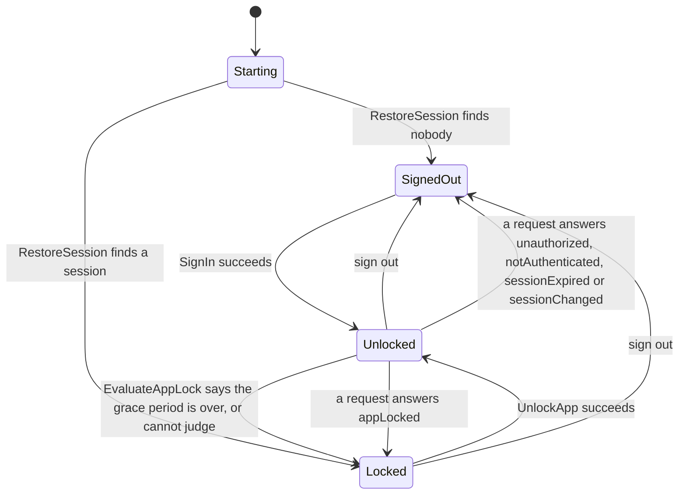

# Boardroom

Boardroom is a React Native demo app for board-of-directors governance. It exists to showcase a strict hexagonal (ports and adapters) architecture and production-grade tooling on a mobile codebase: the dependency rule between layers is not a convention, it is enforced by the linter.

> **Status:** scaffold, tooling, internationalisation foundation, the `domain` and `application` layers (business rules, ports, use cases, unit tests), in-memory adapters that simulate a server, the composition root, the real adapters of the `http` configuration (HTTP client and repositories, encrypted SQLite persistence, secure session storage, biometrics and connectivity of the device) with a mock API server to run them against, and now the screens that make the app usable end to end: sign-in, the lock screen, the privacy cover, voting with its confirmation, the pending and rejected votes, the synchronisation of the outbox, the offline banner and the demo controls, on top of the meetings list and the meeting detail. There is no document viewer yet and no native module (the document viewer and the native screen protection are for the next steps). Everything has been run in Jest; nothing has been run on a device (see "What is not verified").

## Tech stack

| Area          | Choice                                                                                                                                                            |
| ------------- | ----------------------------------------------------------------------------------------------------------------------------------------------------------------- |
| Runtime       | Expo SDK 57, React Native 0.86, React 19 (New Architecture, always on from SDK 55)                                                                                |
| Server state  | TanStack Query 5: the query cache, pagination, pull to refresh, retries (see Server state and UI state)                                                           |
| UI state      | Zustand 5: the few pieces of interface state that must survive navigation                                                                                         |
| Navigation    | expo-router (file-based, typed routes, protected screens), custom scheme `boardroom`                                                                              |
| Native builds | expo-dev-client with Continuous Native Generation (`ios/` and `android/` are git-ignored)                                                                         |
| i18n          | i18next, react-i18next, expo-localization: English and French, English as the fallback, typed keys (see Internationalisation)                                     |
| Language      | TypeScript, strict, plus `noUncheckedIndexedAccess` and `exactOptionalPropertyTypes`; the JS config files are type-checked too (`checkJs`)                        |
| Lint          | ESLint 9 flat config, eslint-config-expo, eslint-plugin-boundaries, eslint-config-prettier, no-magic-string rules for the UI code                                 |
| Formatting    | Prettier                                                                                                                                                          |
| Persistence   | expo-sqlite built with SQLCipher (the cache of meetings and the outbox of votes), expo-secure-store (the session and the key of the database)                     |
| HTTP          | The global `fetch` behind one small client, zod for the schemas of the answers, a documented API (`docs/api.md`)                                                  |
| Device        | expo-local-authentication (biometrics), expo-network (connectivity)                                                                                               |
| Tests         | Jest 29 with four projects (`core`, `infra`, `ui`, `tooling`), jest-expo and React Native Testing Library for the screens, MSW and `node:sqlite` for the adapters |
| Git hooks     | Husky, lint-staged, a Conventional Commits check written in plain shell                                                                                           |

## Getting started

Prerequisites:

- Node.js 24 (see `.nvmrc`) and npm 11.
- For running the app: Xcode (iOS) and/or Android Studio with an emulator (Android).

```sh
nvm use          # picks the Node version from .nvmrc
npm install      # installs dependencies and the git hooks (through the "prepare" script)
npm run validate # lint, typecheck, format check and tests
```

Run the app. The project uses a development client, so Expo Go is not used:

```sh
npm run ios      # generates ios/ if needed, builds the dev client, installs and launches it
npm run android  # same for Android
npm start        # starts Metro for an already installed dev client
```

### Running against the simulated server (mock mode)

In a development build mock mode is the default, so the commands above are all it takes: no server, no account to create, no network. `EXPO_PUBLIC_BOARDROOM_ADAPTERS=mock npm run ios` says the same thing explicitly, and a build that is not a development one (a release build) has to say it, because it never guesses (see the table).

**What state the app starts in.** Both configurations start the way a cold start does. With nobody signed in the app opens on the sign-in screen, and in the mock configuration that screen offers the two demo accounts below (a button each fills in the form). With a session stored on the device (only the http configuration keeps one across restarts) it opens on the lock screen, because a restored session always needs the biometric unlock. After a sign-in or an unlock it lands on the meetings list. See "Session, lock and navigation" for the whole flow.

The setting is the environment variable `EXPO_PUBLIC_BOARDROOM_ADAPTERS`, documented in `.env.example` (copy it to `.env`, which is git-ignored, to change it; restart Metro with `npm start -- --clear` afterwards, because Expo reads it when Metro starts).

| Value            | Effect                                                                                                                                                                                      |
| ---------------- | ------------------------------------------------------------------------------------------------------------------------------------------------------------------------------------------- |
| missing or empty | In a development build, the mock adapters: the same as `mock`. In any other build, refused: the code is `missingAdaptersSetting`                                                            |
| `mock`           | The mock adapters: in-memory repositories, caches and outbox, behind a simulated server                                                                                                     |
| `http`           | The real adapters, against the API at `EXPO_PUBLIC_BOARDROOM_API_BASE_URL` (see "Running against the mock API"). A missing, malformed or insecure address is refused with a code of its own |
| anything else    | Refused: the app shows a screen with the technical code `invalidAdaptersSetting`. A typo must not start the demo against the wrong thing                                                    |

The two demo accounts of the simulated server share the password `boardroom-demo` (it protects nothing, the accounts exist only in the simulation): `alice.martin@boardroom.example`, who is a voting member of most meetings, chairs some, and attends two as a guest and one as the secretary; and `bruno.durand@boardroom.example`, who is invited to two meetings out of three, so the two users see different lists. The meetings are generated from the clock at start-up, so there are always upcoming and past ones. The resolutions follow the date of their meeting: open before it takes place (the demo user can vote on several right away, the minutes of one are already voted), closed after it started once it is behind, and a few past ones are still open by status although their voting window is over.

### Running against the mock API

The `http` configuration needs a server. `npm run mock:api` starts one on this computer: the routes of `docs/api.md`, over the simulated server and the seed of the mock configuration, so that the real adapters (the HTTP client, the encrypted SQLite database, the secure storage) can be tried with nothing to deploy.

```sh
npm run mock:api                    # http://127.0.0.1:4000
npm run mock:api -- --port 4010     # another port (or MOCK_API_PORT=4010)
npm run mock:api -- --latency 800   # slower answers, in milliseconds (default 200)
npm run mock:api -- --host 0.0.0.0  # reachable from a phone on the same network
```

It prints the address, the two accounts and the value to put in `.env`. Then start the app against it:

```sh
# .env
EXPO_PUBLIC_BOARDROOM_ADAPTERS=http
EXPO_PUBLIC_BOARDROOM_API_BASE_URL=http://localhost:4000    # iOS simulator
# EXPO_PUBLIC_BOARDROOM_API_BASE_URL=http://10.0.2.2:4000   # Android emulator
# EXPO_PUBLIC_BOARDROOM_API_BASE_URL=http://192.168.1.20:4000 # a phone: the address of the computer, with --host 0.0.0.0
```

`10.0.2.2` is how the Android emulator names the computer it runs on. A development build accepts `http` for any host, which is what a phone needs; any other build accepts it only for this machine (`localhost`, `127.0.0.1`, `[::1]`, `10.0.2.2`) and requires `https` elsewhere (`insecureApiBaseUrl`). The system has its own say, and it is stricter: the iOS project that Expo generates allows cleartext traffic to the local network only (`NSAllowsLocalNetworking`), and the Android one allows it in debug builds only. A release build therefore talks to a real server over `https`, and the exceptions of the app are there for development.

It is a program of its own, not part of the app: `tooling/mock-api/` holds the entry point (`main.ts`) and the translation between the `http` module of Node and the `Request` and `Response` of the API (`server.ts`), and the routes are `MockApi` in `src/infrastructure/mock-api`, the same code that answers the HTTP tests through MSW. There is no framework, no build and no dependency: Node 24 runs the TypeScript sources directly. Stripping the types alone is not enough here, because the sources use parameter properties (`constructor(private readonly deps)`), which only `--experimental-transform-types` handles, so the script passes it. Node does not know the `@domain/*` aliases of `tsconfig.json` either: `tooling/mock-api/register.mjs` is a small resolver hook (`module.registerHooks`) that reads them from `tsconfig.json` and adds the missing `.ts` extensions. `tooling/mock-api/main.test.ts` starts the real command and asks it something. The tokens are forgotten when it stops, so an app that holds a session from a previous run is told `401` and starts over.

`ios/` and `android/` are produced from `app.config.ts` by Continuous Native Generation and are never committed. Native configuration lives in `app.config.ts` and in config plugins, never in the generated folders.

The Git hooks are installed by the `prepare` script, and only when `npm install` runs inside a Git repository. Husky skips the installation without failing when `.git` does not exist yet, so after a `git init` that comes later, run `npm run prepare` once and check that `git config core.hooksPath` prints `.husky/_`.

### Typed routes

`experiments.typedRoutes` is on, but expo-router writes the route types (`.expo/types/router.d.ts`, git-ignored) only while the dev server runs. On a fresh clone, and in CI, `npm run typecheck` does not check `href` values until `npm start` has run once: a misspelled route still compiles. Start the dev server once after cloning, and after adding a route, to get the check locally. Gating routes in CI needs a step that starts Metro briefly before `tsc`; that belongs to the CI/CD step.

### Placeholders in the native configuration

These values are deliberate placeholders, to be replaced before any store submission:

- The bundle identifier and Android package are `com.boardroom.demo`.
- `assets/` holds the images of the Expo template, and `android.adaptiveIcon.backgroundColor` is the template colour. They await the Boardroom brand artwork.
- No splash screen is configured, because `expo-splash-screen` is not a dependency of the project. The generated native projects keep the Expo template defaults: on iOS the launch storyboard references a launch image that is not generated, so the launch screen is blank, and Android shows the template logo. Configuring a real splash screen means adding `expo-splash-screen` (`npx expo install expo-splash-screen`) and its config plugin with an image and a background colour.
- The light appearance is locked on iOS only (`ios.userInterfaceStyle`). Locking it on Android as well needs `expo-system-ui`.

Android is hardened for confidential material: backups are off (`android.allowBackup: false`) and the storage and vibration permissions that the Expo template adds are blocked (`android.blockedPermissions`). `SYSTEM_ALERT_WINDOW` is kept because the development client overlays rely on it; revisit it together with the release build configuration.

### About `.npmrc`

The repository sets `legacy-peer-deps=true`. expo-router's dependency tree declares non-optional peers (`react-dom`, `react-native-reanimated`, and others) that are only useful for web, drawers and animations. Without this setting npm installs them automatically, and `react-dom` resolves to a version that conflicts with the React version pinned by the SDK. With it, only the peers that expo-router strictly requires are installed, and they are declared explicitly in `package.json`.

A consequence: `npm ls --all` exits with an error. It reports `react-dom`, `react-native-gesture-handler` and `react-native-reanimated` as missing, required by dependencies of expo-router (`@radix-ui/*`, `vaul`, `react-native-drawer-layout`). That is expected. Those packages are only reached from web builds and from `expo-router/drawer`, and neither is supported here. Do not add a CI step that requires `npm ls --all` to be clean (plain `npm ls` is clean).

### Peers of the test tooling

- `@react-native/jest-preset` is declared in `devDependencies` on purpose. `jest-expo` 57 requires it as a peer, and `legacy-peer-deps` stops npm from installing peers by itself.
- `react-test-renderer`, a peer of `@testing-library/react-native`, is not declared. npm installs it as a dependency of `jest-expo`, at the version the SDK expects. Declaring it explicitly is an open decision for the repository owner.

### Dependencies of the internationalisation

- `i18next` and `react-i18next` are regular dependencies. `react-i18next` needs `i18next` and `react` as peers, which are declared, and `typescript` as an optional peer, which is a development dependency already.
- `expo-localization` was added with `npx expo install`, so that its version matches the SDK. It provides the device language and a config plugin (see Internationalisation).
- `intl-pluralrules`, the usual polyfill for `Intl.PluralRules` on Hermes, is deliberately not a dependency: see "Plurals on Hermes" below.

### Dependencies of the real adapters

Added with `npx expo install`, so that their versions match the SDK: `expo-sqlite` (built with SQLCipher by its config plugin), `expo-secure-store`, `expo-local-authentication` and `expo-network`. `zod` is a regular dependency, imported by `src/infrastructure` only (a lint rule), and `msw` a development dependency, imported by tests and test support only. Nothing else was added: no polyfill, no crypto package, no file system package, no UUID package, no TypeScript runner and no HTTP framework. The things that would have been convenient and are not there, and what was done instead: a secure random number (`expo-crypto`: the bits come from `randomblob()` of SQLite, see "Persistence"), excluding the database from the iOS backup (a file system package or a native module: documented as not covered), a UUID for the tokens of the mock API (`crypto.randomUUID()` of Node, the server is a Node program) and a TypeScript runner for `npm run mock:api` (the type stripping of Node 24 and a resolver hook of a few lines).

## npm scripts

| Script                  | What it does                                                                           |
| ----------------------- | -------------------------------------------------------------------------------------- |
| `npm start`             | Starts Metro for the development client                                                |
| `npm run ios`           | Builds and runs the iOS development client                                             |
| `npm run android`       | Builds and runs the Android development client                                         |
| `npm run mock:api`      | Starts the mock API on this computer, for the `http` configuration                     |
| `npm run lint`          | ESLint over the whole repository, zero warnings allowed                                |
| `npm run lint:fix`      | ESLint with autofix                                                                    |
| `npm run typecheck`     | `tsc --noEmit`, which also checks the JS config files at the repository root           |
| `npm test`              | Runs every Jest project, without the coverage gate                                     |
| `npm run test:coverage` | Runs Jest with coverage and enforces the 90 percent gate on `domain` and `application` |
| `npm run format`        | Prettier, write mode                                                                   |
| `npm run format:check`  | Prettier, check mode                                                                   |
| `npm run validate`      | `lint`, `typecheck`, `format:check` and `test:coverage`, in that order                 |

## Architecture

The code is organised in layers. Dependencies only point inwards, toward the domain.

| Folder                | Role                                                                                           | May import                                                                                           |
| --------------------- | ---------------------------------------------------------------------------------------------- | ---------------------------------------------------------------------------------------------------- |
| `app/`                | expo-router route files. Thin: they mount screens. The root layout builds the composition root | `presentation`, `di`, `assets/`, external modules (not TanStack Query nor Zustand)                   |
| `src/domain/`         | Entities, value objects, business rules, business errors                                       | `domain`. No external module at all                                                                  |
| `src/application/`    | Use cases and ports (interfaces)                                                               | `domain`, `application`. No external module at all                                                   |
| `src/infrastructure/` | Adapters implementing the ports: in-memory, HTTP, SQLite, secure storage, device               | `domain`, `application`, `infrastructure`, external modules (not TanStack Query nor Zustand)         |
| `src/presentation/`   | Screens, components, hooks, stores, i18n, theme tokens                                         | `domain`, `application`, `presentation`, `assets/`, external modules. Never `infrastructure` or `di` |
| `src/di/`             | The single composition root that wires ports to adapters with manual typed injection           | `domain`, `application`, `infrastructure`, `di`. No external module at all. Never `presentation`     |

Three extra rules: the `zod` package and the native modules of the device (`expo-sqlite`, `expo-secure-store`, `expo-local-authentication`, `expo-network`) may only be imported from `src/infrastructure`, `@tanstack/react-query` and `zustand` (server state and interface state) may only be imported from `src/presentation`, and `fetch` is called by one module, the HTTP client (`src/infrastructure/http/HttpClient.ts`).

Everything else in the repository (`package.json`, the configs, `tooling/`, scripts) is tooling. Code under `app/` and `src/` cannot import it.

Path aliases map to the matching `src` folder: `@domain/*`, `@application/*`, `@infrastructure/*`, `@presentation/*` and `@di/*`. They resolve in TypeScript, Metro, Jest and ESLint.

### Domain and application

The two inner layers hold all the business logic. They are plain TypeScript, in a plain Node environment, with no external module and no ambient global.

**Errors are values.** Every operation that can fail returns `Result<T, E>` (`src/domain/shared/Result.ts`), or `Promise<Result<T, E>>` when it is asynchronous. Production code of `domain` and `application` never throws (a lint rule enforces it; tests and the `testing` folders may), and the contract of every port says that an adapter never throws or rejects: it returns an error `Result`. An error is plain data: a `code` taken from a const object, plus the structured fields that matter (`src/domain/errors`, one file per concern: validation, authentication, repository, voting, vote delivery, biometric, storage, screen protection). It carries no text, because the translation happens in the presentation. The codes are unique across concerns, so a union of errors from several concerns is told apart by `code` alone. The free-text `cause` of an error is a technical diagnostic: it never holds personal data nor the values of a query.

**Plain, immutable data.** Entities are `readonly` plain objects built by factory functions. A factory with something to check returns a `Result` (`createMeeting`, `createResolution`, `createDocument`, ...); one that has nothing to check just builds the data (`createVote`, `createSession`, `createPendingVote`, `createPage`, `createWatermark`). Value objects are branded types with a validating factory (`parseInstant`, `parseMeetingId`, `parseEmailAddress`, ...): a `UserId` and a `MeetingId` are both strings at runtime, and the compiler keeps them apart. There are no classes to map, so the same data goes to SQLite and to the query cache as it is. Every code, role, status, choice and event name is a const object (`VOTE_CHOICE`, `PARTICIPANT_ROLE`, `MONITORING_EVENT`, ...) with its union type derived from it, never a string literal repeated at call sites. Time is an `Instant` (epoch milliseconds), read from the `Clock` port only.

**Business rules are pure functions** (`src/domain/policies`): the eligibility to vote (and the precise reason when not eligible), the biometric app lock, the expiry of a session, the maximum age of a cached entry. Which list a meeting belongs to (upcoming or past) is decided by the server: `MeetingPeriod` is only a query value. The `Watermark` fixes the content of what a confidential document shows (name, email and instant of the reader); formatting the instant and laying the watermark out stay in the presentation.

**The offline policy lives in the application layer**, in one place (`src/application/shared/loadWithCacheFallback.ts`), where it can be read and tested, not hidden in an adapter. The use cases that read meetings and documents need a valid session, and read and write the cache of that user only (every cache operation takes the owner, so reading as another user finds nothing, by construction).

1. Ask the remote source first. Then check that the user it was asked for is still the one signed in and the app still unlocked: a slow request can span a sign-out and a sign-in, and what comes back must neither be written under the previous owner nor returned as the answer to the new one. If somebody else is signed in, nothing is written or returned and the answer is `sessionChanged`.
2. On success, write the data through to the cache and return it flagged `fresh`. A write that fails does not fail the call: the failure is captured, and the entry is removed, so that an older copy that could not be refreshed is not served afterwards as if it were current (a full purge if even the removal fails).
3. When the network is unavailable, and only then, return the cached copy flagged `stale` with the instant it was cached, if it is not older than the maximum age given in the `deps` (an older entry, or one dated in the future, counts as a miss). On a miss, return the network error.
4. `unauthorized` means the session is no longer valid, for anything: both caches are emptied, for every owner. `forbidden` (the session is valid, the user may not have this item) and `notFound` concern one item: it is removed from the cache with what hangs off it, so a meeting takes the documents it lists with it. A removal that fails is captured and falls back on the full purge, so that a copy the server refused is never served afterwards; a purge that fails is captured. The error is returned.
5. Any other error (`unexpected`) is returned as is.

Known limit: the pages of the list that were cached are not walked on a revocation. A cached page that shows the title of a meeting that became forbidden keeps showing it until it is refreshed or expires; opening the meeting is refused, and its detail and documents are gone.

A cache that cannot be written, read or evicted does not fail the call, the failure is captured by the monitoring. Signing out, signing in (over whoever was signed in before: it also retries a purge that failed earlier), ending an expired session at start, and the session guard meeting an expired session while the app runs, all empty both caches (the stored content of the documents included); the vote outbox is kept, because a vote belongs to its voter and must be sent when they come back. `ListMeetings`, `GetMeeting`, `OpenDocument` and `CastVote` all use the policy.

| Port (`src/application/ports`) | Role                                                                                                                                  |
| ------------------------------ | ------------------------------------------------------------------------------------------------------------------------------------- |
| `MeetingRepository`            | Remote source of truth: a page of meetings for a period, one meeting                                                                  |
| `MeetingCache`                 | Local store of pages and meetings, per owner: save, read (a miss is a value, not an error), remove, purge                             |
| `DocumentRepository`           | Remote documents: metadata, and the local location of the downloaded content                                                          |
| `DocumentCache`                | Local store of documents already viewed (metadata and location), per owner; `remove` and `purge` also delete the stored content       |
| `VoteRepository`               | Remote votes. Idempotent on the idempotency key; a business rejection is distinct from a network failure; never trusts `castAt`       |
| `VoteOutbox`                   | Durable local store of the votes of each voter, pending or rejected, oldest first. Reads are scoped by voter. Not cleared at sign-out |
| `AuthSession`                  | Sign in, current session, sign out. Tokens stay inside the adapter                                                                    |
| `BiometricGate`                | Availability and authentication, for a reason (`unlockApp`, `confirmVote`). No prompt text crosses the port                           |
| `ScreenProtection`             | A dumb global switch (enable, disable) and the capture events. Which documents need it is decided by `ScreenProtectionCoordinator`    |
| `Connectivity`                 | What the device says about its connection (online, offline) and when it changes. A hint, never the truth: the calls are               |
| `Clock`                        | `now()`                                                                                                                               |
| `Monitoring`                   | Structured logs and error capture. Events and attribute names are const sets                                                          |

Every method of every port settles in bounded time; a remote adapter maps a timeout to `networkUnavailable`, a local store to a storage error.

| Use cases (`src/application/use-cases`) | What they do                                                                                                                                                                                                      |
| --------------------------------------- | ----------------------------------------------------------------------------------------------------------------------------------------------------------------------------------------------------------------- |
| `auth/SignIn`                           | Validate the credentials and sign in                                                                                                                                                                              |
| `auth/SignOut`                          | Empty the caches, then sign out. A cache that cannot be emptied does not stop the sign-out                                                                                                                        |
| `auth/GetCurrentUser`                   | Needs a session. Who is signed in, for the screen that applies a rule to the user (the eligibility to vote). Discloses nobody while the app is locked                                                             |
| `auth/RestoreSession`                   | Cold start: no session, or the requirement to unlock the app (the status only, no name nor email before the unlock). Locks the app. An expired session is ended (caches emptied, signed out) and reported as none |
| `auth/EvaluateAppLock`, `UnlockApp`     | Must the app be unlocked on return from the background; unlock it with the biometrics. `UnlockApp` fails closed                                                                                                   |
| `meetings/ListMeetings`, `GetMeeting`   | Need a session. Meetings with the offline policy                                                                                                                                                                  |
| `documents/OpenDocument`                | Needs a session; protects the screen of a confidential document, or of any document served from the cache (fails closed); watermark of the user checked after the load; access log; offline policy                |
| `documents/CloseDocument`               | Releases a document; the screen protection goes off when no confidential document is left open                                                                                                                    |
| `documents/ObserveScreenCapture`        | Needs a session; logs the capture events with the document and user ids, forwards them, and succeeds with the unsubscribe function                                                                                |
| `votes/CastVote`                        | Needs a session; checks eligibility; biometric confirmation; submits, or queues the vote when the network is down or the server fails unexpectedly                                                                |
| `votes/SyncPendingVotes`                | Sends the pending votes of the signed-in user, oldest first; see below                                                                                                                                            |
| `votes/ListPendingVotes`                | The outbox of the signed-in user, pending and rejected votes told apart                                                                                                                                           |
| `votes/AcknowledgeRejectedVote`         | Deletes a rejected vote once the user has seen it                                                                                                                                                                 |
| `connectivity/ObserveConnectivity`      | Needs no session. The status of the connection now and each change after it, one change at a time; the presentation calls `SyncPendingVotes` when it comes back                                                   |

A use case is a class with a single public `execute` method (`ObserveScreenCapture` also takes the callback to call). Its dependencies are injected through the constructor as one typed, `readonly` `deps` object of ports, plus the configuration values it needs (`maxCacheAge`, `maxAttempts`, `gracePeriod`). There is no static state and no singleton; the few instances that guard something in memory (`SyncPendingVotes`, `CastVote`, `ScreenProtectionCoordinator`, `AppLock`) must be created once by the composition root and shared.

**Votes.** A vote is final: a voter has one vote per resolution, identified by an idempotency key built from the resolution and the voter. Sending a vote again is safe as long as the server honours that key, which the `VoteRepository` contract requires: a retry after a lost answer is recorded once.

- `CastVote` refuses a second vote on a resolution being cast on the same instance (`voteInProgress`), checks the eligibility against the meeting (cached or fresh) and the outbox, then asks for the biometric confirmation. A submitted vote is also recorded on the cached copy of its meeting, so that the voter cannot vote again from it offline.
- The outbox keeps a vote in one of two states, pending or rejected, which cannot be mixed up: a rejected vote always carries its reason.
- `SyncPendingVotes` is triggered by the presentation or the composition root, when connectivity is regained (it observes it through `ObserveConnectivity`) and when the app returns to the foreground; the application layer does not decide when to sync. It sends the pending votes oldest first, one at a time, and checks the session again before each one (a run stops if the user signed out or changed, or the app was locked; it does not start while the app is locked). Its report names the resolutions and the reasons, never the choices. A vote the server rejects for a business reason is kept as rejected, with the reason, until the user acknowledges it. Only `networkUnavailable` and `unauthorized` stop the whole run; they concern every vote and count no attempt. An `unexpected` failure counts an attempt on that vote and the run goes on with the next one; after `maxAttempts` the vote is given up as `voteUndeliverable` and shown to the user. A second call while a run is in progress on the same instance does nothing (`alreadyRunning`); two instances, or two processes, are protected by the idempotency key only.

**Biometric lock.** The lock is enforced, not only reported. `AppLock` is one shared in-memory state that the session guard (`requireSession`, which every use case that serves the user goes through) reads: while it is closed, the guard answers `appLocked` and no use case returns data, queues or sends anything. A cold start always closes it (`RestoreSession` returns the status `unlockRequired` and nothing about the user), `EvaluateAppLock` closes it when the grace period in the background is over or cannot be judged, `UnlockApp` opens it when the biometrics succeed, a successful `SignIn` leaves it open (the credentials just typed are the proof of presence) and `SignOut` closes it. On a device where the biometrics cannot be used, `UnlockApp` fails closed every time, and the only way forward is to sign out and sign in again. The biometrics prove that a person enrolled on the device is there, not that it is the user of the session; whether the device passcode is accepted as a fallback is a setting of the adapter, chosen at the composition root.

**Screen protection.** `ScreenProtectionCoordinator` counts the views of each document (a document opened twice is two views) and serialises its calls to the platform, so that the last view of all turns the protection off and a slow `disable` can never land after a later `enable`. `OpenDocument` protects a confidential document and any document served from the cache, whatever level the cache remembers: a copy may have been public when it was saved.

**The session is checked again.** The session guard also detects an expired session while the app runs (both caches are emptied, best effort, and the caller still gets `sessionExpired`). A use case that waits for something (the network, a biometric prompt) checks again, with `requireSameUser`, that the same user is still signed in before it writes or returns anything.

**Test doubles** live in `src/application/testing/` (and the builders of domain fixtures in `src/domain/testing/`, because the domain tests need them and the domain cannot import the application). They are hand-written, in-memory fakes of every port, scriptable (a switch for the network, failures of the storage, queued answers of the server) and checked against the contract of the ports by `fakes.test.ts`. They exist so that the use cases are tested without `jest.mock`, against objects that behave like the real thing. They are test support, not production code: they are excluded from the coverage figures, a fixture there may throw, and a lint rule forbids production code from importing any `testing` folder.

### Clock limits

Time is the clock of the device, read through the `Clock` port, and the user controls it. What the rules built on it do about that:

- Session expiry (`expiresAt`) is on the device clock: a clock set back extends a session locally, a clock set forward ends it early. The server enforces its own expiry on every call.
- The age of a cached entry is compared with the device clock. An entry dated in the future (the clock was set back) is a miss, and so is one older than the maximum age. A clock set back far enough that an old entry looks young cannot be detected, and keeps an entry usable longer than the maximum age.
- The app lock fails closed when the clock goes back (`now` earlier than the instant the app went to the background), and a grace period of zero locks every time. A clock set forward only locks sooner.
- `castAt` of a vote comes from the device. The `VoteRepository` contract says that the server stamps the vote with its own time and applies the voting window to it. The local eligibility check (`votingWindowOver`) is a courtesy that can be wrong in either direction.
- The ordering of the outbox is the order of enqueueing, not a comparison of instants.

### In-memory adapters and contract tests

`src/infrastructure/in-memory` holds an adapter for every port, so that the whole app runs without a server, and `clock/` and `monitoring/` hold the two that are not in-memory by nature.

| Adapter                                                                             | What it is                                                                                                                                                                                 |
| ----------------------------------------------------------------------------------- | ------------------------------------------------------------------------------------------------------------------------------------------------------------------------------------------ |
| `InMemoryMeetingRepository`, `InMemoryDocumentRepository`, `InMemoryVoteRepository` | Three thin windows on one `InMemoryBackend`, the simulated server, so that a vote recorded through one is seen through the others                                                          |
| `InMemoryMeetingCache`, `InMemoryDocumentCache`, `InMemoryVoteOutbox`               | The local stores, per owner and per voter. They copy what they are given and what they hand back. The document cache answers for the files of the device (`InMemoryDocumentContent`)       |
| `InMemoryAuthSession`                                                               | The accounts of the simulated server and the session store of the device in one. Sessions expire a lifetime after the sign-in, on the clock it is given. No tokens exist, so none can leak |
| `InMemoryBiometricGate`, `InMemoryScreenProtection`                                 | Biometrics that are always available and always recognise the user; a screen protection that records what it was asked and can report a capture. Both can be made to fail, for tests       |
| `SimulatedConnectivity`                                                             | The connectivity of the mock configuration: online when the simulated network is, and told when the demo cuts it. Deterministic, nothing native                                            |
| `SystemClock`, `ConsoleMonitoring`                                                  | The clock of the device (the only production code that reads it), and structured events written to the console                                                                             |

**The simulated server** (`InMemoryBackend`) behaves the way the port contracts describe a real one. Every request enters the network first (`networkUnavailable` offline, then the latency), then is authenticated from the stored session (`unauthorized` without a valid, unexpired one). The identity is read when the request is created, and the answer is the one for that identity even if somebody else signs in while the request waits. A user sees the meetings they take part in. A meeting, or a document of a meeting, that exists but that they may not have is `forbidden`; one that does not exist is `notFound`. Telling the two apart shows that an id exists, which costs little here (ids are opaque and a board is a closed group) and lets the app say "you no longer have access"; a server that prefers to hide it answers `notFound`, which the application treats the same way. Which of the two lists a meeting is in is decided against the clock; upcoming ones are soonest first, past ones latest first, ties broken by id. The limit of a page is checked with the page rules of the domain, not trusted, and pages continue after an opaque cursor (the instant and the id of the last meeting) that stays valid when a meeting moves from one list to the other between two pages. The decoder of the cursor is strict: `1e3`, hexadecimal, a space, a negative number or an extra segment is refused. A vote is recorded for the authenticated user only, once per resolution, under a key the server derives itself. A key that already holds a vote is answered before any rule of eligibility, so that a replay still works after the resolution is closed: the same vote again succeeds, another choice is `alreadyVoted`, whatever the clock says. A voter that is not the authenticated user is `unauthorized`. The business rules are the ones of the domain (`checkVotingEligibility`), applied at the time of the server, which stamps the vote with its own time and never trusts `castAt`: a vote whose device time is after the closing instant is accepted while the server's time is still before it. Resolution ids are unique across all meetings (the domain says so for the id and for the idempotency key built from it), and the server refuses content that breaks it. The document location is per user and per revision of the document, so the content one user fetched does not serve another. A meeting returned to a user carries their own recorded votes. Everything it returns is a copy.

**The seed** (`seed.ts`) is the content of the server, generated from the clock when the app starts: 24 upcoming and 42 past meetings, nothing random. Its resolutions follow the date of the meeting: in an upcoming meeting they are open, with a closing time after the meeting starts or none; in a past meeting they were closed after it started, with the votes of the demo users on most of them (the demo user voted for, against and abstained in turn), except in some meetings where the status was never closed and the window is simply over, with nobody having voted. All three states of voting, all three choices, a meeting where the demo user is a guest and several resolutions they can vote on right away are in the data at any start instant (`seed.test.ts` checks it at several). It is server data, so it is in English whatever the language of the app. It is built through the domain factories, so a seed that breaks an invariant makes `buildSeed` return the error (and its test fail), and the container then refuses to start.

**The network** (`SimulatedNetwork`) is the connectivity of the server, owned by the backend (`backend.network`): `setOnline(boolean)` is the one way to cut or restore it, `subscribe()` tells whoever listens when it changes (the `Connectivity` of the mock configuration does), and `setLatency()` changes how long the server takes. Every client of the server goes through it, so going offline cuts them all, deterministically; `container.demoControls.network` (the same object as `container.controls.network`) hands it to the demo and to the tests: it exists in the mock configuration only, because a real device has no switch to cut its own network. The latency is a `Sleep` function handed in at construction, so the domain and the application contain no timer and the tests, which give a sleep that does not wait (`src/infrastructure/testing/sleep.ts`), never sleep. A request never waits more than `MAX_SIMULATED_LATENCY_MILLIS`, whatever is configured, because every port settles in bounded time: a latency above the cap is a timeout and answers `networkUnavailable` once the cap has elapsed, and a sleep that throws or rejects is a network that failed and answers `networkUnavailable` too. Nothing escapes the port.

**The monitoring** (`ConsoleMonitoring`) writes each event to the channel of the console that matches its level, through a map typed over every level: a level added to the port without a channel fails the typecheck instead of being dropped. Serving data from the cache is expected behaviour (it is what the offline demo shows), so it is logged at `info`: a warning would raise a LogBox toast in development. The tests of the container are given a silent monitoring through the runtime override, so they print nothing.

**Contract tests.** For each port that holds state or talks to a server there is a reusable suite, a function that takes a factory and registers the same `describe` against any implementation: `describeMeetingCacheContract`, `describeDocumentCacheContract`, `describeVoteOutboxContract`, `describeMeetingRepositoryContract`, `describeDocumentRepositoryContract`, `describeVoteRepositoryContract`, `describeAuthSessionContract`, `describeScreenProtectionContract`, `describeConnectivityContract` (`src/application/testing/contracts`). That is nine suites for twelve ports. `BiometricGate`, `Clock` and `Monitoring` have none, on purpose: they hold no state and are thin. The first is one question and one prompt that the platform answers (the in-memory adapter only replays what it is told, and the real one maps every outcome of the library to an error of the domain, which its own test checks case by case), the second is a single call that returns the time, and the third is fire and forget and returns nothing a test could read. Their adapters are tested directly. The suites only use the public surface of the port, plus a small harness the factory provides where a port alone cannot say it: to put meetings on the server, to cut the connection, to lose a downloaded file, to move the clock of the server. The caches and the outbox suites check, among others, the isolation of two owners or voters (also under ids that would collide if the owner and the id were concatenated), that `purge` removes everything for every owner, that a miss is a value and not an error, first in first out by insertion (the votes are enqueued with decreasing instants, so that an adapter that sorts by the instant fails), idempotent `enqueue` that reports the vote that holds the key, the rejected state (also through `findByResolution`), and that mutating an object after saving it or after reading it changes nothing the next read returns. The repository suites check, among others, that a recorded vote of one user is not seen by another, and the clauses of the vote that depend on time (a replay or another choice after the close, a late `castAt`).

Three groups of the cache and outbox suites need an implementation with a real storage, and say so as options (`StoreContractOptions`) instead of passing for an implementation that has none:

- **A statement that fails.** The harness has a hook that makes the next statement the store sends fail, once (`failNextStatement`). Each call must then answer with the storage error of its port, leave the data as it was (an enqueue that failed queued nothing, a rejection that failed left the vote pending, a purge that failed removed nothing), and work again straight after. A save that fails must leave no older entry readable, which the harness checks with a full disk that still lets space be freed.
- **Closed and opened again.** The harness closes the store and opens a new one on the same storage (`reopen`): the cache gives back what was saved with its instants, the outbox gives back every vote of every voter in the order of enqueueing, with its attempts and the reason of a rejection, still holds the key of each vote, and goes on in the same order after a vote was removed.
- **Writers at the same time.** The same key written by several callers at once leaves one complete version (never a mix of two), a vote enqueued by eight callers at once is queued once and every caller is told which vote won, and ten attempts counted at once are ten attempts. This group has no option: the fakes and the in-memory adapters run it too.

The groups that an implementation cannot honour show as skipped, not as passed.

Every suite runs against the fakes of the application (`src/application/testing/fakes.contracts.test.ts`), against the in-memory adapters (the tests next to them), and against the real adapters: the SQLite ones over a SQLite database in a file (`SqliteMeetingCache.test.ts`, `SqliteVoteOutbox.test.ts`), the connectivity ones (`ExpoConnectivity.test.ts`, `SimulatedConnectivity.test.ts`) and the HTTP ones through MSW (`HttpRepositories.test.ts`, which runs the repository and the session suites against the real client, the real schemas and the routes of the mock API in front of the same `InMemoryBackend`). The fakes keep no files (so the checks on the content of documents are skipped for them), their server only replays scripted answers (so the business rules of a vote are skipped), and the in-memory stores have no storage to fail nor to reopen.

**Why there are fakes and adapters.** The application has its own fakes of the ports (`src/application/testing`) and the infrastructure has its in-memory adapters, and they do not share code. They answer different needs. The fakes belong to the layer that is tested with them: `application` may not import `infrastructure`, so a use case test cannot use an adapter, and the fakes have switches that an adapter must not have (make the next write fail, queue the answer of the server, see what was asked). The adapters are a working implementation that the app runs on, a simulated server with its own rules. The contract suites are what keeps the two honest: both pass the same checks, so a fake cannot drift from what a real adapter does without a test failing.

### Persistence

`src/infrastructure/persistence` holds the `MeetingCache` and the `VoteOutbox` on SQLite. `DocumentCache` stays in memory: where the content of a document lives, and how a file of confidential content is stored and removed, is decided with the document viewer, in the step that adds it, and an adapter chosen before would only be thrown away. Until then the HTTP configuration registers the location of a document the way the in-memory repository does, and a document opened once is gone when the app is killed.

**The driver seam.** The adapters and the migrations are written against `SqlDatabase`: run a statement, read rows, run a transaction, close. It is made by `createSqlDatabase` from a `SqlConnection`, which is what an engine provides and is three calls (`run`, `all`, `close`). The serialisation and the transactions are in `createSqlDatabase`, once, whatever the engine: statements run one at a time in the order they were asked for, a transaction holds the connection until it ends (committed when its work resolves, rolled back when it rejects), and a lone statement never lands inside the transaction of another caller. `expo-sqlite` has its own exclusive transactions, which open a second connection, and that connection would not know the key of an encrypted database; running the transactions on the one connection avoids it.

Two engines sit behind `SqlConnection`:

- `ExpoSqliteOpener` (`expo-sqlite`, on a device) opens the file, unlocks it with the key and checks that it is SQLCipher. It is as thin as it can be and **it is the only part of the persistence that no Jest test executes for real**: its test replaces the native module with a stand-in that runs the statements on `node:sqlite` and answers like SQLCipher to a key and to its version, and checks the conversation (the key is passed as a raw key, the cipher version is asked for, a wrong key is recognised, a key that is not 64 hexadecimal digits never reaches a statement).
- The Node one (`src/infrastructure/testing/NodeSqlite.ts`, test support) runs the same SQL on `node:sqlite`, which comes with Node 24, so the contract suites execute real SQL in Jest with no dependency. Jest cannot resolve the module (`import 'node:sqlite'` fails: its list of Node modules predates it), so it is obtained with `process.getBuiltinModule('node:sqlite')`, which returns the same module; a comment in the file says so. A lint rule keeps this driver out of production code (nothing outside the tests and the `testing` folders may import a `testing` folder).

**Schema and migrations.** The version of the schema is the `user_version` of the header of the database. `MIGRATIONS` (`migrations.ts`) is the list, numbered 1, 2, 3, with no gap: version 1 creates the cache tables and the outbox, version 2 adds the index that finds the votes of a voter on a resolution. Each migration runs in its own transaction together with the update of the version, so one that fails leaves the database at the version before it and the next start tries again; a migration that was released is never edited, a change is a new one, and there is no way back. A database that is more recent than the app (the app was downgraded) is refused and left alone (`databaseIsNewer`). The tests open a database at every past version, fill it with rows written the way that version wrote them, migrate it to the latest and check the rows and the new objects; they run a migration that fails halfway and check that the version, the schema and the data are those from before; and they refuse a list of migrations with a gap. The names of the tables and columns are constants (`schema.ts`) and are part of the format: they are never edited, a rename is a migration.

**What is stored, and how.**

- The cache keeps a page or a meeting **as the API writes it**, as JSON, so that one description of a meeting exists outside the process (`src/infrastructure/http/dto`). Its key is one column for each part, never the parts joined in a text: `(owner, meeting id)` for a meeting, `(owner, period, cursor, page size)` for a page, with the cursor written as JSON in its column so that "no cursor" is kept apart from any cursor. `(owner, id)` is therefore injective whatever characters they hold, which the contract suite checks on the awkward ids it uses everywhere (separators, quotes, other case, surrounding spaces, the same letter written as one code point or as two).
- The outbox keeps a vote **in columns**, in the order it was enqueued: `sequence` is an `INTEGER PRIMARY KEY AUTOINCREMENT`, so it only grows and a row that is deleted never gives its number back (the order is never a timestamp). The idempotency key is a `UNIQUE` column compared byte for byte (two keys that share a prefix or differ by case are two votes). A `CHECK` constraint makes a rejected vote always carry its reason and its instant and a pending one never: the database refuses the other states. `enqueue` reads the key and inserts in one transaction, so two callers with the same key enqueue it once and both are told; `markAttempt` is an `UPDATE ... SET attempts = attempts + 1`, so that two callers cannot lose an update.
- **What is read back is checked.** The payloads of the cache go through the same zod schemas and the same domain factories as an answer of the API; a row of the outbox goes through the factories of the domain, and the key it derives must be the key it holds. A row that no longer passes (the format moved on, the file was altered) is a **miss**: it is reported to the monitoring (`storedRowDiscarded`, with the kind of row and, for a payload, the paths of the fields that failed, never their values), left out of the answer and deleted. It never throws. For the outbox that means a vote that cannot be read is lost, which is the only thing that can be done with it: nobody can send a choice that cannot be read, and keeping the row would block the key.
- **Failures.** A statement that fails, or does not answer within the time it was given (10 seconds), is the storage error of the port, with a cause that is a kind of failure (`sqlite error 13`, `timeout`) and never a statement, a path or a value. A save that fails removes the older entry of its key, so that it is not served afterwards as if it were current.

**At rest.** The cache holds confidential meeting data and the outbox holds the choices of a secret ballot, so the database is encrypted. The outcome of the evaluation:

- `expo-sqlite` in SDK 57 can be built with SQLCipher: `['expo-sqlite', { useSQLCipher: true }]` in `app.config.ts` sets `expo.sqlite.useSQLCipher` for both native projects (checked with `expo prebuild`: the flag is in `Podfile.properties.json` and `gradle.properties`). The database is unlocked with `PRAGMA key` right after it is opened. Plain SQLite ignores that pragma without a word, so the opener asks for `PRAGMA cipher_version` and **refuses to open when it gets no answer** (`encryptionUnavailable`): a build made without the option fails to start instead of keeping the data in clear.
- **The key** is 256 random bits, made once per installation and kept in the secure storage (`expo-secure-store`: the Keychain with `WHEN_UNLOCKED_THIS_DEVICE_ONLY` on iOS, so it is not synchronised and not restored onto another device; preferences encrypted with a key of the Android Keystore on Android, out of the automatic backups). It is stored before it is used, so that a start that stops in between leaves a key and no file, which the next start fills.
- **Where the random bits come from.** The platform gives no secure random number to JavaScript that the app can use with the dependencies it has: Hermes has no `crypto.getRandomValues`, and `expo-crypto`, which provides one, is not a dependency. The bits come from the engine instead: `SELECT hex(randomblob(32))` on a scratch database in memory, whose generator is seeded by the operating system (`/dev/urandom`). That is a sound source for a key; a dependency on `expo-crypto` (one package, an hour of work, `getRandomBytesAsync`) would make the origin of the bits more obviously right to a reader, and is for the owner to decide.
- **Loss.** If the key is not in the keychain and a file is on the device (the keychain was cleared, or the file was restored onto a device whose keychain does not have the key), or the keychain holds a key that does not open the file, the content can never be read again: the file is deleted, a new key is made and a new empty database is created, and the monitoring is told (`databaseRecreated`, with `keyLost` or `keyRejected`). The cache is refilled by the next requests; **the votes that were waiting to be sent are lost.** A start that fails for any other reason (the keychain cannot be read, the file cannot be opened, the schema cannot be migrated) deletes nothing and does not start (`storageUnavailable`, with the reason).
- **Rotation.** The key is replaced only by the case above. Nothing rotates it while the database is in use: it would be `PRAGMA rekey` with the new key written to the keychain first, and read back on the next start when the old one is rejected; no policy of the app asks for it, so it is not built. The cost to add it is small once a policy exists (for instance "rotate when the user signs out").
- **Not covered.** On iOS the file lives in `Documents/SQLite`, which is part of the device backups. It is encrypted with a key that never leaves the device, so a copy of the file is useless elsewhere, but excluding it from the backup (`NSURLIsExcludedFromBackupKey`) needs a native module or a file system package, which this step does not add. Nothing was run on a device: see "What is not verified".

### HTTP adapters and API contract

`src/infrastructure/http` has the adapters of `MeetingRepository`, `DocumentRepository`, `VoteRepository` and the HTTP side of `AuthSession`, over one small client. `docs/api.md` is the contract between them and the server: routes, payloads, the shape of an error, the idempotency key header, the pagination cursor. The mock API implements it, and the tests run the adapters against that implementation.

- **One client, `HttpClient`**, over the global `fetch`, the only module allowed to call it (a lint rule). It never throws and never hangs: the request is aborted after the timeout (15 seconds, `HTTP_REQUEST_TIMEOUT` in `src/di/config.ts`) and the answer must come within it, body included, whether or not the platform honours the abort. The base URL is a setting, validated at start. The token of the signed-in user is read when the request is created and attached to it, so the answer is the one for that user even if somebody else signs in while it is on its way; a request that needs a token and finds none is `unauthorized` without being sent.
- **Status codes.** 401 is `unauthorized`, 403 `forbidden`, 404 `notFound`, 422 a business rejection of a vote (the body says which rule, see `docs/api.md`), a failure to reach the server, a timeout and a cut-off answer are `networkUnavailable`, and so are 502, 503 and 504: they say the service behind a gateway cannot be reached, so the offline policy applies and a queue of votes is not given up during an outage (a vote only counts an attempt for `unexpected`). Any other status is `unexpected` with the status as its only cause. No cause holds a URL, a path, a token or a part of a body, which the tests check on hostile inputs.
- **Schemas and mappers.** There is a zod schema for every answer, one file per resource (`dto/meetingDto.ts`, `documentDto.ts`, `sessionDto.ts`, `voteDto.ts`), and mappers between the wire and the domain in both directions. A schema checks that each field is there with the type of the API and ignores the fields it does not know; the **values** are checked by the factories of the domain (`createMeeting`, `parseMeetingId`, ...), so a status nobody knows, a blank title or a duplicate id is as invalid as a missing field. An invalid answer is `unexpected`, and the monitoring gets `responseInvalid` with the paths of the fields that failed (`agenda.0.status`), never their values. Instants are ISO 8601 strings on the wire and numbers in the domain; requests are mapped from the domain to the wire explicitly, and a vote does not carry its key (it is derived from the resolution and the voter, and also sent as the `Idempotency-Key` header, which the server checks against the body).
- **The session.** `HttpAuthSession` signs in against the API; the session and the token are kept by `SessionVault` in the secure storage, in **one item**, so that a new session replaces the old one with one write and there is no instant at which the storage holds the token of one user and the session of another, or none while a sign-in succeeds. The memory follows the storage: it changes only once the write succeeded, and `current()` reads from memory once it was loaded. The application only sees the `Session`; the expiry is computed on the clock of the device from the lifetime the server grants (`expiresIn`), never copied from a timestamp of the server. Signing out empties the memory first, then the storage: whatever happens to the storage the token is no longer used, and a storage that cannot forget reports it, so that signing out can be repeated. The demo API has no endpoint to revoke a token, so it stays valid on the server until it expires (a limit of the demo, written in `docs/api.md`). A stored session that no longer reads back is treated as nobody being signed in, reported, and deleted.
- **Documents.** The server answers with the location of the content, per user and per version of the document. Downloading it to the private storage of the app comes with the document viewer; until then the location is registered as downloaded, like the in-memory repository does.
- **Tests.** `HttpClient.test.ts` covers every status and every failure of the client (against a scripted `fetch`, and against the real `fetch` of Node through MSW for the connection that fails, the server that never answers and the abort). Each schema has its rejection cases (every field missing, every field mistyped, the unknown fields ignored) and a round trip through the mappers, including every meeting of the seed. `HttpRepositories.test.ts` runs the existing contract suites against the HTTP adapters. The MSW handler is one line: it hands the `Request` to `MockApi`, which asks the same `InMemoryBackend` as the in-memory repositories, so one implementation of the server rules backs both configurations. MSW is a development dependency used through its Node integration only; it is ES modules only, which Jest 29 does not run, so the "infra" project transforms it (explained in `jest.config.js`) and runs in a plain node environment.

### Biometrics and connectivity

`DeviceBiometricGate` is the `BiometricGate` over `expo-local-authentication`. Availability is the hardware and at least one enrolment (a library that throws or does not answer is `biometricUnavailable`: it fails closed). Authentication maps every outcome of the library to the biometric errors of the domain, in a table typed over all the codes of the library, so a code added by an update fails the typecheck; a code the library sends that the types do not know is `biometricFailed`, never a success:

| Library outcome                                                          | Error of the domain    |
| ------------------------------------------------------------------------ | ---------------------- |
| `user_cancel`, `app_cancel`, `system_cancel`, `user_fallback`, `timeout` | `biometricCancelled`   |
| `authentication_failed`, `unable_to_process`, `unknown`                  | `biometricFailed`      |
| `lockout`                                                                | `biometricLockedOut`   |
| `not_enrolled`                                                           | `biometricNotEnrolled` |
| `not_available`, `passcode_not_set`, `no_space`, `invalid_context`       | `biometricUnavailable` |

The text of the system prompt is user-facing, and infrastructure cannot import the translations, so the adapter is given a function `(reason) => text`. The composition root receives it through `ContainerRuntime.biometricPromptText`, `StartupGate` (presentation) builds it from the i18n instance of the app and `app/_layout.tsx` hands it to `startContainer`; the function reads the current language each time it is called, so a language changed while the app runs is followed by the next prompt. **Whether the device passcode is accepted as a fallback** is a named setting, `ALLOW_DEVICE_PASSCODE_FALLBACK` in `src/di/config.ts`, **off**: the biometrics unlock the app and confirm a vote that is secret and final, a passcode is something a colleague may have seen being typed, a fingerprint is not. The price is a user who is locked out of the biometrics waiting, or signing out and in again; a board that prefers the other trade-off turns it on and nothing else changes.

`ExpoConnectivity` is the `Connectivity` over `expo-network`: `offline` when the platform says the device is not connected or is connected to a network that does not reach the internet, `online` otherwise, and `online` when it cannot say (the calls are the judge). It listens to the platform once however many subscribers there are, only while there is one, and tells its subscribers about changes of the status, not about each report of the platform. `SimulatedConnectivity` is the same port over the simulated network, so that the offline switch of the demo drives the whole app, the banner and the sync included; the mock configuration uses it and has no native requirement.

### Composition root

`src/di` is the one place where ports meet adapters, by manual, typed constructor injection: no container library, no lookup by name, no module-level instance. It imports no external module: the device adapters are built in `src/infrastructure` (`createExpoPlatform`), and `di` only calls them.

| File                              | Role                                                                                                                                                                                                                                                                         |
| --------------------------------- | ---------------------------------------------------------------------------------------------------------------------------------------------------------------------------------------------------------------------------------------------------------------------------- |
| `config.ts`                       | The configuration values, each with a one-line reason: the maximum age of a cache entry, the number of delivery attempts, the app lock grace period, the page size, the simulated latency and session lifetime, the request timeout, the passcode fallback of the biometrics |
| `adapters.ts`, `configuration.ts` | The two configurations as a discriminated union (`mock`, `http`), and the parsing and validation of every setting, in one place (`parseConfiguration`)                                                                                                                       |
| `errors.ts`                       | Why a container cannot be built: one code for each invalid setting, for the storage, for the seed                                                                                                                                                                            |
| `Ports.ts`                        | An adapter for every port, and the configuration values the use cases take                                                                                                                                                                                                   |
| `mockPorts.ts`                    | The adapters of the mock configuration, wired to each other                                                                                                                                                                                                                  |
| `httpPorts.ts`                    | The adapters of the http configuration, wired to each other: the client, the session storage, the encrypted database, the biometrics, the connectivity                                                                                                                       |
| `wireUseCases.ts`                 | Builds the use cases from the ports. The same for every configuration                                                                                                                                                                                                        |
| `ContainerRuntime.ts`             | What the container reads from outside: the clock, the monitoring, the sleep, the device, and the text of the biometric prompt                                                                                                                                                |
| `createContainer.ts`              | `createContainer(config, runtime)` and `startContainer(settings, environment, runtime)`: the container, or an error                                                                                                                                                          |

**Starting is asynchronous, and can fail.** `createContainer` returns `Promise<Result<Container, ContainerError>>`: the http configuration opens its database, which reads the key from the keychain, opens a file and migrates the schema, and none of it may throw or be skipped. The mock configuration is built the same way, with nothing to wait for. A failure is an error to show (`storageUnavailable` with its reason, among others), never an exception and never the other configuration. The root layout stays thin: it hands `startContainer` to `StartupGate` (presentation), which shows a translated loading state, then the screens inside `AppProviders`, or `StartupFailureScreen` with the technical code.

The container holds the use cases, the settings the screens need (`meetingsPageSize`), the clock the use cases read (`clock`: the one instant the presentation records itself, the moment the app goes to the background, is read from it so that `EvaluateAppLock` compares two instants of the same clock) and, in the mock configuration only, the demo controls (`demoControls`: the simulated network, off and on, and the accounts of the simulation). The presentation declares the shape it needs (`AppServices`): the use cases it calls, the settings, the clock, and optional `demoControls`. Stateful objects are single shared instances, built once per container: `ScreenProtectionCoordinator` (shared by `OpenDocument` and `CloseDocument`), `CastVote` and `SyncPendingVotes` (their guards live in the instance). `ContainerRuntime` replaces the clock, the monitoring and the sleep for a test, and hands the container the device (`platform`: the engine of the database, the secure storage, the biometrics, the state of the network; the real one is made late, so that nothing that does not ask for it loads a native module) and the text of the biometric prompt (required: only the layout can read the translations).

The two configurations differ as follows.

| Port              | `mock`                                                                | `http`                                                                                    |
| ----------------- | --------------------------------------------------------------------- | ----------------------------------------------------------------------------------------- |
| Remote            | `InMemory*Repository` over the simulated server                       | `Http*Repository` and `HttpAuthSession` over `HttpClient`                                 |
| Session           | In memory, in the simulated accounts                                  | `SessionVault` in the secure storage                                                      |
| Meeting cache     | In memory                                                             | SQLite, encrypted                                                                         |
| Vote outbox       | In memory                                                             | SQLite, encrypted                                                                         |
| Document cache    | In memory                                                             | In memory, until the step that stores the content of documents                            |
| Biometrics        | `InMemoryBiometricGate`: always available, always recognises the user | `DeviceBiometricGate` over `expo-local-authentication`                                    |
| Connectivity      | `SimulatedConnectivity` over the simulated network                    | `ExpoConnectivity` over `expo-network`                                                    |
| Screen protection | `InMemoryScreenProtection`                                            | `InMemoryScreenProtection`, until the native module step (no screen needs it before that) |

The mock configuration carries what varies between demos, each with its default in `config.ts`: whether the demo user is signed in at start (in which case the app starts unlocked, as after a sign-in; otherwise it starts locked, as after a cold start; the default is **signed out**, and only a test asks for the other), the latency of the server and the lifetime of its sessions. The http configuration carries the address of the API, the request timeout and the passcode fallback. **Every setting is validated in one place, `parseConfiguration`, and an invalid one is a start error with a code of its own:** `missingApiBaseUrl`, `invalidApiBaseUrl` (not an `http` or `https` URL of a host, or one with credentials, a query or a fragment), `insecureApiBaseUrl` (`http` outside a development build for a host that is not this machine), `invalidRequestTimeout` (not a whole number of milliseconds from 1 to 60 seconds) and `invalidBiometricFallback` (not a yes or a no). The wiring of the ports reads them from the configuration and imports none of them.

**Where the environment is read.** The settings are `EXPO_PUBLIC_BOARDROOM_ADAPTERS` and `EXPO_PUBLIC_BOARDROOM_API_BASE_URL`, and they are read once each, in `app/_layout.tsx`, and nowhere else: Metro replaces the exact expression `process.env.EXPO_PUBLIC_...` with its value when it bundles, `domain`, `application` and `di` take no external input (`di` imports no external module), and the layout is the entry point that starts the container. The raw values go to `startContainer` together with whether this is a development build (the layout reads `__DEV__`; `di` reads no global), which parses and validates them: a missing or empty adapters value means `mock` in a development build and is the error `missingAdaptersSetting` in any other, so that a release build never starts on the simulated server because a variable was forgotten; anything unknown is `invalidAdaptersSetting`. When the container cannot be built, the layout shows `StartupFailureScreen` with the technical code, instead of the app. `tooling/environment.test.ts` fails if a second place reads the environment, or if a variable is missing from `.env.example`.

### Server state and UI state

**How the screens get the use cases.** Presentation declares the shape it needs (`AppServices` in `src/presentation/services`: the use cases it calls and the settings it reads) and exposes it to the hooks through React context. The root layout hands the container to `AppProviders`, which also creates the query client and the interface store of this app instance. Presentation never imports `di`, and the container satisfies the interface structurally. A query function calls a use case, never an adapter or a port.

**From a `Result` to query state** (`query/QueryFailure.ts`). A use case returns a `Result`; a query function returns data or throws. The choice made: the query function throws a `QueryFailure` that wraps the error of the `Result`, instead of returning the `Result` as the data of the query. A failed query then goes to its error state, keeps the data of its last success next to the error (so a failed refresh or a failed next page does not blank the list), exposes `error.error.code` typed as one of the codes of the domain, and lets the retry look at the code. Returning the `Result` as data would make every query "successful", hide failures from `isError` and from the retry, and turn a failed page into one more page.

| Error code                                                                          | Retried               | What the screen does                                                               |
| ----------------------------------------------------------------------------------- | --------------------- | ---------------------------------------------------------------------------------- |
| `networkUnavailable`, `unexpected`, `storageReadFailed`                             | Twice, with a backoff | Keeps what it has next to the error, with a retry button                           |
| `unauthorized`, `notAuthenticated`, `sessionExpired`, `sessionChanged`, `appLocked` | Never                 | The session is over for the whole app: see below                                   |
| `forbidden`, `notFound`, `validation`                                               | Never                 | The error replaces the content, never what was loaded before, with no retry button |

Whatever a query rejects with goes through one function, `errorCodeOf` (`query/errorCode.ts`): a `QueryFailure` gives its code, and anything else (an `Error`, a string, a code no screen has a text for) is `unexpected`. The retry policy, the screens and the query cache all use it, so a bug that rejects with something else shows an error instead of crashing a screen.

**A failure that asking again cannot fix is final for the screen.** It shows the error and never the data it had, and offers a retry button only when the code is one a retry can fix (`isRetryableCode`), in the error that replaces a screen, in the error next to content (`InlineError`) and in the footer of a next page that failed, which says why with the text of the code. The use case has already evicted the saved copy in these cases; the screen no longer keeps the copy in memory on the screen either.

**A failure that ends the session ends it for the whole app.** The codes `unauthorized`, `notAuthenticated`, `sessionExpired`, `sessionChanged` and `appLocked` are handled in one place, by the `QueryCache` and the `MutationCache` of the query client (`query/createQueryClient.ts`): a query or an action of the user (a vote, say) that meets one tells the interface store why, which sends the user to the sign-in screen (`appLocked` to the lock screen) with the reason, then empties the whole cache, so nothing of the previous session stays in memory. The same code met by the synchronisation of the votes ends the session the same way. `createAppState` also empties the cache, the queries and the mutations, whenever the user leaves the open app by any other way, a sign-out or a lock: it subscribes to the store, so no path to the sign-in or the lock screen can forget it. The screens that show data are removed by the navigator in the same update (see "Session, lock and navigation"), and the queries that hold data of a user run only while the app is open (`enabled`, from `useSessionOpen`), so that a screen still mounted for one more render cannot ask again on the empty cache. A failure that ends the session on a device also signs the user out of it (`SessionController`), so that a restart does not restore a session the server no longer accepts; a lock does not.

**Query keys** are built by one typed factory (`queryKeys`), from named constants: the meetings (`list`, `detail`, and `details`, the prefix of every detail), the outbox (`votes.pending`) and the signed-in user (`session.user`). The user is not in the key. The query client is created per app instance and holds one session at a time, which is only true because the cache is emptied when the session ends: by the handlers above, and by `createAppState` when the user signs out or the app locks. Without that call a second user would be shown the rows of the first until their own request answers; `screens/failures.test.tsx` and `navigation/sessionNavigation.test.tsx` show it both ways. What an action makes stale is marked through the same keys (`useRefreshQueries`), never by writing to the cache by hand.

**Actions of the user follow the same convention as queries** (`query/useResultMutation.ts`, documented in `query/QueryFailure.ts`). Sign-in, unlock, sign-out, casting a vote and acknowledging a rejected vote are TanStack mutations whose function awaits a use case and unwraps its `Result`: a failure is a thrown `QueryFailure`, the mutation goes to its error state, and `failure` is typed with the errors of that use case (any rejection that is not a `QueryFailure` is `unexpected`). A mutation is never retried, whatever the error (the client says so, and so does the hook); a second `run` while one is under way is ignored, even in the same tick, which is what makes a double tap act once; `onSuccess` refreshes the keys the action made stale and keeps the button busy until it is done; and a mutation is dropped from memory as soon as nothing observes it (`gcTime: 0`), because its result may hold the choice of a vote. The password never becomes the input of a mutation, since TanStack keeps the variables of a mutation next to its state while a screen observes it: `useSignIn` hands the credentials over in a reference that the mutation function empties as it reads it.

**Cache policy** (`QUERY_STALE_TIME_MILLIS` and `QUERY_GC_TIME_MILLIS`, with their reasons). Data counts as current for one minute: coming back to a screen or to a period inside it shows what is held and asks nothing, and after it the screen shows what it holds at once and checks with the server in the background. The persistent copy and the offline rules belong to the use cases, so this cache is only there to avoid asking again for what was just asked, and a short window is enough; revalidating a list of several pages asks for every page loaded, one after the other, which is not worth doing at every return. An unused query is dropped after five minutes: the data is confidential and must not stay in memory for the whole session. A pull to refresh does not revalidate every page: it cuts the list back to its first page and asks for that one (`restart` in `useMeetingsList`), and the next pages are asked for again as the user scrolls.

**Interface state** is a Zustand store, created per app instance and provided through context, again with no module-level store, so tests are isolated. Server data is not in the store, and state that belongs to one component stays in `useState`. Each field is there because no query holds it, more than one place reads it and it is written from outside any component: `meetingsPeriod` (the selected period of the list; today a `useState` would do, it is the first piece of interface state and the stack mandates a store for it); `access` (where the user stands: starting, signed out, locked or unlocked; the application layer holds the truth about the lock and the session but no use case reports it, and the navigator, the lifecycle of the app and the failures that end a session all read or write it); `sessionEndedBy` (why the user was sent back to the sign-in or lock screen, to explain it: the cache that saw the failure is emptied and the screen that showed it is gone); `connectivity` (what the device says about its connection: an event and not a request, read by the banner of every screen and by the trigger of the synchronisation); `privacyCover` (whether the content is hidden because the app is inactive or in the background, written by the events of the system and read by the root and by the dialogs); and `syncSummary` (what the last synchronisation sent or rejected, until the user dismisses it). What belongs to a session (`syncSummary`, `sessionEndedBy`) is forgotten when the user leaves the open app, and the store never holds a name, an email, a password or a vote.

**The screens.** The meetings list has two periods behind an accessible segmented control (a `tablist` of `tab`s that say which is selected, at least 44 points tall). Each period is a list of its own (keyed by period), with its own pull to refresh in progress and its own scroll position. It has infinite cursor pagination with `useInfiniteQuery` (the `select` that builds the view of the pages is a stable function, so the query keeps its result between renders), pull to refresh, and every state: loading, empty, error with a retry (only when trying again can help), the end of the list, a next page that failed (with its own retry) and a refresh that failed (the list stays). A banner says "Showing saved data from ..." whenever a page comes from the cache; for a list of several pages it is dated with the oldest saved page, and the rows are not told apart (one banner for the whole list is the conservative reading, and pages of mixed freshness are not marked row by row). The list is a `FlatList` with a stable `keyExtractor`, a memoised `renderItem` and memoised rows. The meeting detail shows the header, the agenda in order with the resolution of an item, the documents (confidentiality, page count) and the participants (role), with loading, error, not found and saved-copy states; the route parameter is parsed first, and one that is no meeting id is not found. Documents are display only until the document viewer step: their component takes no callback, and there is no disabled button standing in for it. Resolutions carry the voting described in "Voting and synchronisation".

**Where voting stands.** The domain has one function that says it at an instant (`getVotingState`: open, closed, or window over), and the eligibility policy uses it, so a screen and the rules cannot disagree. The presentation reads no clock: the answer of a use case carries the instant it was produced at (`loadedAt` of `Loaded`, the instant of the clock when the use case answered, for a saved copy as well as for fresh data), and the resolution is judged at that instant. A screen that stays open past a closing time shows the state it had at the last load until it is loaded again. The badge says Open, Closed or Voting ended; the line under it is a deadline for an open vote and "Closed on" a date otherwise (for a resolution closed by hand, the date is its scheduled end).

**Navigation.** The detail screen of a meeting is singular in the stack (`dangerouslySingular`, the current name of the `getId` of React Navigation, which expo-router deprecates): a second tap on a row before the screen comes up, or a link opened twice, goes to the screen that is open instead of stacking another one. A screen that fails while it renders is replaced by `AppErrorBoundary`, exported from the root layout as `ErrorBoundary` the way expo-router expects (the route file only re-exports it): the message of an unexpected error in the language of the device, and a button that renders the screen again. The boundary sits above the providers of the layout, so it brings its own translations and its own status bar. Which screens exist at all depends on where the user stands: see "Session, lock and navigation".

**System bars.** The theme is light only, so the content of the status bar (clock, signal, battery) is dark on both platforms, from one token (`statusBarStyle` in `theme/tokens.ts`) read by `AppStatusBar`. Left to the system, Android follows the dark mode of the device and draws light icons on the white header. The component is React Native's `StatusBar`, mounted once in the root layout and in the error boundary, so that every screen is under it, the stack's and the ones outside it (session ended, startup failure, error). The `statusBarStyle` option of the native stack was not used: it only reaches the screens of the stack, it is ignored on iOS here (the generated Info.plist has `UIViewControllerBasedStatusBarAppearance` false), and on Android react-native-screens takes over the window on every transition as soon as one screen gives it a style, so the two must not be mixed. The `StatusBar` component sets the appearance through the window insets controller, which works when the app draws edge to edge; only its colour and translucency props are ignored there, and none is used. Checked by tests on the style that is asked for, not on a device.

**Dates, numbers and the region.** Dates, times and counts are formatted with `Intl` for a locale chosen from the device (`i18n/localeTag.ts`): when the first language tag of the device in the language shown has a region, the full tag is used (`en-GB` gives the day before the month and a 24 hour clock, `fr-CH` the Swiss grouping of digits); otherwise the bare language. The formatters are created once per locale by `FormattersProvider` (inside `I18nProvider`) and shared by every component, not made again by each row. Counts are written by `translateCount`, which takes the formatter of the locale: the plural keys show `{{formattedCount}}`, never the raw number. Time zone labels are not shown: times are in the zone of the device.

**Screen readers.** The states that show up on their own are not silent. A text that appears while the user looks elsewhere (an error, the notice that the data is a saved copy) is a `LiveText`: an alert, a polite live region on Android, and an announcement on iOS (`useAnnounce`, which does nothing on Android where the live region does it). The loading state is a busy progress bar with a name, the list is marked busy while it loads or refreshes, and a refresh in progress is announced on iOS. All the texts are translated. This was not verified with VoiceOver or TalkBack: the tests check what is asked of the platform (the roles, the state, the live region and the announcement), not what is spoken.

Domain codes become translation keys through typed maps, each declared over the whole set of its codes (`i18n/translationKeys.ts`): a code without a text fails the typecheck. The same goes for the colour of the badge of a confidentiality level or of a voting state (`components/badgeTones.ts`) and for the title of each screen of the stack (`navigation/screenTitles.ts`).

### Session, lock and navigation

The flow, as the user lives it, and where each step is in the code. The state is `access` of the interface store (`state/uiStore.tsx`); the use cases do the work and the store follows their answers.



- **Start.** `SessionController` (`session/`), mounted once above the navigator, asks `RestoreSession` as soon as the app has started and shows the loading state until it answers (a stored session that cannot be read is told, with a way to ask again). Nobody signed in means the sign-in screen; a restored session means the lock screen, always.
- **Which routes exist.** `AppNavigator` uses the protected screens of expo-router (`Stack.Protected`, in the installed SDK 57 version): the sign-in route exists only for a signed-out user, the lock route only for a locked app, and the meetings, their details and the pending votes only for an open app. A screen whose guard is false is not in the stack at all, which gives two guarantees. No deep link reaches a protected screen: a link to a meeting opened while signed out or locked finds no such route and the stack starts on sign-in or lock. And the back stack never returns to a protected screen: when the guard turns false (a sign-out, a lock) the screens are removed with their history, and when it turns true again the stack starts anew on its first screen.
- **What a link does afterwards (decision).** The link is not kept. Once the user has signed in or unlocked, they land on the meetings list. Remembering where a link wanted to go would send whoever signs in next (another user, say) to a meeting they may not have, and a lock throws the back stack away on purpose. `navigation/sessionNavigation.test.tsx` checks it.
- **Sign-in.** An email and a password, checked first with the rules of the domain (`createCredentials`) so that a mistake is told next to its field, then by the `SignIn` use case, whose refusals have a message each (credentials refused, server out of reach, fault of the server, fault of the device). The fields have labels and the keyboard and autofill hints of a username and a current password; the button is busy while the request is under way and a second press (or the "go" key) does nothing; there is no automatic retry. The password is emptied from the screen when the form is sent, whatever the answer, is never the input of a mutation and is not logged. In the mock configuration the screen also offers the demo accounts, which come from the demo controls of the services.
- **Lock screen.** One action, `UnlockApp`, which shows the biometric prompt. Every outcome has its message: cancelled, not recognised, locked out, unavailable, not enrolled. It shows nothing of the user (no name, no email, no meeting; `GetCurrentUser` answers `appLocked` until the unlock). The rule when the biometrics cannot be used is that nothing else unlocks the app: the only way forward is to sign out and sign in again, which is why signing out is offered on the lock screen, always; its confirmation cannot say how many votes wait, since the outbox is out of reach while locked, and says in general terms that they are kept.
- **Background and foreground.** `useAppLifecycle` listens to React Native's own `AppState`. The instant the app goes to the _background_ is read from the clock of the use cases (not when it merely becomes inactive: the system's biometric prompt makes it inactive, and unlocking must not count as having been away). On the way back, `EvaluateAppLock` judges it against the grace period (30 seconds, `APP_LOCK_GRACE_PERIOD`), _before the content is shown_: when the unlock is required, when the clock went back, or when the stored session cannot be read, the state moves to locked. Not locking is the answer only when it was judged. A return from inactive that never went to the background only lifts the cover.
- **Privacy cover.** While the app is inactive or in the background (and while the lock is being judged on the way back), `PrivacyCover` hides the content: the name of the app on a neutral background, nothing else, modal for the screen reader. The dialogs are windows of their own, so they show the cover in place of their content. This is the JavaScript-level fallback, because iOS takes the snapshot of the app switcher as the app goes inactive and may do so before the next render; the native screen protection of the document viewer step replaces it on iOS. See "What is not verified".
- **Sign-out.** From the header of the list, with a confirmation that says the user will have to sign in again and, when votes wait, how many and that they are kept on the device and sent after the next sign-in. `SignOut` empties the caches and forgets the session; the state moves to signed out, which empties the query cache and the mutations and removes every screen of the open app. The outbox is kept: a vote belongs to its voter.
- **A session that ends in use** sends the user to the right screen with a translated explanation on it: the sign-in screen for an ended, refused or changed session, the lock screen for a locked app. `SessionEndedScreen` no longer exists; `SessionNotice` is its text, shown on those two screens.

### Voting and synchronisation

From the user's point of view:

1. **Who may vote.** On a resolution whose voting is open and on which the user is eligible, the detail shows the three choices (for, against, abstain). The rule is not written in a component: `resolutionVoteView` (`hooks/resolutionVote.ts`) runs `checkVotingEligibility`, the one `CastVote` applies, on the meeting that was loaded, the user (`GetCurrentUser`) and the outbox (`ListPendingVotes`), at the instant the meeting was loaded. A user who may not vote sees why (their role, with the role named: guest or secretary; not a participant; closed; voting ended; already voted), as text, and no control that would do nothing. A vote that waits to be sent is told on the resolution with its choice ("Your vote: For (waiting to be sent)"), and a vote that was rejected is told with its reason and an acknowledge button.
2. **Casting.** Touching a choice opens the confirmation step (`VoteDialog`, on `Dialog`, which is React Native's `Modal`: a window of its own, so it traps the screen reader; its title is a header, the focus goes to it when it opens, the system's back dismisses it). It states the choice, that the vote is final and cannot be changed or withdrawn, that the biometrics will confirm it, and, when the device is offline, that the vote will be saved and sent later. Confirming calls `CastVote`. While it runs the confirm button is busy and the cancel button disabled, and a second press does nothing.
3. **Every outcome has its own message and its own announcement.** Submitted ("Your vote was recorded."), queued ("Your vote is saved on this device. It will be sent when the connection returns."), each voting rejection (closed, voting ended, already voted, role without a vote, not a participant, resolution gone), each biometric outcome (cancelled, not recognised, locked out, unavailable, not enrolled), a vote already in progress, a vote previously rejected, the outbox that cannot be written, and the session errors. Failures that trying again can fix keep the confirmation open with the choice under review; the others (a rule, a device that cannot do biometrics) leave only a close button.
4. **The detail is refreshed from the use cases, never guessed.** After a submitted vote the meeting and the outbox are asked again, after a queued one the outbox, after a refusal both (it taught the screen something). The confirmation closes when they have answered. There is no optimistic state that the server could contradict.
5. **Pending and rejected votes.** The pending votes screen, reached from the header of the list (a badge counts the votes waiting and the rejected ones), shows the votes waiting to be sent and the rejected ones with their reason, and lets the user open the meeting or acknowledge a rejected vote.
6. **Synchronisation** (`session/useVoteSync.ts`, the one place that decides). `SyncPendingVotes` is called when the connection comes back (`ObserveConnectivity`), when the app returns to the foreground (after the lock was judged), and after a sign-in or an unlock; never while the app is locked or nobody is signed in; never two runs at once from the interface (a request during a run is remembered and answered with one more run after it). A summary is shown only when something was sent or rejected ("2 votes were sent.", "1 vote was rejected. See your pending votes."), and the outbox and the meetings are asked again. A run that meets the end of the session ends it for the whole app.
7. **Offline.** The banner area of a screen (`StatusBanner`) is one block on one background with a line per fact: the device is offline (what the platform thinks), what is shown is a saved copy and since when (what the server really answered), and the summary of the last synchronisation. The two facts about the connection can be true together or apart, so they are separate lines of one calm block, not two stacked banners.

### Demo controls

In the mock configuration only, because they come from the services (`demoControls`) and a real device has neither a switch to cut its network nor accounts to hand out. The sign-in screen offers the accounts of the simulation (a button each fills in the form). Every screen of the open app that shows data has a small area marked "Demo" with a switch, "Simulate being offline", which drives the simulated network: the repositories fail with `networkUnavailable`, the connectivity port tells the app, the banner appears, and when the switch goes back the queued votes are sent. It makes the whole offline scenario work in the running app: go offline, open a meeting already seen, vote, see the vote queued, go online, see it sent. The test ids of the scenario are in `src/presentation/testIds.ts` (`demoOfflineSwitch`, `offlineBanner`, `voteChoiceTestId`, `voteConfirm`, `voteOutcomeTestId`, `syncSummary`, `pendingVotesBadge`, ...), and `navigation/offlineScenario.test.tsx` and the last test of `navigation/rootLayout.test.tsx` (against the real composition root) run it.

### How the rule is enforced

- `eslint.config.mjs` classifies the files under `app/`, `src/` and `assets/` into the elements above with eslint-plugin-boundaries, and declares which element may depend on which.
- The plugin sees every file of the repository, dot files and dot folders included. A file under `app/` or `src/` that does not belong to any layer is an error (`boundaries/no-unknown-files`), and so is an import of any file that is not an app, layer or asset file, such as a script, a config, `package.json` or a test helper (`boundaries/no-unknown-dependencies`). Only `app/` and `presentation` may import `assets/`.
- Imports of external modules and Node.js core modules are checked too, which is what keeps `domain` and `application` free of any framework.
- A layer alias that does not resolve to a file is rejected instead of being mistaken for an external package. Aliases are resolved from an absolute tsconfig path, so ESLint gives the same result from any working directory.
- Type-only imports are checked like any other import, and so are `import('x')` types, `typeof import('x')`, `import x = require('x')`, `jest.mock` and the other Jest module calls, and `require.resolve`.
- `import()`, `require()`, the Jest module calls and `require.resolve` only accept a string literal under `app/` and `src/`, because a specifier built at runtime cannot be checked (`no-restricted-syntax`). `/// <reference path="..." />` is rejected as well.
- Packages are imported by name, never through a path in `node_modules` (`no-restricted-imports`), and every imported package must be declared in `package.json`, development dependencies being reserved to tests, test support (the `testing` folders, which hold the render helper of the screens) and tooling (`import/no-extraneous-dependencies`). `zod` is a dependency, and only `src/infrastructure` may import it.
- `src/domain` and `src/application` cannot use the ambient globals that reach the runtime environment: `process`, `window`, `document`, `fetch`, `localStorage`, timers, `console` and similar (`no-restricted-globals`). Their tests are exempt.
- In the production code of `src/domain` and `src/application`, `throw` is forbidden (every failure is an error `Result`) and so is every read of the system clock: `Date.now()`, `new Date()` without an argument, `Date()` called as a function, and `performance.now()` (time comes from the `Clock` port). `new Date(millis)` stays allowed, it is a conversion (`no-restricted-syntax`). Tests and the `testing` folders are exempt.
- Production code cannot import from a `testing` folder, whether through a relative path or an alias, a type import or a re-export (`no-restricted-imports`). Tests and other test support can. A dynamic `import()` or a `require` of a `testing` folder is not detected by this rule.
- `no-restricted-syntax` and `no-restricted-imports` apply to a set of files as a whole: in a flat config a later block replaces the options of an earlier one instead of merging them. `eslint.config.mjs` builds the options of each block with `restrictSyntax` and `restrictImports`, which always carry the restrictions that apply to every file (the computed module specifiers), and `tooling/lint-rules.test.ts` checks that none is lost for any set of files.
- `@tanstack/**` and `zustand` (and their subpaths) are rejected outside `src/presentation`, by a dependency policy with its own message (`tooling/lint-rules.test.ts` checks it for every layer and for the route files).
- `expo-sqlite`, `expo-secure-store`, `expo-local-authentication` and `expo-network` (and their subpaths) are rejected outside `src/infrastructure`, by a dependency policy of the same kind: the other layers reach the device through a port.
- `fetch` is called by one module, `src/infrastructure/http/HttpClient.ts`: the bare global is rejected everywhere else in `app/` and `src/` (tests and test support excepted), and the forms that get round the rule (`globalThis.fetch`, `global.fetch`, `window.fetch`, `self.fetch`) are rejected everywhere, the client included.
- `.mts` and `.cts` files are linted with the TypeScript parser like `.ts` files.

Known limit: an aliased `require` (`const r = require; r('x')`) cannot be detected by a lint rule.

### Tests

Test files are named `*.test.ts(x)` or `*.spec.ts(x)`. Jest runs four projects (`jest.config.js`):

- `core` covers `src/domain` and `src/application` in a plain Node environment, with no React Native or Expo setup. If either layer reaches for a framework API, its tests fail. Nothing is mocked with `jest.mock`: the use cases are tested against the in-memory fakes of the ports, and the fakes are checked by the contract suites (see In-memory adapters and contract tests).
- `infra` covers `src/infrastructure` and `src/di` in a plain node environment, like `core`: the HTTP adapters are tested against MSW, which needs the `fetch`, `Request` and `Response` of Node (the jest-expo preset replaces them with the native ones of Expo), and the SQLite adapters against `node:sqlite`. MSW is ES modules only and Jest 29 runs CommonJS, so this project (and only this one) lets MSW and its dependencies through Babel; `jest.config.js` says how and what to do when MSW adds a dependency. The in-memory, SQLite and HTTP adapters run the contract suites there, and the container is tested end to end in both configurations: the mock one, and the http one over Node's SQLite, the secure storage in memory, the biometrics and the network state scripted, and MSW in front of the simulated server (`createContainer.http.test.ts`: sign in, list, detail, vote, go offline, queue a vote, come back, sync, restart on the same database and find the state again). The native modules of Expo are never loaded there: the composition root asks for them late, and the tests of the thin wrappers (`ExpoSecureStorage`, `ExpoSqliteOpener`, `ExpoLocalAuthentication`, `ExpoNetworkState`, `createExpoPlatform`) replace each module with a stand-in, with a comment that says why. It is the one use of `jest.mock` in the repository on a module that is not ours, and there is none on a module of ours.
- `ui` covers `src/presentation` on the `jest-expo` preset, with React Native Testing Library. Route files stay thin, and the screens are tested on their own. `src/presentation/navigation/rootLayout.test.tsx` renders the real route tree (`app/_layout.tsx` and its routes) with `expo-router/testing-library` and the real composition root behind it, so a root layout that stops mounting a provider fails a test. The i18n stack is never mocked: components are rendered with the real i18next and react-i18next, and a test sets the language through the provider, or, for the device language, by spying on `useLocales` (`i18n/testing/setDeviceLanguages.ts`). The session flow is tested through the real navigator and the real route files of `app/` (`testing/renderApp.tsx` replaces only the root layout, with the providers of the tests over the fakes of the ports), and the life of the app (background, foreground) is driven by hand (`testing/appState.ts`, which stands in for React Native's `AppState`, a stand-in in Jest that listens to nothing).
- `tooling` covers `tooling/`, in a plain Node environment. It checks the repository itself: the tsconfig aliases match the folders of `src` and the Jest module name mapper, every test file lives under the root of a Jest project (a test that no project would run fails the suite), no test file sits under `app/`, the `commit-msg` hook accepts and rejects the right messages, the lint rules accept and reject the right snippets: the UI code rules, the purity of `domain` and `application`, the imports of test support, and that no restriction is lost when blocks of the configuration overlap (`lint-rules.test.ts`, which lints them with the real configuration through `lint-snippets.mjs`), `app.config.ts` declares the same languages as the source code, the native modules of the real adapters (SQLCipher included) and the Face ID text in each language (`app-config.test.ts`), the environment is read in the root layout only and every variable it reads is in `.env.example` (`environment.test.ts`), the route constants match the files under `app/` (`routes.test.ts`), and `npm run mock:api` starts from the TypeScript sources, answers and stops (`mock-api/main.test.ts`), and serves a device through the real HTTP adapters (`mock-api/server.test.ts`).

The fakes of the caches and of the outbox keep copies of the objects they are given and hand back copies, as a real adapter does by turning the data into rows and back; the contract suites check it. What is true of a fake is still not proof for an adapter, which is why every adapter runs the same suites as the fake.

The tests of the screens use real use cases over the application fakes (`createFakes`), the real i18n and the providers of the app (`AppProviders`, with the query client of production, its cache policy included, and the real interface store), through `src/presentation/testing/renderScreen.tsx`. The one thing the helper changes is the delay of the retries, which is zero. They use fake timers: a list batches the update of its rows on a timer, which with real timers lands between two awaits of a test, outside `act`. A query client keeps a timer for every query it holds, which would keep the test process alive: `testing/queryClients.ts` empties the clients of a test when it ends, after the screen is left. Nothing is replaced with `jest.mock`.

Do not put test files under `app/`: expo-router would treat them as routes.

The path aliases are declared once, in the `paths` of `tsconfig.json`. TypeScript, Metro and ESLint read them there, and `jest.config.js` derives its module name mapper from them.

The 90 percent coverage threshold (statements, branches, functions, lines) on `src/domain` and `src/application` is registered automatically as soon as a layer contains source files. It is checked by `npm run test:coverage`, which `npm run validate` ends with. The `testing` folders (fakes and builders) are not counted: they are test support.

### Folder layout

```text
app/                      expo-router routes (_layout.tsx, index.tsx, meetings/[meetingId].tsx, pending-votes.tsx, sign-in.tsx, lock.tsx)
docs/                     api.md: the contract between the HTTP adapters and the server
locales/                  fr.json: the Info.plist strings of the iOS project in French (Face ID text)
src/
  domain/                 entities, value-objects, policies, errors, shared (Result, Brand)
    testing/                builders of fixtures for the tests (test support)
  application/            ports, use-cases (by feature), shared (offline policy, session)
    testing/                fakes of the ports, and the contract suites in contracts/ (test support)
  infrastructure/
    in-memory/            the simulated server, the in-memory caches, outbox, auth, biometrics, screen protection, the seed
    http/                 the client, the schemas and mappers (dto/), the repositories, the session adapter, the constants of the API
    mock-api/             the routes of the API over the simulated server (MockApi): shared by the HTTP tests and by npm run mock:api
    persistence/          the SQL seam, the migrations, the SQLite cache and outbox, the encrypted database and its key
    secure-storage/       the key-value seam over the keychain, and the vault of the session
    biometrics/           the biometric gate over the device
    connectivity/         the connectivity over the device, and over the simulated network
    device/               the real device (expo-sqlite, expo-secure-store, expo-local-authentication, expo-network), made late
    clock/                SystemClock, the sleep behind the simulated latency
    monitoring/           ConsoleMonitoring
    shared/               copies, results, the bounded-time wrapper, the schemas of a rejected vote
    testing/              the Node SQLite engine, MSW and the HTTP world, doubles of the device (test support)
  presentation/           screens, components, hooks
    i18n/                 translations, language detection, provider, maps from codes to translation keys
    theme/                design tokens (colours, spacing, font sizes, touch target)
    query/                query client and its session handling, query keys, the Result to query convention, retry policy, error codes
    services/             the use cases and settings the screens need (context), the providers of the app, the gate that starts it
    session/              the controller of the session and of the life of the app: restoring it, the lock on the way back, the privacy cover, the connection, the synchronisation of the votes
    state/                the interface store (Zustand)
    format/               dates, times and numbers for the locale of the user, and the provider that shares them
    accessibility/        what the screen reader is told (announcements)
    navigation/           routes, the navigator (protected screens), opening a meeting or the pending votes, the error boundary
    testing/              render helpers (a screen, a hook, the whole navigator), the AppState driver, query client tracker and fixtures for the screens (test support)
  di/                     composition root: configuration, ports, wiring, container
assets/                   app icons (Expo template placeholders)
tooling/                  tests of the repository configuration (including the lint rules), types for the JS configs, mock-api/ (the mock API as a program)
.env.example              the settings the app reads from the environment
app.config.ts             typed Expo config
eslint.config.mjs         ESLint flat config with the architecture rules
jest.config.js            Jest projects and coverage gate
```

## Internationalisation

Every user-facing text is translated, from the first screen. The app ships English and French. English is the fallback language and the source of truth for the set of keys. The code lives in `src/presentation/i18n`, because i18n is a presentation concern; `app/_layout.tsx` only mounts its provider.

| File                                 | Role                                                                                                |
| ------------------------------------ | --------------------------------------------------------------------------------------------------- |
| `constants.ts`                       | `SUPPORTED_LANGUAGES`, `FALLBACK_LANGUAGE`, `DEFAULT_NAMESPACE`: the single source of truth         |
| `resources/en.ts`, `resources/fr.ts` | The translations, as TypeScript modules. `fr.ts` is typed against the shape of `en.ts`              |
| `resources/index.ts`                 | `RESOURCES`, typed over the supported languages, and `copyResources()`, a private copy per instance |
| `i18next.d.ts`                       | Types the keys through the `CustomTypeOptions` module augmentation (`strictKeyChecks`)              |
| `resolveLanguage.ts`                 | Pure function: device language tags in, supported language out                                      |
| `useDeviceLocale.ts`                 | Reads the device locales with `expo-localization`: the language shown, and the locale to format for |
| `localeTag.ts`                       | Pure function: the full tag of the device when it is in the language shown, the language otherwise  |
| `createI18n.ts`                      | Factory returning an initialised i18next instance with its own copy of the resources                |
| `translateCount.ts`                  | `translateCount(t, key, count, formatNumber)`: plural keys with a typed, formatted `count`          |
| `I18nProvider.tsx`                   | Creates the instance once and provides it, with the formatters, following the device                |
| `intlPluralRulesFallback.ts`         | `Intl.PluralRules` for the supported languages, installed only when the engine has none (Hermes)    |

Use a translation in a component:

```tsx
const { t } = useTranslation();
return <Text>{t('navigation.meetings')}</Text>;
```

### Typed keys

The keys are typed from the English resource. These fail `npm run typecheck`:

- `t('unknown.key')` and `t('navigation')` (a group of keys, not a translation);
- `t('unknown.key', 'Some text')` and `t('unknown.key', { defaultValue: 'Some text' })`. Without `strictKeyChecks: true` in `i18next.d.ts`, i18next switches the key check off as soon as a default text is given, which would let an untranslated text reach the screen;
- a French resource with a missing or an extra key, because `fr.ts` is typed `TranslationResource`, the shape of `en.ts`.

All of it is also asserted by tests (`@ts-expect-error` lines in `createI18n.test.ts`, `resources.test.ts` and `translateCount.test.ts`), so the guarantee cannot silently disappear. A lint rule rejects a literal default text on a valid key as well (see "What the linter enforces").

Keys are grouped by area (`navigation.meetings`, `errors.unauthorized`) in a single namespace. Add a text to `en.ts`, then to `fr.ts`: the typecheck fails until both exist. A key that no code uses is removed: `tooling/deadCode.test.ts` fails on it, as it does on a design token nothing uses.

The types check the parameters a text names (`t('meeting.pageCount', { count })` is refused without `formattedCount`), but not that a `count` is a number: a count that is a string (a route parameter, say) compiles and shows the raw key `meeting.pageCount` to the user. So a plural key is read through `translateCount`, which only accepts a plural key, a `count` that is a number and the number formatter of the locale, and writes the count with the grouping of the locale (`1,234 pages`, `1 234 pages`):

```tsx
const { t } = useTranslation();
const { number } = useFormatters();
return <Text>{translateCount(t, 'meeting.pageCount', document.pageCount, number)}</Text>;
```

### French typography and the French resource

French puts a no-break space (U+00A0) before a colon, a semicolon, a question mark and an exclamation mark, so that the sign never starts a line. `resources.test.ts` checks every French value for it. The same test fails when a French value is the English text left as it was, unless the key is in an explicit list of the words both languages write alike (`Documents`, `Public`, ...), and it pins the French text of the messages the user must not miss (the saved-data banner, the errors of the session).

### Adding a language

1. Add its code to `SUPPORTED_LANGUAGES`. The typecheck then asks for steps 2 and 3.
2. Create `resources/<code>.ts`, typed `TranslationResource`, and register it in `RESOURCES`.
3. Add its cardinal rule and its plural categories to `CARDINAL_RULES` and `CATEGORIES` in `intlPluralRulesFallback.ts`, with the same categories as the engine's own `Intl.PluralRules` (the parity test in `intlPluralRulesFallback.test.ts` compares them).
4. If the language has a plural category that `en.ts` does not list (French `many`, Russian `few`), add the matching `_<category>` entry to every plural key of `en.ts`: the other languages are typed against its shape.
5. Add the code to `SUPPORTED_LOCALES` in `app.config.ts`. `tooling/app-config.test.ts` fails if the two lists differ. The list is repeated there because Expo loads `app.config.ts` with plain Node.js module resolution, which cannot import the TypeScript constants of `src/`.

### Language detection

`resolveLanguage` takes the language tags of the device in the order of preference of the user (`['fr-CA', 'en-US']`) and returns the first supported language. The region is ignored (`fr-CA`, `fr-FR` and `fr-BE` are all `fr`, `en-GB` is `en`), the casing, the `_` or `-` separator and the whitespace around a tag are tolerated, and an unsupported or missing locale gives the fallback language. An entry that is not a string (`null`, `undefined`) is skipped instead of throwing, because the tags come from the native side. It is a pure function with unit tests; the only code that touches the device is the few lines of `useDeviceLocale`. The same hook picks the locale to format dates and numbers for (`pickLocaleTag`): the full tag of the device when it is in the language shown (`en-GB` gives day-month order and a 24 hour clock), the bare language otherwise (a forced language, or a device in a language the app does not have).

`I18nProvider` follows the language of the device while the app runs: `useLocales` re-renders it when the user changes the system language or the per-app language, and the provider switches the language of its instance. Its optional `language` prop forces a language, which is what the tests use and what a future in-app language setting would use.

### One explicit provider, no global instance

react-i18next offers two wirings: the global `initReactI18next` plugin on the `i18next` singleton, or an `I18nextProvider` given an instance. This project uses the second, with `createI18n()` as an instance factory over `createInstance()`:

- every call returns an independent instance with its own deep copy of the resources (`copyResources()`), so tests never share state and never reset or mock the library. i18next keeps and mutates the object it is given, so the shared `RESOURCES` object never reaches an instance: `addResource` on one instance changes nothing for the others, nor the `en` and `fr` modules (`createI18n.test.ts` checks it);
- nothing runs at import time;
- the dependency is explicit: a component gets its translations from the provider above it.

Initialisation is synchronous (`initAsync: false`, resources in memory), so the first render is already translated.

### Per-app language settings

`app.config.ts` declares the supported languages to the `expo-localization` config plugin (`supportedLocales`). Prebuild writes them to `CFBundleLocalizations` on iOS and to `res/xml/locales_config.xml` with `android:localeConfig` on Android, which makes the app appear with its languages in the per-app language settings of the system (iOS 13+, Android 13+). The plugin also lets the Android activity handle locale changes without a restart, which the provider relies on. Run `npx expo prebuild` after changing the list (the native folders are generated, never committed).

### Plurals on Hermes

i18next picks a plural form through the global `Intl.PluralRules`. Hermes does not implement it, and since i18next 24 there is no fallback: without it every language gets the English rule "`one` if the count is 1, `other` otherwise". That is wrong for French, where 0 is singular ("0 page"). The usual fix is the `intl-pluralrules` polyfill; it is not a dependency of this project, so `intlPluralRulesFallback.ts` provides the cardinal rules of the supported languages instead, and installs them only when the engine has no `Intl.PluralRules`.

`meeting.pageCount` is a pluralised key (`pageCount_one`, `pageCount_many`, `pageCount_other`), used by the document rows of the meeting detail. `plurals.test.ts` runs it in both languages, with the `Intl.PluralRules` of the engine and without it, and another test shows i18next alone getting French wrong. `intlPluralRulesFallback.test.ts` compares the fallback with the `Intl.PluralRules` of the engine for both languages, so that a count gets the same plural form on both.

Known limits, on purpose:

- Only cardinal plurals. Ordinals (`ordinal: true`) are not supported by the fallback.
- French has three categories: `one` (0 and 1), `many` (exact multiples of one million, "1000000 de pages") and `other`. An engine with its own `Intl.PluralRules` selects `many` for them, and so does the fallback. A plural key therefore needs the three entries in `fr.ts`, and, because the shape of every language comes from `en.ts`, a `_many` entry in `en.ts` too, which English never shows. Without it, i18next would silently render the English text in a French UI for those counts on an engine that has `Intl.PluralRules`.
- If the app later needs more languages or ordinals, the maintained polyfill (`intl-pluralrules`) is the better answer than extending the fallback.

## No magic strings

A string literal is acceptable only when the type system verifies it: a member of a union type (`accessibilityRole="header"`, `fontWeight: '700'`), a typed translation key (`t('navigation.meetings')`), a typed route. Anything else is a named constant with a single definition.

| Kind of value                                           | Where it lives                                                                                      |
| ------------------------------------------------------- | --------------------------------------------------------------------------------------------------- |
| User-facing text                                        | `src/presentation/i18n/resources`, read with `t('...')`                                             |
| Languages and the namespace                             | `src/presentation/i18n/constants.ts`                                                                |
| Colours, spacing, font sizes                            | `src/presentation/theme/tokens.ts`, only the tokens in use                                          |
| Test IDs                                                | A constants module, referenced from the component and from its test                                 |
| Codes, roles, statuses, choices, event names (business) | `UPPER_SNAKE` const objects in `src/domain` and `src/application`, the union type derived from them |

### What the linter enforces

In `app/` and `src/presentation`, `npm run lint` fails on:

- a string literal as a JSX child: JSX text, `{'text'}`, a template literal, and text reached through a conditional, a logical expression, an array or a type assertion (`{ok ? 'Yes' : 'No'}`, `{ok && 'Yes'}`, `{['a', 'b']}`, `{'Yes' as string}`, `{'Yes'!}`), at any nesting up to eight levels. `react/jsx-no-literals` covers the first three, and `no-restricted-syntax` selectors complete it, because the rule does not see the others;
- a string literal in a prop that reads like a text, written `prop="text"`, `prop={'text'}`, as a template literal, a concatenation, a conditional or a type assertion. Props are recognised by name, not from a list: `title`, `label`, `hint`, `description`, `subtitle`, `message`, `text`, `caption`, `placeholder`, `badge`, `alt`, any camelCase name that ends with one of them (`accessibilityLabel`, `headerBackTitle`, `tabBarBadge`, `emptyText`), and the `aria-*` props that hold a text. `react/jsx-no-literals` can only flag all props or none, so `accessibilityRole="header"`, `resizeMode="cover"`, `keyboardType="numeric"` and `aria-live="polite"` stay free;
- text in the object props of an element (`options`, `screenOptions`, any `*Options`, `accessibilityValue`, `accessibilityActions`), in the keys that read like a text (`title`, `drawerLabel`, `tabBarAccessibilityLabel`, ...), whether the key is written `key`, `'key'` or `['key']`. Typed keys such as `presentation: 'modal'` or `tabBarLabelPosition: 'below-icon'` stay free;
- text passed to `Alert` (title, message and button `text`), `ToastAndroid` and `AccessibilityInfo.announceForAccessibility`, by position, so that a typed argument such as the `'plain-text'` input type of `Alert.prompt` stays free; text given to `Share.share(...)` and `navigation.setOptions(...)`;
- a default text in a call of `t`: `t('key', 'Some text')` and `t('key', { defaultValue: 'Some text' })`. The types reject an unknown key even then (see Typed keys), but a text next to a valid key is still a text that lives outside the resources;
- a raw `testID` or `nativeID` literal, or a prop that ends with `TestID`;
- a raw colour: a hex string or an `rgb(...)` style function anywhere, and any string given to a colour property (`color`, `backgroundColor`, `borderTopColor`, ...) of a style. A style is the `style` prop (and any `*Style` prop), the argument of `StyleSheet.create`, `flatten` and `compose`, and a value typed or `satisfies`-checked as `ViewStyle`, `TextStyle`, `ImageStyle` or `StyleProp`. `src/presentation/theme` is where colours are written; the translation resources, which are free text, are exempt from the colour rules too.

Colour props of a component (`<Badge color="primary" />`) are deliberately **not** checked by name: such a prop may take a union of token names, which the type system verifies, and a rule cannot tell it from `<ActivityIndicator color="red" />`. A hex or `rgb(...)` value is still rejected there, by its value.

The name patterns and the lists of calls are constants at the top of the UI section of `eslint.config.mjs`. `tooling/lint-rules.test.ts` checks, with the real configuration, what is rejected and what stays accepted, so a rule that stops working fails the suite.

### What it cannot catch

A selector reads the syntax in front of it; it does not follow a value.

- A text held in a variable or a constant and rendered with `{label}`: the convention and code review cover it.
- A text returned by a call or a callback: `{String('Hello')}`, `{items.map(() => 'Item')}`.
- Numbers. Spacing, sizes and other numeric values are tokens by convention only; a rule on numbers would flag `flex: 1` and `zIndex`.
- A text prop whose name does not read like a text (`<Banner heading="Hello" />`), a text given to `value` or `defaultValue` of an input, and a text passed through a spread (`{...props}`). Name the prop with one of the words above, or review.
- A named colour (`'red'`) outside a style: in a plain object that is only later used as a style, or in a colour prop of a component. Use a token.
- A value nested in more than eight conditionals, which no component needs.
- A `t` that has been renamed (`const { t: translate } = useTranslation()`) when a default text is given to it.

## Git hooks and commit convention

Hooks are installed by `npm install` through the `prepare` script (Husky), provided the directory is already a Git repository (see Getting started). On installs without development dependencies, `prepare` does nothing instead of failing.

- `pre-commit` runs lint-staged (`eslint --fix` and `prettier --write` on the staged files), then `npm run typecheck`.
- `commit-msg` is a POSIX shell script with no dependency. It rejects any message that does not follow [Conventional Commits](https://www.conventionalcommits.org/): `type(scope)!: subject`, where scope and `!` are optional. Allowed types are `feat`, `fix`, `docs`, `style`, `refactor`, `perf`, `test`, `build`, `ci`, `chore` and `revert`. The messages that git creates itself are let through: merges (`Merge branch`, `Merge remote-tracking branch`, `Merge tag`, `Merge commit`, `Merge pull request`), reverts, and the `fixup!`, `squash!` and `amend!` commits used with `git rebase --autosquash`. Any other message starting with `Merge` is rejected.

## Mobile security

What protects what, as built. The rules of the application layer that enforce it (the app lock, the session guard, the offline policy) are in "Domain and application"; this is the storage and the transport, and the limits.

| What                                         | Where it lives                                                                                                 | Protection                                                                                                                                                                                                                                                                        | After a sign-out                                                      |
| -------------------------------------------- | -------------------------------------------------------------------------------------------------------------- | --------------------------------------------------------------------------------------------------------------------------------------------------------------------------------------------------------------------------------------------------------------------------------- | --------------------------------------------------------------------- |
| The session and its token                    | The keychain (iOS) or the keystore-backed preferences (Android), in one item, and in memory while the app runs | `WHEN_UNLOCKED_THIS_DEVICE_ONLY` on iOS: readable only while the device is unlocked, not synchronised, not restored onto another device. Out of the Android backups                                                                                                               | Deleted                                                               |
| The key of the database                      | The same secure storage                                                                                        | The same. 256 random bits, made once per installation                                                                                                                                                                                                                             | Kept: it belongs to the installation, not to the user                 |
| The cache of meetings (pages and meetings)   | The database, `meeting_pages` and `meeting_details`                                                            | SQLCipher (AES-256): encrypted at rest with the key above. Deleted rows are overwritten (`secure_delete`)                                                                                                                                                                         | Emptied, for every owner, with the cache of documents                 |
| The vote outbox                              | The database, `outbox_votes`                                                                                   | The same. It holds the choices of a secret ballot and is never logged                                                                                                                                                                                                             | **Kept**: a vote belongs to its voter and is sent when they come back |
| The cache of documents                       | Memory, until the step that stores the content                                                                 | Gone when the app is killed                                                                                                                                                                                                                                                       | Emptied                                                               |
| The biometric proof                          | Nowhere: the system answers yes or no, and `AppLock` holds the answer in memory                                | A cold start is always locked; the lock fails closed. The passcode of the device is not accepted as a fallback                                                                                                                                                                    | Locked                                                                |
| The password being typed                     | The state of the sign-in screen, while it is typed                                                             | Emptied when the form is sent, whatever the answer; never the input of a mutation (TanStack Query keeps those), never logged. Secure entry, and the autofill hints that password managers need                                                                                    | Gone (the screen is removed)                                          |
| What is on the screen and in the query cache | The screens of the open app, and the query client                                                              | Emptied and removed when the user signs out, when the app locks and when a failure ends the session; covered while the app is inactive or in the background (the JavaScript fallback, see "Session, lock and navigation"). Mutations are dropped as soon as nothing observes them | Gone                                                                  |
| What goes over the network                   | HTTPS, with the token in the `Authorization` header                                                            | `https` is required outside a development build, except for this machine. No certificate pinning (a limit, below)                                                                                                                                                                 |                                                                       |
| What goes to the logs                        | The monitoring                                                                                                 | Identifiers, codes and counts only, from const sets: never a name, an email, a password, a token, a URL, a path, a title, a document or the choice of a vote. The tests check it                                                                                                  |                                                                       |

Android has backups off for the app (`android.allowBackup: false`), and the `expo-secure-store` plugin adds the rules that exclude its preferences from the automatic ones anyway. The database of Android lives in the private storage of the app.

**What the encryption does not do.** The key and the data are on the same device: someone who can run code as the app on an unlocked device (a rooted or jailbroken phone, a debugger) reads both. The database is encrypted against a copy of the file, a lost device that is locked, a backup restored elsewhere. Nothing detects a rooted device. While the app runs, the data it shows is in memory in clear (the query cache, emptied when the session ends and after five minutes without use).

**Known limits.**

- **No certificate pinning.** The client trusts the certificate authorities of the system. Pinning needs a native module or a configuration of the platform that this step does not add.
- **No server-side revocation.** The demo API has no endpoint to revoke a token: signing out forgets it on the device only. A real server must offer one, and the client then calls it before it forgets the token.
- **The keychain of iOS outlives the app.** A reinstalled app finds the session of the previous installation in the keychain (locked, because a cold start is, and expiring on its own). Wiping the keychain on the first start of a fresh installation needs to know that it is one, which this step does not do.
- **The iOS backup** includes the encrypted database (see "Persistence").
- **The key is replaced only when the database is lost** (see "Persistence"): there is no periodic rotation.
- **The biometrics prove presence, not identity.** A device can hold several fingerprints; the session itself expires for that reason.
- **The screen protection is not wired in the http configuration** (an in-memory stand-in records what it is asked): no screen needs it before the document viewer, and the native adapter arrives with the native module step. Until then the privacy cover is the only protection of the app switcher snapshot, and it is a best effort (see "What is not verified").

## What is not verified

Nothing in this step was run on a device or a simulator. What the Jest tests execute for real: the SQL (on `node:sqlite`), the migrations, the key lifecycle, the HTTP client and adapters over `fetch` (on MSW), the schemas, the mock API and the container. What they do not, because it needs a device, and so is **unverified**:

- the native modules themselves: that `expo-sqlite` built with SQLCipher accepts `PRAGMA key` as the opener sends it, answers `PRAGMA cipher_version`, and says "file is not a database" to a wrong key (the opener assumes the documented behaviour, and fails closed when it does not hold); that the keychain stores and returns the items with the options given; that the biometric prompt shows the text and returns the outcomes the table assumes; that `expo-network` reports `isInternetReachable` and its changes the way the adapter reads them;
- that the generated native projects build and run: `expo prebuild` was run to check the plugins (the SQLCipher flags, the Face ID text in both languages, the permissions, the backup rules), the iOS and Android bundles were exported with Metro, and `expo-doctor` and `expo install --check` pass, but no native build was made;
- the cleartext rules of the system for the mock API on a real device (see "Running against the mock API");
- the screens and the session flow, which have been run in Jest on the real navigator and the real route files, and never on a device or a simulator. Specifically: that the biometric prompt of each platform makes `AppState` go inactive (iOS) or not (Android) the way the lifecycle assumes, and that the grace period is not counted from it; that the privacy cover is rendered before the snapshot of the app switcher on iOS (it may not be: the native screen protection of the next step replaces it) and what Android shows in the recent apps list (nothing here sets the secure flag); the native header with its custom actions (`headerRight`) on both platforms and with large text; VoiceOver and TalkBack on the dialogs (the focus on the title when they open, the content behind unreachable) and on the announcements of the outcomes and the banner; the autofill of the password managers on the sign-in fields; the keyboard handling of the sign-in form; the behaviour of expo-router's protected screens for a link that arrives while the app is already running in the background; and that the demo switch works against the running mock configuration (it is tested against the real composition root in Jest).

## Planned sections

The headings below are placeholders. Each one will be written in a later step, together with the feature it describes.

## Architecture diagram

> Placeholder: to be written in a later step.

## Native module

> Placeholder: to be written in a later step.

## Testing strategy

> Placeholder: to be written in a later step.

## CI/CD

> Placeholder: to be written in a later step.

## Migration strategy

> Placeholder: to be written in a later step.

## ADR index

> Placeholder: to be written in a later step.
