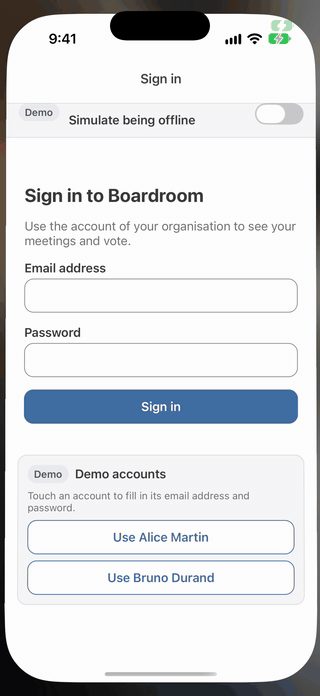
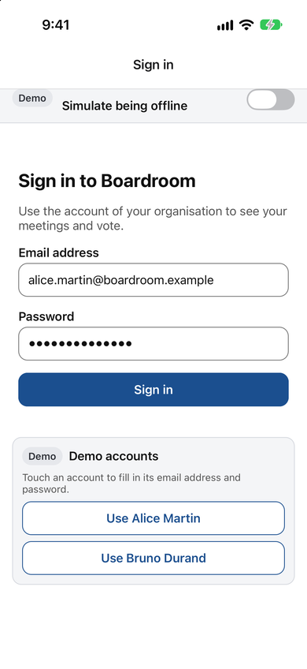
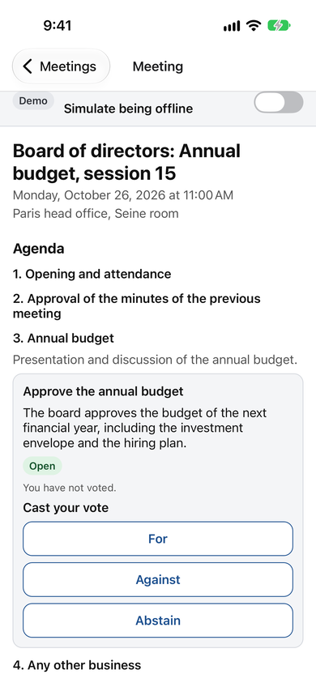
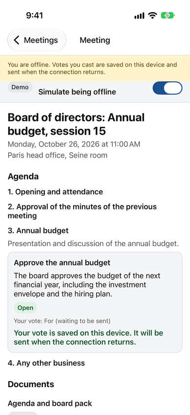
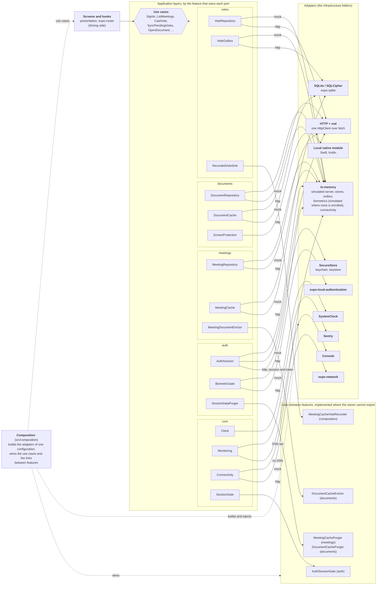

# Boardroom

[](https://github.com/Rileyjrjohns/boardroom/actions/workflows/ci.yml)

Boardroom is a React Native app for board-of-directors governance: members read the papers of their meetings, vote on resolutions, and keep working when the network does not.
It is built to show how a mobile codebase is structured, secured, tested and shipped like a product: features organised in hexagonal layers whose dependency rules are lint errors, an offline vote that is queued in a durable outbox and can neither be lost nor counted twice, and a security model with its limits written down.
The server is simulated and the data is fictional (a generic board, invented people); the business rules, the encrypted persistence of the `http` configuration, the security and the tooling are real.



| Sign-in                                                                  | Meeting                                                              | Offline vote                                                             | Protected document                                                                                      |
| ------------------------------------------------------------------------ | -------------------------------------------------------------------- | ------------------------------------------------------------------------ | ------------------------------------------------------------------------------------------------------- |
|  |  |  |  |

## Ports and adapters

The code is organised by feature (`src/features/auth`, `meetings`, `documents`, `votes`, over a shared `src/core`), and inside each of them by layer. The use cases are the centre of each feature and know only ports, which are interfaces owned by the application layer of their feature (or of the shared kernel). An arrow from a port to an adapter reads "is implemented by", and each port has one per configuration (`mock` or `http`); `src/composition` is the one place that chooses them, and the only one that knows every feature.



The `mock` configuration is the app against the in-memory adapters; the `http` configuration is the app against the real ones. `ScreenProtection` is a concern of the device, so both configurations use the local native module when the build has it. The features depend on each other along one graph and never in a cycle: `auth` on nothing, `meetings` on `auth`, `documents` and `votes` on both, everything on `core`, and a feature never imports another's infrastructure nor the composition. Where a feature needs something of one it may not import, it declares a port (the bottom-right of the diagram), another feature implements it and the composition wires them. The detail is in [Architecture](docs/architecture.md), the decision in [ADR 0015](docs/adr/0015-feature-first-hexagonal-architecture-with-links-inverted-through-the-composition.md), and every port is specified in [docs/spec/ports.md](docs/spec/ports.md).

## Run it in 2 minutes

Prerequisites: Node.js 24 (`.nvmrc`), npm 11, and Xcode (iOS) or Android Studio with an emulator (Android).

```sh
npm install
npm run ios        # or: npm run android
```

That is the whole of mock mode: no backend to start, no account to create, no network needed. In a development build the app runs on the **in-memory adapters** (a simulated server in the memory of the app), and the sign-in screen offers two demo accounts. **MSW is not part of the app**: it is a development dependency, used only by the tests of the HTTP adapters.

A development client is needed once: the app contains native code that Expo Go does not have (SQLite built with SQLCipher, a PDF viewer, the local ScreenProtection module), so the first `npm run ios` or `npm run android` generates the native project and builds it, which takes minutes. After that, `npm start` (`expo start --dev-client`) only starts Metro and the client connects to it. Keep the path of the project free of spaces. Everything else (the `http` configuration against `npm run mock:api`, the environment variables, the demo accounts, the npm scripts) is in [Quick start](docs/quick-start.md).

## Tech choices

| Area         | Choice                                                                    | Why                                                                                                                                                                                    |
| ------------ | ------------------------------------------------------------------------- | -------------------------------------------------------------------------------------------------------------------------------------------------------------------------------------- |
| Architecture | Feature-first hexagonal, boundaries checked by `eslint-plugin-boundaries` | The dependency rule fails the build instead of living in a diagram ([ADR 0015](docs/adr/0015-feature-first-hexagonal-architecture-with-links-inverted-through-the-composition.md))     |
| Runtime      | Expo SDK 57, React Native 0.86, development client                        | Native configuration is code (`app.config.ts`, config plugins) and `ios/` and `android/` are generated ([ADR 0002](docs/adr/0002-expo-continuous-native-generation-and-dev-client.md)) |
| Errors       | A `Result` type, no exception across layers                               | Every failure is a value the caller must handle ([ADR 0008](docs/adr/0008-result-type-instead-of-exceptions.md))                                                                       |
| State        | TanStack Query for server state, Zustand for the little interface state   | A cache and its retries are not hand-written, and server data is never copied into a store ([ADR 0004](docs/adr/0004-tanstack-query-and-zustand-rather-than-redux.md))                 |
| Navigation   | expo-router, typed routes, protected screens                              | A locked or signed-out app has no route to a meeting, so no deep link reaches one ([ADR 0003](docs/adr/0003-expo-router-with-typed-routes.md))                                         |
| Offline      | SQLite with SQLCipher, a vote outbox, the offline policy in use cases     | A write never needs the network at the moment of the action, and the policy is testable without a device ([ADR 0005](docs/adr/0005-offline-first-with-a-sqlite-outbox.md))             |
| HTTP         | The global `fetch` behind one client, zod at the adapter only             | Wire data is validated where it enters, and the inner layers import no package ([ADR 0010](docs/adr/0010-zod-at-the-adapter-boundary-only.md))                                         |
| Wiring       | Manual injection in one composition root                                  | The whole graph is readable in a few files and the compiler checks it ([ADR 0009](docs/adr/0009-manual-dependency-injection-in-one-composition-root.md))                               |
| Native code  | A local module on the Expo Modules API                                    | Screen protection without hand-patched native projects ([ADR 0006](docs/adr/0006-expo-modules-api-for-screen-protection.md))                                                           |
| i18n         | i18next, English and French, typed keys                                   | Every text is translated from the first screen and a literal in the UI is a lint error ([ADR 0011](docs/adr/0011-i18n-from-the-first-screen-with-typed-keys.md))                       |
| Delivery     | EAS with GitHub Actions, Sentry, Fastlane as the alternative              | Builds and updates without a Mac to maintain ([ADR 0007](docs/adr/0007-eas-as-the-default-delivery-pipeline.md))                                                                       |

## Testing strategy

| Level                           | Runs on                         | What it proves                                                                                              |
| ------------------------------- | ------------------------------- | ----------------------------------------------------------------------------------------------------------- |
| Domain and application (`core`) | Node, no React Native           | The business rules and the use cases, against fakes that pass the same contract suites as the real adapters |
| Adapters and wiring (`infra`)   | Node, MSW, `node:sqlite`        | HTTP, SQLite, file and native-wrapper adapters, and the container end to end in both configurations         |
| Screens and navigation (`ui`)   | `jest-expo`, Testing Library    | Screens, hooks, the real navigator on the real route files, the whole app on the real composition root      |
| Repository checks (`tooling`)   | Node                            | The lint rules, the configuration, the shared spec against the code, the links of the documents             |
| End to end                      | Android emulator, iOS simulator | Six [Maestro](https://maestro.dev) flows on the built app, through its accessibility tree                   |

`npm run validate` (lint, typecheck, format check, tests with coverage) is the gate. Coverage is measured on all of `src/` and has two gates: **90 percent** on each `domain` and `application` folder (of `src/core` and of every feature), each on its own, and **70 percent** globally for the rest. The CI shows the figures of every layer in the summary of the run. Two Maestro flows are the reference scenarios and always run first: `biometric-login-list-document` (biometric login, the list, a confidential document) and `offline-vote-resync` (an offline vote, the network back, the outbox synchronised). More in [Testing strategy](docs/testing.md), and what was run on a device, and what was not, in [What is not verified](docs/not-verified.md).

## Migration strategy

For a live native app the default is brownfield, not a rewrite: React Native screens are added flow by flow behind a remote flag, with one owner per flow, a shared session and a bridge for analytics, so each release is small, measurable and reversible. The ports of this repository are the contracts that outlive an implementation: the first adapters can wrap what the native app already has, then be replaced when the shell moves. It is a strategy and not a verified integration. The full document, with the risks and a step-by-step plan, is [docs/migration.md](docs/migration.md).

## Read on

- [Architecture decision records](docs/adr/README.md): fifteen short pages, from the hexagonal architecture to why the no-backend demo runs on in-memory adapters ([ADR 0014](docs/adr/0014-in-memory-adapters-for-the-no-backend-demo.md)).
- [The shared specification](docs/spec/README.md): the domain, the use cases, the ports, the screens and the demo data, independent of any framework, and checked against the code by a test.
- [Security](docs/security.md), [the native module](docs/native-module.md), [CI/CD](docs/ci-cd.md), [design in depth](docs/design-in-depth.md), [conventions](docs/conventions.md), [the HTTP API](docs/api.md): the full index is [docs/README.md](docs/README.md).

Same domain, another framework — in progress: [boardroom-flutter](https://github.com/Rileyjrjohns/boardroom-flutter).
