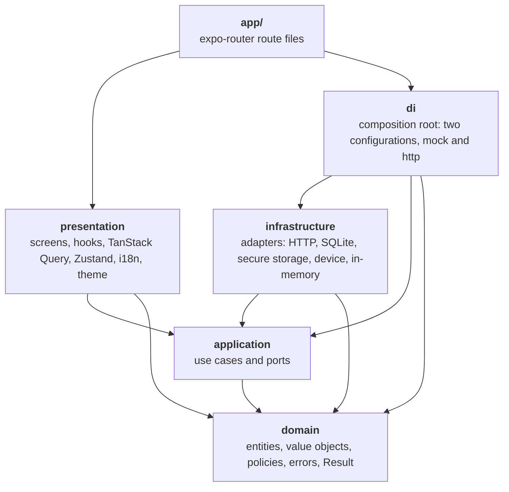
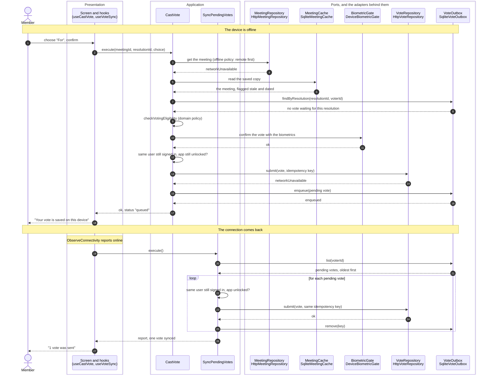

# Architecture

The code is organised in layers, and dependencies only point inwards, toward the domain. The rule is not a convention: it is checked by the linter on every commit (see [How the toolchain enforces it](#how-the-toolchain-enforces-it) and [ADR 0001](adr/0001-hexagonal-architecture-with-enforced-boundaries.md)). The ports and the adapters that implement them are drawn in the [README](../README.md#ports-and-adapters), and every port is specified in [the shared spec](spec/ports.md).

## Layers and the dependency rule



An arrow is an allowed import. `domain` imports nothing. `application` declares the ports (the interfaces to the outside world: repositories, caches, the outbox, the biometric gate, the clock, the screen protection) and `infrastructure` implements them, which is why the arrow points from the adapters to the ports and never the other way: a use case does not know that an adapter exists. `presentation` never imports `infrastructure` or `di`: it declares the shape of the services it needs and receives them from the root layout. `di` is the one place where ports meet adapters.

| Folder                | Role                                                                                           | May import                                                                                           |
| --------------------- | ---------------------------------------------------------------------------------------------- | ---------------------------------------------------------------------------------------------------- |
| `app/`                | expo-router route files. Thin: they mount screens. The root layout builds the composition root | `presentation`, `di`, `assets/`, external modules (not TanStack Query nor Zustand)                   |
| `src/domain/`         | Entities, value objects, business rules, business errors                                       | `domain`. No external module at all                                                                  |
| `src/application/`    | Use cases and ports (interfaces)                                                               | `domain`, `application`. No external module at all                                                   |
| `src/infrastructure/` | Adapters implementing the ports: in-memory, HTTP, SQLite, secure storage, device               | `domain`, `application`, `infrastructure`, external modules (not TanStack Query nor Zustand)         |
| `src/presentation/`   | Screens, components, hooks, stores, i18n, theme tokens                                         | `domain`, `application`, `presentation`, `assets/`, external modules. Never `infrastructure` or `di` |
| `src/di/`             | The single composition root that wires ports to adapters with manual typed injection           | `domain`, `application`, `infrastructure`, `di`. No external module at all. Never `presentation`     |

Three extra rules: the `zod` package and the native modules of the device (`expo-sqlite`, `expo-secure-store`, `expo-crypto`, `expo-file-system`, `expo-local-authentication`, `expo-network`) may only be imported from `src/infrastructure` (`expo-file-system` from one file of it, `src/infrastructure/files/ExpoFileVolume.ts`, and `react-native-pdf` from one component of the presentation, `src/presentation/components/PdfViewer.tsx`), `@tanstack/react-query` and `zustand` (server state and interface state) may only be imported from `src/presentation`, the Sentry SDK (`@sentry/*`) from one file, the adapter of the `Monitoring` port (`src/infrastructure/monitoring/SentryMonitoring.ts`), and `fetch` is called by one module, the HTTP client (`src/infrastructure/http/HttpClient.ts`). The local native module `modules/screen-protection` is imported by `src/infrastructure/native` alone, with one exception, its secure view (see [The secure view](native-module.md#the-secure-view)).

Everything else in the repository (`package.json`, the configs, `tooling/`, scripts) is tooling. Code under `app/` and `src/` cannot import it.

Path aliases map to the matching `src` folder: `@domain/*`, `@application/*`, `@infrastructure/*`, `@presentation/*` and `@di/*`. They resolve in TypeScript, Metro, Jest and ESLint.

## One use case, end to end: casting a vote offline, then synced

The diagram follows one vote through the layers in the `http` configuration. A participant is a port (an interface of the application layer) with the adapter that implements it under its name. In the `mock` configuration the adapters are the `InMemory*` ones and nothing above the ports changes.



What to read in it:

- **The screen knows use cases, not adapters.** `useCastVote` is a TanStack mutation that awaits `CastVote` and unwraps its `Result`. The business answer (`queued` or `submitted`) is a value, and the screen translates it into a message.
- **The policy is in the application layer.** The fallback to the saved copy only when the network is unavailable, the eligibility check (a pure function of the domain), the second check that the same user is still there after the biometric prompt, the queueing: all of it is in `CastVote` and `loadWithCacheFallback`, testable with fakes and no device.
- **A queued vote is safe to send more than once.** The idempotency key is built from the resolution and the voter, and the server records the vote once. A business rejection on the replay (the resolution closed in between) moves the vote to `rejected` with its reason, kept until the user has seen it. After five unexpected failures the vote is given up and shown.
- **The application does not watch the network.** The presentation hears the connection come back (and the app return to the foreground, and a sign-in or an unlock) and asks for a run of `SyncPendingVotes`. That is the one place that decides when to sync (`useVoteSync`).
- **Online, the short path is the same code.** The submission succeeds at once, the vote is recorded on the cached meeting too, and the outbox is not touched.
- **See [ADR 0005](adr/0005-offline-first-with-a-sqlite-outbox.md)** for why the outbox and the offline policy are built this way, and [Domain and application](design-in-depth.md#domain-and-application) for the whole policy.

## How the toolchain enforces it

- **ESLint, with `eslint-plugin-boundaries`** (`eslint.config.mjs`): every file under `app/` and `src/` belongs to a layer, and a layer may only import the layers it is allowed to. Imports of external packages are checked too: `domain`, `application` and `di` import none; `zod` and the native modules of the device only `infrastructure`; TanStack Query and Zustand only `presentation`; the local native module only `src/infrastructure/native` (and its secure view, one presentation component); the Sentry SDK only its adapter; `fetch` only the HTTP client. Production code cannot import a `testing` folder.
- **Purity of the inner layers.** In `domain` and `application`, `throw` is forbidden (every failure is an error `Result`), so is every read of the system clock (time comes from the `Clock` port), and so are the ambient globals that reach the runtime (`process`, `window`, `fetch`, timers, `console`).
- **TypeScript at its strictest.** `strict`, `noUncheckedIndexedAccess`, `exactOptionalPropertyTypes`, and `checkJs` for the JS configs. Translation keys, the maps from error codes to texts, and (once the dev server has run) the routes are typed.
- **No magic strings.** Lint rejects text, colours and test ids written inline in the UI code; they are translations, theme tokens and constants (see [No magic strings](conventions.md#no-magic-strings)).
- **Tests of the rules themselves.** The Jest project `tooling` lints snippets with the real configuration, so a rule that stops working fails a test, and checks the repository's own invariants: aliases, environment reads, routes, the app config, the commit hook. The Jest project `core` runs `domain` and `application` in plain Node, with no React Native or Expo setup, behind a 90 percent coverage gate.
- **Git hooks and scripts.** The pre-commit hook runs lint-staged (ESLint and Prettier on the staged files) and the typecheck, the commit-msg hook enforces Conventional Commits, and `npm run validate` runs lint, typecheck, format check and the tests with coverage, and `npm run lint:architecture` runs the boundary rules alone. How the pipeline runs them is in [CI/CD](ci-cd.md#cicd).

The complete list of rules is in [How the rule is enforced](#how-the-rule-is-enforced), and what a lint rule cannot catch is stated there and under [No magic strings](conventions.md#no-magic-strings).

## How the rule is enforced

- `eslint.config.mjs` classifies the files under `app/`, `src/` and `assets/` into the elements above with eslint-plugin-boundaries, and declares which element may depend on which.
- The plugin sees every file of the repository, dot files and dot folders included. A file under `app/` or `src/` that does not belong to any layer is an error (`boundaries/no-unknown-files`), and so is an import of any file that is not an app, layer or asset file, such as a script, a config, `package.json` or a test helper (`boundaries/no-unknown-dependencies`). Only `app/` and `presentation` may import `assets/`.
- Imports of external modules and Node.js core modules are checked too, which is what keeps `domain` and `application` free of any framework.
- A layer alias that does not resolve to a file is rejected instead of being mistaken for an external package. Aliases are resolved from an absolute tsconfig path, so ESLint gives the same result from any working directory.
- Type-only imports are checked like any other import, and so are `import('x')` types, `typeof import('x')`, `import x = require('x')`, `jest.mock` and the other Jest module calls, and `require.resolve`.
- `import()`, `require()`, the Jest module calls and `require.resolve` only accept a string literal under `app/` and `src/`, because a specifier built at runtime cannot be checked (`no-restricted-syntax`). `/// <reference path="..." />` is rejected as well.
- Packages are imported by name, never through a path in `node_modules` (`no-restricted-imports`), and every imported package must be declared in `package.json`, development dependencies being reserved to tests, test support (the `testing` folders, which hold the render helper of the screens) and tooling (`import/no-extraneous-dependencies`). `zod` is a dependency, and only `src/infrastructure` may import it.
- `src/domain` and `src/application` cannot use the ambient globals that reach the runtime environment: `process`, `window`, `document`, `fetch`, `localStorage`, timers, `console` and similar (`no-restricted-globals`). Their tests are exempt.
- In the production code of `src/domain` and `src/application`, `throw` is forbidden (every failure is an error `Result`) and so is every read of the system clock: `Date.now()`, `new Date()` without an argument, `Date()` called as a function, and `performance.now()` (time comes from the `Clock` port). `new Date(millis)` stays allowed, it is a conversion (`no-restricted-syntax`). Tests and the `testing` folders are exempt.
- Production code cannot import from a `testing` folder, whether through a relative path or an alias, a type import or a re-export (`no-restricted-imports`). Tests and other test support can. A dynamic `import()` or a `require` of a `testing` folder is not detected by this rule.
- `no-restricted-syntax` and `no-restricted-imports` apply to a set of files as a whole: in a flat config a later block replaces the options of an earlier one instead of merging them. `eslint.config.mjs` builds the options of each block with `restrictSyntax` and `restrictImports`, which always carry the restrictions that apply to every file (the computed module specifiers), and `tooling/lint-rules.test.ts` checks that none is lost for any set of files.
- `@tanstack/**` and `zustand` (and their subpaths) are rejected outside `src/presentation`, by a dependency policy with its own message (`tooling/lint-rules.test.ts` checks it for every layer and for the route files).
- `expo-sqlite`, `expo-secure-store`, `expo-crypto`, `expo-local-authentication` and `expo-network` (and their subpaths) are rejected outside `src/infrastructure`, by a dependency policy of the same kind: the other layers reach the device through a port. `expo-file-system` is further limited to one file, `src/infrastructure/files/ExpoFileVolume.ts`, and `react-native-pdf` to one component, `src/presentation/components/PdfViewer.tsx`, by a `no-restricted-imports` pattern each (`tooling/lint-rules.test.ts` checks both, and that each exempt file keeps the other restrictions).
- The local native module `modules/screen-protection` is rejected everywhere but `src/infrastructure/native`: a dependency policy refuses it to every other layer, and a restricted-imports pattern keeps the rest of the infrastructure, tests and test support included, out of it. The one exception is `src/presentation/components/SecureContent.tsx`, which may import the secure view from the entry point and nothing else of the module (`tooling/lint-rules.test.ts` checks both sides).
- `fetch` is called by one module, `src/infrastructure/http/HttpClient.ts`: the bare global is rejected everywhere else in `app/` and `src/` (tests and test support excepted), and the forms that get round the rule (`globalThis.fetch`, `global.fetch`, `window.fetch`, `self.fetch`) are rejected everywhere, the client included.
- The Sentry SDK (`@sentry/**`) is imported by one file, `src/infrastructure/monitoring/SentryMonitoring.ts`, the adapter of the `Monitoring` port: a dependency policy refuses it to the other layers, and a restricted-imports pattern keeps the rest of the infrastructure, tests and test support included, out of it.
- `.mts` and `.cts` files are linted with the TypeScript parser like `.ts` files.

Known limit: an aliased `require` (`const r = require; r('x')`) cannot be detected by a lint rule.

## Composition root

`src/di` is the one place where ports meet adapters, by manual, typed constructor injection: no container library, no lookup by name, no module-level instance. It imports no external module: the device adapters are built in `src/infrastructure` (`createExpoPlatform`), and `di` only calls them.

| File                              | Role                                                                                                                                                                                                                                                                         |
| --------------------------------- | ---------------------------------------------------------------------------------------------------------------------------------------------------------------------------------------------------------------------------------------------------------------------------- |
| `config.ts`                       | The configuration values, each with a one-line reason: the maximum age of a cache entry, the number of delivery attempts, the app lock grace period, the page size, the simulated latency and session lifetime, the request timeout, the passcode fallback of the biometrics |
| `adapters.ts`, `configuration.ts` | The two configurations as a discriminated union (`mock`, `http`), and the parsing and validation of every setting, in one place (`parseConfiguration`)                                                                                                                       |
| `errors.ts`                       | Why a container cannot be built: one code for each invalid setting, for the storage, for a native module that fails, for the seed                                                                                                                                            |
| `Ports.ts`                        | An adapter for every port, and the configuration values the use cases take                                                                                                                                                                                                   |
| `mockPorts.ts`                    | The adapters of the mock configuration, wired to each other                                                                                                                                                                                                                  |
| `httpPorts.ts`                    | The adapters of the http configuration, wired to each other: the client, the session storage, the encrypted database, the biometrics, the connectivity                                                                                                                       |
| `createMonitoring.ts`             | The monitoring of the container: `SentryMonitoring` when the build has an address, `ConsoleMonitoring` otherwise, and the console again when the address is bad or the SDK does not start                                                                                    |
| `wireUseCases.ts`                 | Builds the use cases from the ports. The same for every configuration                                                                                                                                                                                                        |
| `ContainerRuntime.ts`             | What the container reads from outside: the clock, the monitoring, the Sentry SDK (a stand-in in the tests), the sleep, the device, and the text of the biometric prompt                                                                                                      |
| `createContainer.ts`              | `createContainer(config, runtime)` and `startContainer(settings, environment, runtime)`: the container, or an error                                                                                                                                                          |

**Starting is asynchronous, and can fail.** `createContainer` returns `Promise<Result<Container, ContainerError>>`: the http configuration opens its database, which reads the key from the keychain, opens a file and migrates the schema, and none of it may throw or be skipped. The mock configuration is built the same way, with nothing to wait for. A failure is an error to show (`storageUnavailable` with its reason, among others), never an exception and never the other configuration. `createContainer` never rejects: a native module of the device that fails to load or to start, or anything else the construction throws, is `platformUnavailable`, an error with a code of its own whatever was thrown (what it said is not kept). The root layout stays thin: it hands `startContainer` to `StartupGate` (presentation), which shows a translated loading state, then the screens inside `AppProviders`, or `StartupFailureScreen` with the technical code.

The container holds the use cases, the settings the screens need (`meetingsPageSize`), the clock the use cases read (`clock`: the one instant the presentation records itself, the moment the app goes to the background, is read from it so that `EvaluateAppLock` compares two instants of the same clock) the notices the user is owed at the start (`notices`: for now, that local data was reset, see [Persistence](design-in-depth.md#persistence)) and, in the mock configuration only, the demo controls (`demoControls`: the simulated network, off and on, and the accounts of the simulation). The presentation declares the shape it needs (`AppServices`): the use cases it calls, the settings, the clock, and optional `demoControls`. Stateful objects are single shared instances, built once per container: `ScreenProtectionCoordinator` (shared by `OpenDocument` and `CloseDocument`), `CastVote` and `SyncPendingVotes` (their guards live in the instance). `ContainerRuntime` replaces the clock, the monitoring and the sleep for a test, and hands the container the device (`platform`: the engine of the database, the secure storage, the secure random generator, the biometrics, the state of the network and, when the build has it, the native module that protects the screen; the real one is `createExpoPlatform`, whose wrappers import their native modules like any other import: they are loaded with the app, and in Jest the "infra" project gives each of the six Expo modules it wraps and the local ScreenProtection module an empty module (`NATIVE_MODULES` in `jest.config.js`), so that the platform factory and the composition root are imported as the app imports them and nothing native is loaded; the tests of the wrappers keep a stand-in of their own, each with its reason) and the text of the biometric prompt (required: only the layout can read the translations).

The two configurations differ as follows.

| Port              | `mock`                                                                                                | `http`                                                                                                    |
| ----------------- | ----------------------------------------------------------------------------------------------------- | --------------------------------------------------------------------------------------------------------- |
| Remote            | `InMemory*Repository` over the simulated server                                                       | `Http*Repository` and `HttpAuthSession` over `HttpClient`                                                 |
| Session           | In memory, in the simulated accounts                                                                  | `SessionVault` in the secure storage                                                                      |
| Meeting cache     | In memory                                                                                             | SQLite, encrypted                                                                                         |
| Vote outbox       | In memory                                                                                             | SQLite, encrypted                                                                                         |
| Document cache    | In memory, and files for the content                                                                  | SQLite (encrypted) for the metadata, and files for the content                                            |
| Biometrics        | `InMemoryBiometricGate`: always available, always recognises the user                                 | `DeviceBiometricGate` over `expo-local-authentication`                                                    |
| Connectivity      | `SimulatedConnectivity` over the simulated network                                                    | `ExpoConnectivity` over `expo-network`                                                                    |
| Screen protection | `NativeScreenProtection` over the local module, or `InMemoryScreenProtection` when the build has none | `NativeScreenProtection` over the local module (a build without it answers `screenProtectionUnsupported`) |

The mock configuration carries what varies between demos, each with its default in `config.ts`: whether the demo user is signed in at start (in which case the app starts unlocked, as after a sign-in; otherwise it starts locked, as after a cold start; the default is **signed out**, and only a test asks for the other), the latency of the server and the lifetime of its sessions. The http configuration carries the address of the API, the request timeout and the passcode fallback. **Every setting is validated in one place, `parseConfiguration`, and an invalid one is a start error with a code of its own:** `missingApiBaseUrl`, `invalidApiBaseUrl` (not an `http` or `https` URL of a host, or one with credentials, a query or a fragment), `insecureApiBaseUrl` (`http` outside a development build for a host that is not this machine), `invalidRequestTimeout` (not a whole number of milliseconds from 1 to 60 seconds) and `invalidBiometricFallback` (not a yes or a no). The wiring of the ports reads them from the configuration and imports none of them. The one setting that is not validated there is the address of the crash reporter: `createMonitoring` checks it and falls back on the console, since monitoring must not decide whether the app starts.

**Where the environment is read.** The settings are `EXPO_PUBLIC_BOARDROOM_ADAPTERS`, `EXPO_PUBLIC_BOARDROOM_API_BASE_URL` and `EXPO_PUBLIC_SENTRY_DSN` (the address of the crash reporter, optional), and they are read once each, in `app/_layout.tsx`, and nowhere else: Metro replaces the exact expression `process.env.EXPO_PUBLIC_...` with its value when it bundles, `domain`, `application` and `di` take no external input (`di` imports no external module), and the layout is the entry point that starts the container. The raw values go to `startContainer` together with whether this is a development build (the layout reads `__DEV__`; `di` reads no global), which parses and validates them: a missing or empty adapters value means `mock` in a development build and is the error `missingAdaptersSetting` in any other, so that a release build never starts on the simulated server because a variable was forgotten; anything unknown is `invalidAdaptersSetting`. When the container cannot be built, the layout shows `StartupFailureScreen` with the technical code, instead of the app. `tooling/environment.test.ts` fails if a second place reads the environment, or if a variable is missing from `.env.example`.

## Tech stack

| Area          | Choice                                                                                                                                                                                                                                                        |
| ------------- | ------------------------------------------------------------------------------------------------------------------------------------------------------------------------------------------------------------------------------------------------------------- |
| Runtime       | Expo SDK 57, React Native 0.86, React 19 (New Architecture, always on from SDK 55)                                                                                                                                                                            |
| Server state  | TanStack Query 5: the query cache, pagination, pull to refresh, retries (see [Server state and UI state](design-in-depth.md#server-state-and-ui-state))                                                                                                       |
| UI state      | Zustand 5: the few pieces of interface state that must survive navigation                                                                                                                                                                                     |
| Navigation    | expo-router (file-based, typed routes, protected screens), custom scheme `boardroom`                                                                                                                                                                          |
| Native builds | expo-dev-client with Continuous Native Generation (`ios/` and `android/` are git-ignored), a local config plugin for the iOS scene life cycle, a local Expo module (`modules/`)                                                                               |
| i18n          | i18next, react-i18next, expo-localization: English and French, English as the fallback, typed keys (see [Internationalisation](conventions.md#internationalisation))                                                                                          |
| Language      | TypeScript, strict, plus `noUncheckedIndexedAccess` and `exactOptionalPropertyTypes`; the JS config files are type-checked too (`checkJs`)                                                                                                                    |
| Lint          | ESLint 9 flat config, eslint-config-expo, eslint-plugin-boundaries, eslint-config-prettier, no-magic-string rules for the UI code                                                                                                                             |
| Formatting    | Prettier                                                                                                                                                                                                                                                      |
| Persistence   | expo-sqlite built with SQLCipher (the caches of meetings and of documents, and the outbox of votes), expo-secure-store (the session and the key of the database), expo-crypto (the random bytes of that key), expo-file-system (the content of the documents) |
| Documents     | react-native-pdf draws a PDF from a file of the device (its peer, react-native-blob-util, is installed with it); a tiny PDF writer gives the demo documents their content                                                                                     |
| HTTP          | The global `fetch` behind one small client, zod for the schemas of the answers, a documented API ([`api.md`](api.md))                                                                                                                                         |
| Device        | expo-local-authentication (biometrics), expo-network (connectivity), the local module ScreenProtection (screen protection)                                                                                                                                    |
| Unit tests    | Jest 29 with four projects (`core`, `infra`, `ui`, `tooling`), jest-expo and React Native Testing Library for the screens, MSW and `node:sqlite` for the adapters                                                                                             |
| End-to-end    | Maestro flows (see [Testing strategy](testing.md#testing-strategy))                                                                                                                                                                                           |
| Delivery      | EAS Build, Submit and Update (`expo-updates`) driven by GitHub Actions, Sentry for crash reports, Fastlane as the alternative: see [CI/CD](ci-cd.md#cicd)                                                                                                     |
| Git hooks     | Husky, lint-staged, a Conventional Commits check written in plain shell                                                                                                                                                                                       |

## Folder layout

```text
app/                      expo-router routes (_layout.tsx, index.tsx, meetings/[meetingId].tsx, documents/[documentId].tsx, pending-votes.tsx, sign-in.tsx, lock.tsx) and +native-intent.tsx, which is not a route
docs/                     the documentation (README.md is its index) and api.md, the contract between the HTTP adapters and the server
  adr/                    the architecture decision records and their index
  spec/                   the shared specification (domain, ports, use cases, screens) and the fixtures of the demo data
locales/                  fr.json: the Info.plist strings of the iOS project in French (Face ID text)
src/
  domain/                 entities, value-objects, policies, errors, shared (Result, Brand)
    testing/                builders of fixtures for the tests (test support)
  application/            ports, use-cases (by feature), shared (offline policy, session)
    testing/                fakes of the ports, and the contract suites in contracts/ (test support)
  infrastructure/
    in-memory/            the simulated server, the in-memory caches, outbox, auth, biometrics, screen protection, the seed (fixtures/ loads the files of docs/spec/fixtures and shifts their dates to the clock)
    http/                 the client, the schemas and mappers (dto/), the repositories, the session adapter, the constants of the API
    mock-api/             the routes of the API over the simulated server (MockApi): shared by the HTTP tests and by npm run mock:api
    files/                the FileStore seam over a volume of files, and the volume of a device (expo-file-system)
    documents/            the name of the file of a download and how a download is kept, shared by both document repositories
    pdf/                  the tiny PDF writer of the demo content, and the check of the signature of a file
    persistence/          the SQL seam, the migrations, the SQLite caches (and the format of their rows) and outbox, the unlocking of the encrypted database, its key and generations, and the record of a reset
    secure-storage/       the key-value seam over the keychain, and the vault of the session
    biometrics/           the biometric gate over the device
    connectivity/         the connectivity over the device, and over the simulated network
    device/               the real device (expo-sqlite, expo-secure-store, expo-crypto, expo-local-authentication, expo-network, the local module ScreenProtection)
    native/               the adapter of the ScreenProtection port over the local native module, and the one place that imports the module
    clock/                SystemClock, the sleep behind the simulated latency
    monitoring/           ConsoleMonitoring, and SentryMonitoring (the one file that imports the Sentry SDK)
    shared/               copies, results, the bounded-time wrapper, the queue that runs jobs in order, the listeners of an adapter, the paths of a flawed payload, the schemas of a rejected vote
    testing/              the Node SQLite engine, MSW and the HTTP world, doubles of the device (test support)
  presentation/           screens, components, hooks
    i18n/                 translations, language detection, provider, maps from codes to translation keys
    theme/                design tokens (colours, spacing, font sizes, touch target)
    query/                query client and its session handling, query keys, the Result to query convention, retry policy, error codes
    services/             the use cases and settings the screens need (context), the providers of the app, the gate that starts it
    session/              the controller of the session and of the life of the app: restoring it, the lock and the check of the session on the way back and on a timer, the privacy cover, the connection, the synchronisation of the votes
    state/                the interface store (Zustand)
    format/               dates, times and numbers for the locale of the user, and the provider that shares them
    accessibility/        what the screen reader is told (announcements)
    platform/             the platform checks, spelled once
    navigation/           routes, the navigator (protected screens), opening a meeting, a document or the pending votes, the error boundary
    testing/              render helpers (a screen, a hook, the whole navigator), the AppState driver, query client tracker and fixtures for the screens (test support)
  di/                     composition root: configuration, ports, wiring, the choice of the monitoring, container
assets/                   app icons (Expo template placeholders)
modules/screen-protection/ the local Expo module ScreenProtection: Swift, Kotlin and its TypeScript entry (see "Native module: ScreenProtection")
plugins/                  the local config plugin that puts the iOS project on the scene life cycle (to delete with SDK 58)
tooling/                  tests of the repository configuration (including the lint rules, the shared spec against the code and the links of the documents), types for the JS configs, mock-api/ (the mock API as a program), app-routes/ (the route files the scenario tests mount, each a re-export of one of app/), generate-fixtures/ (the script that made docs/spec/fixtures)
.env.example              the settings the app reads from the environment
app.config.ts             typed Expo config
eslint.config.mjs         ESLint flat config with the architecture rules
jest.config.js            Jest projects and coverage gate
eas.json                  the EAS build and submit profiles (see "CI/CD")
.github/                  the pipeline and the dependency updates (see "CI/CD")
.maestro/                 end-to-end flows (see "Testing strategy")
fastlane/                 the Fastlane alternative (see "CI/CD")
```

## Features

Each feature crosses the layers. The table says what the user gets and where to read it; the deep dives are under [Design in depth](design-in-depth.md#design-in-depth).

| Feature                | What the user gets                                                                                                                                                                                                      | Where it lives                                                                                                                                                                                                                  |
| ---------------------- | ----------------------------------------------------------------------------------------------------------------------------------------------------------------------------------------------------------------------- | ------------------------------------------------------------------------------------------------------------------------------------------------------------------------------------------------------------------------------- |
| Sign-in and session    | Sign in with an email and a password; the session is kept on the device, expires, and is ended by the server refusing it                                                                                                | `SignIn`, `SignOut`, `RestoreSession`, `requireSession`; `HttpAuthSession`, `SessionVault`; `SignInScreen`, `SessionController`                                                                                                 |
| Biometric lock         | A cold start is locked; the app locks again after 30 seconds in the background; strong biometrics only on Android, no passcode fallback                                                                                 | `AppLock`, `UnlockApp`, `EvaluateAppLock`, `appLock` policy; `DeviceBiometricGate`; `LockScreen`, `useAppLifecycle`, `PrivacyCover`                                                                                             |
| Meetings               | Upcoming and past meetings with cursor pagination and pull to refresh; a detail with the agenda, the documents and the participants                                                                                     | `ListMeetings`, `GetMeeting`, `Meeting` entity; `HttpMeetingRepository`; `MeetingsListScreen`, `MeetingDetailScreen`, `useMeetingsList`                                                                                         |
| Voting                 | A vote on an open resolution, final, confirmed by the biometrics; the reason when the user may not vote                                                                                                                 | `CastVote`, `checkVotingEligibility`, `getVotingState`; `HttpVoteRepository`; `ResolutionVoting`, `VoteDialog`, `useCastVote`                                                                                                   |
| Offline reading        | A meeting or a document already seen opens without a connection, dated "Showing saved data from ..."                                                                                                                    | `loadWithCacheFallback` (the offline policy); `MeetingCache`, `DocumentCache`; `SqliteMeetingCache`, `SqliteDocumentCache`; `StatusBanner`                                                                                      |
| Offline voting         | A vote cast offline is saved on the device, sent when the connection returns, and never lost or counted twice; a rejected vote is explained                                                                             | `VoteOutbox`, `SyncPendingVotes`, the idempotency key; `SqliteVoteOutbox`; `PendingVotesScreen`, `useVoteSync`                                                                                                                  |
| Confidential documents | A PDF with the name, the email and the time of the reader drawn over every document; confidential ones (and copies served from the cache) on a protected screen where the platform allows; a notice on a screen capture | `OpenDocument`, `CloseDocument`, `ObserveScreenCapture`, `ScreenProtectionCoordinator`, `Watermark`; `NativeScreenProtection`, `modules/screen-protection`; `DocumentScreen`, `SecureContent`, `PdfViewer`, `DocumentWatermark` |
| Encrypted local data   | The caches and the outbox are encrypted at rest; the key is in the keychain or keystore; a lost key resets the data and tells the user                                                                                  | `src/infrastructure/persistence` (`protectedDatabase`, `databaseKey`, `migrations`), `ExpoSecureStorage`; `StatusBanner`                                                                                                        |
| French and English     | Every text in both languages, following the device and the per-app language setting; dates and counts formatted for the locale                                                                                          | `src/presentation/i18n`, `locales/fr.json`, the `expo-localization` plugin                                                                                                                                                      |
| Accessibility          | Roles and states on the controls, announcements for what appears on its own, contrast checked by a test, 44 point targets                                                                                               | `LiveText`, `useAnnounce`, `SegmentedControl`, `theme/tokens.ts`                                                                                                                                                                |
| Failure handling       | Every failure has a message and, when asking again can help, a retry; a screen that crashes is replaced; a build that cannot start says why                                                                             | `AppErrorBoundary`, `StartupFailureScreen`, `QueryFailure`, the `Result` errors of `src/domain/errors`                                                                                                                          |
| Error reporting        | Crash and error reports, scrubbed to identifiers and codes, when the build has a Sentry address; the console otherwise                                                                                                  | `Monitoring` port, `SentryMonitoring`, `createMonitoring`, `ConsoleMonitoring`                                                                                                                                                  |
| Demo and mock server   | Two demo accounts, a switch that cuts the simulated network, and a mock API that can be run on a laptop                                                                                                                 | `InMemoryBackend`, `seed`, `DemoControls`; `MockApi`, `tooling/mock-api`                                                                                                                                                        |
