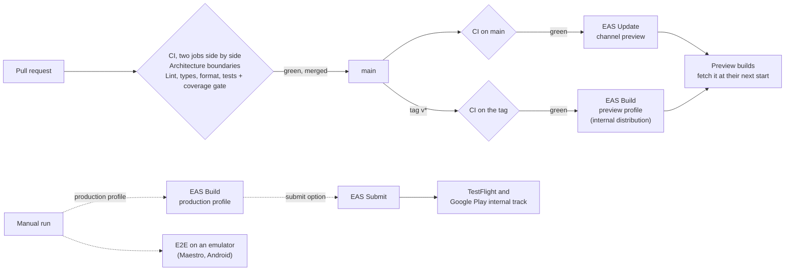

# CI/CD

Every change goes through the same checks, `main` publishes its JavaScript to the testers by itself, a version tag becomes a preview build, and a store build is started by hand. The pipeline is GitHub Actions around EAS (build, submit, update) and Sentry (crash reports); Fastlane is the documented alternative to EAS for the builds.

## The workflows

| File                                | Runs on                                                  | What it does                                                                                                                                                                                                                                                       |
| ----------------------------------- | -------------------------------------------------------- | ------------------------------------------------------------------------------------------------------------------------------------------------------------------------------------------------------------------------------------------------------------------ |
| `.github/workflows/ci.yml`          | Pull requests, pushes to `main`, and called by the build | Two jobs side by side, each with `npm ci` (Node.js from `.nvmrc`, npm cache): the architecture boundaries, and the lint, the typecheck, the format check and the tests with the coverage gate (which uploads the coverage report)                                  |
| `.github/workflows/eas-update.yml`  | A successful CI of a push to `main`, or by hand          | Publishes the JavaScript of that commit to the `preview` channel with EAS Update                                                                                                                                                                                   |
| `.github/workflows/eas-build.yml`   | A tag `v*`, or by hand                                   | A tag: CI on the tag, then the preview build (internal distribution, never submitted). By hand: the preview or the production profile, for one platform or both, and for production with or without store submission. It starts the build and does not wait for it |
| `.github/workflows/e2e-android.yml` | By hand                                                  | Builds a release APK with the environment of the preview profile and runs the Maestro flows of `.maestro` on an Android emulator                                                                                                                                   |
| `.github/dependabot.yml`            | Weekly                                                   | Opens a pull request when an action has a new major version, which the CI then checks                                                                                                                                                                              |

**The CI.** Two jobs, which run side by side and fail separately. **Architecture boundaries** runs `npm run lint:architecture` (ESLint on `app/` and `src/` alone, which is where the boundaries of the layers and the packages each layer may import are enforced), so a broken boundary is a red check named after it. **Lint, types, format, tests** runs `npm run lint`, `npm run typecheck`, `npm run format:check` and `npm run test:coverage -- --ci` as steps of their own; together the two jobs are `npm run validate` taken apart (a test of the tooling checks that nothing `validate` runs is missing from the workflow, and that the boundaries are a job of their own). The full lint repeats the boundary rules, so the second job is still the whole of `validate` on its own. The 90 percent gate on each `domain` and `application` folder (of `src/core` and of every feature) is Jest's: the step fails when a folder falls under it. The coverage report is uploaded as an artifact even when the tests fail. A new push to a branch cancels the run of the previous one (`concurrency` with `cancel-in-progress`, per ref). The permissions are `contents: read`, declared in every workflow, and the CI uses no secret, so a pull request from a fork runs the same checks. Every action is pinned to a major version (`@v7`), and Dependabot proposes the next major. Every job runs on `ubuntu-24.04` and not on `ubuntu-latest`: GitHub began moving that label to Ubuntu 26 on 19 October 2026, and the runner should not change under the repository (a test checks it, and a comment in each workflow says why); moving to a newer image is a commit. `HUSKY=0` keeps the Git hooks, which are for the machines of the developers, from running on the runner. If the branch is protected, require both checks.

**The gate of EAS Update.** `eas-update.yml` starts on `workflow_run` of the CI, limited to `main`, and publishes only when that run succeeded and was a push (never a pull request, which could carry someone else's code into a run that has the token). It checks out the commit the CI validated (`head_sha`), not whatever `main` is by then. Publications are queued, not cancelled, so one cannot be left half done. A tag is built only after the CI has passed on it: `eas-build.yml` calls `ci.yml` as a reusable workflow first (the call finishes when both jobs have, and fails if either does), and refuses a tag that is not `v` plus the `version` of `app.config.ts`, with or without a suffix for a candidate (`v1.2.0`, `v1.2.0-rc.1`).

**Which tag builds what.** A tag `v*` builds the **preview** profile: internal distribution, for the testers, never submitted to a store. The **production** profile is built only by hand, from the Actions tab (`workflow_dispatch`), where the profile, the platform and the store submission are inputs. Nothing a tag does can reach a store: shipping to the stores is a decision of a person, not a side effect of pushing a tag. The check of the tag against the version stays for preview tags, because a preview build receives the updates of its channel and an update reaches only builds of the same version (see the runtime version below): the tag is the version of the app or the version and a suffix (`-rc.1`), so that several candidates of one version can be built.

**The environment of an update.** `eas update` bundles the JavaScript on the runner, and Metro inlines the `EXPO_PUBLIC_*` variables of the environment it runs in, not of a build profile. A bundle made without `EXPO_PUBLIC_BOARDROOM_ADAPTERS` refuses to start (a release build must be told which adapters it uses, see [Composition root](architecture.md#composition-root)). So the update job copies the `env` of the `preview` profile from `eas.json` into its environment before publishing (`jq`), and the update and the builds it goes to cannot disagree: `eas.json` is the single source of those values. The same step is in the end-to-end workflow.

## EAS: profiles, channels and the runtime version

`eas.json` has the three profiles. Each one sets `EXPO_PUBLIC_BOARDROOM_ADAPTERS` itself, because a release build refuses a missing value, and none of them holds a secret (a test checks that every variable of a profile starts with `EXPO_PUBLIC_`, since whatever starts with it is readable in the bundle).

| Profile       | Distribution | Channel      | Adapters | Notes                                                                                                                                                                                                  |
| ------------- | ------------ | ------------ | -------- | ------------------------------------------------------------------------------------------------------------------------------------------------------------------------------------------------------ |
| `development` | internal     | none         | `mock`   | Development client (`expo-dev-client`) for the team, an APK on Android. Takes no update: it loads its JavaScript from Metro                                                                            |
| `preview`     | internal     | `preview`    | `mock`   | What testers install, built by a tag `v*` or by hand. An APK on Android. Receives the updates that `main` publishes. To point it at a server, set `http` and `EXPO_PUBLIC_BOARDROOM_API_BASE_URL` here |
| `production`  | store        | `production` | `http`   | The store build, started by hand only. `autoIncrement` raises the build number, which EAS keeps remotely (`appVersionSource: remote`). The API address is a placeholder                                |

**Placeholders to replace before a real release.** `EXPO_PUBLIC_BOARDROOM_API_BASE_URL` of the production profile is `https://api.replace-me.example.com`: a valid address (the app starts and then fails to reach it, loudly, which is better than a mock server in a store build), and `ascAppId` of the submit profile is `0000000000`. The bundle identifier and the package name (`com.boardroom.demo`) are the placeholders already noted in [Placeholders in the native configuration](build-setup.md#placeholders-in-the-native-configuration). There is no project id, token or secret in the repository: the project id is read from `EAS_PROJECT_ID`.

**Channels.** A build is tied to a channel by its profile and looks for updates on the branch that channel points at. `eas build` creates the channel `preview` (and a branch of the same name) the first time a preview build is made, and `eas update --channel preview` publishes to it, so make one preview build before the first update. Production gets no update from the workflows: its channel is published by hand, after a preview has been seen working (`eas update --channel production`).

**What `app.config.ts` does for updates.** `expo-updates` is configured from the environment: with `EAS_PROJECT_ID` it sets `updates.url` to `https://u.expo.dev/<id>`, `extra.eas.projectId`, and checks for an update when the app starts (`ON_LOAD`) without waiting for the network (`fallbackToCacheTimeout: 0`): a new update is used at the next start. Without it, `updates.enabled` is `false`, which is what a local or a CI build wants. A development build never takes an update.

**The runtime version is the `appVersion` policy** (`runtimeVersion: { policy: 'appVersion' }`): an update reaches only the builds that have the same `version` as `app.config.ts`. The other choice, `fingerprint`, hashes the native side of the project and needs no discipline, but this configuration is not the same everywhere: the Sentry plugin is declared only where there is a token, the build number is written only by Fastlane, and the plugin list is part of the fingerprint. The same commit would then have one fingerprint on a laptop, one on the CI runner and one on the EAS servers, and an update published from the CI would never match the builds it is meant for. `appVersion` is explicit, readable on the store and in the EAS dashboard, and the same wherever the configuration is read. **The price is a rule:** raise `version` in `app.config.ts` whenever the native side changes (a package with native code, an Expo plugin, the local module ScreenProtection, an SDK upgrade), because an update with new JavaScript on a binary that lacks the native code it calls crashes at start. The check of the tag against the version, the store's own refusal of a version already uploaded, and the habit of testing a preview first are what protect it; a stricter team switches to `fingerprint` and gives every environment the same plugins.

**Submission.** `eas-build.yml` adds `--auto-submit` to a production build started by hand with the submit option on (a tag never submits), which sends it to TestFlight and to the internal track of Google Play (as a draft, which a person releases from the console), using the credentials stored in EAS. Going public is never automatic.

## Monitoring: Sentry behind the port

`SentryMonitoring` (`src/core/infrastructure/monitoring`) is the second adapter of the `Monitoring` port. It is off by default: with no `EXPO_PUBLIC_SENTRY_DSN` the monitoring is `ConsoleMonitoring`, as before, and nothing of Sentry starts.

- **Wiring.** The root layout reads `EXPO_PUBLIC_SENTRY_DSN` with the two other variables, in the one place that reads the environment (the guard test in `tooling/environment.test.ts` counts three reads and requires the variable in `.env.example`, empty: off is its default). It goes raw to `parseConfiguration`, which keeps it, trimmed, in the configuration (`sentryDsn`, absent when blank), and `createMonitoring` (`src/composition/container`) chooses the adapter when `mockPorts` and `httpPorts` build the ports, unless the runtime hands over a monitoring (the tests). A DSN that is not valid, or an SDK that does not start, never stops the app: the console stays and says why once (`monitoringNotStarted`, with the reason `invalidDsn` or `sdkFailed`, never the address).
- **Logs are breadcrumbs.** `log` adds a breadcrumb in the `boardroom` category, with the event as message, the level of the port and the allowed attributes. They are the trail an error report carries (the last 50).
- **Errors are exceptions.** `captureError` reports an exception named by the code of the error, with the event (and the `cause`, which the port limits to a kind of failure) as message, the tags `event` and `errorCode`, the allowed attributes as extra data, and a fingerprint made of the two, so that reports group by what happened and not by where the stack starts. The user is known by the `userId` attribute if the port passes one, as `user.id`, and by nothing else.
- **`beforeSend` scrubs.** Of tags, extra data and breadcrumb data, only the attribute names of the port stay (`LOG_ATTRIBUTE`, plus the `event` tag), whoever added the rest. The user keeps its id only (no email, name or address). The request (URL, headers, cookies), the server name and the modules go. Of the contexts, only the technical ones stay, field by field (app, OS, device model, runtime, locale and time zone, trace ids): not the name the user gave the phone. The free texts go: the message of the event, and the message of an exception the app did not report itself, since an uncaught error may quote what the code was handling; its type and stack stay, which is what a crash is read from. `beforeBreadcrumb` drops the automatic breadcrumbs of the SDK (console, requests, taps).
- **Options.** `sendDefaultPii` is off; no screenshot and no view hierarchy (the screens show confidential material); no capture of failed requests (they quote the URL); no performance tracing.
- **Only the adapter knows the SDK.** `@sentry/*` may be imported from `SentryMonitoring.ts` alone (a dependency policy for the layers other than the infrastructure, and `no-restricted-imports` for the rest of it, tests included), the way `react-native-pdf` is reserved to the viewer. The SDK is a parameter (`SentrySdk`, the three functions used), so the tests hand over a recording stand-in, with a comment that says why: the real one needs its native module and sends over the network. In Jest, the "infra" and "ui" projects give the package an empty module like the Expo native modules, so that importing the composition root loads nothing native. `expo-updates` is not imported by any code, and is reserved to the infrastructure like the other native modules of the device, should an adapter ever need it.
- **Source maps.** The Sentry plugin of `app.config.ts` adds the upload of the source maps and debug files to the native builds. It is declared only when `SENTRY_ORG`, `SENTRY_PROJECT` and `SENTRY_AUTH_TOKEN` are all set (`SENTRY_URL` too, for an organisation not on `sentry.io`): without them the build does not touch Sentry, so a local or a CI build never fails for lack of a token, and the reports are sent either way, readable as minified code. The token is read by the build scripts from the environment and never enters the configuration (a test checks that it does not appear in it). **Limits:** the maps uploaded are those of the binary; the JavaScript of an OTA update is not uploaded, so its crashes are not symbolicated until `@sentry/react-native/scripts/expo-upload-sourcemaps.js` is added to the update job (it needs the token as a secret of the workflow, and the Debug IDs of the Sentry Metro configuration, neither of which is set up). The Sentry `environment` is the one the SDK picks (`development` or `production`); to separate preview from production reports, use a DSN, or a project, for each.

## Fastlane, the alternative to EAS

`fastlane/` and the `Gemfile` do the work of EAS Build and EAS Submit from the machine that runs them. Fastlane is Ruby: it is declared in the `Gemfile` (and `Gemfile.lock`) and installed with Bundler in the project, never as a global gem.

| Lane                             | What it does                                                                                                                                                                                                                                    |
| -------------------------------- | ----------------------------------------------------------------------------------------------------------------------------------------------------------------------------------------------------------------------------------------------- |
| `fastlane prebuild platform:
` | `npx expo prebuild --clean` for one platform, with the environment of the production profile of `eas.json` (so the two tools build the same thing) and the build number. The native projects are not committed, so every lane begins here       |
| `fastlane ios beta`              | The next build number after the last of TestFlight, prebuild, `match` read-only (the certificate and profile of the private repository), the signing set by hand on the generated project, `build_app` on the workspace, `upload_to_testflight` |
| `fastlane android internal`      | The next version code after the highest of the internal track, prebuild, `gradle bundle` for the release, signed with the upload key, `upload_to_play_store` to the `internal` track as a draft                                                 |

Everything secret comes from the environment, and a lane stops naming the variable it lacks. Nothing is committed (`*.p8`, `*.jks`, `*.key` and the like are in `.gitignore`).

| Variable                                                                                          | For                                                                       |
| ------------------------------------------------------------------------------------------------- | ------------------------------------------------------------------------- |
| `APP_STORE_CONNECT_KEY_ID`, `APP_STORE_CONNECT_ISSUER_ID`, `APP_STORE_CONNECT_KEY_CONTENT`        | The App Store Connect API key (the `.p8`, in base64): no Apple ID, no 2FA |
| `APPLE_TEAM_ID`                                                                                   | The developer team                                                        |
| `MATCH_GIT_URL`, `MATCH_PASSWORD`                                                                 | The private repository of `match`, and the passphrase that encrypts it    |
| `PLAY_JSON_KEY_PATH`                                                                              | The service account key of Google Play (a path)                           |
| `ANDROID_KEYSTORE_PATH`, `ANDROID_KEYSTORE_PASSWORD`, `ANDROID_KEY_ALIAS`, `ANDROID_KEY_PASSWORD` | The upload key that signs the bundle                                      |

`BOARDROOM_BUILD_NUMBER` is set by the lane itself; `app.config.ts` writes it as `ios.buildNumber` and `android.versionCode` when it is there, and never otherwise, so EAS (which numbers remotely) is never given one.

**EAS or Fastlane.** Choose EAS when the team wants builds without a Mac and without keeping a signing setup alive: the servers build both platforms, store the credentials, number the builds, and publish updates over the air with the same tool, which is what this repository's pipeline does. Choose Fastlane when the build has to run on your own machines (a policy that keeps signing material off a third party, an existing release process in Fastlane, a Mac farm, the need to patch the native project in the middle of the build), or when the stores' metadata and screenshots are managed in code too. Fastlane gives no updates over the air: it can sit beside EAS Update, but then `eas update` still needs the project id. The cost of Fastlane is the machine and the upkeep of `match` and of the Ruby toolchain; the cost of EAS is a build queue, a third party that holds the credentials and a bill.

## Secrets and variables

Nothing below has a value in the repository. `EAS_PROJECT_ID` is not a secret (it is in every update URL), but it is not committed either, so that the project can be another one.

| Name                           | Kind             | Where                                                                                     | Used by                                                                |
| ------------------------------ | ---------------- | ----------------------------------------------------------------------------------------- | ---------------------------------------------------------------------- |
| `EXPO_TOKEN`                   | Secret           | GitHub secret                                                                             | `eas-build.yml`, `eas-update.yml` (the only secret the workflows read) |
| `EAS_PROJECT_ID`               | Variable         | GitHub variable, and an EAS environment variable (plain text) for the builds              | `app.config.ts`: the updates URL and `extra.eas.projectId`             |
| `SENTRY_ORG`, `SENTRY_PROJECT` | Variable         | EAS environment variables (plain text)                                                    | `app.config.ts`: the upload of the source maps                         |
| `SENTRY_AUTH_TOKEN`            | Secret           | EAS environment variable (secret)                                                         | The native build scripts of the Sentry plugin, never the configuration |
| `EXPO_PUBLIC_SENTRY_DSN`       | Public by design | EAS environment variable, per environment                                                 | The app (off when empty)                                               |
| The store credentials of EAS   | Secret           | `eas credentials` (signing), `eas submit` (App Store Connect key, Google service account) | EAS Build and EAS Submit                                               |
| The variables of Fastlane      | Secret           | The shell or the secret store of the machine that runs it                                 | `fastlane/`                                                            |

The EAS environment variables are set with `eas env:create` (for the `preview` and `production` environments of the profiles), for example `eas env:create --name EAS_PROJECT_ID --value <id> --environment production --visibility plaintext` and `eas env:create --name SENTRY_AUTH_TOKEN --value <token> --environment production --visibility secret`.

## Running each part locally

- **The CI.** `npm run validate` is the whole of it; `npm run lint:architecture` is the boundary job alone. `npm run test:coverage` writes `coverage/` as the artifact does.
- **A build, on the servers of Expo.** `npx eas-cli login`, then `npx eas-cli build --profile preview --platform android` (`development`, `preview` or `production`; `--platform ios` needs the Apple credentials). The project id must be in the environment (`EAS_PROJECT_ID=<id>`) or in `.env`. `npx eas-cli build --profile preview --platform android --local` builds on this machine, which needs the Android toolchain (and a path without spaces, see [What is not verified](not-verified.md#what-is-not-verified)).
- **An update.** With the environment of the profile: `export $(jq -r '.build.preview.env | to_entries[] | "\(.key)=\(.value)"' eas.json | xargs)`, then `EAS_PROJECT_ID=<id> npx eas-cli update --channel preview --message "try it"`.
- **What the build produces, without any account.** `npx expo config --type public` prints the configuration (no secret in it), `npx expo export --platform android` bundles the JavaScript, `npx expo prebuild --no-install` generates the native projects (add `EAS_PROJECT_ID=<id>` to see the update settings land in the manifest, and the three Sentry variables to see the plugin), and `npx expo-doctor` checks the project.
- **Sentry.** Put a DSN in `.env` (`EXPO_PUBLIC_SENTRY_DSN=...`) and restart Metro with `npm start -- --clear`; with the mock configuration, any event the app captures (a failed cache write, say) is reported. Without it the events are in the console.
- **Fastlane.** `bundle config set --local path vendor/bundle`, `bundle install`, export the variables above, then `bundle exec fastlane ios beta` (a Mac with Xcode) or `bundle exec fastlane android internal`. `bundle exec fastlane lanes` lists them without running anything.
- **The end-to-end flows.** `maestro test .maestro` on a running emulator with the app installed, or the workflow `E2E (Android)` from the Actions tab.

## What was run, and what could not be

Run here: the lint (the new rules have their cases in `tooling/lint-rules.test.ts`), the typecheck, the tests (the adapter and its scrubbing, the wiring, `app.config.ts` under each combination of the variables, `eas.json`, the workflows and the Fastlane files in `tooling/release.test.ts`), `expo-doctor`, `expo config --type public` (with and without the variables: the token appears nowhere), `expo export --platform android`, and `expo prebuild` with the variables, which wrote the update URL, the runtime version and the build number into the Android manifest and the Sentry properties, and no token. The profiles of `eas.json` were read with the validator of `@expo/eas-json`, and the Fastfile parsed by Fastlane (`fastlane lanes`).

**Not run, and so unverified:** the workflows on GitHub (no repository to run them on), anything on the servers of Expo (a build, a submission, an update: they need an account and a token), the Fastlane lanes (they need an Apple and a Google account, and Xcode 27 with the iOS 27 SDK does not build the app yet, see [iOS scene life cycle](build-setup.md#ios-scene-life-cycle)), the end-to-end workflow's emulator (the flows were written, not run), the delivery of an event to a Sentry project and the upload of the source maps, and that the version of the EAS CLI the workflows pin (`24.x`) accepts every key of `eas.json` the way the validator did.
