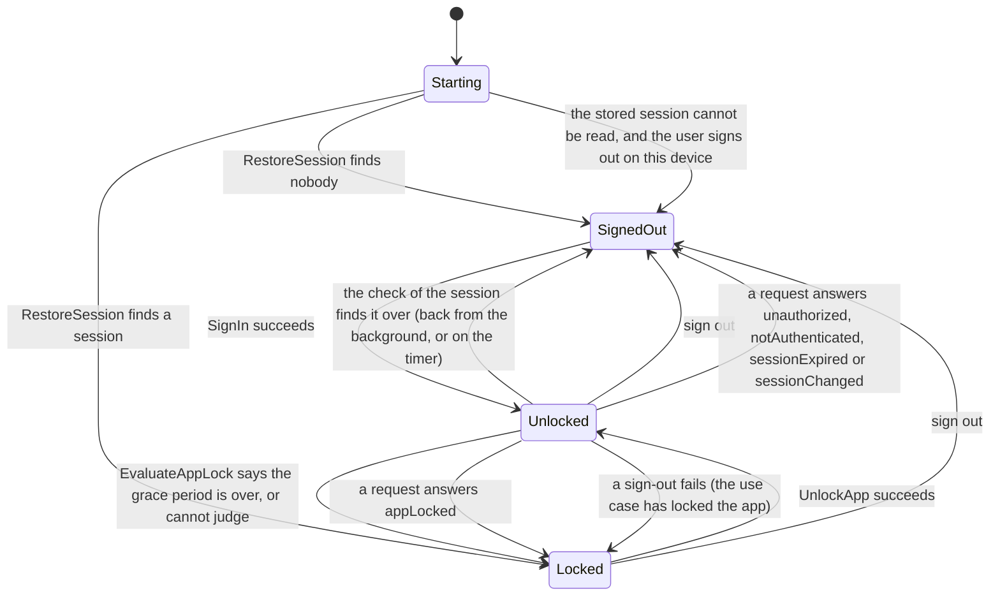

# Design in depth

The deep dives into the code, in the order of the layers and then of the features. They are the reference behind the [README](../README.md) and the other documents of this folder, which link to the headings below. The [composition root](architecture.md#composition-root) and the [enforcement of the dependency rule](architecture.md#how-the-rule-is-enforced) are in [Architecture](architecture.md); the Jest projects are in [Testing strategy](testing.md#the-jest-projects-in-detail).

## Domain and application

The two inner layers hold all the business logic. They are plain TypeScript, in a plain Node environment, with no external module and no ambient global.

**Errors are values.** Every operation that can fail returns `Result<T, E>` (`src/core/domain/shared/Result.ts`), or `Promise<Result<T, E>>` when it is asynchronous. Production code of `domain` and `application` never throws (a lint rule enforces it; tests and the `testing` folders may), and the contract of every port says that an adapter never throws or rejects: it returns an error `Result`. An error is plain data: a `code` taken from a const object, plus the structured fields that matter (`AppError` is the open base, `{ code }`, that every error extends; the families that several features share are in `src/core/domain/errors`: validation, repository, storage; each other one is in the `domain/errors` of the feature that owns it: authentication and biometric in `auth`, voting and vote delivery in `votes`, screen protection in `documents`). It carries no text, because the translation happens in the presentation. The codes are unique across concerns, so a union of errors from several concerns is told apart by `code` alone. The free-text `cause` of an error is a technical diagnostic: it never holds personal data nor the values of a query.

**Plain, immutable data.** Entities are `readonly` plain objects built by factory functions. A factory with something to check returns a `Result` (`createMeeting`, `createResolution`, `createDocument`, ...); one that has nothing to check just builds the data (`createVote`, `createSession`, `createPendingVote`, `createPage`, `createWatermark`). Value objects are branded types with a validating factory (`parseInstant`, `parseMeetingId`, `parseEmailAddress`, ...): a `UserId` and a `MeetingId` are both strings at runtime, and the compiler keeps them apart. There are no classes to map, so the same data goes to SQLite and to the query cache as it is. Every code, role, status, choice and event name is a const object (`VOTE_CHOICE`, `PARTICIPANT_ROLE`, `MONITORING_EVENT`, ...) with its union type derived from it, never a string literal repeated at call sites. Time is an `Instant` (epoch milliseconds), read from the `Clock` port only.

**Business rules are pure functions** (the `policies` folders of the domains): the eligibility to vote (and the precise reason when not eligible), the biometric app lock, the expiry of a session, the maximum age of a cached entry. Which list a meeting belongs to (upcoming or past) is decided by the server: `MeetingPeriod` is only a query value. The `Watermark` fixes the content of what a document shows (name, email and instant of the reader); formatting the instant and laying the watermark out stay in the presentation.

**The offline policy lives in the application layer**, in one place (`src/core/application/offline/loadWithCacheFallback.ts`), where it can be read and tested, not hidden in an adapter. The use cases that read meetings and documents need a valid session, and read and write the cache of that user only (every cache operation takes the owner, so reading as another user finds nothing, by construction).

1. Ask the remote source first. Then check that the user it was asked for is still the one signed in and the app still unlocked: a slow request can span a sign-out and a sign-in, and what comes back must neither be written under the previous owner nor returned as the answer to the new one. If somebody else is signed in, nothing is written or returned and the answer is `sessionChanged`. When the remote call had succeeded, the caches are emptied first (through the `SessionDataPurger`s that the features implement), the files of the documents with them (unless the answer is `appLocked`: the user is the same and comes back): the repository of the documents writes the file as soon as the download is complete, no entry points at it, and a download that ends after a sign-out would otherwise leave a PDF on the device until the next start sweeps it (`signOutDuringDownload.test.ts` checks it with the real cache and real files).
2. On success, write the data through to the cache and return it flagged `fresh`. A write that fails does not fail the call: the failure is captured, and the entry is removed, so that an older copy that could not be refreshed is not served afterwards as if it were current (a full purge if even the removal fails).
3. When the network is unavailable, and only then, return the cached copy flagged `stale` with the instant it was cached, if it is not older than the maximum age given in the `deps` (an older entry, or one dated in the future, counts as a miss). On a miss, return the network error.
4. `unauthorized` means the session is no longer valid, for anything: the caches are emptied, for every owner. `forbidden` (the session is valid, the user may not have this item) and `notFound` concern one item: it is removed from the cache with what hangs off it, so a meeting takes the documents it lists with it. A removal that fails is captured and falls back on the full purge, so that a copy the server refused is never served afterwards; a purge that fails is captured. The error is returned.
5. Any other error (`unexpected`) is returned as is.

Known limit: the pages of the list that were cached are not walked on a revocation. A cached page that shows the title of a meeting that became forbidden keeps showing it until it is refreshed or expires; opening the meeting is refused, and its detail and documents are gone.

A cache that cannot be written, read or evicted does not fail the call, the failure is captured by the monitoring. Signing out, signing in (over whoever was signed in before: it also retries a purge that failed earlier), ending an expired session at start, and the session guard meeting an expired session while the app runs, all empty the caches (the stored content of the documents included); the vote outbox is kept, because a vote belongs to its voter and must be sent when they come back. `ListMeetings`, `GetMeeting`, `OpenDocument` and `CastVote` all use the policy.

| Port (`ports` folders of the applications) | Role                                                                                                                                     |
| ------------------------------------------ | ---------------------------------------------------------------------------------------------------------------------------------------- |
| `MeetingRepository`                        | Remote source of truth: a page of meetings for a period, one meeting                                                                     |
| `MeetingCache`                             | Local store of pages and meetings, per owner: save, read (a miss is a value, not an error), remove, purge                                |
| `DocumentRepository`                       | Remote documents: metadata, and the local location of the downloaded content                                                             |
| `DocumentCache`                            | Local store of documents already viewed (metadata and location), per owner; `remove` and `purge` also delete the stored content (a file) |
| `VoteRepository`                           | Remote votes. Idempotent on the idempotency key; a business rejection is distinct from a network failure; never trusts `castAt`          |
| `VoteOutbox`                               | Durable local store of the votes of each voter, pending or rejected, oldest first. Reads are scoped by voter. Not cleared at sign-out    |
| `AuthSession`                              | Sign in, current session, sign out. Tokens stay inside the adapter                                                                       |
| `BiometricGate`                            | Availability and authentication, for a reason (`unlockApp`, `confirmVote`). No prompt text crosses the port                              |
| `ScreenProtection`                         | A dumb global switch (enable, disable) and the capture events. Which documents need it is decided by `ScreenProtectionCoordinator`       |
| `Connectivity`                             | What the device says about its connection (online, offline) and when it changes. A hint, never the truth: the calls are                  |
| `Clock`                                    | `now()`                                                                                                                                  |
| `Monitoring`                               | Structured logs and error capture. Events and attribute names are const sets                                                             |

Every method of every port settles in bounded time; a remote adapter maps a timeout to `networkUnavailable`, a local store to a storage error.

| Use cases (`use-cases` folders of the applications) | What they do                                                                                                                                                                                                      |
| --------------------------------------------------- | ----------------------------------------------------------------------------------------------------------------------------------------------------------------------------------------------------------------- |
| `auth/SignIn`                                       | Validate the credentials and sign in                                                                                                                                                                              |
| `auth/SignOut`                                      | Empty the caches, then sign out. A cache that cannot be emptied does not stop the sign-out                                                                                                                        |
| `auth/GetCurrentUser`                               | Needs a session. Who is signed in, for the screen that applies a rule to the user (the eligibility to vote). Discloses nobody while the app is locked                                                             |
| `auth/RestoreSession`                               | Cold start: no session, or the requirement to unlock the app (the status only, no name nor email before the unlock). Locks the app. An expired session is ended (caches emptied, signed out) and reported as none |
| `auth/EvaluateAppLock`, `UnlockApp`                 | Must the app be unlocked on return from the background; unlock it with the biometrics. `UnlockApp` fails closed                                                                                                   |
| `meetings/ListMeetings`, `GetMeeting`               | Need a session. Meetings with the offline policy                                                                                                                                                                  |
| `documents/OpenDocument`                            | Needs a session; protects the screen of a confidential document, or of any document served from the cache (fails closed); watermark of the user checked after the load; access log; offline policy                |
| `documents/CloseDocument`                           | Releases a document; the screen protection goes off when no confidential document is left open                                                                                                                    |
| `documents/ObserveScreenCapture`                    | Needs a session; logs the capture events with the document and user ids, forwards them, and succeeds with the unsubscribe function                                                                                |
| `votes/CastVote`                                    | Needs a session; checks eligibility; biometric confirmation; submits, or queues the vote when the network is down or the server fails unexpectedly                                                                |
| `votes/SyncPendingVotes`                            | Sends the pending votes of the signed-in user, oldest first; see below                                                                                                                                            |
| `votes/ListPendingVotes`                            | The outbox of the signed-in user, pending and rejected votes told apart                                                                                                                                           |
| `votes/AcknowledgeRejectedVote`                     | Deletes a rejected vote once the user has seen it                                                                                                                                                                 |
| `votes/DiscardUnreadableVotes`                      | Deletes the saved votes that can no longer be read, when the user asks for it, behind a confirmation that repeats how many there are. Needs a session                                                             |
| `connectivity/ObserveConnectivity`                  | Needs no session. The status of the connection now and each change after it, one change at a time; the presentation calls `SyncPendingVotes` when it comes back                                                   |

A use case is a class with a single public `execute` method (`ObserveScreenCapture` also takes the callback to call). Its dependencies are injected through the constructor as one typed, `readonly` `deps` object of ports, plus the configuration values it needs (`maxCacheAge`, `maxAttempts`, `gracePeriod`). There is no static state and no singleton; the few instances that guard something in memory (`SyncPendingVotes`, `CastVote`, `ScreenProtectionCoordinator`, `AppLock`) must be created once by the composition root and shared.

**Votes.** A vote is final: a voter has one vote per resolution, identified by an idempotency key built from the resolution and the voter. Sending a vote again is safe as long as the server honours that key, which the `VoteRepository` contract requires: a retry after a lost answer is recorded once.

- `CastVote` refuses a second vote on a resolution being cast on the same instance (`voteInProgress`), checks the eligibility against the meeting (cached or fresh) and the outbox, then asks for the biometric confirmation. A submitted vote is also recorded on the cached copy of its meeting, so that the voter cannot vote again from it offline.
- The outbox keeps a vote in one of two states, pending or rejected, which cannot be mixed up: a rejected vote always carries its reason.
- `SyncPendingVotes` is triggered by the presentation or the composition root, when connectivity is regained (it observes it through `ObserveConnectivity`) and when the app returns to the foreground; the application layer does not decide when to sync. It sends the pending votes oldest first, one at a time, and checks the session again before each one (a run stops if the user signed out or changed, or the app was locked; it does not start while the app is locked). Its report names the resolutions and the reasons, never the choices. A vote the server rejects for a business reason is kept as rejected, with the reason, until the user acknowledges it. Only `networkUnavailable` and `unauthorized` stop the whole run; they concern every vote and count no attempt. An `unexpected` failure counts an attempt on that vote and the run goes on with the next one; after `maxAttempts` the vote is given up as `voteUndeliverable` and shown to the user. A second call while a run is in progress on the same instance does nothing (`alreadyRunning`); two instances, or two processes, are protected by the idempotency key only.

**Biometric lock.** The lock is enforced, not only reported. `AppLock` is one shared in-memory state that the session guard (`requireSession`, which every use case that serves the user goes through) reads: while it is closed, the guard answers `appLocked` and no use case returns data, queues or sends anything. A cold start always closes it (`RestoreSession` returns the status `unlockRequired` and nothing about the user), `EvaluateAppLock` closes it when the grace period in the background is over or cannot be judged, `UnlockApp` opens it when the biometrics succeed, a successful `SignIn` leaves it open (the credentials just typed are the proof of presence) and `SignOut` closes it. On a device where the biometrics cannot be used, `UnlockApp` fails closed every time, and the only way forward is to sign out and sign in again. The biometrics prove that a person enrolled on the device is there, not that it is the user of the session; whether the device passcode is accepted as a fallback is a setting of the adapter, chosen at the composition root.

**Screen protection.** `ScreenProtectionCoordinator` counts the views of each document (a document opened twice is two views) and serialises its calls to the platform, so that the last view of all turns the protection off and a slow `disable` can never land after a later `enable`. A view that is closed is never counted again, whatever the platform answers: when the `disable` of the last view fails, the failure is returned and the coordinator remembers that a `disable` is owed, and the next release that finds no view open sends it again (a later `acquire` puts the protection on anyway, and its own release owes the `disable`), so one failure cannot keep the protection on for the rest of the session. `OpenDocument` protects a confidential document and any document served from the cache, whatever level the cache remembers: a copy may have been public when it was saved.

**The session is checked again.** The session guard also detects an expired session while the app runs (the caches are emptied through the purgers, best effort, and the caller still gets `sessionExpired`). A use case that waits for something (the network, a biometric prompt) checks again, with `requireSameUser`, that the same user is still signed in before it writes or returns anything. That includes the reads of the local stores: `ListPendingVotes`, `AcknowledgeRejectedVote` and `DiscardUnreadableVotes` check again once the outbox has answered, so a late answer never returns the entries of one user (or acts on them) after another has signed in, and `MeetingCacheVoteRecorder` (the `RecordedVoteSink` of the votes, in `src/composition/glue`) checks the voter between reading the cached meeting and writing it back, so a sign-out that emptied the caches in between is not undone by a late write.

**Test doubles** live in the `application/testing` folder of the scope that owns the port (`src/core`, `src/features/<feature>`), and the ones that assemble them all (`createFakes`), with the builders of domain fixtures, in `src/testing` (the domain tests need the builders and the domain cannot import the application). They are hand-written, in-memory fakes of every port, scriptable (a switch for the network, failures of the storage, queued answers of the server) and checked against the contract of the ports by `fakes.test.ts`. They exist so that the use cases are tested without `jest.mock`, against objects that behave like the real thing. They are test support, not production code: they are excluded from the coverage figures, a fixture there may throw, and a lint rule forbids production code from importing any `testing` folder.

## Clock limits

Time is the clock of the device, read through the `Clock` port, and the user controls it. What the rules built on it do about that:

- Session expiry (`expiresAt`) is on the device clock: a clock set back extends a session locally, a clock set forward ends it early. The server enforces its own expiry on every call.
- The age of a cached entry is compared with the device clock. An entry dated in the future (the clock was set back) is a miss, and so is one older than the maximum age. A clock set back far enough that an old entry looks young cannot be detected, and keeps an entry usable longer than the maximum age.
- The app lock fails closed when the clock goes back (`now` earlier than the instant the app went to the background), and a grace period of zero locks every time. A clock set forward only locks sooner.
- `castAt` of a vote comes from the device. The `VoteRepository` contract says that the server stamps the vote with its own time and applies the voting window to it. The local eligibility check (`votingWindowOver`) is a courtesy that can be wrong in either direction.
- The ordering of the outbox is the order of enqueueing, not a comparison of instants.

## In-memory adapters and contract tests

`src/composition/dev/in-memory` holds the simulated server and the adapters that read it, and each feature holds its in-memory caches, outbox and screen protection in its `infrastructure` folder, so that the whole app runs without a server; `clock/` and `monitoring/` of `src/core/infrastructure` hold the two that are not in-memory by nature.

| Adapter                                                                             | What it is                                                                                                                                                                                                                                                                   |
| ----------------------------------------------------------------------------------- | ---------------------------------------------------------------------------------------------------------------------------------------------------------------------------------------------------------------------------------------------------------------------------- |
| `InMemoryMeetingRepository`, `InMemoryDocumentRepository`, `InMemoryVoteRepository` | Three thin windows on one `InMemoryBackend`, the simulated server, so that a vote recorded through one is seen through the others                                                                                                                                            |
| `InMemoryMeetingCache`, `InMemoryDocumentCache`, `InMemoryVoteOutbox`               | The local stores, per owner and per voter. They copy what they are given and what they hand back. The document cache answers for the files of the device (the `FileStore`: an entry whose file is gone is a miss)                                                            |
| `InMemoryAuthSession`                                                               | The accounts of the simulated server and the session store of the device in one. Sessions expire a lifetime after the sign-in, on the clock it is given. No tokens exist, so none can leak                                                                                   |
| `InMemoryBiometricGate`, `InMemoryScreenProtection`                                 | Biometrics that are available and recognise the user (the mock configuration uses them only where the device has none enrolled, see `chooseBiometricGate`); a screen protection that records what it was asked and can report a capture. Both can be made to fail, for tests |
| `SimulatedConnectivity`                                                             | The connectivity of the mock configuration: online when the simulated network is, and told when the demo cuts it. Deterministic, nothing native                                                                                                                              |
| `SystemClock`, `ConsoleMonitoring`, `SentryMonitoring`                              | The clock of the device (the only production code that reads it); structured events written to the console; and, when the build has a Sentry address, the same events sent to Sentry, scrubbed (the composition root chooses: `createMonitoring`)                            |

**The simulated server** (`InMemoryBackend`) behaves the way the port contracts describe a real one. Every request enters the network first (`networkUnavailable` offline, then the latency), then is authenticated from the stored session (`unauthorized` without a valid, unexpired one). The identity is read when the request is created, and the answer is the one for that identity even if somebody else signs in while the request waits. A user sees the meetings they take part in. A meeting, or a document of a meeting, that exists but that they may not have is `forbidden`; one that does not exist is `notFound`. Telling the two apart shows that an id exists, which costs little here (ids are opaque and a board is a closed group) and lets the app say "you no longer have access"; a server that prefers to hide it answers `notFound`, which the application treats the same way. Which of the two lists a meeting is in is decided against the clock; upcoming ones are soonest first, past ones latest first, ties broken by id. The limit of a page is checked with the page rules of the domain, not trusted, and pages continue after an opaque cursor (the instant and the id of the last meeting) that stays valid when a meeting moves from one list to the other between two pages. The decoder of the cursor is strict: `1e3`, hexadecimal, a space, a negative number or an extra segment is refused. A vote is recorded for the authenticated user only, once per resolution, under a key the server derives itself. A key that already holds a vote is answered before any rule of eligibility, so that a replay still works after the resolution is closed: the same vote again succeeds, another choice is `alreadyVoted`, whatever the clock says. A voter that is not the authenticated user is `unauthorized`. The business rules are the ones of the domain (`checkVotingEligibility`), applied at the time of the server, which stamps the vote with its own time and never trusts `castAt`: a vote whose device time is after the closing instant is accepted while the server's time is still before it. Resolution ids are unique across all meetings (the domain says so for the id and for the idempotency key built from it), and the server refuses content that breaks it. The content of a document is a PDF that the server makes for it (one page for each page of the document, up to 100, showing the title and `page i / n`), served with the user it is for and a version, which is the revision of what the server holds: the repository writes it to a file named after the user, the document and the version, so the content one user fetched does not serve another, and a document that changed is a new file. A meeting returned to a user carries their own recorded votes. Everything it returns is a copy.

**The seed** (`seed.ts`) is the content of the server: the fixtures of [`docs/spec/fixtures`](spec/fixtures/README.md), which the other clients of the domain share, read by `loadFixtures` and shifted to the clock when the app starts (the rule is in the README of the fixtures), so that there are always upcoming and past meetings: 24 upcoming and 42 past, nothing random. Its resolutions follow the date of the meeting: in an upcoming meeting they are open, with a closing time after the meeting starts or none; in a past meeting they were closed after it started, with the votes of the demo users on most of them (the demo user voted for, against and abstained in turn), except in some meetings where the status was never closed and the window is simply over, with nobody having voted. All three states of voting, all three choices, a meeting where the demo user is a guest and several resolutions they can vote on right away are in the data at any start instant (`seed.test.ts` checks it at several). It is server data, so it is in English whatever the language of the app. It is built through the domain factories, so fixtures that break an invariant make `buildSeed` return the error (and its test fail), and the container then refuses to start.

**The network** (`SimulatedNetwork`) is the connectivity of the server, owned by the backend (`backend.network`): `setOnline(boolean)` is the one way to cut or restore it, `subscribe()` tells whoever listens when it changes (the `Connectivity` of the mock configuration does), and `setLatency()` changes how long the server takes. Every client of the server goes through it, so going offline cuts them all, deterministically; `container.demoControls.network` (the same object as `container.controls.network`) hands it to the demo and to the tests: it exists in the mock configuration only, because a real device has no switch to cut its own network. The latency is a `Sleep` function handed in at construction, so the domain and the application contain no timer and the tests, which give a sleep that does not wait (`src/core/infrastructure/testing/sleep.ts`), never sleep. A request never waits more than `MAX_SIMULATED_LATENCY_MILLIS`, whatever is configured, because every port settles in bounded time: a latency above the cap is a timeout and answers `networkUnavailable` once the cap has elapsed, and a sleep that throws or rejects is a network that failed and answers `networkUnavailable` too. Nothing escapes the port.

**The monitoring** (`ConsoleMonitoring`) writes each event to the channel of the console that matches its level, through a map typed over every level: a level added to the port without a channel fails the typecheck instead of being dropped. Serving data from the cache is expected behaviour (it is what the offline demo shows), so it is logged at `info`: a warning would raise a LogBox toast in development. The tests of the container are given a silent monitoring through the runtime override, so they print nothing. In a build that was given `EXPO_PUBLIC_SENTRY_DSN`, `createMonitoring` (`src/composition/container`) builds `SentryMonitoring` instead, the second adapter of the port, whose `beforeSend` keeps only the attribute names of the port and the id of the user (see [Monitoring: Sentry behind the port](ci-cd.md#monitoring-sentry-behind-the-port)); an address that is not valid, or an SDK that does not start, leaves the console in place and says so once with `monitoringNotStarted`, because monitoring must not decide whether the app runs.

**Contract tests.** For each port that holds state or talks to a server there is a reusable suite, a function that takes a factory and registers the same `describe` against any implementation: `describeMeetingCacheContract`, `describeDocumentCacheContract`, `describeVoteOutboxContract`, `describeMeetingRepositoryContract`, `describeDocumentRepositoryContract`, `describeVoteRepositoryContract`, `describeAuthSessionContract`, `describeScreenProtectionContract`, `describeConnectivityContract` (the `application/testing/contracts` folders of the core and of the features). That is nine suites for twelve ports. `BiometricGate`, `Clock` and `Monitoring` have none, on purpose: they hold no state and are thin. The first is one question and one prompt that the platform answers (the in-memory adapter only replays what it is told, and the real one maps every outcome of the library to an error of the domain, which its own test checks case by case), the second is a single call that returns the time, and the third is fire and forget and returns nothing a test could read. Their adapters are tested directly. The suites only use the public surface of the port, plus a small harness the factory provides where a port alone cannot say it: to put meetings on the server, to cut the connection, to lose a downloaded file, to move the clock of the server. The caches and the outbox suites check, among others, the isolation of two owners or voters (also under ids that would collide if the owner and the id were concatenated), that `purge` removes everything for every owner, that a miss is a value and not an error, first in first out by insertion (the votes are enqueued with decreasing instants, so that an adapter that sorts by the instant fails), idempotent `enqueue` that reports the vote that holds the key, the rejected state (also through `findByResolution`), and that mutating an object after saving it or after reading it changes nothing the next read returns. The repository suites check, among others, that a recorded vote of one user is not seen by another, and the clauses of the vote that depend on time (a replay or another choice after the close, a late `castAt`).

Three groups of the cache and outbox suites need an implementation with a real storage, and say so as options (`StoreContractOptions`) instead of passing for an implementation that has none:

- **A statement that fails.** The harness has a hook that makes the next statement the store sends fail, once (`failNextStatement`). Each call must then answer with the storage error of its port, leave the data as it was (an enqueue that failed queued nothing, a rejection that failed left the vote pending, a purge that failed removed nothing), and work again straight after. A save that fails must leave no older entry readable, which the harness checks with a full disk that still lets space be freed.
- **Closed and opened again.** The harness closes the store and opens a new one on the same storage (`reopen`): the cache gives back what was saved with its instants, the outbox gives back every vote of every voter in the order of enqueueing, with its attempts and the reason of a rejection, still holds the key of each vote, and goes on in the same order after a vote was removed.
- **Writers at the same time.** The same key written by several callers at once leaves one complete version (never a mix of two), a vote enqueued by eight callers at once is queued once and every caller is told which vote won, and ten attempts counted at once are ten attempts. This group has no option: the fakes and the in-memory adapters run it too.

The groups that an implementation cannot honour show as skipped, not as passed.

Every suite runs against the fakes of the application (`src/testing/application/fakes.contracts.test.ts`), against the in-memory adapters (the tests next to them), and against the real adapters: the SQLite ones over a SQLite database in a file (`SqliteMeetingCache.test.ts`, `SqliteDocumentCache.test.ts`, `SqliteVoteOutbox.test.ts`; the document cache runs over a real directory of files too), the connectivity ones (`ExpoConnectivity.test.ts`, `SimulatedConnectivity.test.ts`) and the HTTP ones through MSW (`HttpRepositories.test.ts`, which runs the repository and the session suites against the real client, the real schemas and the routes of the mock API in front of the same `InMemoryBackend`). The fakes keep no files (so the checks on the content of documents are skipped for them), their server only replays scripted answers (so the business rules of a vote are skipped), and the in-memory stores have no storage to fail nor to reopen.

**Why there are fakes and adapters.** The application has its own fakes of the ports (the `application/testing` folders) and the infrastructure has its in-memory adapters, and they do not share code. They answer different needs. The fakes belong to the layer that is tested with them: `application` may not import `infrastructure`, so a use case test cannot use an adapter, and the fakes have switches that an adapter must not have (make the next write fail, queue the answer of the server, see what was asked). The adapters are a working implementation that the app runs on, a simulated server with its own rules. The contract suites are what keeps the two honest: both pass the same checks, so a fake cannot drift from what a real adapter does without a test failing.

## Persistence

The `infrastructure/persistence` folders of `meetings`, `documents` and `votes` hold the `MeetingCache`, the `DocumentCache` and the `VoteOutbox` on SQLite, over the machinery of `src/core/infrastructure/persistence` and the tables that each declares in its own `infrastructure/persistence/schema.ts` (`src/composition/persistence` assembles the slices into the schema of the file). The `DocumentCache` keeps the metadata of a document in the database and its content in a file, behind the `FileStore` seam (below): a document opened once is available offline until the user signs out, and survives the app being killed.

**The driver seam.** The adapters and the migrations are written against `SqlDatabase`: run a statement, read rows, run a transaction, close. It is made by `createSqlDatabase` from a `SqlConnection`, which is what an engine provides and is three calls (`run`, `all`, `close`). The serialisation and the transactions are in `createSqlDatabase`, once, whatever the engine: statements run one at a time in the order they were asked for (the queue, `createSerialQueue`, is the one the session vault uses too), a transaction holds the connection until it ends (committed when its work resolves, rolled back when it rejects), and a lone statement never lands inside the transaction of another caller. `expo-sqlite` has its own exclusive transactions, which open a second connection, and that connection would not know the key of an encrypted database; running the transactions on the one connection avoids it.

Two engines sit behind `SqlConnection`:

- `ExpoSqliteOpener` (`expo-sqlite`, on a device) provides the raw calls of a `DatabaseOpener`: open a file by its name, remove a file, and on a connection, the statements of `SqlConnection` plus `exec`, for the ones that take no parameter (`PRAGMA key`). **It decides nothing**: what to do with a key (unlock the file and check it is SQLCipher), how a failure is classified ("file is not a database" is a key that is rejected) and what to do with a file in the way are in `unlockDatabase` and `openProtectedDatabase`, which Jest tests against SQLite. The one thing the wrapper does is tolerate a file that is not there when it is asked to remove it (the module rejects, and a caller that wants a file gone does not care that it already is). **It is the only part of the persistence that no Jest test executes for real**: its test replaces the native module with a stand-in that runs the statements on `node:sqlite` and rejects, like the module, when asked to delete a database that is not there or that is open, and checks the conversation.
- The Node one (`src/core/infrastructure/testing/NodeSqlite.ts`, test support) runs the same SQL on `node:sqlite`, which comes with Node 24, so the contract suites execute real SQL in Jest with no dependency. Jest cannot resolve the module (`import 'node:sqlite'` fails: its list of Node modules predates it), so it is obtained with `process.getBuiltinModule('node:sqlite')`, which returns the same module; a comment in the file says so. A lint rule keeps this driver out of production code (nothing outside the tests and the `testing` folders may import a `testing` folder).

**Schema and migrations.** The version of the schema is the `user_version` of the header of the database. `MIGRATIONS` (`src/composition/persistence/migrations.ts`, which keeps the history of the whole file whichever feature owns a table) is the list, numbered 1, 2, 3, with no gap: version 1 creates the cache tables and the outbox, version 2 adds the index that finds the votes of a voter on a resolution, version 3 rebuilds the outbox so that its status can be `quarantined` (SQLite cannot change a `CHECK`: the table is made again with the same columns, the rows are copied with their numbers, the high-water mark of the sequence is carried over and the index is created again), version 4 adds the cache of documents (a table keyed by `(owner, document_id)` and an index on the location of the content). Each migration runs in its own transaction together with the update of the version, so one that fails leaves the database at the version before it and the next start tries again; a migration that was released is never edited, a change is a new one, and there is no way back. A database that is more recent than the app (the app was downgraded) is refused and left alone (`databaseIsNewer`). The tests open a database at every past version, fill it with rows written the way that version wrote them, migrate it to the latest and check the rows and the new objects; they run a migration that fails halfway and check that the version, the schema and the data are those from before; and they refuse a list of migrations with a gap. The names of the tables and columns are constants (each feature's `infrastructure/persistence/schema.ts`, assembled in `src/composition/persistence/schema.ts`) and are part of the format: they are never edited, a rename is a migration.

**What is stored, and how.**

- The cache keeps a page or a meeting as JSON in **a format of its own** (`storedMeeting.ts`: its zod schemas and its mappers), not the DTOs of the API, so that a change of the API (a field renamed, an instant written another way) cannot make the rows already on the devices unreadable, and a change of what is stored is a decision of the cache. The format happens to be what the API wrote when the cache was first written, and a test holds a row of each kind exactly as that version wrote it and reads it. Its key is one column for each part, never the parts joined in a text: `(owner, meeting id)` for a meeting, `(owner, period, cursor, page size)` for a page, with the cursor written as JSON in its column so that "no cursor" is kept apart from any cursor. `(owner, id)` is therefore injective whatever characters they hold, which the contract suite checks on the awkward ids it uses everywhere (separators, quotes, other case, surrounding spaces, the same letter written as one code point or as two).
- The outbox keeps a vote **in columns**, in the order it was enqueued: `sequence` is an `INTEGER PRIMARY KEY AUTOINCREMENT`, so it only grows and a row that is deleted never gives its number back (the order is never a timestamp). The idempotency key is a `UNIQUE` column compared byte for byte (two keys that share a prefix or differ by case are two votes). A `CHECK` constraint makes a rejected vote always carry its reason and its instant and a pending one never: the database refuses the other states. `enqueue` reads the key and inserts in one transaction, so two callers with the same key enqueue it once and both are told; `markAttempt` is an `UPDATE ... SET attempts = attempts + 1` that runs only on a row that reads back as a vote, in the same transaction as the look at that row.
- **What is read back is checked.** The payloads of the cache go through the stored schemas and the factories of the domain; a row of the outbox goes through the factories of the domain, and the key it derives must be the key it holds. For the **cache**, a row that no longer passes (the format moved on, the file was altered) is a **miss**: it is reported to the monitoring (`storedRowDiscarded`, with the kind of row and, for a payload, the paths of the fields that failed, never their values), left out of the answer and deleted, since the next request refills it. It never throws.
- **A vote that cannot be read is quarantined, never deleted by a read and never overwritten.** An entry of the outbox that no longer reads back as a vote may still be the only trace of a choice, so nothing destroys it silently. Version 3 of the schema adds a status, `quarantined`, and the outbox marks the row with it the first time it fails to read (`storedRowQuarantined`, without the content; the columns of the row are left exactly as they were). A quarantined entry is out of the queue: `list` leaves it out of the votes and **counts it** (`OutboxListing.unreadable`), `findByResolution` does not return it, `markAttempt`, `reject` and `remove` do not touch it, and `enqueue` of a vote whose key it holds queues nothing and says `heldByUnreadable` (the vote is not written over it, and `CastVote` reports a storage error with that cause). Only `discardUnreadable` removes entries, when the user asks: `ListPendingVotes` returns the count, the pending votes screen says how many saved votes can no longer be read and offers to delete them behind a confirmation that repeats the number, and the use case `DiscardUnreadableVotes` is what the button calls. A row is attributed to a voter by its `voter_id` text, whatever else it holds; a row whose `voter_id` is no voter's belongs to nobody who can ever sign in and stays where it is (a few bytes). The in-memory outboxes hold typed values and cannot hold such an entry; the contract suite pins the behaviour above for the implementations that can (the SQLite outbox and the fake, which can be given one) and shows the group as skipped for the others.
- **Failures.** A statement that fails, or does not answer within the time it was given (10 seconds), is the storage error of the port, with a cause that is a kind of failure (`sqlite error 13`, `timeout`) and never a statement, a path or a value. A save that fails removes the older entry of its key, so that it is not served afterwards as if it were current.

**Documents: the metadata in the database, the content in files.**

- **The seam, `FileStore`** (`src/core/infrastructure/files`), is to the files what `SqlDatabase` is to the statements: write a file whole or not at all, say whether it is there and how big, delete it, list the names, delete everything. It is made by `createFileStore` from a `FileVolume`, the raw calls of a directory (`ensureRoot`, `write`, `move`, `size`, `remove`, `list`), which may reject. All the logic is in `createFileStore`, once: a name is one segment of letters, digits, dots, dashes and underscores (anything else is a failure, so a name from outside cannot reach a directory above the store); a write goes to a file of its own and is **moved** onto its name only when it is complete, so a reader never finds half a file and a failure leaves the previous file as it was and no partial file behind; a failure is a value whose cause is a code (`ENOENT`, `timeout`), never a path or a message; every call settles in bounded time. Two volumes sit behind it: `ExpoFileVolume` (`expo-file-system`, on a device) is as thin as it can be, and is the only file that imports the package (a lint rule); the Node one (`src/core/infrastructure/testing/NodeFileVolume.ts`, test support) runs the same calls on the file system of the machine, and is obtained from `process.getBuiltinModule` like the Node SQLite driver. The store is tested in Node (`FileStore.test.ts`, over a volume that can be made to fail); the wrapper's test (`ExpoFileVolume.test.ts`) replaces the package with a stand-in that keeps files in memory and checks the conversation.
- **Where the files are.** In a directory of the app that the backups leave out: the **caches directory on iOS** (the documents folder is part of the iCloud and iTunes backups, and keeping a file out of them needs a call `expo-file-system` does not offer) and the **private storage of the app on Android** (the files directory; Android's backups are off for the app, `android.allowBackup: false`). The caches directory may be emptied by the system when the device runs low on storage, which the contract already covers: **a file that is gone makes the entry a miss** (the row is dropped, the next open downloads it again). On Android the files directory is not emptied by the system to make room, which is why it is used there: a document already opened stays available offline until the user signs out or clears the data of the app. The files are protected by the sandbox and by the data protection of the platform; **the app does not encrypt them**. Someone who can run code as the app on an unlocked device (a rooted or jailbroken phone) reads them (see [Mobile security](security.md#mobile-security)).
- **The name of a file** is the SHA-256 digest of the owner, the document and the version (`documentFileName`, written in plain TypeScript for short texts: nothing is hashed that is longer than an identifier), through JSON so that the parts are never joined in one text. So two users never share a file, a new version never reuses the file of the one before, the same triple always gives the same place, and the name is hexadecimal (safe whatever the identifiers contain, the same on a case-insensitive file system) and says nothing of the user or the document to someone who lists the directory. The version is the `ETag` of the answer (the revision of the server in the mock configuration).
- **The table `document_entries`** (migration 4) is keyed by `(owner, document_id)`, one column for each part. The location of the content is a column of its own, with an index, because the cache has to ask which other entries point at a file. The metadata is JSON in the cache's own format (`storedDocument.ts`: its zod schema and its mappers, not the DTO of the API).
- **Content is deleted before the entry, and files are shared by count.** `remove`, `purge` and a `save` that moves an entry to another file delete the file first, and only then drop the row; if the file cannot be deleted the call fails and the row stays, so it can be repeated. Two owners may point at the same file: it is deleted only when no other row points at it, so one user's sign-out cannot take the file from another. A `save` that fails drops the older entry whatever its file does (it is not served as if it were current; the file it leaves is for the sweep). `purge` deletes every file of the directory, the ones no entry points at included, and keeps the entries whose file could not be deleted.
- **A row that no longer reads back is a miss**, as for the meetings: reported (`storedRowDiscarded`, the paths of the fields that failed, never their values), left out of the answer, and removed **together with its file**. A location that is no file of the store is such a row. A row whose file is gone is dropped, and only while it still points where it was read: a newer save is left alone.
- **The files no entry points at are swept when the cache starts** (`sweepOrphans`, called by the composition root before anything can be downloaded): a download whose entry was never saved, a deletion that was interrupted, a file that was being written when the app stopped. A file that cannot be deleted is left for the next start, and the failed sweep is reported once by the composition root (`orphanFileNotDeleted`, without file names), as in the mock configuration. The mock configuration has no database, so its cache is in memory and its composition root empties the store when it starts.
- **Calls run one at a time**: a `save`, a `remove` or a `read` reads a row, decides, touches a file and writes a row, and two callers must not interleave those steps. The contract suite of `DocumentCache` runs against it with the groups for a statement that fails, a store closed and opened again, writers at the same time, and the content (`SqliteDocumentCache.test.ts`).

**At rest.** The cache holds confidential meeting data and the outbox holds the choices of a secret ballot, so the database is encrypted. The outcome of the evaluation:

- `expo-sqlite` in SDK 57 can be built with SQLCipher: `['expo-sqlite', { useSQLCipher: true }]` in `app.config.ts` sets `expo.sqlite.useSQLCipher` for both native projects (checked with `expo prebuild`: the flag is in `Podfile.properties.json` and `gradle.properties`). The database is unlocked with `PRAGMA key` right after it is opened. Plain SQLite ignores that pragma without a word, so the opener asks for `PRAGMA cipher_version` and **refuses to open when it gets no answer** (`encryptionUnavailable`): a build made without the option fails to start instead of keeping the data in clear.
- **The key** is 256 random bits, made once per file and kept in the secure storage (`expo-secure-store`: the Keychain with `WHEN_UNLOCKED_THIS_DEVICE_ONLY` on iOS, so it is not synchronised and not restored onto another device; preferences encrypted with a key of the Android Keystore on Android, out of the automatic backups). It is stored before it is used, so that a start that stops in between leaves a key and no file, which the next start fills. The keychain item holds the key **and the generation of the file it opens** (`<generation>:<64 hexadecimal digits>`; a bare key, which an app that knew one file kept, is the first generation): the two change in one write. Starts are one at a time for a keychain (`openProtectedDatabase` queues them), because two starts at once would each find no key, each make one, and leave a key that does not open the file the other created.
- **Where the random bits come from.** `expo-crypto`: `getRandomBytesAsync(32)` draws from the secure generator of the platform (`SecRandomCopyBytes` on iOS, `SecureRandom` on Android) and rejects when it cannot, it never falls back on a weaker source. Earlier versions asked SQLite for `randomblob(32)` on a scratch database, whose generator falls back on a weak seed (the time, the process number) if the operating system's source cannot be opened, without saying so; that is gone, with the scratch database (`DatabaseOpener.openScratch`). The generator is injected (`RandomBytes`, the `randomBytes` option of `openProtectedDatabase`, `DevicePlatform.randomBytes`), so the code that decides what to do with the bits is tested in Node with `crypto.randomBytes` (`nodeRandomBytes`, test support), and the device side, `expoRandomBytes`, is one line. The bytes become the key in `keyFromBytes`: exactly 32 bytes, written as **64 lower-case hexadecimal digits, the form every key has always been kept in, so a database made by an earlier version opens as before**; anything else (too few or too many bytes, all zeros, something that is not an array of bytes, a generator that rejects, throws or does not answer in time) is a failure of the key storage (`keyStorage`) with nothing stored, made or opened.
- **Loss, and what is done about it: nothing is deleted.** If the key is not in the keychain and a file is on the device (the keychain was cleared, or the file was restored onto a device whose keychain does not have the key), or the keychain holds a key that does not open the file, or the file is not a database, the content cannot be read with the key the app has. The app does not delete the file. The engine has no rename, so a name is never reused: each generation of the database is a file of its own (`boardroom.db`, `boardroom.db.1`, `boardroom.db.2`, ...), and the unreadable one is **set aside** where it is while a new database is created in the next file, with a new key. In order: (1) a record that local data was reset is written to the keychain, which a reset of the database does not touch; (2) the key that did not open the file is kept under another item (`boardroom.database-key.previous`), best effort, so that the file can be read again if the cause was the keychain and not the file; (3) the new key and the next generation are stored in one write, which is the point of no return; (4) the monitoring is told with `captureError` (`databaseRecreated`, with `keyLost` or `keyRejected`), not with a log; (5) once the new database is open and migrated, the copy set aside by the reset before this one, if any, is removed: **at most one unreadable copy is kept, the latest.** Because the new file has another name, a leftover journal of the old one cannot be applied to it. It happens at most once in a start, and a start that stops anywhere in it finds the state of the last write and goes on. **The votes that were waiting in the old file are not in the new one**: the user is told (below). An item of the keychain that is there and is not a key (or a generation and a key) is **not** a lost key but a keychain that cannot be trusted: the start fails with `storageUnavailable` (`keyStorage`) and nothing is made, set aside or deleted. A start that fails for any other reason (the keychain cannot be read or written, the file cannot be opened, the schema cannot be migrated) does not start either. One limit: when the keychain is lost and a later generation of the file is on the device, nothing says which file was the current one, and the app looks for the first; the data of a later generation is then never found (and is unreadable anyway without its key).
- **The user is told, once, after the next sign-in or unlock.** The record in the keychain becomes a startup notice of the container (`notices.localDataReset`, read while the container starts, with `acknowledgeLocalDataReset` to clear it). The screens of the open app show it in the banner area (`StatusBanner`): _"Some data saved on this device could not be read and was reset. Votes that were waiting to be sent from this device may have been lost: please check that your votes were recorded."_ (and its French text), with a button to dismiss it. Dismissing clears the record; a record that cannot be cleared is captured and the notice comes back at the next start. It is not forgotten when the user signs out, it is owed to them.
- **Rotation.** The key is replaced only by the reset above. Nothing rotates it while the database is in use: it would be `PRAGMA rekey` with the new key written to the keychain first, and read back on the next start when the old one is rejected; no policy of the app asks for it, so it is not built. The cost to add it is small once a policy exists (for instance "rotate when the user signs out").
- **Not covered.** On iOS the file lives in `Documents/SQLite`, which is part of the device backups. It is encrypted with a key that never leaves the device, so a copy of the file is useless elsewhere, but excluding it from the backup (`NSURLIsExcludedFromBackupKey`) needs a native module or a file system package, which the app does not add. Nothing was run on a device: see [What is not verified](not-verified.md#what-is-not-verified).

## HTTP adapters and API contract

The HTTP adapters of `MeetingRepository`, `DocumentRepository`, `VoteRepository` and the HTTP side of `AuthSession` are in the `infrastructure` folder of their feature, over one small client (`src/core/infrastructure/http`). `docs/api.md` is the contract between them and the server: routes, payloads, the shape of an error, the idempotency key header, the pagination cursor. The mock API implements it, and the tests run the adapters against that implementation.

- **One client, `HttpClient`**, over the global `fetch`, the only module allowed to call it (a lint rule). It never throws and never hangs: the request is aborted after the timeout (15 seconds, `HTTP_REQUEST_TIMEOUT` in `src/composition/container/config.ts`) and the answer must come within it, body included, whether or not the platform honours the abort. The base URL is a setting, validated at start. A request is given to the client as a description, or as a function that builds it: the route is made of an identifier and the query of values, and building them (`encodeURIComponent` throws on a lone surrogate) happens where the client can catch a failure, which is `unexpected` with a cause that holds nothing of the value, and nothing is sent. The token of the signed-in user is read when the request is created **together with the user it belongs to**, and attached to it, so the answer is the one for that user even if somebody else signs in while it is on its way. A request that needs a token and finds none is `unauthorized` without being sent, and so is a request made _for_ a user (`forUser`) when the token it holds belongs to another: that is how a vote is backed up against the voter not being the signed-in user any more, instead of relying on the server to refuse it. Every request asks that nothing be stored (`Cache-Control: no-store`) and refuses redirects (`redirect: 'error'`: a redirect would carry the token to another address). An answer is read up to 2 MiB (`MAX_RESPONSE_BYTES`): one that declares more is refused unread, and a body that grows past it stops being read; the read as a stream is used where the platform has one, and where it has not (React Native's `fetch`) the whole text is read and its length checked, the timeout being the bound. A request can say that the body of a success is not read (`perform`), which is what a vote does: the server recorded it, and whatever it says is not the vote's business.
- **Downloading a file** (`HttpClient.download`) follows the same rules as a request of JSON, because it is the same client: the headers (`Accept` is the media type asked for), the token read when the request is created together with the user it belongs to (which the download hands back, so the file is named for the user whose token it carried), the statuses and the failures, the causes without a URL. Then its own checks, in order: the **media type** of the answer must be the one asked for (`application/pdf`, parameters and case ignored), checked before a byte of the body is read; the length it **declares** must not be above the maximum (20 MiB, `MAX_DOCUMENT_BYTES`); the body is read as a **stream** and abandoned as soon as it grows past the maximum, or whole through `arrayBuffer` where the platform gives no stream, and its length checked after; and the whole download has a **timeout of its own** (a minute, `DOCUMENT_DOWNLOAD_TIMEOUT`), since a file takes longer than a page of JSON. The body of an answer that is not a success is never read.
- **Status codes.** 401 is `unauthorized`, 403 `forbidden`, 404 `notFound`, 422 a business rejection of a vote (the body says which rule, see `docs/api.md`), a failure to reach the server, a timeout and a cut-off answer are `networkUnavailable`, and so are 408 (the server gave up waiting for the request), 429 (too many requests, to be sent again later) and 502, 503 and 504 (the service behind a gateway cannot be reached): they say the service cannot take the request now, so the offline policy applies and a queue of votes is not given up during an outage (a vote only counts an attempt for `unexpected`). Any other status, a redirect included, is `unexpected` with the status as its only cause. No cause holds a URL, a path, a token or a part of a body, which the tests check on hostile inputs. **A 401 ends the session on the device**: see [Session, lock and navigation](#session-lock-and-navigation).
- **Schemas and mappers.** There is a zod schema for every answer, one file per resource (`dto/meetingDto.ts`, `documentDto.ts`, `sessionDto.ts`, `voteDto.ts`), and mappers between the wire and the domain in both directions. A schema checks that each field is there with the type of the API and ignores the fields it does not know; the **values** are checked by the factories of the domain (`createMeeting`, `parseMeetingId`, ...), so a status nobody knows, a blank title or a duplicate id is as invalid as a missing field. An invalid answer is `unexpected`, and the monitoring gets `responseInvalid` with the paths of the fields that failed (`agenda.0.status`), never their values. Instants are ISO 8601 strings on the wire and numbers in the domain; requests are mapped from the domain to the wire explicitly, and a vote does not carry its key (it is derived from the resolution and the voter, and also sent as the `Idempotency-Key` header, which the server checks against the body).
- **The session.** `HttpAuthSession` signs in against the API; the session and the token are kept by `SessionVault` in the secure storage, in **one item**, so that a new session replaces the old one with one write and there is no instant at which the storage holds the token of one user and the session of another, or none while a sign-in succeeds. The memory follows the storage: it changes only once the write succeeded, and `current()` reads from memory once it was loaded. Every operation of the vault goes through one queue, in the order it was asked for; a write the vault gave up on because the keychain was slow can still land later, and when it does the vault puts the storage back in the state of its memory (through the same queue), so a sign-out is never undone by a sign-in write that arrived late, nor the other way round. The application only sees the `Session`; the expiry is computed on the clock of the device from the lifetime the server grants (`expiresIn`), never copied from a timestamp of the server. Signing out empties the memory first, then the storage: whatever happens to the storage the token is no longer used, and a storage that cannot forget reports it, so that signing out can be repeated. The demo API has no endpoint to revoke a token, so it stays valid on the server until it expires (a limit of the demo, written in `docs/api.md`). A stored session that no longer reads back is treated as nobody being signed in, reported, and deleted. What the server grants is bounded before it is believed: a token is visible ASCII with no space or control character and at most 4096 characters (it goes into a header), and a lifetime is at most 30 days.
- **Documents.** `GET /documents/{id}/content` is the PDF itself, with the version of the content as its `ETag`. `HttpDocumentRepository.fetchContent` downloads it with the checks above, then refuses it unless the bytes start with `%PDF-` (a server that says `application/pdf` and sends an error page is not trusted) and the answer carries a usable `ETag` (visible ASCII, 1 to 256 characters), both `unexpected` with the cause `invalid response` and a `responseInvalid` for the monitoring that says which (never the file); then writes it to the `FileStore` under the name of the user, the document and the version (`storeDocumentContent`, shared with the in-memory repository, so both configurations name and keep the files the same way), and answers with the location of the file. A file that cannot be written is `unexpected` with the cause `content not stored`, and `documentContentNotStored` goes to the monitoring with the code the file system gave. Asking again downloads again and replaces the file in the same place. The API never names a location, and the client never reads one from an answer.
- **Tests.** `HttpClient.test.ts` covers every status and every failure of the client (against a scripted `fetch`, and against the real `fetch` of Node through MSW for the connection that fails, the server that never answers and the abort). Each schema has its rejection cases (every field missing, every field mistyped, the unknown fields ignored) and a round trip through the mappers, including every meeting of the seed. `HttpClient.download.test.ts` covers the download against a scripted `fetch` (the media type refused before a byte is read, the size by declaration and by stream, the buffer where there is no stream, every status, the timeout), and `HttpDocumentRepository.test.ts` runs it end to end through MSW and real files (a real PDF, a wrong media type, bytes that are not a PDF, a body that is too big, a server that is too slow, 401, 403, 404, 503, a file that cannot be written). `HttpRepositories.test.ts` runs the existing contract suites against the HTTP adapters. The MSW handler is one line: it hands the `Request` to `MockApi`, which asks the same `InMemoryBackend` as the in-memory repositories, so one implementation of the server rules backs both configurations. MSW is a development dependency used through its Node integration only; it is ES modules only, which Jest 29 does not run, so the "infra" project transforms it (explained in `jest.config.js`) and runs in a plain node environment.

## Biometrics and connectivity

`DeviceBiometricGate` is the `BiometricGate` over `expo-local-authentication`. Availability is the hardware and at least one enrolment (a library that throws or does not answer is `biometricUnavailable`: it fails closed). Authentication maps every outcome of the library to the biometric errors of the domain, in a table typed over all the codes of the library, so a code added by an update fails the typecheck; a code the library sends that the types do not know is `biometricFailed`, never a success:

| Library outcome                                                          | Error of the domain    |
| ------------------------------------------------------------------------ | ---------------------- |
| `user_cancel`, `app_cancel`, `system_cancel`, `user_fallback`, `timeout` | `biometricCancelled`   |
| `authentication_failed`, `unable_to_process`, `unknown`                  | `biometricFailed`      |
| `lockout`                                                                | `biometricLockedOut`   |
| `not_enrolled`                                                           | `biometricNotEnrolled` |
| `not_available`, `passcode_not_set`, `no_space`, `invalid_context`       | `biometricUnavailable` |

The text of the system prompt is user-facing, and infrastructure cannot import the translations, so the adapter is given a function `(reason) => { message, cancelLabel }`: what the prompt says and the label of its cancel button, which the system would otherwise write in its own language. The composition root receives it through `ContainerRuntime.biometricPromptText`, `StartupGate` (presentation) builds it from the i18n instance of the app and `app/_layout.tsx` hands it to `startContainer`; the function reads the current language each time it is called, so a language changed while the app runs is followed by the next prompt. **Only strong biometrics count on Android** (`biometricsSecurityLevel: 'strong'`, for both reasons): a camera-based face unlock is a Class 2 biometric a photograph can fool; iOS has no weak one. The outcomes are looked up by their own keys only (`Object.hasOwn`: `constructor` or `toString` is not a code), and only `success: true` is a success. iOS answers `missing_usage_description`, which the types of the library do not list, when the build lacks the Face ID usage description: it is `biometricUnavailable` for the user and is captured as a configuration error (`biometricMisconfigured`), because it is a mistake of the build. **Whether the device passcode is accepted as a fallback** is a named setting, `ALLOW_DEVICE_PASSCODE_FALLBACK` in `src/composition/container/config.ts`, **off**: the biometrics unlock the app and confirm a vote that is secret and final, a passcode is something a colleague may have seen being typed, a fingerprint is not. The price is a user who is locked out of the biometrics waiting, or signing out and in again; a board that prefers the other trade-off turns it on and nothing else changes. A test starts the real container with the setting both ways and checks the options the platform receives.

`ExpoConnectivity` is the `Connectivity` over `expo-network`: `offline` when the platform says the device is not connected or is connected to a network that does not reach the internet, `online` otherwise, and `online` when it cannot say (the calls are the judge). It listens to the platform once however many subscribers there are, only while there is one, and tells its subscribers about changes of the status, not about each report of the platform. Each call of `subscribe` is a subscription of its own, even for the same function (unsubscribing one leaves the other), and a listener that throws is captured by the monitoring (`connectivityListenerFailed`) without stopping the others from hearing the change, nor escaping; the contract suite pins both for every implementation. `SimulatedConnectivity` is the same port over the simulated network, so that the offline switch of the demo drives the whole app, the banner and the sync included; the mock configuration uses it and has no native requirement.

## Server state and UI state

**How the screens get the use cases.** Each feature declares the shape it needs in its own `presentation/services` (`AuthServices`, `MeetingsServices`, `DocumentsServices`, `VotesServices`, and `CoreServices` for the shared components) and exposes it to its hooks through its own React context. `AppServices` (`src/composition/shell/services`) is the whole of what the container hands over, and the one place that sees every feature's shape. The root layout hands the container to `AppProviders`, which puts each part in the context of its feature, plugs the slots (below) and creates the query client and the stores of this app instance. Presentation never imports the container (`src/composition/container`), and the container satisfies the interface structurally. A query function calls a use case, never an adapter or a port.

**From a `Result` to query state** (`query/QueryFailure.ts`). A use case returns a `Result`; a query function returns data or throws. The choice made: the query function throws a `QueryFailure` that wraps the error of the `Result`, instead of returning the `Result` as the data of the query. A failed query then goes to its error state, keeps the data of its last success next to the error (so a failed refresh or a failed next page does not blank the list), exposes `error.error.code` typed as one of the codes of the domain, and lets the retry look at the code. Returning the `Result` as data would make every query "successful", hide failures from `isError` and from the retry, and turn a failed page into one more page.

| Error code                                                                          | Retried               | What the screen does                                                               |
| ----------------------------------------------------------------------------------- | --------------------- | ---------------------------------------------------------------------------------- |
| `networkUnavailable`, `unexpected`, `storageReadFailed`                             | Twice, with a backoff | Keeps what it has next to the error, with a retry button                           |
| `unauthorized`, `notAuthenticated`, `sessionExpired`, `sessionChanged`, `appLocked` | Never                 | The session is over for the whole app: see below                                   |
| `forbidden`, `notFound`, `validation`                                               | Never                 | The error replaces the content, never what was loaded before, with no retry button |

Whatever a query rejects with goes through one function, `errorCodeOf` (`src/core/presentation/query/errorCode.ts`): a `QueryFailure` gives its code, and anything else (an `Error`, a string, a code no screen has a text for) is `unexpected`. The retry policy, the screens and the query cache all use it, so a bug that rejects with something else shows an error instead of crashing a screen. Which codes a retry can fix (`RETRYABLE_CODES`) and which end the session (`SESSION_ENDING_CODES`) are rules of the application layer: the core says its own (`coreRetryableCodes`), each feature says its own (`documentsRetryableCodes`), the composition puts them together (`src/composition/glue/retryableCodes.ts`), and `auth` owns the session policy (`src/features/auth/application/session/sessionPolicy.ts`). The query client is given them (the error catalog and `isSessionEndingCode`), applies them, and keeps only the tuning of TanStack Query (how many tries, how long to wait: `query/retryPolicy.ts`).

**A failure that asking again cannot fix is final for the screen.** It shows the error and never the data it had, and offers a retry button only when the code is one a retry can fix (`isRetryableCode` of the application layer), in the error that replaces a screen, in the error next to content (`InlineError`) and in the footer of a next page that failed, which says why with the text of the code. The use case has already evicted the saved copy in these cases, and the query client drops the data from the query itself when the item is refused or gone (`forbidden`, `notFound`: `forgetRefusedItem` in `query/createQueryClient.ts`, run by the `QueryCache` when the query fails), so the meeting is not in memory either, only hidden. Any other failure keeps the data of the last success next to its error.

**A failure that ends the session ends it for the whole app.** The codes `unauthorized`, `notAuthenticated`, `sessionExpired`, `sessionChanged` and `appLocked` (`isSessionEndingCode` of the application layer) are handled in one place, by the `QueryCache` and the `MutationCache` of the query client (`query/createQueryClient.ts`): a query or an action of the user (a vote, say) that meets one tells the access store why (`auth`'s, the composition connects the two in `createAppState`), which sends the user to the sign-in screen (`appLocked` to the lock screen) with the reason, then empties the whole cache, so nothing of the previous session stays in memory. The same code met by the synchronisation of the votes ends the session the same way. `createAppState` also empties the cache, the queries and the mutations, whenever the user leaves the open app by any other way, a sign-out or a lock: it subscribes to the store, so no path to the sign-in or the lock screen can forget it. The screens that show data are removed by the navigator in the same update (see [Session, lock and navigation](#session-lock-and-navigation)), and the queries that hold data of a user run only while the app is open (`enabled`, from `useSessionOpen`), so that a screen still mounted for one more render cannot ask again on the empty cache. **An answer belongs to the access it started under.** The access store counts the changes of `access` (`accessEpoch`, which goes up every time the user moves), and whatever starts under one access and answers later hands the epoch back with its result: the store applies a result only if it is still the current one. A synchronisation that finishes after another user has signed in neither shows them its summary nor signs them out with its `sessionChanged`; an action of the user (a vote, say) carries the epoch it started under in its `QueryFailure`, so its refusal does not end the session of the user who came after; a query that was removed from the cache when the user left never reaches the handler (a cancelled query does not call it). A failure that ends the session on a device also signs the user out of it, so that a restart does not restore a session the server no longer accepts; a lock does not. Who does it depends on the failure. **The server refusing the session (`unauthorized`) is ended by the application layer, where the answer was met** (`endRefusedSession`, called by the one place that handles it for the cache fallback, by `CastVote` and by `SyncPendingVotes`): the app is locked, both caches are emptied, the session is forgotten through the port, and a session that cannot be forgotten is captured (`signOutFailed`) while the caller still gets `unauthorized`. It does so only for the user the refusal was about: `unauthorized` is also what the HTTP adapter answers when the token it holds belongs to another user than the request was made for (somebody signed in while it was on its way), and that other session was not refused. The votes in the outbox stay. `SessionController` then moves the screens (the query client tells the access store) and signs out only for the codes the application layer did not end (`notAuthenticated`, `sessionExpired`, `sessionChanged`), so a refused session is signed out once, not twice.

**Query keys** are built by one typed factory per feature, from named constants: the meetings (`meetingsQueryKeys`: `list`, `detail`, and `details`, the prefix of every detail), the outbox (`votesQueryKeys`: `votes.pending`) and the signed-in user (`sessionQueryKeys`: `session.user`). `src/composition/shell/queryKeys.test.ts` holds them together, to check that no two of them collide. The user is not in the key. The query client is created per app instance and holds one session at a time, which is only true because the cache is emptied when the session ends: by the handlers above, and by `createAppState` when the user signs out or the app locks. Without that call a second user would be shown the rows of the first until their own request answers; `screens/failures.test.tsx` and `navigation/sessionNavigation.test.tsx` show it both ways. What an action makes stale is marked through the same keys (`useRefreshQueries`), never by writing to the cache by hand.

**Actions of the user follow the same convention as queries** (`query/useResultMutation.ts`, documented in `query/QueryFailure.ts`). Sign-in, unlock, sign-out, casting a vote and acknowledging a rejected vote are TanStack mutations whose function awaits a use case and unwraps its `Result`: a failure is a thrown `QueryFailure`, the mutation goes to its error state, and `failure` is typed with the errors of that use case (any rejection that is not a `QueryFailure` is `unexpected`). A mutation is never retried, whatever the error (the client says so, and so does the hook); a second `run` while one is under way is ignored, even in the same tick, which is what makes a double tap act once; `onSuccess` refreshes the keys the action made stale and keeps the button busy until it is done; and a mutation is dropped from memory as soon as nothing observes it (`gcTime: 0`), because its result may hold the choice of a vote. The password never becomes the input of a mutation, since TanStack keeps the variables of a mutation next to its state while a screen observes it: `useSignIn` hands the credentials over in a reference that the mutation function empties as it reads it. What the tests assert is that no mutation of the query client holds it (neither as its variables nor in its state), that the field is empty once the form is sent and that it is never logged; what the JavaScript runtime does with a string it was given (strings are immutable and are freed by the garbage collector, not erased) is not controlled. `onSuccess` and `onFailure` are told the epoch the action started under, for the ones that move the user.

**Cache policy** (`QUERY_STALE_TIME_MILLIS` and `QUERY_GC_TIME_MILLIS`, with their reasons). Data counts as current for one minute: coming back to a screen or to a period inside it shows what is held and asks nothing, and after it the screen shows what it holds at once and checks with the server in the background. The persistent copy and the offline rules belong to the use cases, so this cache is only there to avoid asking again for what was just asked, and a short window is enough; revalidating a list of several pages asks for every page loaded, one after the other, which is not worth doing at every return. An unused query is dropped after five minutes: the data is confidential and must not stay in memory for the whole session. A pull to refresh does not revalidate every page: it cuts the list back to its first page and asks for that one (`restart` in `useMeetingsList`), and the next pages are asked for again as the user scrolls.

**Interface state** is a few Zustand stores, one per owner (`uiStore` for the shared interface in the core, `accessStore` in `auth`, `meetingsStore` in `meetings`, `voteSyncStore` in `votes`), each created per app instance and provided through its context, again with no module-level store, so tests are isolated; `createAppState` in `AppProviders` creates them, together with the query client, and is the one place that connects them. Server data is not in a store, and state that belongs to one component stays in `useState`. Each field is there because no query holds it, more than one place reads it and it is written from outside any component: `meetingsPeriod` (`meetingsStore`: the selected period of the list; today a `useState` would do, it is the first piece of interface state and the stack mandates a store for it); `access` (`accessStore`, where the user stands: starting, signed out, locked or unlocked; the application layer holds the truth about the lock and the session but no use case reports it, and the navigator, the lifecycle of the app and the failures that end a session all read or write it; its transitions are guarded, each one starts from the state it makes sense from, so a late check cannot put a lock screen back for a session that has ended) and `accessEpoch` (goes up with every change of `access`: see above); `sessionEndedBy` (`accessStore` too: why the user was sent back to the sign-in or lock screen, to explain it: the cache that saw the failure is emptied and the screen that showed it is gone); `connectivity` (`uiStore`: what the device says about its connection: an event and not a request, read by the offline line of the banner, which the screens of the open app and the sign-in and lock screens show, and by the trigger of the synchronisation); `privacyCover` (whether the content is hidden because the app is inactive or in the background, written by the events of the system and read by the root and by the dialogs); `syncSummary` (`voteSyncStore`: what the synchronisations sent or rejected, added up until the user dismisses it, so that a later run does not wipe what an earlier one told); and `localDataResetNotice` (whether the notice that local data was reset is shown, until the user dismisses it: see [Persistence](#persistence)). What belongs to a session (`syncSummary`, `sessionEndedBy`) is forgotten when the user leaves the open app, and the store never holds a name, an email, a password or a vote.

**The screens.** The meetings list has two periods behind an accessible segmented control (a `tablist` of `tab`s that say which is selected, at least 44 points tall). Each period is a list of its own (keyed by period), with its own pull to refresh in progress and its own scroll position. It has infinite cursor pagination with `useInfiniteQuery` (the `select` that builds the view of the pages is a stable function, so the query keeps its result between renders), pull to refresh, and every state: loading, empty, error with a retry (only when trying again can help), the end of the list, a next page that failed (with its own retry) and a refresh that failed (the list stays). A banner says "Showing saved data from ..." whenever a page comes from the cache; for a list of several pages it is dated with the oldest saved page, and the rows are not told apart (one banner for the whole list is the conservative reading, and pages of mixed freshness are not marked row by row). The list is a `FlatList` with a stable `keyExtractor`, a memoised `renderItem` and memoised rows. The meeting detail shows the header, the agenda in order with the resolution of an item, the documents (confidentiality, page count) and the participants (role), with loading, error, not found and saved-copy states; the route parameter is parsed first, and one that is no meeting id is not found. A document of the meeting is a button that opens the viewer (see [Documents and watermark](#documents-and-watermark)): its row has the role and a name that says the title, the level and the pages, and a hint. Resolutions carry the voting described in [Voting and synchronisation](#voting-and-synchronisation).

**Where voting stands.** The domain has one function that says it at an instant (`getVotingState`: open, closed, or window over), and the eligibility policy uses it, so a screen and the rules cannot disagree. The presentation reads no clock: the answer of a use case carries the instant it was produced at (`loadedAt` of `Loaded`, the instant of the clock when the use case answered, for a saved copy as well as for fresh data), and the resolution is judged at that instant. A screen that stays open past a closing time shows the state it had at the last load until it is loaded again. The badge says Open, Closed or Voting ended; the line under it is a deadline for an open vote and "Closed on" a date otherwise (for a resolution closed by hand, the date is its scheduled end).

**Navigation.** The detail screen of a meeting is singular in the stack (`dangerouslySingular`, the current name of the `getId` of React Navigation, which expo-router deprecates): a second tap on a row before the screen comes up, or a link opened twice, goes to the screen that is open instead of stacking another one. A screen that fails while it renders is replaced by `AppErrorBoundary`, exported from the root layout as `ErrorBoundary` the way expo-router expects (the route file only re-exports it): the message of an unexpected error in the language of the device, and a button that renders the screen again. The boundary sits above the providers of the layout, so it brings its own translations and its own status bar. Which screens exist at all depends on where the user stands: see [Session, lock and navigation](#session-lock-and-navigation).

**System bars.** The theme is light only, so the content of the status bar (clock, signal, battery) is dark on both platforms, from one token (`statusBarStyle` in `theme/tokens.ts`) read by `AppStatusBar`. Left to the system, Android follows the dark mode of the device and draws light icons on the white header. The component is React Native's `StatusBar`, mounted once in the root layout and in the error boundary, so that every screen is under it, the stack's and the ones outside it (session ended, startup failure, error). The `statusBarStyle` option of the native stack was not used: it only reaches the screens of the stack, it is ignored on iOS here (the generated Info.plist has `UIViewControllerBasedStatusBarAppearance` false), and on Android react-native-screens takes over the window on every transition as soon as one screen gives it a style, so the two must not be mixed. The `StatusBar` component sets the appearance through the window insets controller, which works when the app draws edge to edge; only its colour and translucency props are ignored there, and none is used. Checked by tests on the style that is asked for, not on a device.

**Dates, numbers and the region.** Dates, times and counts are formatted with `Intl` for a locale chosen from the device (`i18n/localeTag.ts`): when the first language tag of the device in the language shown has a region, the full tag is used (`en-GB` gives the day before the month and a 24 hour clock, `fr-CH` the Swiss grouping of digits); otherwise the bare language. The formatters are created once per locale by `FormattersProvider` (inside `I18nProvider`) and shared by every component, not made again by each row. Counts are written by `translateCount`, which takes the formatter of the locale: the plural keys show `{{formattedCount}}`, never the raw number. Time zone labels are not shown: times are in the zone of the device.

**Screen readers.** The states that show up on their own are not silent. A text that appears while the user looks elsewhere (an error, the notice that the data is a saved copy) is a `LiveText`: an alert, a polite live region on Android, and an announcement on iOS (`useAnnounce`, which does nothing on Android where the live region does it). Only the screen the user is looking at announces (`useIsScreenFocused`): the list stays mounted under the detail, and both show the same banner, so a change of the connection would otherwise be said once by each. The loading state is a busy progress bar with a name, the list is marked busy while it loads or refreshes, and a refresh in progress is announced on iOS. **Forms:** a refused form moves the focus to the first field it refuses, and the error of a field is also its accessibility hint (React Native has no `aria-describedby`), so a screen reader reads the name of the field, then what is wrong with it. **Contrast:** what marks where a control is (the edge of a text field, the track of a switch, a group of segments) uses the `interactiveBorder` token, which holds at least 3:1 against the background and the surface (WCAG 1.4.11; `theme/tokens.test.ts` pins the ratio), while the hairline between rows (`border`, about 1.4:1) is decoration. All the texts are translated. This was not verified with VoiceOver or TalkBack: the tests check what is asked of the platform (the roles, the state, the live region and the announcement), not what is spoken.

Domain codes become translation keys through typed maps, each declared over the whole set of the codes of its owner (`CORE_ERROR_KEYS` in the core's `i18n/translationKeys.ts`, and the `i18n/<feature>MessageKeys.ts` of each feature): a code without a text fails the typecheck, and `src/composition/shell/errorCatalog.ts` puts the maps together into the catalog that the screens and the query client read. The same goes for the colour of the badge of a confidentiality level or of a voting state (`components/badgeTones.ts`) and for the title of each screen of the stack (`navigation/screenTitles.ts`).

## Session, lock and navigation

The flow, as the user lives it, and where each step is in the code. The state is `access` of the access store (`src/features/auth/presentation/state/accessStore.tsx`); the use cases do the work and the store follows their answers.

- **Start.** `SessionController` (`session/`), mounted once above the navigator, asks `RestoreSession` as soon as the app has started and shows the loading state until it answers (a stored session that cannot be read is told, with a way to ask again and, behind a short explanation, a way out: signing out on this device, which forgets the session, keeps the votes that wait and goes to the sign-in screen, so a session that stays unreadable does not keep the user on that screen for good). Nobody signed in means the sign-in screen; a restored session means the lock screen, always.
- **Which routes exist.** `AppNavigator` uses the protected screens of expo-router (`Stack.Protected`, in the installed SDK 57 version): the sign-in route exists only for a signed-out user, the lock route only for a locked app, and the meetings, their details, their documents and the pending votes only for an open app. A screen whose guard is false is not in the stack at all, which gives two guarantees. No deep link reaches a protected screen: a link to a meeting opened while signed out or locked finds no such route and the stack starts on sign-in or lock. And the back stack never returns to a protected screen: when the guard turns false (a sign-out, a lock) the screens are removed with their history, and when it turns true again the stack starts anew on its first screen.
- **What a link does afterwards (decision).** The link is not kept. Once the user has signed in or unlocked, they land on the meetings list. Remembering where a link wanted to go would send whoever signs in next (another user, say) to a meeting they may not have, and a lock throws the back stack away on purpose. `navigation/sessionNavigation.test.tsx` checks it.
- **Sign-in.** An email and a password, checked first with the rules of the domain (`createCredentials`) so that a mistake is told next to its field, then by the `SignIn` use case, whose refusals have a message each (credentials refused, server out of reach, fault of the server, fault of the device). The fields have labels and the keyboard and autofill hints of a username and a current password; the button is busy while the request is under way and a second press (or the "go" key) does nothing; there is no automatic retry. The password is emptied from the screen when the form is sent, whatever the answer, is never the input of a mutation and is not logged. In the mock configuration the screen also offers the demo accounts, which come from the demo controls of the services.
- **Lock screen.** One action, `UnlockApp`, which shows the biometric prompt. Every outcome has its message: cancelled, not recognised, locked out, unavailable, not enrolled. It shows nothing of the user (no name, no email, no meeting; `GetCurrentUser` answers `appLocked` until the unlock). The rule when the biometrics cannot be used is that nothing else unlocks the app: the only way forward is to sign out and sign in again, which is why signing out is offered on the lock screen, always; its confirmation cannot say how many votes wait, since the outbox is out of reach while locked, and says in general terms that they are kept.
- **Background and foreground.** `useAppLifecycle` listens to React Native's own `AppState`. The instant the app goes to the _background_ is read from the clock of the use cases (not when it merely becomes inactive: the system's biometric prompt makes it inactive, and unlocking must not count as having been away). On the way back, `EvaluateAppLock` judges it against the grace period (30 seconds, `APP_LOCK_GRACE_PERIOD`), _before the content is shown_: when the unlock is required, when the clock went back, or when the stored session cannot be read, the state moves to locked. Not locking is the answer only when it was judged, and it is not the end of the check: **when no lock is required the session is still checked** (`useSessionCheck`, through `GetCurrentUser`, which goes through the session guard) while the cover stays up. A session that expired while the app was away ends there, with its reason, and the user sees the sign-in screen before anything of the previous user is uncovered; a check that cannot be answered locks (fail closed). A return from inactive that never went to the background only lifts the cover.
- **A session that expires while the app stays open.** `useSessionWatch` runs the same check on a timer while the app is open and in the foreground, so the data of an idle app does not stay on the screen until a request happens to find out. How often is a security rule, since it bounds how long the data of an expired session can stay on the screen, so the application layer holds it (`SESSION_CHECK_INTERVAL_MILLIS`, 30 seconds, in `src/features/auth/application/session/sessionPolicy.ts`) and the hook only runs the timer. The timer exists only then: it is cleared when the cover goes up, when the user leaves the open app and when the screens are unmounted, and a check that has not answered is not doubled.
- **Privacy cover.** While the app is inactive or in the background (and while the lock is being judged on the way back), `PrivacyCover` hides the content: the name of the app on a neutral background, nothing else, modal for the screen reader (`accessibilityViewIsModal`, which VoiceOver honours). On Android the content under the cover, and under any dialog, is also flagged `importantForAccessibility="no-hide-descendants"` so that TalkBack does not walk past the cover to what is below: `DialogHost` (`components/DialogHost.tsx`, mounted by `SessionController`) holds the content and the windows of the dialogs side by side, because a dialog written inside a screen would be hidden with it. The dialogs are windows of their own, so they show the cover in place of their content. This is the JavaScript-level fallback, because iOS takes the snapshot of the app switcher as the app goes inactive and may do so before the next render; the cover of the native screen protection closes that gap on iOS for the screens that are protected (see [Native module: ScreenProtection](native-module.md#native-module-screenprotection)). See [What is not verified](not-verified.md#what-is-not-verified).
- **Sign-out.** From the header of the list, with a confirmation that says the user will have to sign in again and, when votes wait, how many and that they are kept on the device and sent after the next sign-in. `SignOut` empties the caches (the content of the documents is deleted from the device with them) and forgets the session; the state moves to signed out, which empties the query cache and the mutations and removes every screen of the open app (a document on the screen is released as its screen goes: see [Documents and watermark](#documents-and-watermark)). The outbox is kept: a vote belongs to its voter. A session that cannot be forgotten is the one failure: the use case has locked the app and emptied the caches by then, so the interface goes to the lock screen straight away (which offers signing out again) instead of leaving the data of the user on display.
- **A session that ends in use** sends the user to the right screen with a translated explanation on it: the sign-in screen for an ended, refused or changed session, the lock screen for a locked app. `SessionEndedScreen` no longer exists; `SessionNotice` is its text, shown on those two screens.
- **Links from the system.** `app/+native-intent.tsx` re-exports `redirectSystemPath` of `navigation/systemLinks.ts`, which expo-router asks about every link before it routes it. It drops the link with which the development launcher of a dev build opens the app (`expo-development-client`): the router read it as a string at start-up, while it was still rendering the first time, and logged "Can't perform a React state update on a component that hasn't mounted yet" from a promise that resolved during the render. It is a link to no screen of the app, so the app starts on its first screen as it does without a link. The same function drops a link longer than 2048 characters (`MAX_SYSTEM_LINK_LENGTH`) and a link whose percent-encoding `decodeURIComponent` refuses, because the query-string parser of the router is quadratic on such a link and runs on the JavaScript thread (see [What is not covered](security.md#what-is-not-covered)): a dropped link that started the app starts it on its first screen, and one that arrives while the app runs changes nothing. Links to screens are returned unchanged (and then met by the protected screens above). The warning is not reproducible in Jest: `navigation/rootLayout.test.tsx` fails if the root layout logs it, and `systemLinks.test.ts` pins what is dropped.

## Voting and synchronisation

From the user's point of view:

1. **Who may vote.** On a resolution whose voting is open and on which the user is eligible, the detail shows the three choices (for, against, abstain). The rule is not written in a component: `resolutionVoteView` (`hooks/resolutionVote.ts`) runs `checkVotingEligibility`, the one `CastVote` applies, on the meeting that was loaded, the user (`GetCurrentUser`) and the outbox (`ListPendingVotes`), at the instant the meeting was loaded. A user who may not vote sees why (their role, with the role named: guest or secretary; not a participant; closed; voting ended; already voted), as text, and no control that would do nothing. A vote that waits to be sent is told on the resolution with its choice ("Your vote: For (waiting to be sent)"), and a vote that was rejected is told with its reason and an acknowledge button.
2. **Casting.** Touching a choice opens the confirmation step (`VoteDialog`, on `Dialog`, which is React Native's `Modal`: a window of its own, so it traps the screen reader; its title is a header, the focus goes to it when it opens, the system's back dismisses it). It states the choice, that the vote is final and cannot be changed or withdrawn, that the biometrics will confirm it, and, when the device is offline, that the vote will be saved and sent later. Confirming calls `CastVote`. While it runs the confirm button is busy and the cancel button disabled, and a second press does nothing.
3. **Every outcome has its own message and its own announcement.** Submitted ("Your vote was recorded.", told once, by the screen that cast it), queued ("Your vote is saved on this device. It will be sent when the connection returns.", told for as long as the vote waits: it is the state of the resolution that says it, so the words go when the vote is sent or refused), each voting rejection (closed, voting ended, already voted, role without a vote, not a participant, resolution gone), each biometric outcome (cancelled, not recognised, locked out, unavailable, not enrolled), a vote already in progress, a vote previously rejected, the outbox that cannot be written, and the session errors. Failures that trying again can fix keep the confirmation open with the choice under review; the others (a rule, a device that cannot do biometrics) leave only a close button.
4. **The detail is refreshed from the use cases, never guessed.** After a submitted vote the meeting and the outbox are asked again, after a queued one the outbox, after a refusal both (it taught the screen something). The confirmation closes when they have answered. There is no optimistic state that the server could contradict.
5. **Pending and rejected votes.** The pending votes screen, reached from the header of the list (a badge counts the votes waiting and the rejected ones), shows the votes waiting to be sent and the rejected ones with their reason, and lets the user open the meeting or acknowledge a rejected vote. When saved votes can no longer be read (see [Persistence](#persistence)), the screen also says how many there are, that they will not be sent, and that the user should check on the meeting whether the vote was recorded; a button deletes them behind a confirmation that repeats the number (`DiscardUnreadableVotes`). Nothing deletes them without that.
6. **Synchronisation** (`session/useVoteSync.ts`, the one place that decides). `SyncPendingVotes` is called when the connection comes back (`ObserveConnectivity`), when the app returns to the foreground (after the lock was judged), and after a sign-in or an unlock; never while the app is locked or nobody is signed in; never two runs at once from the interface (a request during a run is remembered and answered with one more run after it). A summary is shown only when something was sent or rejected ("2 votes were sent.", "1 vote was rejected. See your pending votes."), added to what earlier runs told until the user dismisses it, and the outbox and the meetings are asked again. A run that meets the end of the session ends it for the whole app.
7. **Offline.** The banner area of a screen (`StatusBanner`) is one block on one background with a line per fact: the device is offline (what the platform thinks), what is shown is a saved copy and since when (what the server really answered), and the summary of the last synchronisation. The two facts about the connection can be true together or apart, so they are separate lines of one calm block, not two stacked banners.

## Documents and watermark

A document of a meeting is a button. Pressing it opens the route `app/documents/[documentId].tsx` (protected like the others: no deep link reaches it while the user is signed out or the app is locked, and the stack never goes back to it), whose screen shows a PDF from a file of the device, with the name of the reader drawn over it.

**Opening and closing.** `useDocumentView` is a lifecycle, not a query, on purpose: `OpenDocument` does something (it turns the screen protection on through the coordinator, counts a view of the document and logs the access), so running it a second time (a refetch, a second observer) would count a view that nothing would release, and the protection would stay on after the screen is gone; and a query would keep the location of the content and the name of the reader in the cache. The document lives in the state of the screen instead (an external store read with `useSyncExternalStore`, so that nothing sets state from an effect) and goes with it. It is **open while the screen is shown to the user and the app is open**, and **released exactly once, by `CloseDocument`, for each time it was opened**, when either stops being true: the user goes back, another screen is put over it (blur: it is opened again when the user comes back), the app locks, the user signs out, the session ends. The navigator removes the screens of an app that is no longer open, which unmounts this one, so the release does not depend on the hook noticing. `OpenDocument` can take long, so the screen may be gone before it answers: a document that opens for a screen that has left is **released at once** (the view it counted would otherwise stay counted, and the protection with it). Two screens of the same document are two views: closing one leaves the other protected. A failure that ends the session ends it for the whole app, told to the interface store the way the query cache tells it. The same document pressed twice is one screen of the stack (`dangerouslySingular`, like a meeting). Nothing of the document is in the query cache, before or after a sign-out or a lock (`documentNavigation.test.tsx` checks it through the real navigator, the lifecycle of the app and the end of a session).

**What the screen shows.** The title, the level, and for a document the app protects a **"Protected screen"** badge: it says what the app asked of the platform, not a promise the platform cannot keep (on Android the window is flagged secure and screenshots and recordings are blocked; iOS has no public block, so the app covers the app switcher, listens for captures and leaves the PDF and the watermark out of screenshots through the secure view, which relies on an undocumented flag: see [Native module: ScreenProtection](native-module.md#native-module-screenprotection)). Protected means `screenProtected` of `OpenDocument`: a confidential document, **or any document served from the saved copy**, since a copy may have been public when it was saved. The screen protection and the badge follow that flag; **the watermark does not: every document viewed carries it**, internal and public ones included, since the name of the reader on a page deters a photograph of any of them. The PDF, the loading veil and the watermark are inside `SecureContent`, the secure view of the module (the title, the badge and the page indicator are outside it); the PDF is drawn by `PdfViewer`, the one component that imports `react-native-pdf`: it gives the view the file, fits the width of the page, and sets off what leads out of a confidential document (annotations, links). **It does not set text selection**: the prop of `react-native-pdf` does not reach the iOS view, which keeps the text selection of PDFKit, and Android has no text selection in this viewer. On iOS, while a document is protected, the screen protection module clears the selection as soon as it appears and dismisses the edit menu (Copy, Select All, Look Up) that the long-press brings, so nothing can be copied (see [Native module: ScreenProtection](native-module.md#native-module-screenprotection)). It watches PDFKit, so a viewer that is not a `PDFView` would need its own handling; the text of a document that is not protected can still be selected and copied; and a screenshot or a photo remains possible (see [What is not covered](security.md#what-is-not-covered)). **The PDF view is mounted only while the app is active.** On Android the native view renders pages again when the app resumes; when the lock removes the screen at that very moment, it renders on a document that is already closed and the app crashes (`IllegalStateException: Already closed` in pdfium), and the library is not patched. The privacy cover (`privacyCover` of the interface store) is up as soon as the app is inactive or in the background and stays up on the way back until the lock has been judged, so the screen unmounts the view while it is up and mounts it again, from the first page, when it is lifted; a locked app removes the screen, and nothing is mounted again for it. The document itself stays open and protected meanwhile. Over the view, a loading state until the file is read, then a page indicator (`Page 3 of 24`, a polite live region), and an error with a retry when the file cannot be displayed (the document is released and opened again). When the document cannot be opened, `DocumentErrorState` says why in the words of a document (`DOCUMENT_ERROR_KEYS`, typed over every code of `OpenDocument`) and offers a retry only for a code a retry can fix (`isRetryableCode`, with `screenProtectionFailed` among them): **a document that was never opened on this device cannot be read offline**, and the screen says so; a document opened before opens again offline from the saved copy, protected, under the banner that dates it. The banner area of the screen (offline, saved copy, demo switch) is the one of the other screens.

**A screenshot or a recording** is reported by the screen protection while the screen is shown (`ObserveScreenCapture`, subscribed when the screen is shown and unsubscribed when it is left, including when the screen leaves before the use case has answered). The use case logs it with the ids of the document and of the user, and the screen shows a calm notice in a live region ("A screenshot was detected. It has been recorded."; the end of a recording says nothing new). A second capture with the same words is a new notice (a counter keys it), so it is announced again; a button dismisses it.

**The watermark** (`DocumentWatermark`). The content is the domain `Watermark` (the full name and the email of the signed-in user, taken from validated data, and the instant of the opening, read from the `Clock` by `OpenDocument` after the load): the presentation only formats the instant for the active locale and lays the text out. It is tiled across the whole area of the page, slanted, on a square as big as the diagonal of the area turned by the angle of the tokens (so that every corner is covered after the turn), alternate rows shifted by half a tile; faint (`watermark.opacity`); **drawn above the PDF**; **never intercepting a touch** (`pointerEvents="none"`: the page scrolls, zooms and follows links as if it were not there); and **hidden from screen readers** on both platforms (`accessibilityElementsHidden` and `no-hide-descendants`), since a name repeated forty times says nothing to someone who cannot see the page. The colour, opacity, angle and spacing are tokens (`watermark`, `colors.watermarkText`). The size of the area is measured once it is laid out; before that the size of the window is used, which the area cannot exceed, so the page is never shown bare.

What the watermark **does**: a screenshot, a photograph of the screen or a recording of it carries the name, the email and the time of the person who had the document open, which deters a leak and attributes one afterwards. What it **does not**: it prevents nothing (a camera pointed at the screen takes the page with the name on it); it is drawn by the app over the view and is not in the file, so the file in the sandbox is clean for anyone who can read it (see [Mobile security](security.md#mobile-security)); it can be removed from an image by someone who works at it, and cropped when only a part of the page is taken; the time is the clock of the device, which its user controls; and it says who had the document open, not who held the camera. It is a deterrent and an audit trail next to the screen protection and the access log, not a rights management system.

**The content.** In the http configuration it is the PDF the server sends, downloaded with the checks of [HTTP adapters and API contract](#http-adapters-and-api-contract). In the mock configuration, the simulated server makes one with a **tiny PDF writer** (`src/composition/dev/pdf/createDocumentPdf.ts`, plain TypeScript, no dependency): a valid file of one A4 page for each page of the document, up to 100 (`DEMO_PDF_MAX_PAGES`; the page indicator shows what the file has), each showing the title (wrapped, in WinAnsi, with a character the standard fonts lack written as `?`) and `page i / n` in Helvetica, with no font, image or compression embedded, and the same bytes for the same document. Its test reads back what it writes the way a reader does (the header, the table of offsets pointing at each object, the pages from the tree of the root, the trailer), and the output was checked once with poppler and Ghostscript. The repository writes the PDF to the `FileStore` the way the HTTP one writes a download. Each open asks the server first (the offline policy of the use cases: remote first, the saved copy only when the network is unavailable), so the file is downloaded again every time and replaces the previous one; a conditional request with the `ETag` would save the transfer, and is not built.

**A development client built before the viewer lacks two native modules**, `expo-file-system` and `react-native-pdf` (with `react-native-blob-util`): rebuild it (`npm run ios`, `npm run android`). Both configurations write the content of the documents to files, and the package is imported with the app like the other native modules of the device, so a build without `expo-file-system` fails at start, the mock configuration included; one without `react-native-pdf` cannot draw a document.

**Test ids** for the end-to-end flows are declared by the feature of the screen (`DOCUMENTS_TEST_IDS` in `src/features/documents/presentation/testIds.ts`, and the same for `auth`, `meetings`, `votes`, the shared ones in `CORE_TEST_IDS` and the shell's in `src/composition/shell/testIds.ts`, which `TEST_IDS` puts together): `documentTestId(id)` (the row in the meeting, a button, declared by `meetings`), `documentScreen`, `documentLoading`, `documentError` (with `retryButton`), `documentNotFound`, `documentTitle`, `documentProtectedBadge`, `documentPdf`, `documentPdfLoading`, `documentPdfError`, `documentPageIndicator`, `documentWatermark`, `documentSecureContent`, `documentWatermarkTile`, `documentCaptureNotice` and `documentCaptureDismiss`. Each id is on an element that reaches the native tree: the text that says something (`documentError`, `documentPdfError`, `documentCaptureNotice`, `documentNotFound`, `documentTitle`, `documentPageIndicator`, `documentProtectedBadge`), a control (`documentCaptureDismiss`, `retryButton`, the rows), or a container kept from being flattened (`documentScreen`, `documentPdf`, `documentSecureContent`); a bare container with an id and nothing of its own may be missing from the tree of `uiautomator` on Android. `DocumentScreen.test.tsx` checks it. The watermark and its tiles are hidden from the accessibility tree on purpose: a tool that reads it must ask for hidden elements, and `uiautomator` will not see them.

## Demo controls

In the mock configuration only, because they come from the services (`demoControls`) and a real device has neither a switch to cut its network nor accounts to hand out. The sign-in screen offers the accounts of the simulation (a button each fills in the form). Every screen of the open app that shows data, and the sign-in and lock screens, have a small area marked "Demo" with a switch (a user who went offline and then signed out would otherwise have no way to bring the connection back, and the offline line of the banner is on those two screens as well), "Simulate being offline", which drives the simulated network: the repositories fail with `networkUnavailable`, the connectivity port tells the app, the banner appears, and when the switch goes back the queued votes are sent. It makes the whole offline scenario work in the running app: go offline, open a meeting already seen, vote, see the vote queued, go online, see it sent. The test ids of the scenario are those of the core (`demoOfflineSwitch`, `offlineBanner`) and of the votes (`voteChoiceTestId`, `voteConfirm`, `voteOutcomeTestId`, `syncSummary`, `pendingVotesBadge`, ...), and `navigation/offlineScenario.test.tsx` and the last test of `navigation/rootLayout.test.tsx` (against the real composition root) run it.
